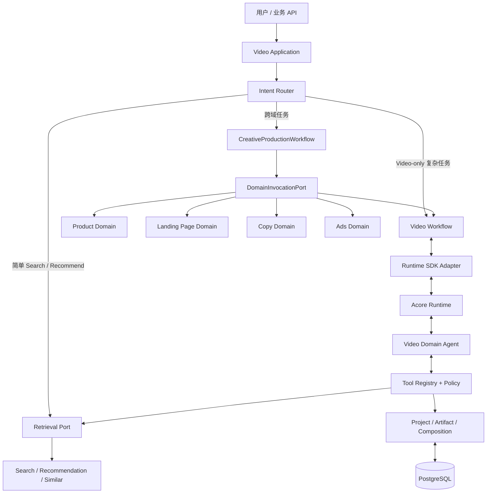
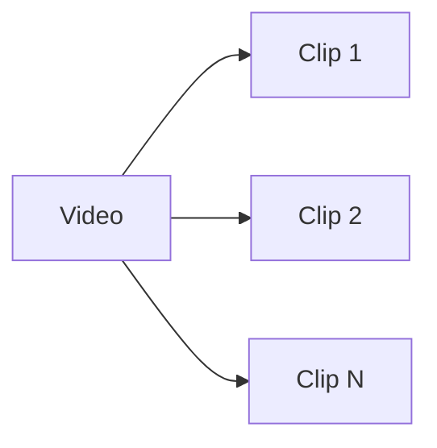

# Video Domain Agent 与跨域创作编排：架构设计总纲

文档地图与权威顺序见 [README.md](README.md)。交付范围与模型基线见 [implementation/00_交付范围与VideoClip模型.md](implementation/00_交付范围与VideoClip模型.md)。跨域编排详见 [implementation/07_跨域编排与领域子工作流设计.md](implementation/07_跨域编排与领域子工作流设计.md)。

## 1. 交付目标


本项目交付一个通用 Video Domain Agent，以及其外围的 `CreativeProductionWorkflow` 跨域编排层。Video Domain Agent 负责视频意图、检索规划、Storyboard、ClipPlan 和素材分配；主 Workflow 负责 Product、Landing Page、Copy、Ads 与 Video 之间的依赖、并行、汇总、确认和恢复。



本次交付：

- 主 Workflow 的跨域依赖编排、并行、fan-in、Artifact 交换、审批、补偿和恢复。
- Product、Landing Page、Copy、Ads 的领域调用契约与 Mock/Adapter。
- Video Domain Agent 作为独立子工作流的接入边界。

本次不交付：

- Product、Landing Page、Copy、Ads 领域的真实业务实现和外部平台接入。
- 广告自动发布、线上落地页修改、真实商品库和广告账户操作。
- 真实视频入库、索引和推荐训练。
- 视频生成、媒体渲染、导出和 NLE。
- 视频版权、许可、商业用途、地域可用性和署名过滤。
- 产品前端和生产规模化平台。

## 2. 核心能力

| 能力 | 职责 | 本次实现 |
|---|---|---|
| CreativeProductionWorkflow | 跨域 Task/Step、依赖图、并行、汇总、审批、恢复 | Spring Boot 主 Workflow |
| DomainInvocationPort | 统一调用领域服务和子工作流 | 契约 + Mock/Adapter |
| Product Domain | 商品、品牌、市场、Offer 和 Claim 事实 | Mock/Adapter |
| Landing Page Domain | 页面获取、诊断、方案和校验 | Mock/Adapter |
| Copy Domain | 广告语、口播稿、CTA 和本地化 | Mock/Adapter |
| Ads Domain | 广告草稿、预算、受众和合规校验 | Mock/Adapter |
| Video Domain Agent | 意图、澄清、规划、Tool 选择和结构化输出 | 托管 Agent |
| Intent Router | 简单请求与复杂请求分流 | 规则 + 可选小模型 |
| Video Workflow | Video-only Task、Step、Checkpoint 和恢复 | Spring Boot 子 Workflow |
| Retrieval Port | Search、Recommend、Similar | URRE Adapter |
| Tool Registry | 工具 Schema、白名单和执行 | 业务模块 |
| Policy Gateway | 身份、预算和 Tool 风险 | 业务模块 |
| Artifact Registry | 版本、lineage 和确认 | PostgreSQL + JSON |
| Runtime | 单次 Agent 执行 | Acore Runtime SDK |

## 3. Agent / Tool / Service / Workflow 边界

| 形态 | 使用条件 | 本次示例 |
|---|---|---|
| Agent | 需要自然语言理解、创作判断或不确定性处理 | Video Domain Agent |
| Tool | Agent 以结构化输入调用的领域能力 | Search、Recommendation、Assignment |
| Service | 确定、高频、可测试的业务能力 | Artifact、Evidence |
| Workflow | 多步骤、等待、重试和恢复 | CreativeProductionWorkflow / Video Workflow |

原则：

- Agent 不是所有请求的默认入口。
- 跨域请求由主 Workflow 编排，不创建“全能 Agent”。
- Video Domain Agent 不直接调用 Product、Landing Page、Copy 或 Ads。
- 领域之间只交换 Artifact Ref 和版本化结果。
- 简单 Search/Recommendation 直接调用 Port。
- Agent 只处理小候选集，不遍历全量数据。
- Agent 不直接落库、读 Fixture 基础设施 或执行媒体命令。
- Workflow 持有 Task/Step 权威状态，Runtime Run 只做投影。

## 4. 视频领域对象

视频素材只有两个层级：



### 4.1 Video

完整视频资产，包含来源、时长、技术属性、预览、标签和版本。

### 4.2 Clip

Video 内可独立发现和引用的连续片段，包含：

- `clip_id`
- `video_id`
- `start_ms/end_ms`
- `preview_ref`
- `semantic_summary`
- `quality_flags`
- `feature/model versions`

Clip 是唯一的片段层级。PRD 中的“片段”和“切片”统一由 Clip 表示。

### 4.3 计划侧对象

计划侧不能与素材对象混为一层：

- Storyboard：叙事结构。
- ClipPlan：执行计划。
- ClipRequirement：计划中的一条目标。
- MaterialAssignment：素材候选到计划 Clip 的绑定。

跨域领域对象不进入 Video 的 `Video -> Clip` 素材层级。主 Workflow 只持有跨域 Artifact Envelope 和引用，领域内部对象由所属领域管理。

## 5. 请求路由

| 请求 | 路径 |
|---|---|
| 明确关键词/条件搜索 | Direct Search |
| 按 Seed Video/Clip 找相似 | Direct Similar |
| 有项目上下文的主动推荐 | Direct Recommendation |
| 多轮澄清、创作规划、素材组合 | Agent Workflow |
| 替换单个计划 Clip | Agent Workflow |
| 同时要求商品、视频、文案、落地页或广告草稿 | CreativeProductionWorkflow |

规则：

- Router 先做规则和 Schema 判断。
- 低置信度时才调用小模型。
- Direct 与 Agent 路径必须返回相同 CandidateSet。
- 是否启动 Agent 通过 `handled_by=fast_path|agent` 可观测。
- 跨域请求先形成 `CampaignBrief` 和依赖图，再调用领域服务。

## 6. 创作 Artifact


规则：

- Artifact 独立版本化，不原地覆盖。
- 下游通过 `parent_artifact_ids` 引用上游。
- 用户确认后的硬约束不可被后续 Agent 静默修改。
- 修改一个计划 Clip 时，只失效对应 Requirement、CandidateSet 和 Assignment。
- 媒体时间线和最终视频不属于本次 Artifact 链。

跨域 Artifact 使用统一 Envelope：

- `campaign-brief`
- `workflow-plan`
- `product-context`
- `landing-page-plan`
- `copy-package`
- `video-creative-artifact`
- `ads-draft`
- `review-package`

每个 Artifact 记录 `owner_domain`、`content_schema`、版本、hash、parent refs 和 stale 状态。Video Agent 只能读取跨域编排层明确提供的只读 Context Snapshot。

## 7. Task / Run / Checkpoint

Task 状态：

- `Created`
- `Planned`
- `AwaitingApproval`
- `Running`
- `Waiting`
- `Reviewing`
- `Completed`
- `Failed`
- `Cancelled`

`Waiting` 原因：

- `awaiting_user`
- `budget_exhausted`
- `awaiting_domain`
- `awaiting_approval`

恢复必须保存：

- Task、Plan、Step 和业务事件 sequence。
- `request_id`
- `session_id`
- `agent_id/spec_version`
- `runtime_run_id`
- `runtime_last_event_id`
- `action_request_id`
- 已完成 Artifact 和剩余预算。
- 跨域 Step 依赖、领域 invocation、外部任务引用和审批范围。

Runtime `completed` 必须先回读，再推进 Task；SSE EOF 不代表执行成功。

## 8. Tool 治理

每个 Tool 声明：

- 名称和版本。
- 输入/输出 Schema。
- 权限 scope。
- 副作用等级。
- 超时和重试。
- 幂等模式。
- 日志脱敏策略。

调用链：

```text
Agent Action
  → Tool Registry
  → Policy Gateway
  → Domain Port
  → Mock / Future Adapter
  → Tool Result Envelope
```

跨域调用不属于 Video Domain Agent Tool：

```text
CreativeProductionWorkflow
  → DomainInvocationPort
  → Policy Gateway
  → Product / Landing Page / Copy / Ads / Video Workflow
  → DomainInvocationResult
```

## 9. Retrieval Mock

本次交付使用：

- Fake Video/Clip Catalog。
- Fake Search。
- Fake Recommendation。
- Fake Similar。
- Fake Evidence。

Mock 与未来真实 Adapter 必须共用：

- Port。
- CandidateSet Schema。
- Evidence Schema。
- 错误码。
- 事件关联键。

Mock 必须支持：

- 稳定成功结果。
- 零结果。
- 超时。
- 非法参数。
- 重复候选。

## 10. 安全与质量

- 租户和用户由服务端注入。
- Agent 输入中的视频标题、Clip 摘要和证据均不可信。
- Agent 不能自动放宽用户硬约束。
- 没有证据的候选不能进入确认 Assignment。
- 质量至少包含 Schema、Contract、Evidence、Policy 和 Agent Eval。
- 生产媒体质检不在本次交付。

## 11. 可观测性

统一关联键以 [API 与数据契约](implementation/01_API与数据契约.md) §8 为权威，至少包括 `request_id`、`trace_id`、`task_id`、`step_id`、`run_id`、`runtime_run_id`、`action_request_id`、`tool_call_id`、`candidate_set_id`、`artifact_id`。

必要事件：

- Task/Step/Tool 状态。
- Action 和审批。
- Artifact 创建和失效。
- Retrieval/Recommendation 请求和结果。
- 素材分配、替换和最终保留。

## 12. 交付顺序

1. Video/Clip 契约和 Mock Catalog。
2. Mock Search/Recommendation/Similar。
3. Runtime SDK Adapter、AgentSpec 和 Tool。
4. Storyboard、ClipPlan 和 Assignment。
5. 跨域 Task、DomainInvocationPort、Artifact Envelope 和 Mock 领域。
6. 主 Workflow 依赖图、并行、审批、恢复和跨域 Eval。
7. 故障恢复和交付 Demo。

不建立真实数据加工、媒体渲染、前端或真实跨域领域实现的前置依赖。跨域编排契约和领域 Mock 是本次交付的一部分。

## 13. 架构决策

架构决策使用本表的 `ADR-*` 编号。实施文档中的 `IMPL-ADR-*`、`VDA-ADR-*` 属于各自文档的编号空间，引用时必须写明所属空间，不要混用。

| ID | 决策 |
|---|---|
| ADR-01 | 交付通用 Video Domain Agent 及其跨域编排层 |
| ADR-02 | 素材模型固定为 Video / Clip |
| ADR-03 | 计划侧使用 ClipPlan / ClipRequirement |
| ADR-04 | Search/Recommendation Mock-first |
| ADR-05 | Simple Query 不启动 Agent |
| ADR-06 | Agent 只使用受控 Tool |
| ADR-07 | Task/Checkpoint 由业务 Workflow 持有 |
| ADR-08 | Runtime Run 只投影执行状态 |
| ADR-09 | 身份、项目范围和 Tool 权限是硬约束 |
| ADR-10 | Mock 与真实 Adapter 共用契约 |
| ADR-11 | 本次不交付媒体执行和真实索引 |
| ADR-12 | 跨域编排纳入交付，领域实现通过 Mock/Adapter 接入 |
| ADR-13 | 主 Workflow 是跨域编排唯一权威 |
| ADR-14 | Video Domain Agent 不直接调用其他领域 |

## 14. 最终原则

**CreativeProductionWorkflow 负责跨域依赖和状态；各领域负责自身事实与执行；DomainInvocationPort 负责受控交接；Video Domain Agent 只负责视频领域；Mock Adapter 提供可重复数据；Video 和 Clip 仍是唯一视频素材层级。**

任何新增设计都必须先回答它属于主 Workflow、某个领域，还是 Video Domain Agent。真实检索、媒体渲染、前端和外部平台能力只能通过领域 Adapter 扩展，不能反向塞入 Video Domain Agent。

