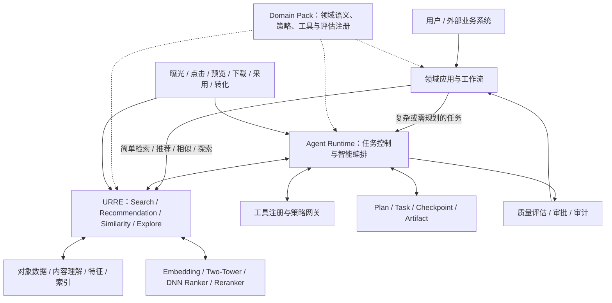
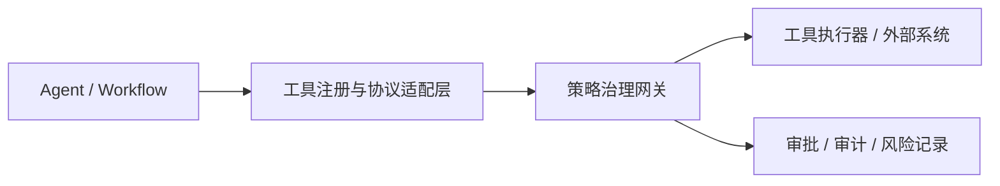
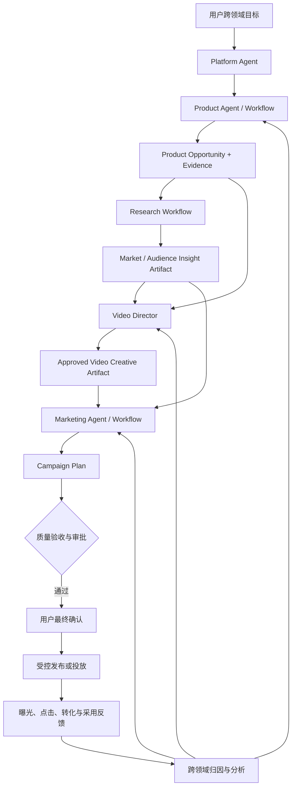
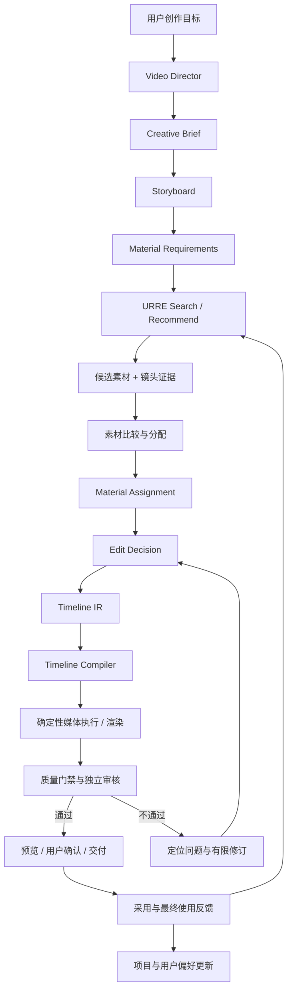

# 检索推荐与 Agent 平台：架构设计总纲

文档地图、权威顺序和图的身份见根目录 [README.md](README.md)。专项设计见 [01 URRE](01_URRE架构设计.md)、[02 Agent Runtime](02_AgentRuntime架构设计.md)、[03 Video Domain Pack](03_VideoDomain架构设计.md)；字段与实施见 [implementation/](implementation/README.md)。

---

## 1. 平台定位与核心对象

平台由四类核心能力构成：

| 能力 | 主要职责 |
|---|---|
| URRE | 大规模候选发现、相关性/偏好计算、排序、反馈优化 |
| Agent Runtime | 任务理解、计划、协作、工具调用、状态恢复与交付 |
| Domain Pack | 领域对象语义、特征、策略、工具、工作流和评估定义 |
| Domain Application | 用户交互、业务流程、项目工作区与最终体验 |

> URRE · Universal Retrieval & Recommendation Engine

### 1.1 统一架构图

下图是本平台正式逻辑图。Runtime 与 URRE 并列；Domain Pack 是领域语义、策略、工具与评估的注册与组合单元，不是请求转发层；简单请求可直达 URRE，不必经过 Agent Runtime。URRE 中 Search、Recommendation、Similarity、Explore 四类能力并列，Rights 硬过滤先于排序。

> 正式逻辑以本节 mermaid 为准。`images/整体架构图.png`、`images/视频检索推荐 Agent 架构图.png` 不作开工总图；图的身份见根目录 [README.md](README.md)。

### 1.2 逻辑架构与部署架构分离

以上是逻辑职责图，不要求每个方框都拆成独立微服务。初期可采用 Spring Boot 模块化单体承载平台 API、Domain Pack 管理和 AgentScope Java SDK；只有在吞吐、隔离、扩缩容或团队边界明确时再拆服务。

---

## 2. 关键边界与调用原则

### 2.1 Agent 与 URRE

- Agent 负责：理解意图、拆解任务、选择检索/推荐场景、组织多轮请求、评估候选是否满足创作目标。
- URRE 负责：Query/Context 结构化、召回、过滤、排序、重排、结果融合、反馈接收和效果评估。
- Agent 通过语义化 API / Tools 调用 URRE。
- Agent 不直接访问 Elasticsearch、Milvus、Redis 等底层索引或特征存储。
- URRE 不执行任意 LLM 生成的 SQL、DSL 或未注册策略代码。

### 2.2 Search 与 Recommendation

| 维度 | Search | Recommendation |
|---|---|---|
| 起点 | Query / 指定对象 / 约束 | User / Context / Task / Scene |
| 相关性 | Query-Item | User/Context-Item |
| 目标 | 找到符合本次明确需求的对象 | 找到当前值得主动呈现的对象 |
| 典型召回 | 关键词、语义、视觉、属性、关系 | 内容、协同、用户兴趣、上下文、趋势、探索 |
| 评价 | Recall@K、NDCG、零结果率、任务满足度 | 采用率、多样性、新颖性、长期价值 |
| 共享部分 | 特征、索引、模型服务、过滤设施、候选融合组件 | 特征、索引、模型服务、过滤设施、候选融合组件 |

不得把两者合并成一个含义模糊的 `find` 接口。可以共享底层组件，但 API、策略配置和评估目标必须可区分。

### 2.3 任务路径分级

| 请求 | 默认路径 |
|---|---|
| 关键词检索、筛选、分页 | 直接 Search API |
| 相似视频 / 相似商品 | Similar API |
| 当前项目素材推荐 | Recommendation API + Task Context |
| 复杂查询澄清、跨工具比较 | 轻量 Agent |
| 创作规划、素材组合、混剪 | Agent Runtime + Domain Workflow |
| 发布、投放、删除、付费生成 | Agent + 审批 + 策略网关 |

**原则：Agent 是复杂度升级路径，不是所有请求的默认入口。**

### 2.4 Agent / Tool / Service / Workflow 职责矩阵

所有能力先按“是否需要不确定性决策”选择实现形态，再决定是否拆成独立 Agent。矩阵中的“主控”表示该形态承担主要状态与决策责任；“执行”表示确定性业务实现；“编排”表示固定阶段、分支、等待和恢复；“—”表示默认不承担该职责。

| 能力 / 环节 | Agent | Tool | Service | Workflow | 默认判定 |
|---|---|---|---|---|---|
| Platform Agent | 主控：跨领域目标、路由、任务控制 | 向 Agent 暴露领域能力 | Session / Task API 与 Runtime API | 编排跨领域复杂任务 | Agent；简单请求不激活 |
| Video Director | 主控：视频任务目标、计划、专业能力调度 | 调用视频领域工具 | Project / Task / Artifact API | 进入 Creation、Editing 或 Delivery 工作流 | 视频域主 Agent |
| Search Planner | 条件启用：仅在查询存在歧义、多约束或需要拆解时参与 | 创建并校验 SearchPlan | SearchPlan Schema / Validator | 作为复杂搜索的前置阶段 | Planner；不默认作为自治 Agent |
| Search / Similar / Explore | — | `search_video_materials` 等语义工具 | URRE Search、Similarity、Explore Service | 简单查询绕过 Agent 直接调用 | Service |
| Recommendation Strategy | 不负责执行推荐；可在高不确定性场景请求 Agent 解释策略冲突 | 消费推荐场景、目标与约束 | Domain Strategy Registry / 策略配置 | 作为推荐工作流的目标选择节点 | Domain Strategy；不是 Agent |
| Recommendation | — | `recommend_video_materials` 等语义工具 | URRE Recommendation Service | 项目、分镜或创作上下文推荐节点 | Service |
| Creation | 在创作方向、叙事取舍和冲突决策处使用 Creation Agent | 创建 Brief、Storyboard、Assignment 等 Artifact | Project / Artifact / Composition Service | Creation Workflow 负责阶段编排和等待确认 | Workflow 为主，Agent 按决策点启用 |
| Material Curation | 默认不独立；高复杂度比较可升级为有界专业 Agent | 候选比较、素材分配和替代方案工具 | Composition Service | 素材比较与分配工作流节点 | Tool / Workflow；按需 Agent |
| Editing | 仅在需要解释剪辑意图或处理复杂冲突时使用 Editing Agent | `validate_timeline`、`render_preview` 等工具 | Timeline / Compiler / Media Service | Editing Workflow 负责结构化剪辑阶段 | Workflow 为主；Agent 条件启用 |
| Quality Review | 主控：独立审核、问题定位与修订建议 | 获取原始要求、Artifact 和证据 | 技术检测、Rights、评估模型服务 | 质量门禁与有限修订流程 | 独立审核 Agent + Workflow |
| Video Understanding / Index / Model | — | 受控提交理解、索引或模型任务 | Worker、Embedding、Two-Tower、DNN、Reranker Service | 入库、索引和模型发布流水线 | Service / Pipeline |
| Timeline Compiler / Media Execution | — | 经 Policy Gateway 暴露渲染、导出和状态查询工具 | Compiler、FFmpeg Worker、NLE Adapter | 预览、渲染、导出和人工确认流程 | 确定性 Service / Workflow |
| Feedback | — | 提交曝光、采用、替换和最终使用事件 | Feedback & Attribution Service | 事件采集、画像更新和模型训练流水线 | Service / Pipeline |

判定原则：

- Agent 必须拥有独立上下文、目标、权限或评审责任；仅仅包装一次 API 调用不能成为 Agent。
- Tool 是 Agent / Workflow 访问 Service 的受治理语义边界，不能绕过租户、权限、预算和审计。
- Service 执行确定性或可评估的算法、检索、媒体和项目操作，不持有自由扩张的 Agent 目标。
- Workflow 负责阶段、依赖、等待、重试和恢复；需要专业判断的节点可以调用 Agent，但不应把整个流程都变成 Agent 对话。
- Search Planner、Recommendation Strategy、Creation、Editing 等名称表示能力边界，不表示必须存在对应的常驻 Agent 进程。

### 2.5 Retrieval Toolkit 能力边界

Agent 应通过统一的 Retrieval Toolkit 使用检索推荐能力，而不是只拥有 Search，也不应直接连接索引、特征库或模型服务。Toolkit 至少覆盖以下能力：

| 能力 | 默认承载服务 | Agent 控制边界 |
|---|---|---|
| Search | URRE Search Service | 可调整 Query、已注册召回通道和过滤范围，不能突破硬约束 |
| Recommendation | URRE Recommendation Service | 可选择授权范围内的推荐场景、目标和策略 ID |
| Similarity | URRE Similarity Service | 必须声明相似目标，避免混淆主题、视觉和行为相似 |
| Explore | URRE Explore Service | 可扩展候选空间，但探索结果必须单独标记，不能伪装成高相关结果 |
| Rerank | URRE Rerank Service | 只能对已有候选集按授权策略重排，不能恢复已被硬约束过滤的候选 |
| Explain | URRE Explain Service | 只能解释已有请求、候选和证据，不能生成无依据结论 |
| Profile Summary | Feature / Profile Service | 只返回任务所需的最小画像摘要，不能读取完整隐私画像 |
| Feedback Event | Feedback & Attribution Service | 只记录真实 UI 事件或用户确认结果，不能由 Agent 推断或伪造用户反馈 |

Toolkit 使用稳定的通用能力名称和 `domain` 参数适配不同领域；Domain Pack 可以提供领域别名或专用 Tool，但其执行仍必须映射到相同的基础能力和治理规则。简单 Search、Similar 或 Recommendation 可以直接调用对应业务 API，不因 Toolkit 的存在而强制经过 Agent。

所有 Toolkit 调用必须经过 Tool Registry 和 Policy Gateway，并遵守租户、项目权限、Rights、数据范围、预算和审计约束。Profile Summary 与 Feedback Event 属于敏感能力：前者必须执行字段级最小化，后者必须保留事件来源、确认依据和幂等标识。

---

## 3. Domain Pack：领域能力组合规范

Domain Pack 的设计动因是提前隔离领域变化，避免平台在新增业务场景时逐步退化为多个领域的耦合集合。这是整个平台最值得前置规划的能力边界之一。如果没有明确的领域隔离，未来很容易出现：

- 检索引擎中充斥视频素材等单一领域的专属字段。
- Agent 工具中出现大量商品选品等单一领域的专属逻辑。
- 推荐算法和业务流程相互耦合。
- 新增领域需要修改大量底层代码。

Domain Pack 机制应将领域对象、特征、策略、工具、工作流和评估的变化收敛在领域包内部，同时保持 URRE、Agent Runtime 和公共治理能力的契约稳定。

每个领域包建议由以下部分组成：

1. Domain Schema：领域实体与关系定义。
2. Domain Ontology：领域概念、术语、层级和语义关系。
3. Feature Definition：领域特征定义及计算口径。
4. Recall Strategy：领域候选召回策略注册。
5. Ranking Strategy：领域排序目标与策略注册。
6. Business Rules：硬约束、软偏好和业务规则。
7. Agent Tools：领域工具及输入输出契约。
8. Agent Skills：可复用领域任务能力与工作流模板。
9. Evaluation：领域离线评估集、在线指标和业务成功标准。
10. Rights & Provenance：来源、授权、许可和证据要求。

### 3.1 领域与公共模型边界

公共实体只保留跨领域真正稳定的元信息，例如：

- entity_id
- tenant_id
- domain_id
- entity_type
- lifecycle_status
- created_at / updated_at
- source_ref
- provenance_ref

领域属性独立定义。视频的镜头时长、运动、构图，商品的价格带、供应关系，广告的渠道、预算和受众，不应塞入一个超级实体。

### 3.2 注册与扩展约束

- Domain Pack 通过注册清单声明 Schema、策略 ID、工具、Skills 和评估配置。
- 配置只允许引用已注册、已审核的策略 ID。
- Schema 发布前必须校验兼容性。
- 领域规则不能静默改变其他领域的行为。
- Domain Pack 有版本号、依赖关系、兼容范围和回滚策略。
- 跨领域协作通过明确的业务流程与对象映射完成，不混用领域商业评分。

---

## 4. Agent Runtime 2.0：从对话编排到任务控制面

### 4.1 Runtime 组成

| 子系统 | 职责 |
|---|---|
| Intent Router | 识别请求类型、复杂度和执行路径 |
| Planner | 生成受约束的执行计划 |
| Workflow Engine | 执行固定流程、分支、并行和等待 |
| Agent Coordinator | 按需调度主 Agent 与子 Agent |
| Session Manager | 管理交互连续性、活跃 Agent、上下文引用和过期恢复 |
| Task Manager | 管理任务生命周期、状态和取消 |
| Checkpoint Manager | 保存可恢复状态和阶段进度 |
| Artifact Registry | 管理结构化阶段产物与版本 |
| Tool Registry | 工具注册、发现、协议适配 |
| Policy Gateway | 权限、白名单、审批、沙箱和审计 |
| Quality Gate | 质量评估、重试、人工复核和交付门禁 |
| Budget Manager | Token、模型、工具、渲染和外部服务成本控制 |
| Observability | Trace、事件、耗时、失败和成本归因 |

### 4.2 Session / Plan / Task / Checkpoint / Artifact 分离

| 对象 | 回答的问题 | 生命周期 |
|---|---|---|
| Session | 这次交互进行到哪里、等待什么？ | 活跃 → 空闲/归档；可过期、可重建 |
| Plan | 准备做什么、为什么、按什么步骤做？ | 可审批、可冻结、可版本化 |
| Task | 当前任务处于什么状态？ | 以 `02` §4.2 为唯一状态集：`Created → Planned → AwaitingApproval → Running ⇄ Waiting → Reviewing → Completed`，另有 `Failed` / `Cancelled`。不设独立 `Paused` 或 `WAITING_USER`。`Waiting` 用原因区分：`budget_exhausted` / `awaiting_user` / `awaiting_external` |
| Checkpoint | 中断后从哪里恢复？ | 随执行持续产生 |
| Artifact | 每个阶段产生了什么可复用成果？ | 独立版本化、可引用、可审计 |

不要将这些对象合并为一段对话历史或一个大 JSON 状态对象。Session 只保存交互连续性，Project、Task 和 Artifact 才是长期业务事实源。总纲不再发布与 `02` 不相等的简化状态集；任务状态机的权威定义见 [`02_AgentRuntime架构设计.md`](02_AgentRuntime架构设计.md) §4.2。

### 4.3 固定工作流与动态规划

- 高频、确定性任务：固定工作流。
- 参数可变但步骤稳定：模板工作流 + 参数化。
- 非标准复杂任务：动态规划，但执行前需校验计划、工具范围、预算、权限和验收标准。
- 执行期间允许受控重规划，不允许无限扩张任务目标或静默改变已批准约束。

### 4.4 工具调用双层治理

- 注册适配层：发现、协议适配、参数校验、结果归一、依赖注入。
- 策略网关：身份鉴权、项目权限、工具白名单、数据范围、审批、速率限制、沙箱和审计。
- MCP 是工具连接协议，不等于权限系统，也不等于执行沙箱。

建议副作用等级：

| 等级 | 操作类型 | 默认策略 |
|---|---|---|
| L0 | 只读、查询、检索 | 授权范围内自动执行 |
| L1 | 分析、评分、草稿 | 自动执行并留痕 |
| L2 | 预览、低成本试生成 | 预算内执行 |
| L3 | 修改项目、覆盖文件、批量变更 | 明确确认或策略审批 |
| L4 | 发布、投放、付费生成、删除、外部提交 | 强审批 / 明确授权 |

---

## 5. 数据、反馈与治理横切能力

平台需要统一记录：

- Request Context：用户、租户、领域、任务、场景、入口。
- Candidate Evidence：候选来源、召回通道、命中依据、时间区间、模型/策略版本。
- Behavior Event：曝光、点击、预览、收藏、下载、采用、替换、实际使用、转化。
- Decision Trace：计划版本、工具调用、策略选择、关键判断、审批和重试。
- Artifact Lineage：产物来源、输入版本、生成版本、父子关系。
- Cost Ledger：模型、工具、第三方 API、媒体生成和渲染的资源消耗。

横切治理至少包含：身份权限、租户隔离、版权与来源、隐私、预算、质量、可观测性、审计和版本回滚。

---

## 6. 跨领域业务协作架构

平台从架构设计初期就应支持领域间协作，但协作通过明确的 Artifact、对象引用和业务流程完成，不通过合并领域模型或商业评分实现。典型业务链为：

**商品机会发现 → 市场研究 → 视频创意生产 → 广告投放 → 效果反馈**

### 6.1 领域职责与对象映射

| 领域或能力 | 核心对象 | 上游输入 | 下游交付 | 领域目标与评价 |
|---|---|---|---|---|
| Product Domain | Product、SKU、Supplier、Market、Trend、Opportunity | 用户目标、市场范围、价格带和供应约束 | 商品机会、选品结论、卖点与证据 | 市场匹配、竞争强度、供应稳定性、成本、毛利的综合评估 |
| Research Workflow | 市场、受众、竞争、趋势和证据集 | 商品机会、目标市场与业务问题 | Research Insight Artifact | 可靠性、覆盖度、时效性和可追溯性 |
| Video Domain | Creative Brief、Storyboard、Video、Shot、Segment、Timeline | 商品机会、卖点、市场洞察和创意约束 | 已确认的视频创意及其 Artifact | 创作适配、镜头证据、技术质量、语义与审美 |
| Marketing Domain | Campaign、Audience、Creative、Channel、Budget、Experiment | 商品、视频创意、受众洞察和投放目标 | Campaign Plan、审核记录与优化建议 | CTR、CVR、CPA、ROAS、预算效率和长期价值 |
| Quality Review | 原始要求、输入 Artifact、领域证据和输出产物 | 各阶段交付物及验收标准 | Quality Report 与修订建议 | 按领域定义质量门禁，不以单一跨领域分数替代 |

跨领域对象不得合并为超级实体。领域之间使用稳定的引用和映射关系，例如商品机会引用 Product/SKU，Creative Brief 引用商品机会与市场洞察，Campaign 引用视频 Artifact、受众和渠道。映射必须记录来源版本、置信度和 Provenance。

### 6.2 Artifact 交接与流程

各阶段通过结构化 Artifact 交接，不依赖 Agent 之间共享完整聊天记录。Artifact 至少记录类型、版本、来源对象、上游产物、证据、权限范围、创建者和校验状态。用户目标、预算、市场范围和禁用条件在交接过程中必须保持可追溯，下游领域不能静默放宽。

Research 能力默认实现为 Workflow 与分析 Tool，消费 Product 和 Marketing 提供的任务上下文。只有在拥有独立领域数据、目标和持续评审责任时，才升级为 Research Domain Pack 或有界专业 Agent，避免为“研究”名称默认创建常驻 Agent。

### 6.3 共享数据、反馈与评分隔离

跨领域可以共享：

- 用户、租户、任务和项目上下文。
- 检索、召回、特征和模型基础设施。
- 商品、视频创意、受众、广告表现和转化事件之间的关联。
- Artifact Lineage、行为事件、决策轨迹和成本账本。
- 任务编排、审批、审计和权限治理机制。

反馈应建立可归因链路，例如“商品机会 → 创意 Artifact → Campaign / Audience / Channel → 曝光、点击、转化”。归因结果可以用于跨领域分析、下一轮策略建议和模型训练，但不得直接合并不同领域的分数：

- 商品商业潜力、视频创作质量和广告 ROI 必须有独立口径、模型版本和评估集。
- 跨领域流程可以消费各领域结果并生成新的决策输入，但不能用一个总分覆盖领域硬约束。
- 权限、Rights 和合规过滤在跨领域交接后仍然生效，下游领域不能扩大上游授权范围。
- 发布、投放、预算调整和对外提交属于高影响操作，必须经过 Policy Gateway、明确审批和审计。

### 6.4 协作约束与验收

跨领域协作至少满足：

1. 每项跨领域任务由 Platform Agent 或显式 Workflow 负责全局目标、依赖和状态，不依赖多个 Agent 自行协商。
2. 领域 Agent 只在其专业边界内决策，输入输出通过 Artifact 契约交接。
3. 上游对象、Artifact 和约束具有版本及来源链路，下游变更能够影响分析并触发必要的失效或复核。
4. 任一领域失败时不复制其业务逻辑到其他领域；由 Workflow 决定重试、降级、跳过、换领域或人工接管。
5. 跨领域报表和评分必须标明领域来源与计算口径，不能把不同量纲的分数直接相加。

---

## 7. 视频领域端到端闭环

### 7.1 视频对象层级

- Video：完整视频资产。
- Shot：镜头级语义对象。
- Segment：镜头内部可定位的片段/时间区间。

视频、镜头和片段应共享资产身份与来源链路，但各自有不同的检索粒度和质量特征。镜头/片段规模可能远大于视频数量，索引和评估需要支持分层策略。

### 7.2 视频检索能力拆分

视频 Domain Pack 应显式提供：

1. 素材发现：围绕用户 Query 找视频、镜头和片段。
2. 镜头证据检索：返回具体时间区间、画面证据和匹配理由。
3. 元素/知识推荐：人物、物体、地点、动作、风格、拍摄手法等相关元素。
4. 创作侧资料召回：围绕当前分镜和创作目标召回资料。
5. 创作型推荐：从整体作品角度推荐补充镜头、替代素材和组合方案。

这些能力补充而非取代通用 Search / Recommendation / Similar / Explore。

### 7.3 结构化检索结果

每个候选至少应携带：

- asset_id / video_id / shot_id / segment_id
- source_uri / preview_uri（按权限返回）
- start_time / end_time / duration
- matched_query / matched_requirements
- recall_channels / relevance_score / rank_score
- evidence_summary / evidence_refs
- quality_flags / rights_status / availability
- feature_version / model_version / strategy_version

Agent 不能只拿到一段自然语言摘要，否则难以核验镜头证据、定位片段和生成时间线。

---

## 8. 质量体系与交付门禁

质量评价分层进行，不使用单一分数覆盖所有问题：

| 质量维度 | 检查内容 | 典型责任方 |
|---|---|---|
| 技术质量 | 文件可解码、画面/音轨、帧率、分辨率、时长 | 媒体检测服务 |
| 任务合同 | 是否满足用户明确要求、时长、比例、禁用项 | 任务验收器 |
| 检索证据 | 候选是否真正包含目标主体、动作和场景 | 检索评估器 / 独立审核 Agent |
| 语义与审美 | 叙事连贯、风格一致、节奏、情绪、镜头衔接 | 独立质量评估 |
| Rights / Provenance | 来源、许可、授权范围、使用限制 | 权利规则与审核流程 |

Rights / Provenance 中的硬性违规不能被其他维度高分抵消。

用户提出的“80 分阈值、最多两次重试、保留最佳版本、人类兜底”应作为可配置的业务策略模板，而不是平台全局硬编码。不同任务可有不同权重、门槛和重试预算。

---

## 9. 关键架构决策记录（ADR 摘要）

| ID | 决策 | 理由 |
|---|---|---|
| ADR-01 | URRE 独立于 Agent Runtime | 保护检索推荐性能与职责边界 |
| ADR-02 | Search 与 Recommendation 独立 API | 两类目标和评价指标不同 |
| ADR-03 | Domain Pack 定义领域语义与策略 | 避免通用模型退化成超级对象 |
| ADR-04 | Session / Plan / Task / Checkpoint / Artifact 分离 | 支持交互连续、长任务恢复、审计与复用 |
| ADR-05 | 固定流程优先，动态规划受控 | 控制延迟、成本和不确定性 |
| ADR-06 | 工具注册与策略治理分层 | 协议互通不代表权限安全 |
| ADR-07 | 结构化证据随检索结果返回 | 支撑核验、定位和创作执行 |
| ADR-08 | Timeline IR + 确定性编译执行 | 避免 LLM 直接控制底层媒体时间线 |
| ADR-09 | 独立质量门禁与 Rights 硬约束 | 避免产出 Agent 自评自过 |
| ADR-10 | 预算账本与停机策略 | 防止多轮 Agent 和生成任务失控 |
| ADR-11 | 先按 Agent / Tool / Service / Workflow 判定职责形态 | 避免把确定性检索、策略和执行流程过度 Agent 化 |
| ADR-12 | 跨领域通过 Artifact 与对象映射协作 | 共享数据、反馈和编排能力，同时保持领域评分与权限隔离 |

架构决策编号只使用本表的 `ADR-01`–`ADR-12`，编号不改。实施决策在 `implementation/03` §9，编号为 `IMPL-ADR-01`–`IMPL-ADR-11`，两套编号空间不得混用。引用实施决策时必须写 `IMPL-ADR-xx`；引用本表时写 `00` ADR-xx。

---

## 10. 建设顺序与验收边界

### 阶段 A：平台最小闭环

- URRE Search、Recommendation 两条独立链路。
- Domain Pack 注册与 Schema 校验。
- 统一行为事件和候选证据结构。
- 简单请求不经 Agent 的快速链路。

### 阶段 B：Agent Runtime 治理闭环

- Intent Router、固定工作流、受控动态规划。
- Plan / Task / Checkpoint / Artifact。
- 工具注册、策略网关、审计和预算。
- 一个主 Agent + 按需子 Agent。

### 阶段 C：视频创作闭环

- Video / Shot / Segment 三层对象。
- 镜头证据检索和任务上下文推荐。
- Creative Brief、Storyboard、Material Assignment。
- Edit Decision、Timeline IR、确定性渲染。
- 分层质量评估与人工确认。

### 阶段 D：多领域扩展

- 商品选品 Domain Pack。
- 广告投放 Domain Pack。
- 跨领域业务流程，但保持领域评分与规则隔离。

### 与实施阶段 0–5 的对照

能力里程碑以本节 A–D 为准；工程迭代以 [`implementation/03_实施路线图与验收基线.md`](implementation/03_实施路线图与验收基线.md) §2 的 0–5 为准。两套编号并存，按下表对照，互不替代。

| 能力里程碑（`00`） | 工程迭代（`implementation/03`） | 说明 |
|---|---|---|
| 阶段 A 退出 | 阶段 1–2 完成 | Search 与 Recommendation 都具备独立链路后，才算阶段 A 退出 |
| 阶段 B | 阶段 0 的治理底座，并在后续阶段持续加固任务治理 | Intent Router、Plan / Task / Checkpoint / Artifact、工具与预算等 |
| 阶段 C | 阶段 3–4 | 创作工作流、素材组合、时间线、渲染与评估 |
| 阶段 D | 阶段 5 | 推荐升级、规模化与跨领域扩展 |

Explore 在能力模型中与 Search / Recommendation / Similarity 并列保留，但**不作为阶段 0–2 的强制退出项**，上线阶段可延后，待规划拍板。正式 SLO 与质量分数阈值以实施文档为准，本节不另给生产门槛。

---

## 11. 最终架构原则

**URRE 是规模化候选发现与排序底座；Agent Runtime 是受治理的任务控制与智能编排系统；Domain Pack 是领域语义、策略、工具与工作流的封装；领域应用负责把这些能力组织成用户可用的产品。**

平台通用化的对象是能力机制、契约、治理和生命周期，不是把所有行业的业务语义压成同一套字段与评分公式。
