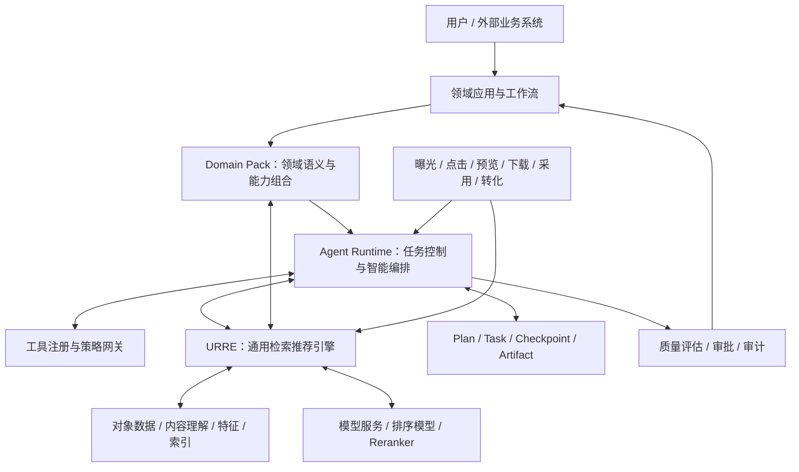
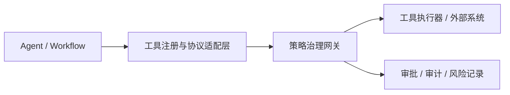
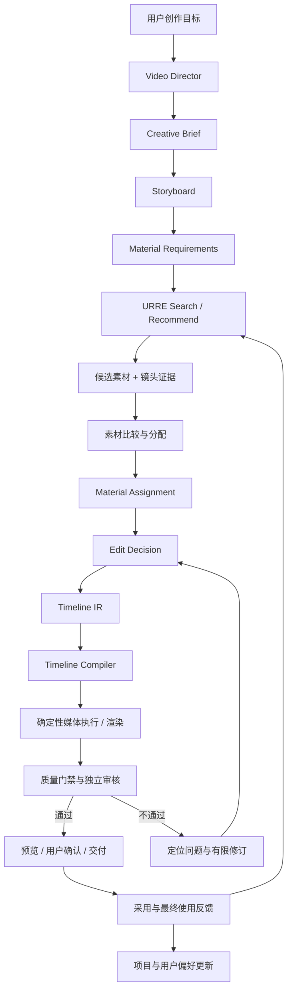

# 检索推荐与 Agent 平台：架构设计 2.0

> **文档层级：** 平台总纲  
> **下级文档：** [01 URRE](01_URRE通用检索推荐引擎_架构设计2.0.md)、[02 Agent Runtime](02_Agent_Runtime与任务治理_架构设计2.0.md)、[03 Video Domain Pack](03_Video_Domain_Pack与创作执行_架构设计2.0.md)  
> **研究依据：** [research](research/README.md)  
> **实施材料：** [implementation](implementation/README.md)

---

## 1. 平台定位与核心对象

平台由四类核心能力构成：

| 能力 | 主要职责 |
|---|---|---|
| URRE | 大规模候选发现、相关性/偏好计算、排序、反馈优化 |
| Agent Runtime | 任务理解、计划、协作、工具调用、状态恢复与交付 |
| Domain Pack | 领域对象语义、特征、策略、工具、工作流和评估定义 |
| Domain Application | 用户交互、业务流程、项目工作区与最终体验 |

> URRE · Universal Retrieval & Recommendation Engine

### 1.1 统一架构图

> Domain Pack 与 Agent Runtime、URRE 都存在明确的契约关系：它不是一个“中间转发层”，而是领域知识、领域策略和领域工具的注册与组合单元。

### 1.2 逻辑架构与部署架构分离

以上是逻辑职责图，不要求每个方框都拆成独立微服务。初期可采用 Spring Boot 模块化单体承载平台 API、Domain Pack 管理和 AgentScope Java SDK；只有在吞吐、隔离、扩缩容或团队边界明确时再拆服务。

---

## 2. 关键边界与调用原则

### 2.1 Agent 与 URRE

- Agent 负责：理解意图、拆解任务、选择检索/推荐场景、组织多轮请求、评估候选是否满足创作目标。
- URRE 负责：Query/Context 结构化、召回、过滤、排序、重排、结果融合、反馈接收和效果评估。
- Agent 通过语义化 API / Tools 调用 URRE。
- Agent 不直接访问 Elasticsearch、Milvus、Redis 等底层索引或特征存储。
- URRE 不执行任意 LLM 生成的 SQL、DSL 或未注册策略代码。

### 2.2 Search 与 Recommendation

| 维度 | Search | Recommendation |
|---|---|---|
| 起点 | Query / 指定对象 / 约束 | User / Context / Task / Scene |
| 相关性 | Query-Item | User/Context-Item |
| 目标 | 找到符合本次明确需求的对象 | 找到当前值得主动呈现的对象 |
| 典型召回 | 关键词、语义、视觉、属性、关系 | 内容、协同、用户兴趣、上下文、趋势、探索 |
| 评价 | Recall@K、NDCG、零结果率、任务满足度 | 采用率、多样性、新颖性、长期价值 |
| 共享部分 | 特征、索引、模型服务、过滤设施、候选融合组件 | 特征、索引、模型服务、过滤设施、候选融合组件 |

不得把两者合并成一个含义模糊的 `find` 接口。可以共享底层组件，但 API、策略配置和评估目标必须可区分。

### 2.3 任务路径分级

| 请求 | 默认路径 |
|---|---|
| 关键词检索、筛选、分页 | 直接 Search API |
| 相似视频 / 相似商品 | Similar API |
| 当前项目素材推荐 | Recommendation API + Task Context |
| 复杂查询澄清、跨工具比较 | 轻量 Agent |
| 创作规划、素材组合、混剪 | Agent Runtime + Domain Workflow |
| 发布、投放、删除、付费生成 | Agent + 审批 + 策略网关 |

**原则：Agent 是复杂度升级路径，不是所有请求的默认入口。**

---

## 3. Domain Pack：领域能力组合规范

每个领域包建议由以下部分组成：

1. Domain Schema：领域实体与关系定义。
2. Domain Ontology：领域概念、术语、层级和语义关系。
3. Feature Definition：领域特征定义及计算口径。
4. Recall Strategy：领域候选召回策略注册。
5. Ranking Strategy：领域排序目标与策略注册。
6. Business Rules：硬约束、软偏好和业务规则。
7. Agent Tools：领域工具及输入输出契约。
8. Agent Skills：可复用领域任务能力与工作流模板。
9. Evaluation：领域离线评估集、在线指标和业务成功标准。
10. Rights & Provenance：来源、授权、许可和证据要求。

### 3.1 领域与公共模型边界

公共实体只保留跨领域真正稳定的元信息，例如：

- entity_id
- tenant_id
- domain_id
- entity_type
- lifecycle_status
- created_at / updated_at
- source_ref
- provenance_ref

领域属性独立定义。视频的镜头时长、运动、构图，商品的价格带、供应关系，广告的渠道、预算和受众，不应塞入一个超级实体。

### 3.2 注册与扩展约束

- Domain Pack 通过注册清单声明 Schema、策略 ID、工具、Skills 和评估配置。
- 配置只允许引用已注册、已审核的策略 ID。
- Schema 发布前必须校验兼容性。
- 领域规则不能静默改变其他领域的行为。
- Domain Pack 有版本号、依赖关系、兼容范围和回滚策略。
- 跨领域协作通过明确的业务流程与对象映射完成，不混用领域商业评分。

---

## 4. Agent Runtime 2.0：从对话编排到任务控制面

### 4.1 Runtime 组成

| 子系统 | 职责 |
|---|---|
| Intent Router | 识别请求类型、复杂度和执行路径 |
| Planner | 生成受约束的执行计划 |
| Workflow Engine | 执行固定流程、分支、并行和等待 |
| Agent Coordinator | 按需调度主 Agent 与子 Agent |
| Task Manager | 管理任务生命周期、状态和取消 |
| Checkpoint Manager | 保存可恢复状态和阶段进度 |
| Artifact Registry | 管理结构化阶段产物与版本 |
| Tool Registry | 工具注册、发现、协议适配 |
| Policy Gateway | 权限、白名单、审批、沙箱和审计 |
| Quality Gate | 质量评估、重试、人工复核和交付门禁 |
| Budget Manager | Token、模型、工具、渲染和外部服务成本控制 |
| Observability | Trace、事件、耗时、失败和成本归因 |

### 4.2 Plan / Task / Checkpoint / Artifact 分离

| 对象 | 回答的问题 | 生命周期 |
|---|---|---|
| Plan | 准备做什么、为什么、按什么步骤做？ | 可审批、可冻结、可版本化 |
| Task | 当前任务处于什么状态？ | Created → Running → Waiting → Completed/Failed/Cancelled |
| Checkpoint | 中断后从哪里恢复？ | 随执行持续产生 |
| Artifact | 每个阶段产生了什么可复用成果？ | 独立版本化、可引用、可审计 |

不要将四者合并为一段对话历史或一个大 JSON 状态对象。

### 4.3 固定工作流与动态规划

- 高频、确定性任务：固定工作流。
- 参数可变但步骤稳定：模板工作流 + 参数化。
- 非标准复杂任务：动态规划，但执行前需校验计划、工具范围、预算、权限和验收标准。
- 执行期间允许受控重规划，不允许无限扩张任务目标或静默改变已批准约束。

### 4.4 工具调用双层治理

- 注册适配层：发现、协议适配、参数校验、结果归一、依赖注入。
- 策略网关：身份鉴权、项目权限、工具白名单、数据范围、审批、速率限制、沙箱和审计。
- MCP 是工具连接协议，不等于权限系统，也不等于执行沙箱。

建议副作用等级：

| 等级 | 操作类型 | 默认策略 |
|---|---|---|
| L0 | 只读、查询、检索 | 授权范围内自动执行 |
| L1 | 分析、评分、草稿 | 自动执行并留痕 |
| L2 | 预览、低成本试生成 | 预算内执行 |
| L3 | 修改项目、覆盖文件、批量变更 | 明确确认或策略审批 |
| L4 | 发布、投放、付费生成、删除、外部提交 | 强审批 / 明确授权 |

---

## 5. 数据、反馈与治理横切能力

平台需要统一记录：

- Request Context：用户、租户、领域、任务、场景、入口。
- Candidate Evidence：候选来源、召回通道、命中依据、时间区间、模型/策略版本。
- Behavior Event：曝光、点击、预览、收藏、下载、采用、替换、实际使用、转化。
- Decision Trace：计划版本、工具调用、策略选择、关键判断、审批和重试。
- Artifact Lineage：产物来源、输入版本、生成版本、父子关系。
- Cost Ledger：模型、工具、第三方 API、媒体生成和渲染的资源消耗。

横切治理至少包含：身份权限、租户隔离、版权与来源、隐私、预算、质量、可观测性、审计和版本回滚。

---

## 6. 视频领域端到端闭环

### 6.1 视频对象层级

- Video：完整视频资产。
- Shot：镜头级语义对象。
- Segment：镜头内部可定位的片段/时间区间。

视频、镜头和片段应共享资产身份与来源链路，但各自有不同的检索粒度和质量特征。镜头/片段规模可能远大于视频数量，索引和评估需要支持分层策略。

### 6.2 视频检索能力拆分

视频 Domain Pack 应显式提供：

1. 素材发现：围绕用户 Query 找视频、镜头和片段。
2. 镜头证据检索：返回具体时间区间、画面证据和匹配理由。
3. 元素/知识推荐：人物、物体、地点、动作、风格、拍摄手法等相关元素。
4. 创作侧资料召回：围绕当前分镜和创作目标召回资料。
5. 创作型推荐：从整体作品角度推荐补充镜头、替代素材和组合方案。

这些能力补充而非取代通用 Search / Recommendation / Similar / Explore。

### 6.3 结构化检索结果

每个候选至少应携带：

- asset_id / video_id / shot_id / segment_id
- source_uri / preview_uri（按权限返回）
- start_time / end_time / duration
- matched_query / matched_requirements
- recall_channels / relevance_score / rank_score
- evidence_summary / evidence_refs
- quality_flags / rights_status / availability
- feature_version / model_version / strategy_version

Agent 不能只拿到一段自然语言摘要，否则难以核验镜头证据、定位片段和生成时间线。

---

## 7. 质量体系与交付门禁

质量评价分层进行，不使用单一分数覆盖所有问题：

| 质量维度 | 检查内容 | 典型责任方 |
|---|---|---|
| 技术质量 | 文件可解码、画面/音轨、帧率、分辨率、时长 | 媒体检测服务 |
| 任务合同 | 是否满足用户明确要求、时长、比例、禁用项 | 任务验收器 |
| 检索证据 | 候选是否真正包含目标主体、动作和场景 | 检索评估器 / 独立审核 Agent |
| 语义与审美 | 叙事连贯、风格一致、节奏、情绪、镜头衔接 | 独立质量评估 |
| Rights / Provenance | 来源、许可、授权范围、使用限制 | 权利规则与审核流程 |

Rights / Provenance 中的硬性违规不能被其他维度高分抵消。

用户提出的“80 分阈值、最多两次重试、保留最佳版本、人类兜底”应作为可配置的业务策略模板，而不是平台全局硬编码。不同任务可有不同权重、门槛和重试预算。

---

## 8. 关键架构决策记录（ADR 摘要）

| ID | 决策 | 理由 |
|---|---|---|
| ADR-01 | URRE 独立于 Agent Runtime | 保护检索推荐性能与职责边界 |
| ADR-02 | Search 与 Recommendation 独立 API | 两类目标和评价指标不同 |
| ADR-03 | Domain Pack 定义领域语义与策略 | 避免通用模型退化成超级对象 |
| ADR-04 | Plan / Task / Checkpoint / Artifact 分离 | 支持长任务恢复、审计与复用 |
| ADR-05 | 固定流程优先，动态规划受控 | 控制延迟、成本和不确定性 |
| ADR-06 | 工具注册与策略治理分层 | 协议互通不代表权限安全 |
| ADR-07 | 结构化证据随检索结果返回 | 支撑核验、定位和创作执行 |
| ADR-08 | Timeline IR + 确定性编译执行 | 避免 LLM 直接控制底层媒体时间线 |
| ADR-09 | 独立质量门禁与 Rights 硬约束 | 避免产出 Agent 自评自过 |
| ADR-10 | 预算账本与停机策略 | 防止多轮 Agent 和生成任务失控 |

---

## 9. 建设顺序与验收边界

### 阶段 A：平台最小闭环

- URRE Search、Recommendation 两条独立链路。
- Domain Pack 注册与 Schema 校验。
- 统一行为事件和候选证据结构。
- 简单请求不经 Agent 的快速链路。

### 阶段 B：Agent Runtime 治理闭环

- Intent Router、固定工作流、受控动态规划。
- Plan / Task / Checkpoint / Artifact。
- 工具注册、策略网关、审计和预算。
- 一个主 Agent + 按需子 Agent。

### 阶段 C：视频创作闭环

- Video / Shot / Segment 三层对象。
- 镜头证据检索和任务上下文推荐。
- Creative Brief、Storyboard、Material Assignment。
- Edit Decision、Timeline IR、确定性渲染。
- 分层质量评估与人工确认。

### 阶段 D：多领域扩展

- 商品选品 Domain Pack。
- 广告投放 Domain Pack。
- 跨领域业务流程，但保持领域评分与规则隔离。

---

## 10. 最终架构原则

**URRE 是规模化候选发现与排序底座；Agent Runtime 是受治理的任务控制与智能编排系统；Domain Pack 是领域语义、策略、工具与工作流的封装；领域应用负责把这些能力组织成用户可用的产品。**

平台通用化的对象是能力机制、契约、治理和生命周期，不是把所有行业的业务语义压成同一套字段与评分公式。
