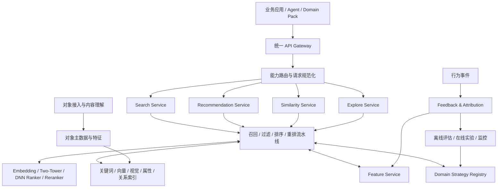
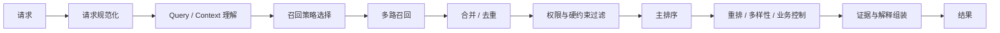
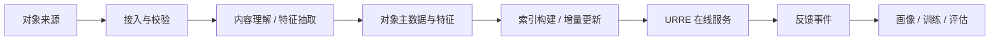

# URRE 通用检索推荐引擎架构设计

**定位：** 多领域候选发现、相关性计算、排序与反馈优化平台

**边界：** 不承担完整 Agent 任务规划；不承载领域创作执行

---

## 1. 设计目标

URRE（Universal Retrieval & Recommendation Engine）面向视频、商品、广告、内容等领域，提供统一的候选发现和决策支持能力。

核心目标：

- 大规模对象的低延迟候选发现。
- Search、Recommendation、Similarity、Explore 四类业务能力并列。
- 召回、过滤、特征、模型、排序、反馈等基础设施共享。
- 领域语义、策略目标和业务规则由 Domain Pack 注入。
- 结果可解释、可追溯、可评估。
- 支持千万级视频资产，以及进一步扩展到镜头/片段级更大规模对象集合。

## 2. 能力边界

| 能力 | URRE 负责 | 上层 Agent / Domain 负责 |
|---|---|---|
| Query Understanding | 结构化查询能力、实体/属性解析服务 | 复杂意图澄清、业务目标判断 |
| Candidate Recall | 多路召回、候选合并 | 决定任务目标与召回意图 |
| Filtering | 权限、状态、硬约束执行 | 定义领域约束和用户授权 |
| Ranking | Query/Context 与 Item 相关性排序 | 定义业务目标、解释创作适配性 |
| Reranking | 多样性、新鲜度、业务策略重排 | 决定最终创作取舍 |
| Recommendation | 用户/任务/场景上下文推荐 | 提供当前任务、项目和创作阶段 |
| Feedback | 接收、规范化、聚合行为事件 | 采集真实业务结果并补充语义 |
| Evaluation | 离线、在线、实验与指标体系 | 定义领域成功标准 |

---

## 3. 总体架构



逻辑模块不要求物理服务一一对应。高频请求链路应尽量短，离线训练、索引构建和复杂内容理解不进入在线请求关键路径。

## 4. 四类一等业务能力

### 4.1 Search

输入：Domain、Query、Filters、Scope、User/Tenant Context、Pagination。

链路：
1. Query 规范化与结构化。
2. 领域实体与属性识别。
3. 选择关键词、语义、视觉、属性、关系等召回通道。
4. 候选合并与去重。
5. 权限和硬约束过滤。
6. 相关性排序。
7. 多样性、新鲜度等重排。
8. 返回结果与证据。

### 4.2 Recommendation

输入：Domain、User、Scene、Task Context、Project Context、Current State、Constraints。

召回来源：
- 用户长期兴趣与近期行为。
- 当前任务与项目上下文。
- 内容相似和协同信号。
- 热门、趋势、新鲜内容。
- 领域规则和业务机会。
- 探索性候选。

排序不能简单等于“预测点击率”。需要根据场景考虑采用率、任务帮助程度、内容质量、多样性、新颖性、业务价值和长期满意度。

### 4.3 Similarity

支持语义相似、视觉相似、属性相似、行为相似、关系相似。调用方应声明相似目标，避免将“画面相似”误解为“主题相似”。

### 4.4 Explore

主动扩展候选空间，强调新颖性、覆盖度、长尾发现和潜在机会。探索结果应与常规相关性结果区分标记，避免把低相关候选伪装成高相关结果。

---

## 5. 通用处理流水线



### 5.1 召回层

- Keyword Recall：精确词项和倒排检索。
- Semantic Recall：文本语义向量。
- Visual Recall：图像/视频帧视觉语义。
- Attribute Recall：结构化属性和范围过滤。
- Collaborative Recall：用户/物品协同信号。
- Context Recall：任务、项目和场景上下文。
- Relation Recall：实体关系与知识图谱。
- Trend Recall：趋势、热门和新鲜度。
- Exploration Recall：受控探索与长尾候选。

每个召回通道应有独立的超时、候选上限、覆盖监控和版本号。通道失败应可降级，不应导致整条服务链路不可用。

### 5.2 过滤层

硬约束优先于排序偏好，包括：
- 租户和数据权限。
- 对象状态、可用性和删除状态。
- 用户指定的必须条件。
- Rights / License / 使用范围。
- 领域业务硬规则。

硬约束不能作为一个可被高相关性分数抵消的普通排序特征。

### 5.3 排序与重排

主排序计算当前请求目标与候选的匹配程度。重排负责多样性、新鲜度、重复抑制、探索比例和业务策略。

Search 与 Recommendation 必须有独立目标函数与评估集。即使底层共享模型服务，也不代表共享同一套训练标签和损失函数。

### 5.4 Embedding / Two-Tower / DNN / Reranker 模型职责

| 模型能力 | 主要阶段 | 输入 | 输出与边界 |
|---|---|---|---|
| Embedding Service | 语义索引、召回、相似发现 | Query、视频/镜头/片段文本、图像、多模态特征 | 向量表示；不直接决定最终业务排序 |
| Two-Tower | 大规模候选召回 | 用户/上下文塔、对象塔及其特征 | 用户与对象的低维匹配表示；用于高效候选发现，不代替重排 |
| DNN Ranker | 主排序或精排 | Query/Context、候选特征、交叉特征和业务约束特征 | 相关性或任务适配分数；不改变权限与 Rights 硬过滤结果 |
| Reranker | 小候选集重排 | 排序后的候选、证据、多样性与业务目标 | 最终重排结果；不负责全量召回 |

模型层必须遵守以下边界：

- Search 与 Recommendation 可以共享 Embedding、训练和推理基础设施，但保留独立目标、标签、模型版本和评估集。
- Two-Tower 的召回分数不能未经校准直接作为 DNN 或 Reranker 的最终业务分数。
- DNN 输出必须可追溯到特征版本、模型版本和策略版本；任何模型分数都不能绕过租户、权限和 Rights 硬约束。
- 将现有分数直接相加前必须完成校准；模型缺失、超时或降级时应回退到规则或轻量排序基线。
- MVP 可以先使用关键词、向量召回和轻量排序；Two-Tower、DNN 和 Reranker 按数据规模、延迟与收益逐步启用。

---

## 6. Domain Strategy Contract

Domain Pack 应向 URRE 注册：

- Domain Schema / Entity Type。
- Feature Definitions。
- Query Parser / Context Adapter。
- Recall Strategy IDs。
- Filter Rules。
- Ranking Objective / Model IDs。
- Rerank Policy IDs。
- Result Evidence Schema。
- Evaluation Dataset / Metrics。
- Rights & Availability Rules。

策略配置只引用经过注册和校验的策略 ID；不允许由请求参数任意加载代码、表达式或查询 DSL。

### 6.1 公共对象与领域对象

公共对象元信息仅承担跨领域共性。领域实体单独定义，例如：

- Video：视频资产、镜头、片段。
- Product：商品、SKU、类目、供应关系。
- AdCreative：广告创意、渠道、受众、投放活动。

领域特征含义由 Domain Pack 管理，公共特征平台只负责版本、存储、读取和计算机制。

---

## 7. 结果契约：从“候选列表”升级为“候选 + 证据”

统一结果建议包含：

```json
{
  "request_id": "string",
  "domain": "video",
  "capability": "search",
  "strategy_version": "string",
  "items": [
    {
      "entity_id": "string",
      "entity_type": "video_segment",
      "score": 0.0,
      "rank": 1,
      "recall_channels": ["semantic", "visual"],
      "matched_requirements": ["night_city", "aerial"],
      "evidence": {
        "summary": "string",
        "time_range": {"start_ms": 12000, "end_ms": 18500},
        "evidence_refs": ["string"]
      },
      "availability": "available",
      "rights_status": "verified",
      "feature_version": "string"
    }
  ],
  "trace": {
    "query_version": "string",
    "model_versions": ["string"],
    "latency_ms": 0
  }
}
```

该结构是概念契约，具体字段由 API 详细设计进一步规范。不得向无权限用户暴露源文件真实地址或敏感证据。

---

## 8. 反馈闭环

### 8.1 事件分层

| 事件 | 含义 | 价值 |
|---|---|---|
| Impression | 实际曝光 | 建立候选机会集 |
| Click | 主动点击 | 弱兴趣信号 |
| Preview | 有效预览 | 更强意向信号 |
| Save | 收藏 / 暂存 | 偏好信号 |
| Download | 下载 | 使用意图 |
| Adopt | 加入项目 / 选品池 | 任务采用 |
| Use | 最终使用 | 强价值信号 |
| Replace / Reject | 替换 / 拒绝 | 负向但需结合原因 |
| Convert | 转化 / 业务结果 | 业务价值信号 |

不能把未点击直接等同负反馈；必须保留曝光位置、候选集合、上下文、展示时长和策略版本。

### 8.2 反馈用途

- 在线画像与短期上下文更新。
- 离线训练样本构建。
- Search / Recommendation 分别评估。
- 策略效果分析与 A/B 实验。
- Agent 任务规划与领域工作流优化。

---

## 9. 质量、实验与可观测性

### 9.1 Search 指标

Recall@K、NDCG@K、MRR、零结果率、查询改写率、有效预览率、下载率、任务满足度、P95/P99 延迟。

### 9.2 Recommendation 指标

Adoption@K、NDCG@K、覆盖度、多样性、新颖性、重复率、任务完成贡献、长期留存或业务价值。

### 9.3 平台指标

吞吐、P95/P99、召回通道可用率、超时率、索引延迟、特征新鲜度、模型版本分布、单位请求成本。

离线指标与线上业务结果需要对应；不得只通过离线 NDCG 提升宣称产品推荐效果必然提升。

---

## 10. 索引摄入与在线服务解耦

对象接入、媒体理解、特征计算、索引构建属于离线/准实时数据生产链路，不由对话 Agent 负责。



Agent 可以发起受控的“新增素材入库”业务任务，但实际接入、转码、抽帧、理解、索引和状态管理由专门的数据生产流水线执行。

---

## 11. 非功能约束

- 多租户隔离、数据权限与 Rights 检查必须进入在线链路。
- 高频 Search / Recommend 不依赖 LLM 才能完成。
- 召回通道可独立降级，模型可替换。
- 支持策略、特征、模型和索引版本追踪。
- 结果能追溯到召回来源和证据。
- 领域策略异常不影响其他领域。
- 支持限流、超时、熔断、缓存和候选上限。
- 在线服务与离线训练/索引任务资源隔离。

---

## 12. URRE 2.0 的验收标准

1. Search、Recommendation、Similarity、Explore 具备独立语义与接口。
2. 同一领域可注册不同 Search 与 Recommendation 策略。
3. 领域硬约束和权限过滤在排序前生效。
4. 返回结果可追溯到策略、模型、召回通道和证据。
5. 反馈事件可关联请求、候选集、用户行为和后续业务结果。
6. 简单请求不需要启动 Agent。
7. 索引摄入链路与 Agent 对话链路解耦。
8. 新增领域主要通过 Domain Pack 扩展，不复制 URRE 核心流水线。
9. Embedding、Two-Tower、DNN Ranker 和 Reranker 具有独立版本、接口边界、降级策略和可归因指标。
