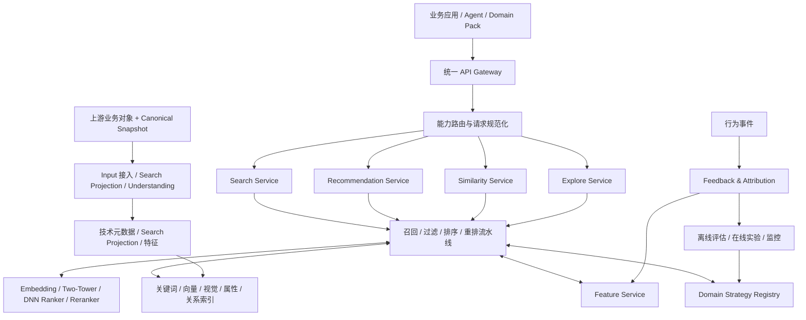
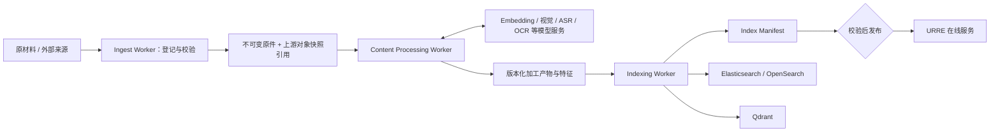

# URRE 通用检索推荐引擎架构设计

**定位：** 多领域候选发现、相关性计算、排序与反馈优化平台

**边界：** 不承担完整 Agent 任务规划；不承载领域创作执行

> **本次交付约束：** URRE 真实检索、商品/广告等领域和数据加工平面不在交付范围。本次只使用 Video/Clip Mock Adapter；本文保留为未来替换 Mock 的接口参考，不能成为 Video Domain Agent 的开工前置。

真实 URRE 2.0 的控制面、加工产物、上游 API、Elasticsearch、Qdrant 和 Redis 字段模型见 [URRE 数据与存储模型设计](05_URRE数据与存储模型设计.md)。

---

## 1. 设计目标

URRE（Universal Retrieval & Recommendation Engine）的通用框架可面向多个领域；本次交付只使用其视频领域接口，并全部由 Mock Adapter 实现。

核心目标：

- 大规模对象的低延迟候选发现。
- Search、Recommendation、Similarity、Explore 四类业务能力并列。
- 召回、过滤、特征、模型、排序、反馈等基础设施共享。
- 领域语义、策略目标和业务规则由 Domain Pack 注入。
- 结果可解释、可追溯、可评估。
- 支持 Video 与 Clip 两级对象；Clip 是唯一片段层级。

## 2. 能力边界

| 能力 | URRE 负责 | 上层 Agent / Domain 负责 |
|---|---|---|
| Query Understanding | 结构化查询能力、实体/属性解析服务 | 复杂意图澄清、业务目标判断 |
| Candidate Recall | 多路召回、候选合并 | 决定任务目标与召回意图 |
| Filtering | 权限、状态、硬约束执行 | 定义领域约束和用户授权 |
| Ranking | Query/Context 与 Item 相关性排序 | 定义业务目标、解释创作适配性 |
| Reranking | 多样性、新鲜度、业务策略重排 | 决定最终创作取舍 |
| Recommendation | 用户/任务/场景上下文推荐 | 提供当前任务、项目和创作阶段 |
| Feedback | 接收、规范化、聚合行为事件 | 采集真实业务结果并补充语义 |
| Evaluation | 离线、在线、实验与指标体系 | 定义领域成功标准 |

---

## 3. 总体架构

Similarity / Explore 与 Search、Recommendation 并列。下图是当前架构依据。




逻辑模块不要求物理服务一一对应。高频请求链路应尽量短，离线训练、索引构建和复杂内容理解不进入在线请求关键路径。四类能力在路由后并列进入同一类流水线，过滤层中的租户、对象状态和项目权限硬约束必须在排序与重排之前生效。

## 4. 四类一等业务能力

### 4.1 Search

输入：Domain、Query、Filters、Scope、User/Tenant Context、Pagination。

链路：
1. Query 规范化与结构化。
2. 领域实体与属性识别。
3. 选择关键词、语义、视觉、属性、关系等召回通道。
4. 候选合并与去重。
5. 权限和硬约束过滤。
6. 相关性排序。
7. 多样性、新鲜度等重排。
8. 返回结果与证据。

### 4.2 Recommendation

输入：Domain、User、Scene、Task Context、Project Context、Current State、Constraints。

召回来源：
- 用户长期兴趣与近期行为。
- 当前任务与项目上下文。
- 内容相似和协同信号。
- 热门、趋势、新鲜内容。
- 领域规则和业务机会。
- 探索性候选。

排序不能简单等于“预测点击率”。需要根据场景考虑采用率、任务帮助程度、内容质量、多样性、新颖性、业务价值和长期满意度。

### 4.3 Similarity

支持语义相似、视觉相似、属性相似、行为相似、关系相似。调用方应声明相似目标，避免将“画面相似”误解为“主题相似”。

### 4.4 Explore

主动扩展候选空间，强调新颖性、覆盖度、长尾发现和潜在机会。探索结果应与常规相关性结果区分标记，避免把低相关候选伪装成高相关结果。

---

## 5. 通用处理流水线


### 5.1 召回层

- Keyword Recall：精确词项和倒排检索。
- Semantic Recall：文本语义向量。
- Visual Recall：图像/视频帧视觉语义。
- Attribute Recall：结构化属性和范围过滤。
- Collaborative Recall：用户/物品协同信号。
- Context Recall：任务、项目和场景上下文。
- Relation Recall：实体关系与知识图谱。
- Trend Recall：趋势、热门和新鲜度。
- Exploration Recall：受控探索与长尾候选。

每个召回通道应有独立的超时、候选上限、覆盖监控和版本号。通道失败应可降级，不应导致整条服务链路不可用。

### 5.2 过滤层

硬约束优先于排序偏好，包括：
- 租户和数据权限。
- 对象状态、可用性和删除状态。
- 用户指定的必须条件。
- 领域业务硬规则。

硬约束不能作为一个可被高相关性分数抵消的普通排序特征。

### 5.3 排序与重排

主排序计算当前请求目标与候选的匹配程度。重排负责多样性、新鲜度、重复抑制、探索比例和业务策略。

Search 与 Recommendation 必须有独立目标函数与评估集。即使底层共享模型服务，也不代表共享同一套训练标签和损失函数。

### 5.4 Embedding / Two-Tower / DNN / Reranker 模型职责

| 模型能力 | 主要阶段 | 输入 | 输出与边界 |
|---|---|---|---|
| Embedding Service | 语义索引、召回、相似发现 | Query、Video/Clip 文本、图像、多模态特征 | 向量表示；不直接决定最终业务排序 |
| Two-Tower | 大规模候选召回 | 用户/上下文塔、对象塔及其特征 | 用户与对象的低维匹配表示；用于高效候选发现，不代替重排 |
| DNN Ranker | 主排序或精排 | Query/Context、候选特征、交叉特征和业务约束特征 | 相关性或任务适配分数；不改变权限硬过滤结果 |
| Reranker | 小候选集重排 | 排序后的候选、证据、多样性与业务目标 | 最终重排结果；不负责全量召回 |

模型层必须遵守以下边界：

- Search 与 Recommendation 可以共享 Embedding、训练和推理基础设施，但保留独立目标、标签、模型版本和评估集。
- Two-Tower 的召回分数不能未经校准直接作为 DNN 或 Reranker 的最终业务分数。
- DNN 输出必须可追溯到特征版本、模型版本和策略版本；任何模型分数都不能绕过租户、权限和项目范围。
- 将现有分数直接相加前必须完成校准；模型缺失、超时或降级时应回退到规则或轻量排序基线。
- MVP 可以先使用关键词、向量召回和轻量排序；Two-Tower、DNN 和 Reranker 按数据规模、延迟与收益逐步启用。

### 5.5 向量数据库选型

> **本次交付不启用。** 本节只用于未来把 Mock Retrieval Adapter 替换为真实 URRE。Qdrant、Milvus、ES/OpenSearch 和 Kafka 均不是本次 Video Domain Agent 的依赖。

**默认选择：Qdrant。** 

选择 Qdrant 的主要原因是其部署和运维复杂度更适合未来真实 URRE 的第一阶段，同时能够覆盖文本向量、视觉向量、Payload 条件和多租户隔离需求。URRE 的硬约束数量较多，且租户、对象状态和项目范围必须参与召回阶段的过滤；Qdrant 的 Payload filter 适合把这些条件直接推入向量查询，并与现有 Java 服务、Kafka 索引链路和 Elasticsearch 全文检索组合。

| 维度 | 默认方案：Qdrant |
|---|---|
| 当前阶段 | MVP 到多领域扩展阶段的主向量检索 |
| 检索分工 | 文本/视觉向量召回和 Payload 过滤 |
| 全文检索 | 不替代 Elasticsearch 的 BM25 |
| 运维模式 | 优先选择低组件数、易升级和可快照恢复的部署方式 |
| 主要风险 | 超大规模、高写入和高并发下的成本与延迟 |

向量检索采用以下架构边界：

- **关键词与向量分开召回。** BM25、中文分词、聚合和复杂全文查询由 Elasticsearch 承担；Qdrant 负责文本向量、视觉向量和相似检索。两类结果在 URRE 内合并、去重和 RRF 融合，不在不同存储之间直接比较原始分数。
- **硬过滤进入向量查询。** `tenant_id`、数据权限、对象状态和项目范围由服务端可信上下文注入，并作为 Qdrant 查询条件在召回阶段执行。Agent 和 Domain Pack 不得移除或覆盖硬过滤条件。
- **Collection 按向量空间管理。** 默认按“领域 + 向量类型 + Embedding 模型主版本”划分 Collection，例如 `video_text_v1`、`video_visual_v1`。新索引通过 Manifest 选择当前物理 Collection；Qdrant Alias 可用于单库内部兼容，但不能承担 ES 与 Qdrant 的跨系统发布。不把租户数量直接映射为无限多的物理 Collection。
- **数据与索引版本可追溯。** Point ID、对象版本、Embedding 模型版本、索引配置版本和索引更新时间必须可追踪；模型升级通过影子索引和受控切换完成，不在原索引上直接覆盖。
- **访问通过 Adapter 隔离。** URRE 只依赖统一的 `VectorStorePort`，Agent 和领域服务不得直连 Qdrant。生产环境必须启用副本、快照、容量告警、慢查询监控和索引重建演练。

---

## 6. Domain Strategy Contract

Domain Pack 应向 URRE 注册：

- Domain Schema / Entity Type。
- Source Adapter / Processing Profile IDs。
- Embedding Profile IDs。
- Index Profile / Index Schema Versions。
- Feature Definitions。
- Query Parser / Context Adapter。
- Recall Strategy IDs。
- Filter Rules。
- Ranking Objective / Model IDs。
- Rerank Policy IDs。
- Result Evidence Schema。
- Evaluation Dataset / Metrics。
- Availability Rules。

策略配置只引用经过注册和校验的策略、Processing、Embedding 与 Index Profile ID；不允许由请求参数任意加载代码、表达式或查询 DSL。Profile 的创建、发布、回滚和废弃必须版本化，在线请求不能引用 Draft 版本。

### 6.1 公共对象与领域对象

公共对象元信息仅承担通用能力。本次只定义视频领域对象：

- Video：完整视频资产。
- Clip：Video 内可独立检索的连续片段。

领域特征含义由 Domain Pack 管理，公共特征平台只负责版本、存储、读取和计算机制。

---

## 7. 结果契约：从“候选列表”升级为“候选 + 证据”

统一结果建议包含：

```json
{
  "request_id": "string",
  "domain": "video",
  "capability": "search",
  "strategy_version": "string",
  "items": [
    {
      "entity_id": "string",
      "entity_type": "clip",
      "score": 0.0,
      "rank": 1,
      "recall_channels": ["semantic", "visual"],
      "matched_requirements": ["night_city", "aerial"],
      "evidence": {
        "summary": "string",
        "time_range": {"start_ms": 12000, "end_ms": 18500},
        "evidence_refs": ["string"]
      },
      "availability": "available",
      "feature_version": "string"
    }
  ],
  "trace": {
    "query_version": "string",
    "model_versions": ["string"],
    "latency_ms": 0
  }
}
```

该结构是概念契约，具体字段由 API 详细设计进一步规范。`entity_type` 与 `03` 对象层级对齐，枚举为 `video` / `clip`，字段级权威见 `implementation/01`。不得向无权限用户暴露源文件真实地址或敏感证据。

---

## 8. 反馈闭环

### 8.1 事件分层

| 事件 | 含义 | 价值 |
|---|---|---|
| Impression | 实际曝光 | 建立候选机会集 |
| Click | 主动点击 | 弱兴趣信号 |
| Preview | 有效预览 | 更强意向信号 |
| Save | 收藏 / 暂存 | 偏好信号 |
| Download | 下载 | 使用意图 |
| Adopt | 加入项目 / 选品池 | 任务采用 |
| Use | 最终使用 | 强价值信号 |
| Replace / Reject | 替换 / 拒绝 | 负向但需结合原因 |
| Convert | 转化 / 业务结果 | 业务价值信号 |

不能把未点击直接等同负反馈；必须保留曝光位置、候选集合、上下文、展示时长和策略版本。

### 8.2 反馈用途

- 在线画像与短期上下文更新。
- 离线训练样本构建。
- Search / Recommendation 分别评估。
- 策略效果分析与 A/B 实验。
- Agent 任务规划与领域工作流优化。

---

## 9. 质量、实验与可观测性

### 9.1 Search 指标

Recall@K、NDCG@K、MRR、零结果率、查询改写率、有效预览率、下载率、任务满足度、P95/P99 延迟。

### 9.2 Recommendation 指标

Adoption@K、NDCG@K、覆盖度、多样性、新颖性、重复率、任务完成贡献、长期留存或业务价值。

### 9.3 平台指标

吞吐、P95/P99、召回通道可用率、超时率、索引延迟、特征新鲜度、模型版本分布、单位请求成本。

离线指标与线上业务结果需要对应；不得只通过离线 NDCG 提升宣称产品推荐效果必然提升。

---

## 10. 非交付附录：未来真实数据加工与索引

本节只描述未来接入真实 URRE 时的设计约束。本次交付不实现 Ingest、Processing、Embedding、Indexing、ES、Qdrant 或 Kafka。


### 10.1 定位与事实源

原材料加工与索引平面是 URRE 的一等数据生产层，负责把视频、商品、文档和外部内容转换为可检索对象。上游领域业务服务拥有权威业务对象和业务元数据；数据加工平面保存不可变输入快照、技术元数据、版本化 Search Projection 和特征，作为可追溯的检索输入与派生事实。Elasticsearch、Qdrant 中的全文索引、向量和属性字段是可由加工产物重建的派生数据。

URRE 在线检索不直接读取原始视频或商品文件。Agent 可以通过受治理 Tool 发起批量入库、重处理或索引重建任务，但不得执行转码、抽帧、内容理解、Embedding 或底层索引写入。



#### 10.1.1 业务事实与检索派生的责任边界

数据加工平面不是新的业务事实源，也不替上游定义“对象在业务上是什么”。各层职责如下：

| 层 | 权威职责 | 不承担的职责 |
|---|---|---|
| 上游领域业务服务 | 对象身份、权威业务元数据、业务状态、生命周期和业务来源 | 为每个检索场景重复实现转码、抽帧、分块、Embedding 和索引发布 |
| 数据加工平面 | 接入检索输入快照、执行 Search Projection / Understanding、保存版本与血缘、构建和发布索引 | 修改上游权威字段，或把派生结果直接提升为业务事实 |
| Domain Pack | 定义领域 Schema、Canonicalization 约束、处理 Adapter、Processing / Embedding / Index Profile 和验收口径 | 持久化业务事实或执行底层基础设施写入 |
| URRE 核心服务 | Query / Context、召回、硬过滤、融合、排序、重排和证据组装 | 业务规范化、原始媒体处理、模型任务调度和索引发布 |

责任判断规则：

1. 回答“对象在业务上是什么”的字段和规则归上游。
2. 回答“为了检索对象需要额外生成什么”的产物归数据加工平面。
3. 回答“领域需要哪些处理步骤、口径和版本”的定义归 Domain Pack。
4. 回答“哪些对象应被召回、过滤、排序”的计算归 URRE 核心。

**业务规范化 / Canonicalization** 指上游对象身份、业务状态和来源认定等事实治理。**检索派生 / Search Projection** 指转码、抽帧、Clip 切分、ASR、OCR、视觉标签、特征和 Embedding 等为检索生成的可重建表示。二者不得继续合并在一个含义模糊的 `Normalize` 阶段中。

上游可以提供稳定、版本化且通过 Schema 校验的 Clip、OCR 或商品结构化特征。数据加工平面必须把它们登记为带来源、版本和 hash 的 Input Artifact，校验后直接消费；只有缺少可用产物或检索侧需要不同表示时，才生成新的 Search Projection。派生 Artifact 不得在没有上游业务命令的情况下修改权威元数据或业务状态。

### 10.2 处理阶段与职责

| 阶段 | 主要职责 | 产物 | 不应承担 |
|---|---|---|---|
| Upstream Snapshot | 上游业务服务提供权威对象、业务元数据和可选稳定产物 | 版本化业务快照、Input Artifact 引用 | 为检索生成全部派生表示或决定在线排序 |
| Source Registration | 登记来源、租户、访问凭据、输入快照和批处理范围 | `IngestionJob`、原始对象引用 | 解释或改写上游业务语义 |
| Ingest / Validate | 下载或挂载、校验 hash、格式、病毒与权限，保存不可变原件并提取可复现的技术元数据 | 原始对象、技术元数据快照 | 直接向在线索引写入未加工内容或修正业务字段 |
| Canonicalization Contract | 校验上游权威字段和可选 Input Artifact 的版本、Schema、hash 与权限 | 已接受的业务快照引用 | 在本层静默清洗、映射或修正商品和视频业务字段 |
| Search Projection | 转码、抽帧、Clip切分、文档分块以及检索侧字段投影 | 派生媒体、Clip、可重建检索字段 | 修改原始对象、业务事实或最终排序 |
| Understand | ASR、OCR、视觉理解、分类、标签、实体和关系抽取 | 版本化分析结果与证据 | 修改原始对象、掩盖来源或替代上游业务裁决 |
| Embed | Content Processing 内的子阶段；按注册模型生成文本、视觉、多模态或商品表示 | 向量、模型版本、归一化参数 | 直接决定最终业务分数；默认不要求独立 Worker |
| Index Build | 批量生成搜索文档和 Qdrant Point，执行 upsert、回填和校验 | ES 文档、Qdrant Point、索引统计 | 绕过加工产物临时拼接字段 |
| Publish | 校验后切换 Active Manifest 指针，在线别名仅作为 Manifest 内部资源 | 可回滚的 index version | 在未校验时覆盖当前在线索引 |

各阶段使用 Kafka 或等价持久队列传递任务事件。MVP 可以把多个 Worker 打包在同一个部署单元中，但队列、幂等键和职责边界必须分离。媒体预览、时间线编译和导出由 `Media Worker` 负责，不与数据加工 Worker 混用。

领域通过 `ProcessingProfile` 和 Adapter 扩展处理能力：

- 视频 Domain Pack：未来可执行转码、抽帧、Clip 切分、ASR、OCR、视觉理解和 Clip 级 Embedding。
- 本次交付只使用固定 Video/Clip Fixture，不执行上述加工。

`ProcessingProfile` 必须声明上游输入快照与 Input Artifact 的 Schema 和版本要求，以及本 Profile 生成的 Search Projection 类型。`ProcessingProfile`、Embedding 模型版本、分块规则和索引 Schema 都必须版本化。在线请求只能使用已发布 Profile，不允许 Agent 动态指定未注册的解析器、模型或索引 Schema。

数据加工平面必须保持以下不变量：

- 上游权威字段只读；发现冲突时返回可归因的校验错误，由上游修正并发布新版本。
- 上游稳定产物优先复用；重复计算结果只能作为新的派生 Artifact，不能覆盖上游事实。
- 每项 Search Projection 都能从输入快照、Input Artifact、Profile 和模型版本重建。
- Indexing Worker 只能从加工产物生成索引，不得在索引阶段补做业务清洗或内容理解。

### 10.3 批处理、增量与重建

同一套加工能力必须同时支持以下模式：

- **初始批量加工：** 对流式或对象存储中的素材批量创建 `IngestionJob`，按租户、来源和 Processing Profile 分片执行。
- **增量加工：** 新对象、内容更新和模型升级通过事件触发局部重处理。
- **定向回填：** 指定时间范围、来源、租户或失败集合重新加工，不覆盖无关对象。
- **索引重建：** 从事实源和加工产物重建 ES 文档与 Qdrant Point，用于模型升级、Schema 变更和索引损坏恢复。

版本与幂等必须分层，不能用一个键同时表达内容加工和索引发布：

- `content_version`：由 `data-control-plane` 在 `source-uploads/finalize` 校验通过并生成不可变对象后分配；原始二进制发生合法替换时递增。
- `metadata_version`：由领域业务服务在标题、标签、属性等权威元数据变化时递增。
- **Processing Key**：`tenant_id + entity_type + entity_id + content_version + metadata_version + processing_profile_version`。
- **Embedding Key**：`processing_artifact_hash + embedding_space + embedding_model_version`；文本、视觉和多模态向量分别计算。
- **Index Item Key**：`tenant_id + index_profile_version + index_target + entity_type + entity_id + metadata_version + processing_artifact_hash + index_embedding_outputs_hash`。
- **Request Idempotency Key**：客户端重复提交同一个批处理请求时返回同一个 Job；它不能替代上述内容、加工和索引幂等键。

客户端和 Worker 不得自行覆盖上述权威版本。`index_embedding_outputs_hash` 是该 Index Target 实际使用的一组向量空间、模型版本、维度和输出 hash 的稳定摘要。内容与元数据结构变化必须通过明确规则递增版本。重复投递、Worker 重启和人工重试必须得到同一结果，不得产生重复对象、无版本变更的向量或错误覆盖新版本。

Item 与 Batch 使用不同状态机：

- **Item：** `Accepted → Ingesting → Processing → Embedding → Indexing → Validating → Active`，另有 `Failed` / `Cancelled`。
- **Batch：** `Accepted → Running → Completed`，允许 `PartiallyCompleted`，另有 `Failed` / `Cancelled`。

Batch 汇总 Item 的成功、失败和重试数量。视频 API 中的 `ingest_status`、`analysis_status` 和 `index_status` 是从 Item 状态投影出的粗粒度摘要，不是独立状态事实源。持续失败进入死信队列，不能无限重试阻塞主队列。

`data-control-plane` 必须在创建 Job 前校验租户的对象数、并发、存储和处理成本配额。超过配额时直接拒绝，不得先接收再依赖队列自然限流。

### 10.4 索引一致性与发布

Elasticsearch/OpenSearch 与 Qdrant 的双写不是原子事务，因此不能把“两边都调用成功”当作发布完成。**唯一的原子发布点是控制面中的 `Active Index Manifest`**；ES Alias、Qdrant Alias 和物理索引名称只是 Manifest 引用的资源，不分别承担跨系统发布。

Index Manifest、Profile 注册表、Job 状态和租户配额属于未来真实 URRE 的扩展，需要另行增加 Schema 和契约。本次交付只使用固定 Mock Fixture，不提供 IndexManifest。

- `manifest_id`、`domain`、`index_profile_version`、`source_snapclip_id`。
- ES 物理索引 / Alias、Qdrant Collection / Alias、Embedding 与 Processing 版本。
- 各目标文档数、Point 数、对象主键集合摘要、内容 hash、校验结果。
- 状态 `Draft` / `Validated` / `Active` / `Failed` / `RolledBack`、创建人和发布时间。

全量重建、Embedding 模型升级和 Index Schema 升级采用不可变的新索引版本：

1. 为一次处理快照生成新的 `index_version`。
2. Indexing Worker 写入新的 Draft ES 索引和 Qdrant Collection，不覆盖当前在线版本。
3. Indexing Worker 分别校验每个 target 的预期文档/Point 数量、逻辑对象主键覆盖、hash、关键字段和失败集合，并提交校验报告；不要求 ES 文档数与 Qdrant Point 数机械相等。
4. 任一侧写入或校验失败时，`data-control-plane` 将整个 Manifest 标记为 `Failed`，不得发布部分结果，也不得切换在线指针。
5. `data-control-plane` 复核校验报告后把 Manifest 标记为 `Validated`；只有它才能在一个关系数据库事务中通过 CAS 将 Manifest 标记为 `Active` 并切换 `Active Manifest` 指针。
6. 在线请求开始时读取一次 Active Manifest，并在整个请求内固定使用其中的 ES/Qdrant 资源，避免一次请求跨两个版本。
7. 观察质量、错误率和索引延迟，完成灰度后再下线旧版本。

日常小批量增量可以复用当前索引代际，但必须先把相关 Item 在 ES 与 Qdrant 两侧完成幂等写入和差异校验，再由 `data-control-plane` 推进 Manifest 的同步水位；任何一侧失败都不能推进水位。Worker 不得直接修改 Active 指针。需要完整回滚、模型/Schema 变更或大批量回填时，仍使用新的不可变索引版本。无法提供 Item 级可见性隔离时，不得声称跨存储原子发布。

ES 与 Qdrant 都必须保存 `tenant_id`、对象状态和项目权限范围，用于召回阶段的在线权限过滤。

敏感原文和长期签名地址不进入向量 Payload。结果只返回受控 `evidence_ref`；在线 Evidence Resolver 组织缩略图、时间区间、转写摘要或短期预览地址，并重新执行租户和项目权限校验。Evidence Resolver 不暴露未授权源文件路径。

### 10.5 可观测性与验收

数据加工平面至少监控：队列积压、各阶段吞吐、单对象耗时、模型调用失败率、死信数量、批次完成率、处理到可检索延迟、索引文档/Point 差异、索引版本分布、重建耗时和单位对象成本。

以上监控与验收条款属于**未来真实 URRE 2.0** 的门槛，不是本次 Video Domain Agent 开工或 Demo 的门禁。本次门槛以 [交付范围](implementation/00_交付范围与VideoClip模型.md) 和 [实施路线图](implementation/03_实施路线图与验收基线.md) 为准，只要求 Mock Search、Recommendation 和 Similar 可重复验收。

未来真实 URRE 验收必须证明：原始素材可重复加工；Worker 重试不产生重复结果；ES 与 Qdrant 可从同一加工快照重建；模型或 Schema 升级可以双版本构建，并通过 Active Manifest 发布和回滚；任一侧索引失败时 Manifest 保持原在线版本；跨租户和数据权限过滤在索引发布前后均有效；在线服务不依赖原始文件路径或对话 Agent。

---

## 11. 非功能约束

- 多租户隔离和数据权限检查必须进入在线链路。
- 高频 Search / Recommend 不依赖 LLM 才能完成。
- 召回通道可独立降级，模型可替换。
- 支持策略、特征、模型和索引版本追踪。
- 结果能追溯到召回来源和证据。
- 领域策略异常不影响其他领域。
- 支持限流、超时、熔断、缓存和候选上限。
- 在线服务与离线训练/索引任务资源隔离。

---

## 12. 验收标准

### 12.1 本次门槛

以 [交付范围](implementation/00_交付范围与VideoClip模型.md) 和 [实施路线图](implementation/03_实施路线图与验收基线.md) 为准：

1. Search、Recommendation 与 Similar 的语义必须独立，并通过 Mock Adapter 验收；Explore 不进入本次交付门槛。
2. 简单请求不需要启动 Agent。
3. 反馈事件可关联请求、候选集和后续业务结果。
4. 结果可追溯到策略和证据；Mock 与未来真实 Adapter 共用 Port 和 Schema。

### 12.2 未来 URRE 2.0 验收

以下条款不作为本次开工或 Demo 门禁：

1. 同一领域可注册不同 Search 与 Recommendation 策略。
2. 领域硬约束和权限过滤在排序前生效。
3. 返回结果可追溯到策略、模型、召回通道和证据。
4. 原材料加工与索引平面可同时执行批量、增量和重建任务，并与 Agent 对话链路解耦。
5. 新增领域主要通过 Domain Pack 扩展，不复制 URRE 核心流水线。
6. Embedding、Two-Tower、DNN Ranker 和 Reranker 具有独立版本、接口边界、降级策略和可归因指标。
7. 上游 Canonical Snapshot 与稳定 Input Artifact 可校验复用；数据加工平面不修改权威业务字段，也不将 Search Projection 反写为业务事实。
