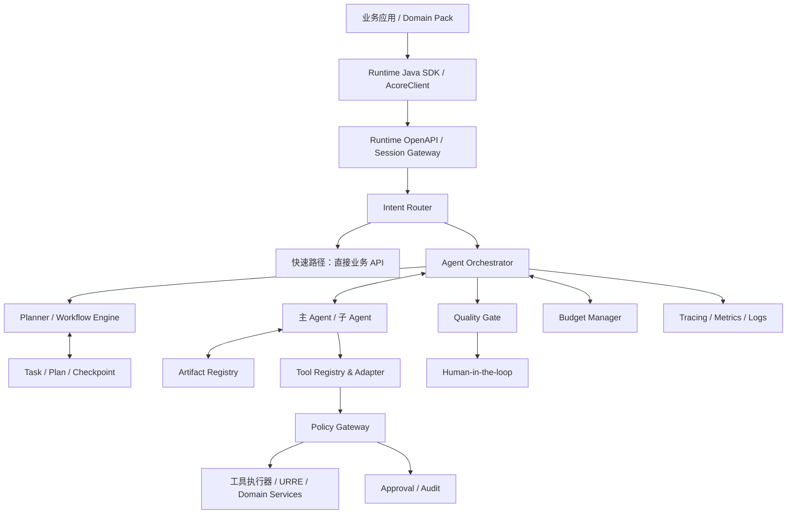
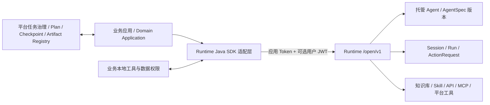
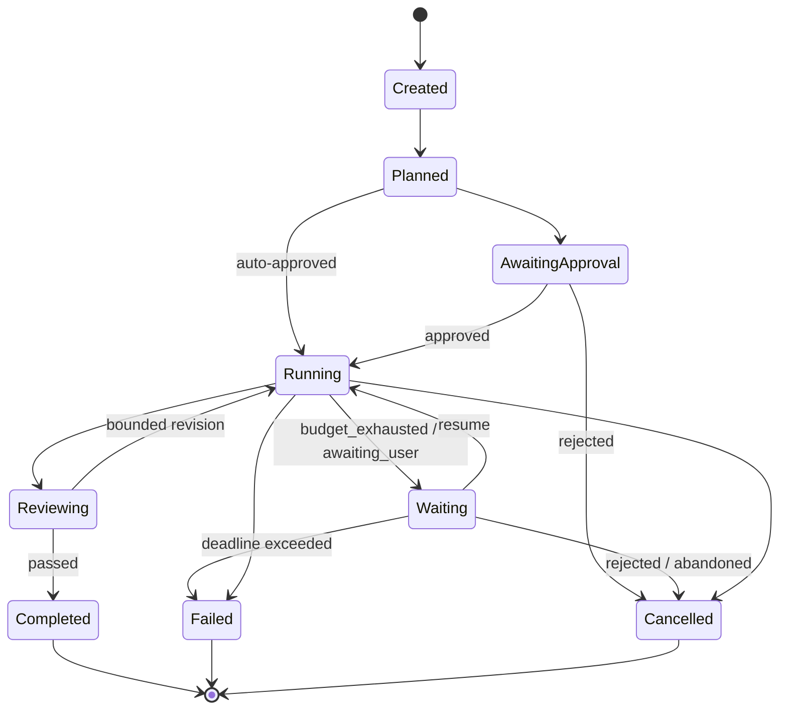
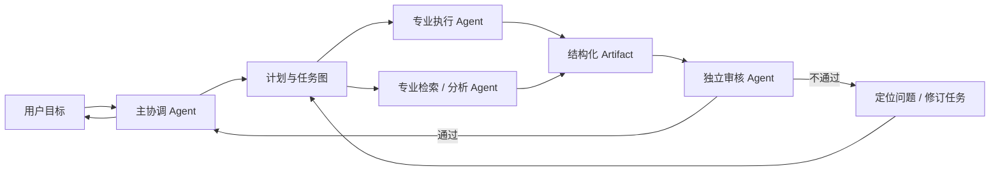
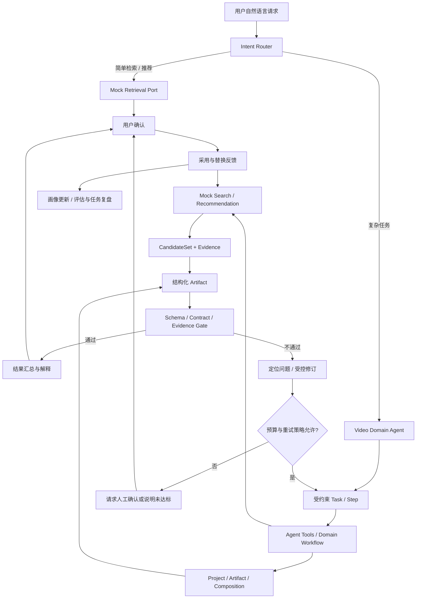

# Agent Runtime 架构设计

**定位：** 面向多领域 Agent 的任务控制、协作编排与安全治理层

**业务接入文档/源码基线：** Acore Runtime Java SDK `0.2.0`（发布状态待核验），JDK 17+，通过 `/open/v1` 开放接口访问托管 Agent

**服务端实现边界：** 业务可依赖的是 Runtime Java SDK 与 `/open/v1` 契约；服务端内部框架由 Runtime 平台维护。AgentScope Java 2.0 只能作为尚未由本仓库验证的实现候选，不能出现在业务接入依赖中。

**文档基线：** 2026-11-12 根据 Acore Runtime Java SDK 文档（`runtime-sdk/java/overview.md`、`runtime-sdk/java/api-reference.md`）和 Java 示例工程（`java-examples/README.md`）完成对照。这些路径是外部基线，**本仓库不收录**。

> **本次交付约束：** 本项目只接入一个 Video Domain Agent。平台跨领域协作、Product/Marketing Agent、真实 URRE 服务、视频生成和媒体执行均不在交付范围；本文中的相关章节仅作为 Runtime 通用边界参考。

---

## 1. 设计目标

Agent Runtime 不只是模型调用封装，也不只是一个可以调用工具的 ReAct Loop。它应成为可观察、可恢复、可治理的任务执行控制面。

需要解决：

- 简单请求与复杂任务的执行路径分流。
- 固定工作流和动态规划协同。
- 多 Agent 按需激活与职责隔离。
- Plan、Task、Checkpoint、Artifact 独立管理。
- 工具注册、协议适配、权限、审批、审计。
- 有边界的推理、重试、预算和停止条件。
- 质量评估与人工接管。
- 长任务暂停、恢复、取消和版本化。

## 2. Runtime 总体架构

### 2.1 Java SDK 在架构中的位置

Runtime Java SDK 是业务后端访问托管 Runtime 的薄客户端，不是 AgentScope 或完整任务编排引擎。业务后端使用 `AcoreClient` 完成认证、Agent/Session/Run/Action/文件等资源调用；Runtime 在服务端完成模型推理、托管 Agent 执行、远端资源与 MCP 调用。

职责边界：

- Java SDK 提供稳定的业务调用面、类型化配置、SSE 转发、有限恢复、幂等标识和本地工具回调。
- Runtime 服务端负责托管 Agent 定义解析、执行、资源调用、Run 生命周期和事件产生。
- 业务后端负责可信登录态、用户与租户归属、业务幂等记录、结果补偿、展示过滤、持久化执行凭据和多实例协调。
- 平台治理层负责 Java SDK 尚未提供第一类对象的 Plan、Checkpoint、质量门禁、完整成本账本和领域 Artifact Registry。
- 服务端即使采用 AgentScope Java 2.0，也不得把其内部类型或内部推理链暴露为业务接入契约；对业务方稳定的契约仍是 Runtime SDK 与 `/open/v1` OpenAPI/SSE 协议。

### 2.2 两种调用模型

| 模型 | 典型入口 | 适用场景 | 权威结果 |
| --- | --- | --- | --- |
| 任务 | `tasks().run` 或 `tasks().submit` + `tasks().await` | 分类、摘要、后台处理、文件分析 | `RunResult`；最终仍应检查 `Run.status()` |
| 对话/流式 | `sessions().create` + `runs().stream` / `runs().attach` | 多轮聊天、边生成边展示、断线恢复 | `RunStream`/`RunView` 用于展示，最终状态回读 `runs().get` |

`tasks().submit` 会创建新 Session。已有 Session、上传文件或需要多轮上下文时，应使用 `runs().create` 或 `runs().stream(CreateRunRequest, requestId)` 在指定 `sessionId` 中执行。单选一条调用路径应由业务能力决定，不能把任务快捷方法用于必须复用会话的文件或多轮场景。

## 3. 请求路由：不是每个请求都启动 Agent

| 复杂度 | 请求示例 | 默认路径 |
|---|---|---|
| L0 | 搜索、筛选、分页、简单详情 | 直接业务 API |
| L1 | Query 改写、相似解释、简单比较 | 轻量 Agent 或服务组合 |
| L2 | 多轮澄清、跨工具检索、结果综合 | 单主 Agent + 工具 |
| L3 | 多阶段规划、多个专业环节协作 | 主 Agent + 按需子 Agent |
| L4 | 外部副作用、高风险、付费、发布 | 审批工作流 + 强策略控制 |

Router 可依据任务类型、复杂度、风险等级、延迟预算和用户授权决定路径。不能仅以“用户输入很长”判断复杂度。

### 3.1 Platform Agent 与领域 Agent

- **Platform Agent** 是跨领域任务的默认主协调能力，负责目标确认、领域识别、任务路由、工具边界和跨领域 Artifact 交接。
- **Video Domain Agent** 是本次唯一交付的领域 Agent，负责创作目标、ClipPlan、领域能力调度和用户确认，不重复承担平台级身份、租户和通用任务治理。
- 单一视频请求可以直接进入 Video Domain Agent 或业务 API；本次不实现跨领域 Platform Agent。
- Search Planner 默认是复杂查询中的受约束 Planner，Recommendation Strategy 默认是领域策略，二者都不因为拥有名称中的业务语义就成为自治 Agent。

统一实现形态以 [总纲职责矩阵](00_架构设计总纲.md) 为准。

## 4. Session / Plan / Task / Checkpoint / Artifact

### 4.0 SDK 原生对象与平台扩展对象

Java SDK 已经提供一组可以直接使用的运行对象，但并非现有架构中的所有对象都是 SDK 第一类资源。必须按下表区分“可直接接入”和“平台必须建设”，否则会把目标架构误当成 SDK 现状。

| 架构对象 | Java SDK 原生映射 | 当前能力边界 | 架构决策 |
| --- | --- | --- | --- |
| Agent | `AgentSpec`、`AgentRevision`、`ManagedAgent`、`agents().contract` | 支持类型化定义、候选版本、发布、查询、精确版本选择、停用和回滚；支持模型、知识库、Skill、工具、API、MCP、子 Agent、沙箱、记忆、变量、Schema 与定义预算 | 托管 Agent 定义与版本以 SDK/Runtime 为准；业务负责发布流程、候选验收和配置绑定 |
| Session | `Session`、`SessionSummary`、`SessionSnapshot`、Session 文件/事件/产物 API | 支持创建、查询、列表摘要、业务键、标题、账本、上传、产物和快照 | 以 SDK Session 保存交互连续性；Project 和长期业务事实仍由业务保存 |
| Task / Run | `TaskRequest`、`CreateRunRequest`、`Run`、`RunResult` | SDK 原生执行实例是 Run；支持同步等待、异步提交、查询、按业务键查询、对账、取消、恢复、中断续写 | 简单任务可用一个 Run 承载；含 Plan、多阶段审核和长期项目状态的任务聚合由平台控制面保存 |
| ActionRequest | `ActionRequest`、`actions().list/listPage/decideAction`、`ActionDecision` | 原生支持本地工具、确认、拒绝、补充输入和参数替换等停点；具体类型取决于服务端协议 | 用于工具/人工停点；不能用它替代完整业务审批系统 |
| Plan | 无独立 Plan API | 计划可由 Agent 指令或外部 Planner 生成，但 SDK 没有 Plan 的独立版本、冻结、批准和差异 API | 平台/Domain Pack 自建 Plan 对象，并用 Run 执行已批准步骤 |
| Checkpoint | 无任意业务 Checkpoint API | 有 `sessionId`、`runId`、SSE `lastEventId`、Session Snapshot、待处理 Action、幂等键和文件/产物引用等恢复原语 | 业务控制面保存最小充分 Checkpoint，且不得记录模型内部推理链 |
| Artifact | `Run.resultJson()`、`outputs()`、`RunOutput`、`SessionArtifact`、下载 API | 原生强项是结构化结果和同一 Session 工作区中的文件产物；支持路径、MIME、大小、SHA-256 和代数 | 文件 Artifact 可直接接入；Creative Brief、Storyboard 等领域 Artifact 必须由业务 Registry 提供版本、血缘和权限 |
| Budget | `Models.Budget(maxTurns, timeoutSeconds)`、`Run.usage()` | 可收紧单次 Run 轮数和超时，读取 token/turns；没有完整的跨步骤成本预估、动态限额和计费账本 | SDK 预算映射为执行约束；完整 Budget Manager 由平台实现 |

结论：SDK 负责“执行与交互原语”，平台负责“任务治理与领域语义”。不能因为 SDK 能创建 Run 就认为它已经拥有完整的 Plan/Task/Checkpoint/Artifact 生命周期。

### 4.1 Plan

Plan 是任务执行方案，包含：
- Goal：任务目标。
- Constraints：硬约束与软偏好。
- Steps：步骤、依赖、输入输出。
- Required Tools：允许使用的工具范围。
- Acceptance Criteria：验收条件。
- Risk & Budget：风险级别、成本上限。
- Approval State：待审批、已批准、已冻结、已撤销。
- Version：计划版本。

批准后的 Plan 应冻结其关键约束。Agent 可以提出 Plan Revision，但不得静默修改已经批准的目标、预算、工具范围和外部副作用权限。

Java SDK 当前没有 Plan 第一类 API。Plan 的存储、版本、批准、冻结和约束差异应由平台/Domain Pack 实现；SDK Run 通过 `specVersion`、`businessKey`、`Models.Budget` 和输入 JSON 承接已批准计划的执行参数。Plan 未被批准时不应通过创建 Run 绕过审批。

`todo_write`/Plan Mode 的边界：在功能语义上，动态任务清单可以等价于业务 Plan 的可执行投影，但当前 `runtime-sdk/java` 与 `java-examples` 中没有公开的 `todo_write`、Plan Mode 或 Todo API。若通过模型指令或自定义 Tool 生成 Todo 列表，它只是一个结构化输出或业务 Tool 调用；必须由平台按 Plan Schema 校验、版本化并冻结，不能把聊天文本或工具展示当作 Task 权威状态。E24 已明确其执行记录不是 Plan Mode。

### 4.2 Task

Task 是平台侧的业务任务聚合，负责目标、计划引用、状态与生命周期；Runtime 侧每次实际执行对应一个 Run。简单单步任务可以让 Task 与 Run 近似一对一，但多阶段、多 Run、人工审批和跨领域任务必须保持独立，不能用 Run 状态替代完整 Task 状态。

本图是 Task 的唯一正式状态集。**不设独立 `Paused` 或 `WAITING_USER`。** 本次 Video Domain Agent 交付启用以下 `waiting_reason`：

- `budget_exhausted`：预算耗尽，等待扩额、降级或停机决策后恢复或取消；
- `awaiting_user`：等待用户确认、补充或审批。

`awaiting_external` 留作未来外部任务扩展，本次 Schema、DDL 和状态机不启用；未来启用时必须通过新版本契约同步数据库约束、投影规则和验收脚本。

计划审批由任务策略决定：策略未要求审批时允许 `Planned → Running`；要求审批时必须经过 `AwaitingApproval`。`Waiting` 的恢复、取消或超时失败也应使用上述显式迁移，不引入额外状态。

Task 还应记录 owner、tenant、domain、parent_task、current_step、deadline、cancel_reason、`waiting_reason`（若处于 `Waiting`）和状态版本。

SDK Run 状态与平台 Task 状态是投影关系，不是同一枚举。接入时应遵循以下规则：

- `Run.status=completed` 只表示 Runtime 执行结束；若存在质量门禁，Task 进入 `Reviewing`，验收通过后才进入 `Completed`。
- `Run.status=requires_action` 映射为 `Waiting`。本地 Tool 批次应在当前协调流程中完成并续接原 Run；人工审批、工具确认或补充用户输入映射为 `awaiting_user`。本次不使用 `awaiting_external`，读取 Action 前不得猜测原因。
- `Run.status=failed` 与 `cancelled` 分别投影到 Task 的 `Failed` 与 `Cancelled`，同时保存 `error`、`stopReason` 和关联字段。
- SDK 活动态、SSE 结束或 `await_timeout` 都不是 Task 的终态依据。流正常关闭通常只表示当前流段结束，最终仍以 Run 回读和业务验收为准。
- Task 状态迁移必须由业务控制面持久化，并保存对应 `runId`、Action ID 和状态版本，不能从聊天文本恢复。

### 4.3 Checkpoint

Checkpoint 保存恢复所需的最小充分状态：
- 当前步骤与已完成步骤。
- 输入 Artifact 的引用和版本。
- 关键变量与外部任务 ID。
- 工具执行状态和幂等键。
- 剩余预算、重试计数和截止时间。
- 需要等待的用户输入或外部事件。

不要把模型完整内部推理链作为恢复状态。应保存可审计的决策摘要、结构化状态和产物引用。

Java SDK 当前不提供通用 Checkpoint 写入 API。业务 Checkpoint 应组合并引用以下 SDK 恢复原语：

- `requestId`、原输入、明确 `specVersion` 和业务身份，用于提交结果未知时幂等恢复；
- `sessionId`、`runId`、浏览器确认的 SSE `lastEventId`，用于重新挂接原 Run；
- `SessionSnapshot`、按页 Run/事件账本和 Session Artifact，用于刷新后重建展示；
- ActionRequest 的 `actionRequestId`、已完成决议和本地工具 `toolCallId` 去重记录；
- 文件 `uploadId`、产物 `artifactId`、版本和 SHA-256。

`lastEventId`、会话账本 `seq`、列表 `lastId` 和待审批游标语义不同，不得互相替代。SDK 的 SSE 自动续传只在已知帧位点时有限重试，不能替代业务对多订阅、限流退避和工具停点批次的协调。

| SDK 能力 | 实际恢复范围 | 不是 Checkpoint Workflow 的原因 |
| --- | --- | --- |
| `sessions().snapshot(sessionId)` | 重建 Session、历史 Run、账本和活动 Run 引用 | 只读聊天/执行快照；不保存任意 Workflow Step 状态 |
| `runs().get(runId)` | 回读单个 Run 的权威状态 | 不包含 Task/Step 图或业务 Artifact 状态 |
| `runs().attach(runId, lastEventId)` | 从已知 SSE 帧位点继续接收 | 只恢复事件订阅，不重建执行引擎状态 |
| `ActionRequest` + `decideAction` | 处理本地工具、确认或补充输入停点 | 只覆盖协议停点，不是任意步骤的存档/恢复 |
| `runs().resume(runId)` | 按停点协议恢复指定 Run | 不能从任意 Task Step 或业务 Checkpoint 恢复 |
| `requestId` / `businessKey` | 幂等重放、定位原 Run | 只提供关联与去重，不是状态快照 |
| `interruptAndSend` | 取消旧 Run 并在原会话开启新一轮 | 是替代执行，不是恢复原 Checkpoint |

因此，SDK 目前具备的是 **Run/Session/Action 级恢复原语**，不包含通用 **Task/Step Checkpoint Workflow Engine**。E24 的 `ProgressRun` 是内存中的业务演示状态，README 也明确进程重启后不能恢复；生产 Checkpoint 必须由平台持久化。

### 4.4 Artifact

Artifact 是可引用、可复用、可版本化的阶段成果，例如：
- Task Brief、Creative Brief、Storyboard。
- Search Request、Candidate Set、Evidence Report。
- ClipPlan、ClipRequirement、Material Assignment。

Edit Decision、Timeline、Preview 和 Final Output 属于平台通用扩展，不在本次 Video Domain Agent 交付范围。

每个 Artifact 应包含类型、Schema 版本、内容引用、父产物、来源任务、创建者、生成工具/模型版本、校验状态和权限范围。

Java SDK 原生提供 `Run.resultJson()/result()` 的结构化结果，以及 `RunOutput/SessionArtifact` 的文件产物元数据和短期下载。它不负责领域 Artifact Schema、父子血缘和评审状态的通用管理。因此：

- 文件型 Artifact 可保存 `runId + artifactId + path + sha256 + generation`，下载时重新签发短期地址，不能长期保存 `accessUrl`。
- 结构化结果必须按业务 Schema 验收；`completed` 时仍可能没有结构化结果，需要处理 `unresolved()`。
- Creative Brief、Storyboard、SearchPlan、Quality Report 等领域对象由 Domain Artifact Registry 管理，并以 `runId`、来源 Task、输入 Artifact 版本和校验记录建立血缘。

### 4.5 Session

Session 表示一次连续交互及其 Agent 运行上下文，负责对话连续性、用户当前输入、已激活 Agent、短期上下文引用和等待状态。Session 不是项目、任务或业务产物的权威事实源。

Session 至少应记录：
- `session_id`、`tenant_id`、`user_id`、`domain_id`。
- 当前 Agent、活跃 Task、最近 Artifact 引用和待处理用户输入。
- 权限快照或授权引用、上下文版本和创建/最近活动时间。
- 空闲、归档或过期策略，以及恢复时允许读取的 Memory 范围。

Java SDK 可直接提供 `sessionId`、Agent、可空异步标题、创建和最近事件信息、Session 摘要、业务键、分页 Run/事件、Session Artifact 和 Snapshot。业务仍需保存可信 `user/tenant/project` 归属、自有标题、置顶、跨工单排序索引和展示权限。Session 标题生成不保证即时可用，不能阻塞首轮正文展示。

| 对象 | 回答的问题 | 权威边界 |
|---|---|---|
| Session | 这次连续交互进行到哪里，下一步等待什么？ | 交互连续性；可过期、可重建 |
| Project | 长期业务对象当前是什么状态？ | 项目级长期事实源 |
| Task | 这次任务执行处于什么状态？ | 任务生命周期与恢复入口 |
| Checkpoint | 中断后从哪里继续？ | 最小充分恢复状态 |
| Artifact | 每个阶段交付了什么？ | 可引用、可版本化的业务成果 |

Session 可以引用 Task、Project、Checkpoint 和 Artifact，但不能用聊天历史替代这些对象。Session 过期不等于 Task 失败或 Project 丢失；恢复 Session 时应从 Task/Project/Artifact 重新装载权威状态，并只恢复授权范围内的 Memory。

## 5. 固定工作流与动态规划

### 5.1 固定工作流

适合高频、确定、可评估的任务。优势是可测试、可预测、可限额。

例：视频素材搜索 → 候选过滤 → 结果展示 → 反馈采集。

### 5.2 模板工作流

步骤基本固定，但允许用户目标、约束、候选数、风格等参数变化。

例：为一个 30 秒宣传目标生成 CreativeBrief、Storyboard 和 ClipPlan。

### 5.3 动态规划

适合非标准复杂任务。必须在执行前进行：
1. 目标和约束提取。
2. 步骤依赖检查。
3. 工具白名单检查。
4. 风险与权限检查。
5. 预算和时间检查。
6. 验收条件检查。
7. 计划批准或自动策略校验。

执行期间只允许受控重规划。新步骤若扩大权限、预算或副作用等级，必须重新走策略审批。

Java SDK 能执行托管 Agent、固定版本和单次 Run 预算，但没有独立的 Plan 生成、冻结和批准 API。复杂动态规划必须由平台 Planner/Workflow Engine 维护 Plan 和 Task 节奏，再把已批准步骤映射为一次或多次 SDK Run；不能在每次 Run 中重新解释已冻结的硬约束。

## 6. 多 Agent 协作

### 6.1 角色设计原则

- 一个明确的主协调 Agent 负责目标与任务状态。
- 子 Agent 围绕独立专业产物工作。
- 规划、执行、审核尽量分离。
- 子 Agent 之间通过 Artifact 契约交接，不依赖互相读取全部聊天记录。
- 多 Agent 不意味着每个步骤都并行；依赖明确时串行更稳。

Java SDK 的 `AgentSpec.subAgents[]` 可以引用本应用已上线的托管 Agent，并要求固定精确版本；调用证据可通过 `childRunId` 关联子 Run。SDK 不提供团队调度器、子 Agent 并发上限策略、共享黑板或跨子 Agent 的一致性协议，这些仍由平台任务编排层负责。子 Agent 的 Artifact 契约必须显式定义，不能依赖相互读取完整 Session 历史。

### 6.2 推荐协作模式

审核 Agent 应拿到验收标准、输入产物和必要证据，不应只看到执行 Agent 自己写的“完成说明”。

SDK 可以承载审核 Agent 的 Run，也可以把审核作为外部服务或 Workflow Gate；独立审核是否启用由任务风险和专业判断需求决定。SDK 没有内置质量评分与责任隔离，审核结论必须写入平台 Quality Report/Artifact 并驱动 Task 状态。

### 6.3 Video Domain Agent 端到端执行流程

下图描述本次交付的 Video Domain Agent 从入口路由到结构化 Artifact 的控制流。简单请求直接使用 Mock Retrieval；复杂请求进入 Video Domain Agent。质量审核只检查 Agent Contract 和证据，不包含媒体执行质检。

流程约束：

- 普通 Search、Similar 和 Recommendation 不启动 Video Domain Agent。
- Retrieval 和 Recommendation 默认是 Tool + Mock Service，不因流程图中的“任务环节”而变成自治 Agent。
- 质量门禁必须依据原始要求、Artifact 和证据审核；仅在需要专业判断或责任隔离时启用独立审核 Agent。
- 修订必须回到受约束计划或明确的问题阶段，并受预算、重试次数和停机条件限制。“最多两次”是可以由 Domain Pack 配置的策略模板，不是平台全局常量。
- 用户确认和实际采用事件必须回流 URRE、评估与任务复盘，不能只记录为聊天反馈。

映射到 Java SDK 时，Platform Agent、领域 Agent、Planner/Workflow 和审核环节可以由 SDK 托管 Agent 与业务控制面组合实现；只有实际需要模型决策的执行步骤才创建 Run。简单业务 API 仍应直接调用，不为了统一调用方式而额外创建 Agent Run。

## 7. 工具系统：注册适配层 + 策略治理层

Java SDK 已经提供以下资源接入原语：

| SDK 能力 | 类型/入口 | 执行位置与要点 |
| --- | --- | --- |
| 知识库与检索配置 | `KnowledgeBinding`、`KnowledgeRetrievalConfig` | Runtime 服务端检索；需验证资源授权、学习状态与实际命中 |
| Skill | `SkillBinding` | Runtime 读取并执行专业流程；需验证发布状态和调用身份权限 |
| 平台工具 | `PlatformToolBinding` | Runtime 调用已登记平台能力 |
| 业务接口 | `ApiBinding` | Runtime 按接口目录契约访问开放平台接口；Agent 需有接口资源包授权 |
| 本地工具 | `LocalToolDefinition` + `LocalToolset` | 业务进程注册 handler；至少一次执行，副作用工具必须按 `toolCallId` 去重 |
| 远端 MCP | `McpBinding`、`McpConfig` | Runtime 发现并调用；支持 SSE、Streamable HTTP 和显式 JSON-RPC 兼容模式 |
| 子 Agent | `AgentSpec.subAgents[]` | Runtime 创建子 Run；引用固定托管 Agent 版本 |
| 沙箱、记忆、变量 | `SandboxBinding`、`MemoryConfig`、`VariableBinding` | 由 AgentSpec 版本化配置；具体环境能力和权限需验收 |

SDK 的这些配置把 Resource Binding 与调用契约类型化，但 SDK 本身不是完整 Tool Registry 或 Policy Gateway。统一工具目录、参数范围策略、数据脱敏、双人复核、配额和跨域审计仍需平台治理层实现。

### 7.1 注册与协议适配层

职责：
- 工具发现与注册。
- 参数 Schema 和版本管理。
- 协议适配（内部 API、MCP 等）。
- 输入校验、输出归一。
- 超时、重试、幂等与错误分类。
- 工具能力描述与可见范围。

SDK 的当前落点：

- `AgentSpec` 和 `AgentRevision` 负责把可用资源及其配置与应用版本绑定；候选版本不会自动上线。
- `LocalToolDefinition` 提供模型可见的 JSON Schema，`LocalToolset` 只在业务进程执行 handler。
- `runs().stream` 和 `forwardTo` 不会自动执行本地工具；`tasks().await` 只自动处理全部开放事项均已注册的本地工具批次。
- 流式场景需要业务回读 Run、读取完整 `pendingToolCalls` 批次、一次提交完整 `ToolOutcome`，再按原游标续流。

### 7.2 Policy Gateway

职责：
- 身份与租户鉴权。
- 项目/资源级权限。
- 工具白名单与参数范围。
- 数据脱敏与输出过滤。
- 人工审批与双人复核（按风险）。
- 沙箱、网络出口与文件系统限制。
- 速率、并发、成本与调用配额。
- 审计记录与异常告警。

MCP 仅解决工具连接和调用协议的一部分问题，不应被当成完整的安全治理层。

SDK 对 MCP 提供协议、固定方法配置、固定请求头和按 Run 转发用户认证的构建能力，但端点网络可达性、Runtime 侧许可、接收方 JWT 校验和数据权限仍需逐层验收。`methodsConfig` 只覆盖已列出的方法，不是未来新增工具的默认拒绝清单。本地工具到业务数据服务的身份也必须单独授权，不能假设 Runtime 用户 JWT 会自动传给本地数据连接。

### 7.3 副作用等级

| 等级 | 例子 | 执行规则 |
|---|---|---|
| L0 只读 | 搜索、读取、查询 | 授权范围内自动执行 |
| L1 分析 | 评分、摘要、生成草稿 | 自动执行并记录 |
| L2 预览 | 低成本试生成、预览渲染 | 预算范围内执行 |
| L3 修改 | 修改项目、覆盖文件、批量变更 | 明确确认或策略审批 |
| L4 外部副作用 | 发布、投放、删除、付费生成、提交订单 | 强审批和明确授权 |

审批必须绑定具体参数和对象范围，不能只审批一句宽泛的“允许 Agent 操作”。

## 8. 推理预算与反事实检查

目标不是让模型思考得越久越好，而是让它在有效推理窗口内完成必要判断。

### 8.1 适合引入反事实检查的节点

- 计划执行前：如果关键假设不成立，计划是否仍然有效？
- 候选选择前：如果去掉最高分证据，结论是否仍成立？
- 素材分配前：如果替换当前素材，是否更符合分镜目标？
- 质量验收前：如果用户最重要的硬约束被违反，当前高分是否仍应通过？
- 重试前：本轮失败是否有可改变的原因，还是只会重复相同动作？

### 8.2 推理预算

每个任务设置：
- 最大规划轮数。
- 最大工具调用数。
- 最大子 Agent 数量。
- 最大重试次数。
- 最大 Token / 模型成本。
- 最大外部服务成本。
- 超时与停机条件。

当新一轮推理无法带来新的证据、策略变化或可执行动作时，应停止并向用户说明不确定性或请求人工决策。

Java SDK 可落到执行约束的参数目前是 `Models.Budget(maxTurns, timeoutSeconds)`，并可从 `Run.usage()` 读取 `inputTokens`、`outputTokens` 和 `turns`。工具调用数、子 Agent 数量、重试成本、外部服务成本和跨 Run 停机条件不是 SDK 的完整 Budget API，必须由平台预算账本和执行协调器实现。客户端 `await_timeout`、HTTP timeout 与 Run 服务端预算也是三种不同超时。

## 9. 质量门禁与独立审核

质量门禁分为：
1. Schema Gate：结构与字段完整性。
2. Contract Gate：用户明确要求是否满足。
3. Evidence Gate：关键结论是否有证据。
4. Technical Gate：技术产物是否可用。
5. Policy Gate：身份权限、数据范围和安全合规是否通过。
6. Human Gate：高影响决策是否需要用户确认。

质量阈值、重试次数和人工兜底应按 Domain Pack 与任务类型配置。视频任务可采用“80 分阈值、最多两次修订、保留最佳版本”的策略模板，但这不是平台硬编码常量。

Java SDK 没有内置 Quality Gate，`Run.status=completed` 也不代表业务验收通过。质量门禁应由平台或 Domain Pack 读取原始要求、Run 输出、结构化结果和 Artifact 后执行；失败时保存最佳可用产物和审核证据，再通过新的受控 Run 或人工流程修订。

## 10. 成本与资源治理

Budget Manager 为任务预留和记录：
- LLM Token 与模型调用。
- Mock Retrieval Tool。
- 文件下载与存储。
- 子 Agent 与并行任务成本。

支持预算预估、调用账本、动态限额、熔断、停机和成本归因。任务中途预算耗尽时应进入 `Waiting`（`budget_exhausted`），而不是无限继续，也不进入独立的 `Paused` 状态。

SDK/Runtime 原生预算负责单次 Run 的轮数、服务端超时和用量观测；平台 Budget Manager 负责在 Profile、Domain Pack、Project 和 Task 层做跨 Run 预估、预留、归因、限额与熔断。每次 SDK Run 都应在业务账本中关联 `requestId`、`runId`、`businessKey`、`specVersion`、输入/输出 token 和轮数，避免只依赖 Runtime 聚合值。

## 11. 可观测性与审计

每个任务可追踪：
- 用户请求与确认约束。
- Plan 版本与修改记录。
- Task 状态迁移。
- Agent 激活与子任务关系。
- Tool 调用、参数摘要、结果引用、耗时和错误。
- Artifact 版本链。
- 审批记录。
- 质量分项与失败原因。
- 成本账本。

日志不应无差别记录敏感提示词、凭证或原始隐私数据；审计信息要满足最小必要原则。

Java SDK 可直接提供 `AcoreApiException` 的 `httpStatus()`、`type()`、`reason()`、`displayMessage()`、`retryable()`、`requestId()`、`traceId()` 和 `detailJson()`，以及 Run 的 `usage` 和事件流。业务可通过 `RequestInterceptor` 记录方法、路径、尝试次数、响应状态与耗时，并以 `traceparent` 透传链路。SDK 不提供全部 Plan、策略、成本账本和业务副作用的审计；这些证据由平台服务在对应边界记录，并对页面隐藏 Token、完整敏感输入和内部推理链。

## 12. Java Runtime SDK 能力清单

以下清单覆盖 `0.2.0` 当前公开能力，主要依据外部基线 `runtime-sdk/java/` 下的 API 速查、认证、Agent 版本、任务、流式对话、工具与资源、MCP、文件、可靠性和后端集成文档。这些路径不在本仓库内。目标环境是否已部署对应 Runtime 能力仍需通过在线验收确认。

### 12.1 客户端与认证

| 能力 | Java 入口/对象 | 使用方式 | 架构落点与边界 |
| --- | --- | --- | --- |
| SDK 客户端 | `AcoreClient.builder()` | 配置 `baseUrl`、凭证、HTTP timeout、`maxRetries`、client tag 和 interceptor | 业务到 Runtime 的通用调用封装；base URL 不包含 `/open/v1` |
| 应用认证 | `OpenPlatformCredentials.of(...)` | 用应用 ID/密钥换 Token，SDK 缓存并处理有限的 401 重新换发 | 应用身份服务和资源授权 |
| 个人 Key | `PersonalKey.of(...)` | 按发布页/个人接入方式直接创建客户端 | 与开放平台应用凭证是不同接入模式，不能混用或写入前端 |
| 真实用户身份 | `credentials.withUserJwt(Supplier<String>)` | 每次请求写可信用户 JWT；异步线程需显式传递 | 业务登录链先验签；SDK 不负责用户登录和 ThreadLocal 传播 |
| 请求治理 | `timeout`、`maxRetries`、`RequestInterceptor` | 控制单次 HTTP 行为，统一日志、指标和 trace 头 | 不能当作 Run 总超时、配额或策略网关 |
| 版本识别 | `AcoreClient.VERSION` | 读取当前加载制品版本；构建资源缺失时为 `dev` | 日志和兼容性核对；不能替代运行时服务端版本 |

### 12.2 Agent 定义与版本

| 能力 | Java 入口/对象 | 使用方式 | 架构落点与边界 |
| --- | --- | --- | --- |
| 调用契约 | `agents().contract(agentId, version)` | 读取 Agent kind、输入/输出 Schema、版本和 `approvalRequired` | 调用已有平台 Agent 前先按契约构造输入和停点处理 |
| 类型化定义 | `AgentSpec.builder(...)`、`AgentRevision.of(...)` | 配置模型、人设、Schema、知识、工具、MCP、子 Agent、沙箱、记忆、变量和定义预算 | 不可变定义；无环境默认模型 |
| 配置导入 | `AgentSpec.fromJson/load/toBuilder` | 导入已有配置并派生新版本 | 严格导入但不保证保留空白；服务端仍做资源和权限验证 |
| 候选与上线 | `managedAgents().create/apply/publish/promote` | 创建/提交候选，验收后显式上线 | 稳定名称 + 同版本同正文可用 `apply` 幂等同步；版本正文不可覆盖 |
| 查询、停用与回滚 | `get/list/getVersion/retire/retireVersion` | 查询归属与版本状态，停用 Agent/版本，回滚即重新 `promote` 旧版本 | 业务负责发布审批、配置绑定和失败回退 |
| 精确执行版本 | `withSpecVersion` | 每个 Run 固定具体版本，未指定时使用当前上线版本 | 已开始 Run 使用冻结配置；新执行才切换 |

### 12.3 Task、Run、Session 与 Action

| 能力 | Java 入口/对象 | 使用方式 | 架构落点与边界 |
| --- | --- | --- | --- |
| 同步任务 | `tasks().run(TaskRequest, timeout, LocalToolset)` | 提交并轮询到终态或未托管停点 | 适合简单业务任务；超时不取消 Run |
| 异步任务 | `tasks().submit` → `tasks().await` | 先保存 `runId`，后台等待；可稍后再次等待 | 不占用页面请求线程；业务先持久化幂等请求 |
| 指定 Session Run | `runs().create(CreateRunRequest, requestId)` | 复用已有 `sessionId`，指定版本、业务键和预算 | 附件和多轮场景的主路径 |
| Session 管理 | `sessions().create/get/list/listSummaries/delete`、`SessionListQuery` | 维护对话、摘要、标题、活动和业务键 | `listSummaries` 保留 `lastActiveAt` 与待审批标识 |
| 历史与快照 | `sessions().events/snapshot`、`runs().listBySession` | 分页读取账本和 Run，刷新后重建 | 用户消息取 Run `input()`；账本不包含用户输入 |
| Run 查询与对账 | `runs().get/list/listRequiringAction/reconcile/reconcilePage`、`RunListQuery` | 按状态、业务键、待审或结束时间查询 | 业务键可对应多个 Run；过滤依赖配套 Runtime |
| 取消、恢复、中断 | `runs().cancel/resume/interruptAndSend` | 取消原 Run、按停点协议恢复、原会话中断后续写 | 取消不撤销已发生副作用；恢复方式由 Action 协议决定 |
| Result 读取 | `RunResult`、`Run` | 检查 `status`、`output/result`、`unresolved`、`error/stopReason`、`outputs`、`usage` | `completed` 不等于业务结果正确或质量通过 |

### 12.4 输入、输出与文件

| 能力 | Java 入口/对象 | 使用方式 | 架构落点与边界 |
| --- | --- | --- | --- |
| 类型化输入 | `RunInput.builder` | 填写文本、业务变量、附件和同会话工作区路径 | 不可覆盖协议保留字段；Builder 不可变 |
| 图片/文件上传 | `InputAttachment`、`sessions().upload` | 先建 Session 并上传，再在原 Session 创建 Run；新接入用 `InputAttachment` 明确绑定本轮文件 | 上传文件属于 Session；E13 也展示了同 Session 工作区文件可见，但显式附件语义更清晰。附件上限 16、图片 8、工作区文件 64 |
| URL 附件 | `InputAttachment.url(url, kind)` | 由 Runtime 按出网策略取回 | SDK 不在业务进程预先下载；需服务端允许出网 |
| 结构化输出 | `JsonSchema`、`Run.resultJson/result` | 定义 output Schema 并校验业务字段 | DSL 不替代完整 JSON Schema 服务端校验 |
| 工作区产物 | `Run.outputs()`、`SessionArtifact` | 读取路径、MIME、大小、SHA-256 和代数 | 长期保存 `runId + artifactId`，短期 `accessUrl` 不能当永久地址 |
| 产物下载 | `runs().download`、`result.artifact(field)` | 按 Run/Artifact 下载，或结构化结果路径精确关联 | SDK 不自动校验 SHA-256；业务下载后独立核对 |

### 12.5 资源、工具与多 Agent

| 能力 | Java 入口/对象 | 使用方式 | 架构落点与边界 |
| --- | --- | --- | --- |
| 知识与 Skill | `KnowledgeBinding`、`SkillBinding` | 在 AgentSpec 版本中绑定并配置检索/流程 | `completed` 不能证明检索或 Skill 实际命中 |
| 平台工具/API | `PlatformToolBinding`、`ApiBinding` | Runtime 执行平台工具或开放 API | 需 Agent、用户和资源包三层权限分别验收 |
| 本地工具 | `LocalToolDefinition`、`LocalToolset`、`ToolOutcome` | Spec 声明 Schema，业务注册 handler 并随任务传入 | `await` 可自动处理全本地工具批次；流式模式必须读取完整 Action 批次并通过 `callerToolResults` 回传 |
| MCP | `McpBinding`、`McpConfig`、`McpMethodConfig` | 声明平台/外部端点、协议、方法限制和固定头 | Runtime 执行；可显式转发 Run 用户认证，需端点许可 |
| 子 Agent | `AgentSpec.subAgents[]` | 固定引用已上线托管 Agent 版本 | 可通过 `childRunId` 关联；团队并发与调度由平台负责 |
| 用户记忆 | `MemoryConfig`、`AgentSpec.userMemory()` | 同受益用户跨 Session 召回 | 多人应用必须传递真实用户 JWT；本地工具数据身份独立 |

### 12.6 停点、可靠性与观测

| 能力 | Java 入口/对象 | 使用方式 | 架构落点与边界 |
| --- | --- | --- | --- |
| 待处理事项 | `actions().list/listPage/decideAction` | 查询 ActionRequest，按确认、拒绝、补充输入或工具结果决议 | 具体动作类型和改参能力以目标服务端协议为准 |
| 类型化决议 | `ActionDecision` | `approve/reject/approveWithInput/userInput/callerToolResults` | 底层 409 会区分同决议、冲突与不可核实 |
| 幂等提交 | `requestId` | 同一业务操作重试复用；输入/版本改变换新键 | `businessKey` 只关联，不去重 |
| SSE 展示 | `RunStream`、`RunView`、`SseEvent.toSseFrame` | `RunView` 累积正文和工具 `CALLING/EXECUTING/SUCCEEDED/FAILED/INTERRUPTED`，或转发完整帧 | 展示状态仍需 Run 回读校验 |
| 原始事件流 | `runs().events(runId, lastEventId)` | 读取 `InputStream`，用于业务自行解析或桥接 | 由调用方负责关闭；仍需使用正确的事件游标和身份 |
| 断线恢复 | `runs().attach(runId, lastEventId)` | 从已有 Run 的指定帧后恢复 | 已知帧位点有限续传；多订阅/429 退避由业务负责 |
| 错误诊断 | `AcoreApiException`、`ForwardResult`、`StreamForwardingException` | 读取状态、原因、重试性、请求/追踪 ID 和刷新位点 | 保留机器码；日志只记录最小必要信息 |
| 离线测试 | `FakeAcoreRuntime` | 模拟文本、结构化结果、工具停点、产物和失败 | 不模拟真实鉴权、网关、人工审批或在线工具 |

### 12.7 推荐接入链路

1. 应用启动时创建一个复用的 `AcoreClient`，从受控配置加载 `baseUrl`、应用凭证和 HTTP 策略；多人应用使用可信 JWT Supplier 创建用户执行客户端。
2. 调用已有 Agent 前读取 `agents().contract`；自建 Agent 时使用 `AgentSpec + AgentRevision` 提交候选，显式验证后 `promote`。
3. 任务型请求使用 `requestId`、明确 `specVersion`、可选 `businessKey/budget` 提交；优先使用 Run 而非另一套 HTTP 封装。
4. 多轮或文件型请求先创建 Session，在同一 Session 中上传并以 `RunInput/CreateRunRequest` 创建 Run。
5. 实时响应消费 SSE，但以 Run 回读作为终态依据；`requires_action` 进入 Action/本地工具处理流程。
6. 业务数据库保存 `requestId`、`sessionId`、`runId`、`actionRequestId`、`artifactId`、事件游标、执行身份和工具去重凭据。
7. 网络失败、页面重连和后台补扫分别使用幂等重放、`attach`、`listRequiringAction/reconcile`，不创建替代 Run。

### 12.8 示例源码验证的真实模式

| 模式 | 示例证据 | 结论 |
| --- | --- | --- |
| Agent 稳定部署 | `E10AgentVersions`、`RuntimeConversationRunner` | 生产部署优先用稳定名称、固定版本和 `apply`；同版本同正文幂等，正文变化应升级版本 |
| 单轮任务与多轮对话分流 | `E01/E02/E06/E07` 对 `tasks`，`E03/E04/E05/E18` 对 Session + Run | Session 保存连续性，Run 表示单轮执行；不能用 `tasks().submit` 处理已有 Session/文件 |
| 精确版本运行 | `E10`、`E18`、`E22ProductHighlights`、E24 runner | 每轮/每个 Run 保存 `agentId + specVersion`；候选版本可验证而不 promote |
| 流式展示 | `ChatPrinter`、`E19`、`E23` | 使用 `RunView` 累积正文和工具状态，`forwardTo` 转发完整 SSE 帧；EOF 后回读 Run |
| caller-tool 续接 | `CallerToolContinuation`、`RuntimeConversationRunner` | 流式模式需读取完整 Action/账本工具批次，一次提交完整 `ToolOutcome`，再 attach 原 Run |
| 身份与数据权限分层 | `E12`、`E22FilteredConversationDetail`、`E23/E24` | Runtime 用户 JWT、MCP/工具服务身份和本地数据权限分别校验 |
| 文件与产物 | `E13/E14/E20/E21` | 上传属于 Session；文件生成需写 `artifacts/`；SHA-256 由业务核对 |
| 业务进度 | E24 `ProgressRun/RuntimeProgressProjection` | 进度来自实际 SSE 工具事件，是业务投影，不是 SDK 原生 Plan/Todo 状态 |

`RunView` 的已使用状态包括工具 `CALLING / EXECUTING / SUCCEEDED / FAILED / INTERRUPTED`；E24 还使用 `TOOL_CALL_START`、`TOOL_CALL_RESULT`、`CUSTOM/acore.tool_result_status`、`TEXT_MESSAGE_CONTENT` 和 `RUN_FINISHED`。这些事件只用于受控展示和业务投影，不能替代 Run 回读或 Task 状态机。

### 12.9 能力边界

Java SDK 当前不应被描述为已经提供以下平台能力：

- 独立 Plan、Task Graph 和 Checkpoint 的版本、批准与冻结 API；
- 通用 Workflow Engine、多 Agent 团队调度和跨 Agent 共享黑板；
- 完整 Policy Gateway、统一 Tool Registry、副作用分级和双人复核；
- 跨 Run 的成本预估、动态限额、计费和归因；
- 领域 Artifact Schema、父子血缘、质量门禁和审核工作流；
- Session 重命名、完整最近活动排序、跨实例 SSE/工具去重协调；
- 面向浏览器的可信身份、内容展示过滤和业务资源权限校验。

这些能力应在业务后端、平台治理服务或 Domain Pack 中实现，并通过 SDK 的 Run、Action、Artifact 和标识与执行链路关联。

## 13. Runtime SDK 与服务端实现的映射原则

> **实施原则：** Runtime SDK 与 `/open/v1` 是已经由示例源码验证的业务接入契约；AgentScope Java 2.0 只是可能位于 Runtime 内部的候选，不由示例或当前文档证明。平台只实现 SDK 没有承载的业务治理。

无论 Runtime 服务端实际采用 AgentScope、其他框架还是内部实现，都必须保持 Java SDK 的类型、状态、错误码、SSE 和恢复语义稳定。不得要求业务应用直接理解 AgentScope 内部 Agent、消息或 StateStore 类型。

| 运行能力 | SDK/`open/v1` 已验证投影 | 可能的服务端/平台实现位置 | 平台仍需负责的治理职责 |
| --- | --- | --- | --- |
| 单 Agent 推理与工具调用 | 托管 Agent、Run、ActionRequest、`RunView` | Runtime 服务端 | Agent 生命周期、租户/项目归属、资源授权和结果验收 |
| 复杂执行环境 | AgentSpec 节点、Sandbox、Run 输入输出 | Runtime/平台内部 | Plan/Task 控制、预算、质量门禁和业务 Checkpoint |
| 模型/工具/上下文拦截 | SDK interceptor 只覆盖业务 HTTP 请求 | Runtime/业务 Adapter 拦截点 | Policy Gateway、脱敏、审计、资源范围和异常策略 |
| 工具目录与执行 | 平台工具、API、本地工具、MCP 绑定 | Runtime + 业务 LocalToolset | 统一注册、版本、参数范围、审批、配额、副作用去重和降级 |
| 工作空间与产物 | Session 文件、workspace files、`RunOutput` | Runtime Workspace + 领域 Registry | 领域 Artifact Registry、血缘、权限、保留与清理 |
| 会话记忆 | Session、MemoryConfig、用户记忆 | Runtime 服务端 | Project/Task/User 分层、过期、恢复和身份隔离 |
| 子 Agent | `subAgents[]`、`childRunId` | Runtime 服务端 | 角色策略、Artifact 契约、并发调度和总预算 |
| 权限与审批 | ActionRequest、MCP/资源授权、本地工具 handler | Runtime + 平台 Approval | 副作用分级、参数绑定审批、双人复核、审计 |
| 执行事件 | AG-UI/SSE `RunStream`、账本 | Runtime Event + 业务投影 | 事件版本、持久化、重放、展示过滤；不暴露内部推理链 |
| 状态与恢复 | Session Snapshot、Run 回读、SSE 游标、Action | Runtime State + 平台 Task/Checkpoint | Task/Checkpoint 状态机、业务一致性、幂等与对账 |

AgentScope 的具体 API、模块名和版本未由当前示例验证。若未来确认服务端采用它，也只能封装在 Runtime 内部，不改变 SDK 能力清单和业务契约。

## 14. Runtime 验收标准

- 简单 Search / Recommend 不必经过 Agent。
- 复杂任务可生成可检查的 Plan。
- Plan、Task、Checkpoint、Artifact 独立存取与关联。
- 长任务可暂停、恢复、取消。
- 动态计划执行前经过策略和预算校验。
- 工具调用经过统一注册适配和 Policy Gateway。
- 高风险操作具有明确审批记录。
- 重试有上限且保留最佳产物。
- 质量审核与执行角色有必要隔离。
- 每次执行可追踪到模型、工具、策略、产物和成本。
- Java SDK 的 Agent 版本、Session、Run、Action、文件、SSE、本地工具和 MCP 接入均按目标 Runtime 版本完成在线验收。
- SDK Run 状态能够正确投影到平台 Task 状态；Plan/Checkpoint 等领域扩展不被误认为 SDK 原生能力。
- 同一业务操作在响应丢失、等待超时、断线重连和工具停点后都能定位原 Run，不产生重复副作用。
