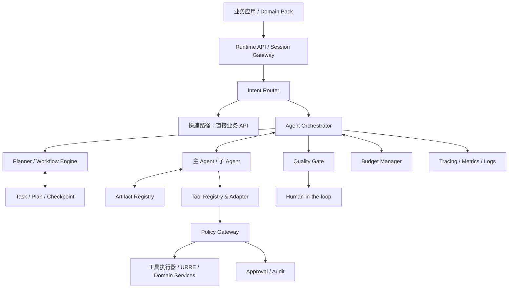
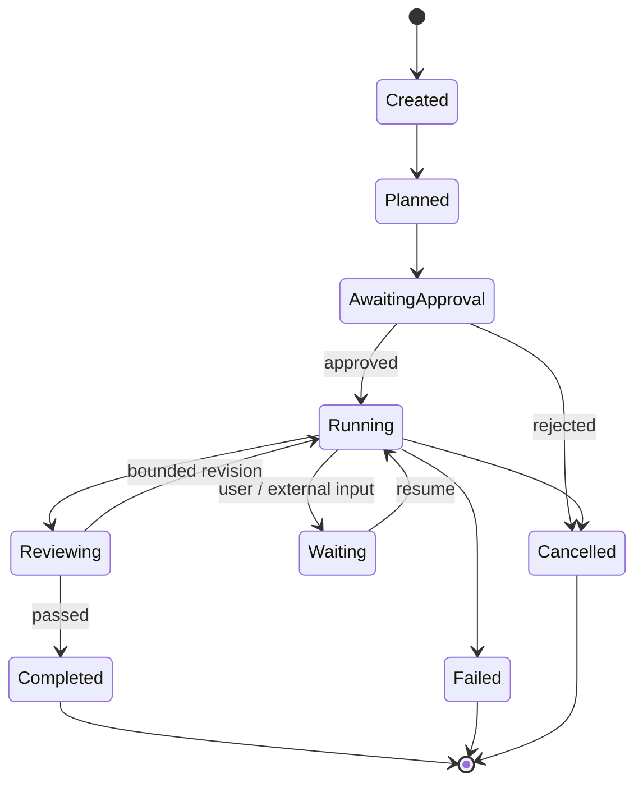
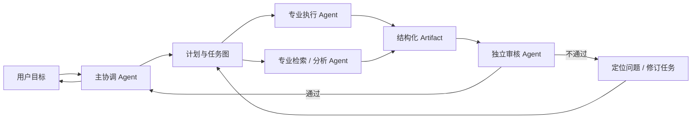
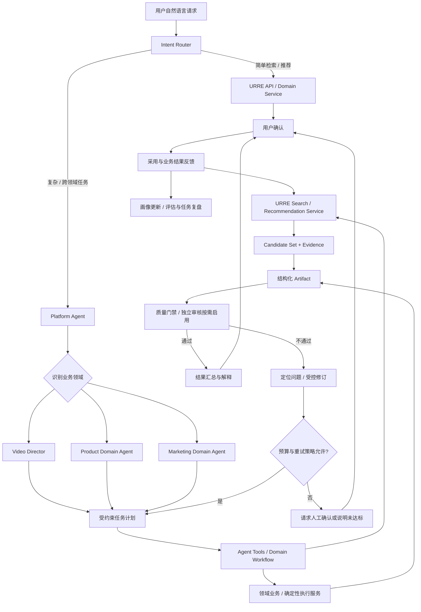

# Agent Runtime 与任务治理架构设计 2.0

**定位：** 面向多领域 Agent 的任务控制、协作编排与安全治理层

**建议技术方向：** AgentScope Java 2.0 + Spring Boot

---

## 1. 设计目标

Agent Runtime 不只是模型调用封装，也不只是一个可以调用工具的 ReAct Loop。它应成为可观察、可恢复、可治理的任务执行控制面。

需要解决：

- 简单请求与复杂任务的执行路径分流。
- 固定工作流和动态规划协同。
- 多 Agent 按需激活与职责隔离。
- Plan、Task、Checkpoint、Artifact 独立管理。
- 工具注册、协议适配、权限、审批、审计。
- 有边界的推理、重试、预算和停止条件。
- 质量评估与人工接管。
- 长任务暂停、恢复、取消和版本化。

## 2. Runtime 总体架构

## 3. 请求路由：不是每个请求都启动 Agent

| 复杂度 | 请求示例 | 默认路径 |
|---|---|---|
| L0 | 搜索、筛选、分页、简单详情 | 直接业务 API |
| L1 | Query 改写、相似解释、简单比较 | 轻量 Agent 或服务组合 |
| L2 | 多轮澄清、跨工具检索、结果综合 | 单主 Agent + 工具 |
| L3 | 多阶段规划、多个专业环节协作 | 主 Agent + 按需子 Agent |
| L4 | 外部副作用、高风险、付费、发布 | 审批工作流 + 强策略控制 |

Router 可依据任务类型、复杂度、风险等级、延迟预算和用户授权决定路径。不能仅以“用户输入很长”判断复杂度。

### 3.1 Platform Agent 与领域 Agent

- **Platform Agent** 是跨领域任务的默认主协调能力，负责目标确认、领域识别、任务路由、工具边界和跨领域 Artifact 交接。
- **Video Director Agent** 是视频领域内的主协调 Agent，负责创作目标、视频计划、领域能力调度和用户确认，不重复承担平台级身份、租户和通用任务治理。
- 单一视频请求可以直接进入 Video Director 或业务 API；只有跨领域、需要长期协调或存在复杂决策时才由 Platform Agent 激活领域 Agent。
- Search Planner 默认是复杂查询中的受约束 Planner，Recommendation Strategy 默认是领域策略，二者都不因为拥有名称中的业务语义就成为自治 Agent。

统一实现形态以 [总纲职责矩阵](00_架构设计总纲.md) 为准。

## 4. Session / Plan / Task / Checkpoint / Artifact

### 4.1 Plan

Plan 是任务执行方案，包含：
- Goal：任务目标。
- Constraints：硬约束与软偏好。
- Steps：步骤、依赖、输入输出。
- Required Tools：允许使用的工具范围。
- Acceptance Criteria：验收条件。
- Risk & Budget：风险级别、成本上限。
- Approval State：待审批、已批准、已冻结、已撤销。
- Version：计划版本。

批准后的 Plan 应冻结其关键约束。Agent 可以提出 Plan Revision，但不得静默修改已经批准的目标、预算、工具范围和外部副作用权限。

### 4.2 Task

Task 是任务运行实例，负责状态与生命周期：

Task 还应记录 owner、tenant、domain、parent_task、current_step、deadline、cancel_reason 和状态版本。

### 4.3 Checkpoint

Checkpoint 保存恢复所需的最小充分状态：
- 当前步骤与已完成步骤。
- 输入 Artifact 的引用和版本。
- 关键变量与外部任务 ID。
- 工具执行状态和幂等键。
- 剩余预算、重试计数和截止时间。
- 需要等待的用户输入或外部事件。

不要把模型完整内部推理链作为恢复状态。应保存可审计的决策摘要、结构化状态和产物引用。

### 4.4 Artifact

Artifact 是可引用、可复用、可版本化的阶段成果，例如：
- Task Brief、Creative Brief、Storyboard。
- Search Request、Candidate Set、Evidence Report。
- Material Assignment、Edit Decision、Timeline。
- Quality Report、Preview、Final Output。

每个 Artifact 应包含类型、Schema 版本、内容引用、父产物、来源任务、创建者、生成工具/模型版本、校验状态和权限范围。

### 4.5 Session

Session 表示一次连续交互及其 Agent 运行上下文，负责对话连续性、用户当前输入、已激活 Agent、短期上下文引用和等待状态。Session 不是项目、任务或业务产物的权威事实源。

Session 至少应记录：
- `session_id`、`tenant_id`、`user_id`、`domain_id`。
- 当前 Agent、活跃 Task、最近 Artifact 引用和待处理用户输入。
- 权限快照或授权引用、上下文版本和创建/最近活动时间。
- 空闲、归档或过期策略，以及恢复时允许读取的 Memory 范围。

| 对象 | 回答的问题 | 权威边界 |
|---|---|---|
| Session | 这次连续交互进行到哪里，下一步等待什么？ | 交互连续性；可过期、可重建 |
| Project | 长期业务对象当前是什么状态？ | 项目级长期事实源 |
| Task | 这次任务执行处于什么状态？ | 任务生命周期与恢复入口 |
| Checkpoint | 中断后从哪里继续？ | 最小充分恢复状态 |
| Artifact | 每个阶段交付了什么？ | 可引用、可版本化的业务成果 |

Session 可以引用 Task、Project、Checkpoint 和 Artifact，但不能用聊天历史替代这些对象。Session 过期不等于 Task 失败或 Project 丢失；恢复 Session 时应从 Task/Project/Artifact 重新装载权威状态，并只恢复授权范围内的 Memory。

## 5. 固定工作流与动态规划

### 5.1 固定工作流

适合高频、确定、可评估的任务。优势是可测试、可预测、可限额。

例：视频素材搜索 → 候选过滤 → 结果展示 → 反馈采集。

### 5.2 模板工作流

步骤基本固定，但允许用户目标、约束、候选数、风格等参数变化。

例：为一个 30 秒广告生成创作简报和分镜。

### 5.3 动态规划

适合非标准复杂任务。必须在执行前进行：
1. 目标和约束提取。
2. 步骤依赖检查。
3. 工具白名单检查。
4. 风险与权限检查。
5. 预算和时间检查。
6. 验收条件检查。
7. 计划批准或自动策略校验。

执行期间只允许受控重规划。新步骤若扩大权限、预算或副作用等级，必须重新走策略审批。

## 6. 多 Agent 协作

### 6.1 角色设计原则

- 一个明确的主协调 Agent 负责目标与任务状态。
- 子 Agent 围绕独立专业产物工作。
- 规划、执行、审核尽量分离。
- 子 Agent 之间通过 Artifact 契约交接，不依赖互相读取全部聊天记录。
- 多 Agent 不意味着每个步骤都并行；依赖明确时串行更稳。

### 6.2 推荐协作模式

审核 Agent 应拿到验收标准、输入产物和必要证据，不应只看到执行 Agent 自己写的“完成说明”。

### 6.3 通用端到端执行流程

下图描述跨领域请求从入口路由到任务交付和反馈回流的完整控制流。简单请求走快速路径，只有复杂或跨领域请求才由 Platform Agent 接管；检索推荐默认由 URRE Service 执行，质量审核是否启用独立 Agent 由 Domain Pack 和任务风险决定。

流程约束：

- 普通 Search、Similar 和 Recommendation 不启动 Platform Agent 或领域 Agent。
- 单一领域复杂任务可以直接进入领域 Agent；只有跨领域、长期协调或复杂决策才由 Platform Agent 路由。
- Retrieval 和 Recommendation 默认是 Tool + URRE Service，不因流程图中的“任务环节”而变成自治 Agent。
- 质量门禁必须依据原始要求、Artifact 和证据审核；仅在需要专业判断或责任隔离时启用独立审核 Agent。
- 修订必须回到受约束计划或明确的问题阶段，并受预算、重试次数和停机条件限制。“最多两次”是可以由 Domain Pack 配置的策略模板，不是平台全局常量。
- 用户确认和实际采用事件必须回流 URRE、评估与任务复盘，不能只记录为聊天反馈。

## 7. 工具系统：注册适配层 + 策略治理层

### 7.1 注册与协议适配层

职责：
- 工具发现与注册。
- 参数 Schema 和版本管理。
- 协议适配（内部 API、MCP 等）。
- 输入校验、输出归一。
- 超时、重试、幂等与错误分类。
- 工具能力描述与可见范围。

### 7.2 Policy Gateway

职责：
- 身份与租户鉴权。
- 项目/资源级权限。
- 工具白名单与参数范围。
- 数据脱敏与输出过滤。
- 人工审批与双人复核（按风险）。
- 沙箱、网络出口与文件系统限制。
- 速率、并发、成本与调用配额。
- 审计记录与异常告警。

MCP 仅解决工具连接和调用协议的一部分问题，不应被当成完整的安全治理层。

### 7.3 副作用等级

| 等级 | 例子 | 执行规则 |
|---|---|---|
| L0 只读 | 搜索、读取、查询 | 授权范围内自动执行 |
| L1 分析 | 评分、摘要、生成草稿 | 自动执行并记录 |
| L2 预览 | 低成本试生成、预览渲染 | 预算范围内执行 |
| L3 修改 | 修改项目、覆盖文件、批量变更 | 明确确认或策略审批 |
| L4 外部副作用 | 发布、投放、删除、付费生成、提交订单 | 强审批和明确授权 |

审批必须绑定具体参数和对象范围，不能只审批一句宽泛的“允许 Agent 操作”。

## 8. 推理预算与反事实检查

目标不是让模型思考得越久越好，而是让它在有效推理窗口内完成必要判断。

### 8.1 适合引入反事实检查的节点

- 计划执行前：如果关键假设不成立，计划是否仍然有效？
- 候选选择前：如果去掉最高分证据，结论是否仍成立？
- 素材分配前：如果替换当前素材，是否更符合分镜目标？
- 质量验收前：如果用户最重要的硬约束被违反，当前高分是否仍应通过？
- 重试前：本轮失败是否有可改变的原因，还是只会重复相同动作？

### 8.2 推理预算

每个任务设置：
- 最大规划轮数。
- 最大工具调用数。
- 最大子 Agent 数量。
- 最大重试次数。
- 最大 Token / 模型成本。
- 最大外部服务成本。
- 超时与停机条件。

当新一轮推理无法带来新的证据、策略变化或可执行动作时，应停止并向用户说明不确定性或请求人工决策。

## 9. 质量门禁与独立审核

质量门禁分为：
1. Schema Gate：结构与字段完整性。
2. Contract Gate：用户明确要求是否满足。
3. Evidence Gate：关键结论是否有证据。
4. Technical Gate：技术产物是否可用。
5. Policy Gate：权限、版权、合规是否通过。
6. Human Gate：高影响决策是否需要用户确认。

质量阈值、重试次数和人工兜底应按 Domain Pack 与任务类型配置。视频任务可采用“80 分阈值、最多两次修订、保留最佳版本”的策略模板，但这不是平台硬编码常量。

## 10. 成本与资源治理

Budget Manager 为任务预留和记录：
- LLM Token 与模型调用。
- Embedding / Reranker。
- 外部搜索 API。
- 文件下载与存储。
- 视频理解、生成和渲染。
- 子 Agent 与并行任务成本。

支持预算预估、调用账本、动态限额、熔断、停机和成本归因。任务中途预算耗尽时应进入 Waiting/Paused，而不是无限继续。

## 11. 可观测性与审计

每个任务可追踪：
- 用户请求与确认约束。
- Plan 版本与修改记录。
- Task 状态迁移。
- Agent 激活与子任务关系。
- Tool 调用、参数摘要、结果引用、耗时和错误。
- Artifact 版本链。
- 审批记录。
- 质量分项与失败原因。
- 成本账本。

日志不应无差别记录敏感提示词、凭证或原始隐私数据；审计信息要满足最小必要原则。

## 12. 与 AgentScope Java 2.0 的映射原则

> **实施原则：** AgentScope 提供运行框架，平台只实现业务治理，不在第一阶段复制框架能力。

当前技术方向采用 AgentScope Java 2.0 + Spring Boot，但要区分框架提供的 Agent/消息/工具能力与平台必须自建的业务治理能力。

| AgentScope 能力 | 原始用途 | 平台侧对应 | 平台仍需负责的治理职责 |
|---|---|---|---|
| ReActAgent | 单 Agent 推理和工具调用 | Agent 执行与 Runtime 调度 | 生命周期、任务归属、租户隔离 |
| Harness | 为复杂任务提供执行环境和工程能力 | Agent Runtime 作为任务执行控制面 | 意图路由、计划与工作流编排、预算、质量门禁和恢复治理 |
| Middleware | 推理、工具执行、权限和上下文拦截 | 统一策略、观测和业务拦截中间件 | 身份与租户隔离、数据范围、上下文装载、审计和异常处理 |
| Toolkit | 封装检索、推荐及领域业务工具 | 工具注册适配层和领域 Tool | 注册、协议适配、权限、审批、审计、配额和降级 |
| Workspace | Agent 工作空间、配置和资源 | Agent 运行空间，以及项目、任务和资源的隔离引用 | 工作目录与资源生命周期、租户和项目权限、持久化、清理及版本约束 |
| Memory | 会话记忆和长期记忆 | 分层记忆能力 | 会话、任务、项目和用户偏好分层，以及过期、恢复和 Memory 隔离 |
| SubAgent | 将复杂任务委派给专业 Agent | 主 Agent 与按需子 Agent 协作 | 角色策略、Artifact 契约、并发与调度边界、预算控制 |
| Permission | 工具调用授权和人工审批 | 工具调用授权与人工审批能力 | 身份鉴权、资源级权限、参数范围、副作用分级、审批记录和审计 |
| Event System | 前端实时展示推理和执行进度 | 任务事件流与工作台实时进度展示 | 事件规范和持久化、重放与审计；前端只展示阶段、Tool 摘要和 Artifact 等可审计进度，不暴露内部推理链 |
| StateStore | 会话状态持久化和恢复 | Session 短期状态持久化适配 | Session 生命周期，以及 Task/Checkpoint 业务状态机、恢复和一致性 |
| Session | 会话机制 | 交互连续性与 Agent 运行上下文 | Session 过期、恢复、业务对象引用和 Memory 隔离 |

具体 API、模块名和版本需在研发启动时核对官方文档和实际依赖，不以架构文档中的概念映射代替技术验证。

## 13. Runtime 验收标准

- 简单 Search / Recommend 不必经过 Agent。
- 复杂任务可生成可检查的 Plan。
- Plan、Task、Checkpoint、Artifact 独立存取与关联。
- 长任务可暂停、恢复、取消。
- 动态计划执行前经过策略和预算校验。
- 工具调用经过统一注册适配和 Policy Gateway。
- 高风险操作具有明确审批记录。
- 重试有上限且保留最佳产物。
- 质量审核与执行角色有必要隔离。
- 每次执行可追踪到模型、工具、策略、产物和成本。
