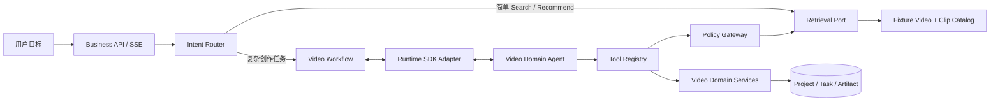
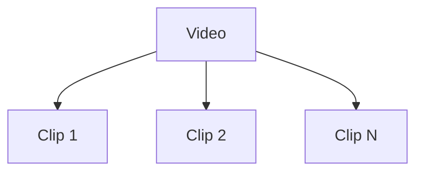
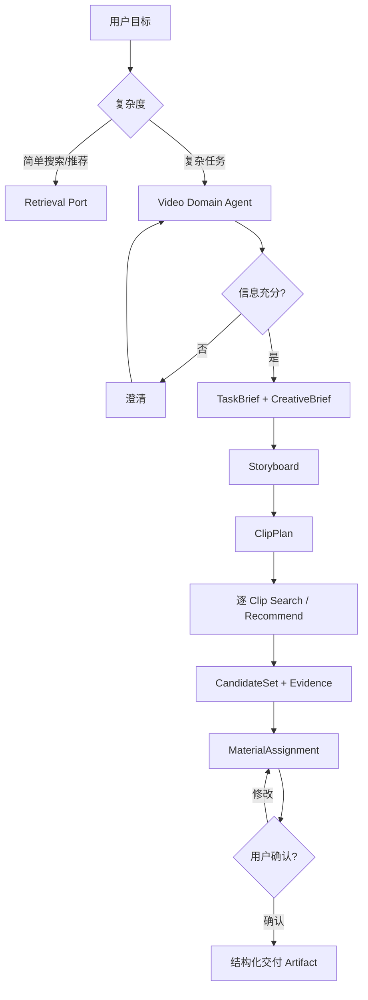

# Video Domain 架构设计 2.2

**定位：** 通用 Video Domain Agent 的领域架构基线。

**范围：** Video 与 Clip 的发现、推荐、规划、素材分配和用户确认。

**交付约束：** 只交付 Agent 及其领域契约；检索推荐使用 Mock，真实数据加工、索引、视频生成和媒体渲染不进入本次交付。范围以 [交付范围与 Video/Clip 模型基线](implementation/00_交付范围与VideoClip模型.md)为准。

## 1. 设计目标

Video Domain Agent 负责：

- 理解用户要找 Video、找 Clip、替换 Clip 或组织一组 Clip 的目标。
- 判断请求应由快速检索路径还是 Agent Workflow 处理。
- 通过受控 Tool 调用 Search、Recommendation、Similar 和素材分配能力。
- 生成结构化 Creative Brief、Storyboard、ClipPlan 和 MaterialAssignment。
- 在信息不足、候选不足、权利受阻或预算耗尽时澄清、降级或停止。
- 保持任务、Artifact、Tool 调用和 Runtime Run 的可恢复、可审计关系。

Video Domain Agent 不负责：

- 真实视频入库、语义切片、ASR、OCR 或向量化。
- 搜索索引、推荐训练、排序模型和线上实验。
- 视频生成、字幕、擦除、换画幅、配音、渲染和导出。
- 视频版权、许可、商业用途、地域可用性和署名过滤。
- 产品前端、商品、广告、投放和跨领域流程。

## 2. 系统边界

边界规则：

- 简单 Search 和 Recommendation 直接调用 Port，不启动 Agent。
- Agent 不直接读取 Fixture、数据库或底层索引。
- Mock Adapter 与未来真实 Adapter 使用相同接口和 Schema。
- Agent 的创作结果是结构化 Artifact，不是自然语言计划。
- 项目状态保存在业务数据库，聊天记录不是事实源。
- Runtime Run 只投影到 Task/Step，不成为业务状态机。

## 3. Video 与 Clip 对象

### 3.1 Video

Video 是一级视频资产，可表示完整成片、上传视频、外部视频或生成视频。

最少字段：

- `video_id`
- `title`
- `source_type`
- `duration_ms`
- `width`
- `height`
- `fps`
- `preview_ref`
- `availability`
- `tags`
- `feature_version`

### 3.2 Clip

Clip 是 Video 内可独立发现、推荐、引用和分配的连续时间片段。PRD 中的“片段”和“切片”统一由 Clip 表示。

最少字段：

- `clip_id`
- `video_id`
- `start_ms`
- `end_ms`
- `duration_ms`
- `preview_ref`
- `keyframe_ref`
- `semantic_summary`
- `tags`
- `quality_flags`
- `availability`
- `feature_version`
- `model_versions`

不变量：

- `start_ms < end_ms`。
- Clip 时间区间必须位于父 Video 的时长范围内。
- Clip 必须可回溯父 Video。
- 搜索结果中的 Clip 必须带时间区间和证据引用。
- Clip 可跨语义切点，不要求对应内部剪辑切点。

### 3.3 计划侧对象

素材侧只有 Video 和 Clip；计划侧使用名称明确的 Artifact：

- `Storyboard`：叙事结构。
- `ClipPlan`：本次创作的可执行 Clip 需求集合。
- `ClipRequirement`：ClipPlan 内的一条需求。
- `MaterialAssignment`：将候选 Video/Clip 绑定到计划 Clip。

计划侧 `storyboard_clip_id` 与素材侧 `clip_id` 必须使用不同 ID 命名空间或明确字段名，避免混淆。

## 4. 领域能力

### 4.1 Search

以明确 Query 或约束发现 Video/Clip。

输出至少包含：

- `entity_type: video | clip`
- `video_id`
- `clip_id`（Clip 候选必填）
- `start_ms` / `end_ms`（Clip 候选必填）
- 分数与召回通道
- 证据摘要和证据引用
- 可用性和版本

### 4.2 Similar

以已有 Video/Clip 为种子发现相似对象。Similar 只返回受控候选，不隐式写入项目。

### 4.3 Recommendation

以用户、项目、当前 Storyboard、ClipRequirement 和已选素材为上下文主动提供候选。

推荐场景至少包括：

- `project_home`
- `clip_candidate`
- `search_complement`
- `similar_alternative`
- `continue_exploration`

### 4.4 Clip Curation

比较候选、解释匹配、生成首选与替代，并接受用户锁定或替换。

### 4.5 Feedback

记录曝光、打开、预览、拒绝、分配、替换和最终保留。Mock 阶段也必须产生可归因事件。

## 5. Agent 与确定性服务职责

| 能力 | 默认实现 | 职责 |
|---|---|---|
| Video Domain Agent | 托管 Agent | 意图、澄清、创作判断和有限工具循环 |
| Intent Router | 规则 + 可选小模型 | 简单请求直达 Port，复杂请求进入 Workflow |
| Search Plan | Schema 约束的 Tool 输入 | 生成受控检索条件 |
| Search/Recommend/Similar | Mock Service | 返回稳定 CandidateSet |
| Composition | 确定性 Service + 有界模型复核 | 生成 MaterialAssignment |
| Artifact Registry | 业务 Service | 版本、状态和 lineage |
| Policy Gateway | 业务 Service | 身份权限、项目范围、预算和 Tool 白名单 |

Agent 不遍历全量候选，不修改候选分数，不直接写项目数据库，也不把内部推理写入 Artifact。

## 6. Creative IR

### 6.1 TaskBrief

用户目标、受众、平台、目标时长、画幅、语言、硬约束、软偏好和验收标准。

### 6.2 CreativeBrief

主题、叙事方向、情绪、风格、节奏和创作约束。

### 6.3 Storyboard

场景和叙事结构。场景下使用 `clip_requirements`，每条需求表达叙事角色与视觉目标。

### 6.4 ClipPlan

由 Storyboard 派生的可执行需求集合，每条 ClipRequirement 包含：

- `storyboard_clip_id`
- `narrative_role`
- `visual_goal`
- `duration_target_ms`
- `hard_constraints`
- `soft_preferences`
- `fallback_requirements`
- `evidence_requirements`

### 6.5 MaterialAssignment

将候选绑定到 `clip_plan_id + storyboard_clip_id`，并保存：

- `entity_ref`
- `match_evidence`
- `alternatives`
- `selection_reason`
- `user_confirmed`

## 7. 端到端流程

异常路径：

- 零结果：放宽软条件、调整 Query、请求用户确认，最多执行一次自动 fallback。
- Tool 超时：标记覆盖不足，按策略重试或降级。
- 预算耗尽：进入 `Waiting(budget_exhausted)`。
- 信息矛盾：进入 `Waiting(awaiting_user)`。
- 模型输出非法：拒绝 Tool 调用或 Artifact 写入，重新修正一次。

## 8. Mock 架构

本次交付使用：

- `FakeVideoCatalog`
- `FakeRetrievalGateway`
- `FakeRecommendationGateway`
- `FakeEvidenceResolver`

要求：

- 数据固定、可重复、版本化。
- 支持成功、零结果、超时、非法参数和重复候选。
- 所有 Mock 结果满足与生产 API 相同的 JSON Schema。
- 业务代码只依赖 Port，不判断当前是否使用 Mock。
- Mock 数据与评测数据分离：固定 Fixture 保证集成测试稳定，评测集允许独立版本。

## 9. 权限与安全

- `tenant_id`、用户和项目范围由服务端可信上下文注入。
- Agent 不能覆盖身份、项目范围和 Tool 白名单。
- 视频标题、Clip 摘要和外部证据均视为不可信数据。
- 工具参数必须经过 Schema 校验。
- 每次 Tool 调用记录 `tool_call_id`、输入 hash、结果引用和错误码。

## 10. 持久化与恢复

- Project、Task、Plan、Step、Checkpoint 和 Artifact 保存在业务数据库。
- 大 CandidateSet 和 Artifact 内容可以进入对象存储，数据库保存引用和 hash。
- Runtime 保存 `agent_id`、`spec_version`、`session_id`、`runtime_run_id`、Action 和 SSE 位点。
- 恢复顺序：读取 Task/Checkpoint → 校验输入 Artifact → 回读原 Run → 处理开放 Action → attach 或继续 Workflow。
- 重复请求不得生成重复 CandidateSet、Assignment、Run 或反馈。

## 11. 验收标准

1. 所有视频领域 Schema 只使用 Video 和 Clip。
2. 搜索可返回 Video 或 Clip，Clip 带精确时间区间和证据。
3. 简单 Search/Recommendation 不启动 Agent。
4. 复杂任务能生成 Storyboard、ClipPlan 和 MaterialAssignment。
5. 每个 ClipRequirement 至少有 Search 或 Recommendation 候选路径。
6. 用户只修改一个 Clip 时，不重建无关 Artifact。
7. Mock Adapter 支持成功、零结果、超时和非法参数。
8. Runtime Run、Action、Tool 和 Artifact 可完整追溯。
9. Task 等待、恢复、取消和预算耗尽行为符合状态机。
10. 不依赖真实索引、媒体渲染或前端即可完成端到端验收。
