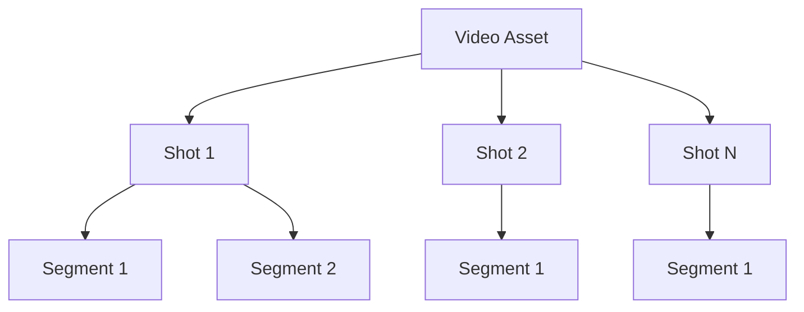
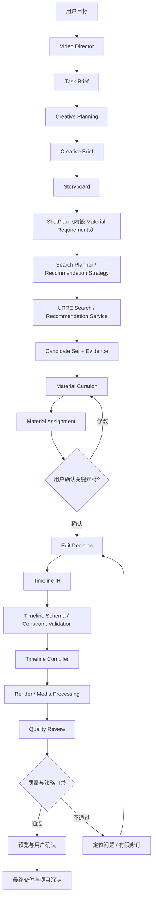
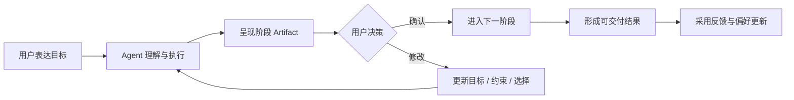

# Video Domain Pack 与视频创作执行架构设计 2.0

**定位：** URRE + Agent Runtime 之上的视频领域能力包与创作执行系统

**范围：** 视频素材检索、镜头证据检索、任务推荐、创作规划、素材分配、混剪与成片交付

---

## 1. 目标与边界

视频领域系统将自然语言创作目标转化为结构化创作计划，并通过 URRE 发现大规模候选素材，最终形成可编辑、可预览、可交付的视频作品。

三类系统分工：

- **Agent Runtime：** 理解目标、规划、协调、调用工具、管理任务和质量门禁。
- **URRE：** 对 Video / Shot / Segment 进行规模化召回、过滤、排序和推荐。
- **Deterministic Media Services：** 执行转码、裁切、字幕、音频、时间线编译、渲染和技术检测。

LLM 不应直接生成底层媒体操作指令并无校验执行。它输出结构化中间表示，再由确定性编译与执行服务处理。

## 2. Video Domain Pack 组成

| 组成 | 内容 |
|---|---|
| Domain Schema | Video、Shot、Segment、Creator、Project、License 等对象 |
| Domain Ontology | 场景、主体、动作、镜头语言、风格、情绪、拍摄手法 |
| Feature Definitions | 视觉、语义、技术、质量、版权、时序和使用特征 |
| Recall Strategies | 文本、视觉、属性、时间片段、相似、上下文召回 |
| Ranking Strategies | 查询相关性、分镜适配、素材质量、多样性、创作价值 |
| Business Rules | 可用性、版权、分辨率、时长、比例、内容限制 |
| Agent Tools | 搜索、推荐、镜头证据查询、素材比较、项目操作 |
| Agent Skills | 素材搜索、分镜规划、镜头补齐、素材整理、混剪 |
| Evaluation | 检索相关性、镜头证据、创作适配、成片质量 |
| Rights & Provenance | 来源、授权、许可范围、署名、使用限制 |

## 3. 视频对象模型：Video / Shot / Segment

### 3.1 Video

完整视频资产，承载：
- 全局标题、描述、来源、作者、许可。
- 时长、分辨率、帧率、编码、音轨。
- 全局主题、场景摘要、主体与风格标签。
- 视频级向量和内容摘要。

### 3.2 Shot

镜头级语义对象，承载：
- 起止时间、镜头时长。
- 场景、主体、动作、构图、景别、运镜。
- 镜头稳定性、清晰度、曝光、色彩等质量特征。
- 镜头级语义向量、关键帧和证据引用。

### 3.3 Segment

镜头内部或跨镜头的可定位片段，承载：
- 精确时间区间。
- 可用剪辑入点/出点。
- 动作发生区间、主体出现区间。
- 片段级预览、关键帧、音频事件。
- 片段适用性与技术限制。

Video、Shot、Segment 共享资产身份和来源链路，但不能把三种粒度压成同一对象。搜索结果应说明命中的粒度和时间区间。

## 4. 视频领域能力分类

### 4.1 素材发现

面向明确素材需求，支持：
- 自然语言文本检索。
- 参考图片/视频检索。
- 场景、主体、动作、构图、风格、景别、运镜筛选。
- 时长、比例、分辨率、帧率等技术过滤。
- 本地素材库与互联网来源检索的统一结果组织（权限与来源分别标记）。

### 4.2 镜头证据检索

回答“目标内容在视频的哪一段出现”。结果必须包含：
- video_id / shot_id / segment_id。
- start_ms / end_ms。
- 关键帧或预览证据。
- 命中主体、动作、场景等要求。
- 证据置信度和来源状态。

镜头证据检索不是普通视频摘要。摘要说明视频大致讲什么，证据检索必须支持精确定位。

### 4.3 元素与知识推荐

围绕视频内容中的元素提供关联发现：
- 主体、物体、地点、动作。
- 视觉风格、色调、构图、镜头语言。
- 主题知识、相关场景和补充素材。
- 同一主题的不同表达方式。

### 4.4 创作侧资料召回

以 Creative Brief、Storyboard、当前镜头目标和项目状态为输入，召回：
- 对应素材。
- 可替代镜头。
- 叙事衔接镜头。
- 风格参考和补充元素。
- 当前作品缺失的镜头类型。

### 4.5 创作型推荐

从整体作品而非单条素材角度推荐：
- 当前分镜缺口。
- 镜头组合建议。
- 画面节奏与场景多样性补充。
- 可替代素材与备选方案。
- 主题、色彩和风格一致性建议。

这些是视频 Domain Pack 的领域能力；底层仍通过 URRE 的 Search、Recommendation、Similarity、Explore 完成候选发现和排序。

Recommendation Strategy 负责选择推荐场景、目标、约束和策略版本，URRE Recommendation Service 负责实际召回、排序和重排。Strategy 不直接遍历候选，也不默认启动自治 Agent。

## 5. 视频领域角色与默认实现形态

| 能力 / 角色 | 默认实现形态 | 职责 | 主要产物或下游 |
|---|---|---|---|
| Video Director Agent | Agent | 视频域主协调、目标理解、计划、领域能力调度和用户确认 | Task Brief、Plan |
| Creation Agent / Creation Workflow | Workflow 为主；Creation Agent 在创作方向和叙事取舍处启用 | 形成创作方向、叙事、分镜和素材组合决策 | Creative Brief、Storyboard、Material Assignment |
| Search Planner | 轻量 Planner / Workflow Node | 仅在复杂 Query 中澄清目标、拆分子查询并生成受约束的 SearchPlan | SearchPlan |
| Search Service | URRE Service | 执行 Search、Similar、Explore，完成召回、过滤、排序和证据组装 | Candidate Set、Exploration Set |
| Recommendation Strategy | Domain Strategy | 确定推荐场景、目标、约束、策略 ID 和评估口径 | RecommendationStrategy |
| Recommendation Service | URRE Service | 执行上下文推荐、多路召回、排序和重排 | Recommendation Set |
| Material Curation | Creation Workflow 的有界阶段；高复杂度时启用专业 Agent | 比较候选、处理替代关系和完成素材分配 | Material Assignment |
| Editing Workflow / Editing Agent | Workflow 为主；Editing Agent 处理剪辑意图和复杂冲突 | 组织剪辑意图、Edit Decision 和 Timeline IR | Edit Decision、Timeline IR |
| Quality Review Agent | 独立审核 Agent + Workflow Gate | 依据原始要求、Artifact 和证据独立审核，定位问题并提出有限修订 | Quality Report |

这些名称表示职责边界，不表示每个能力都要启动常驻自治 Agent。完整判定见 [Agent / Tool / Service / Workflow 职责矩阵](00_架构设计总纲.md)。

- 简单素材搜索直接调用 Search API，不经过 Search Planner 或 Video Director。
- 复杂搜索由 Search Planner 生成并校验 SearchPlan，再由 URRE Search Service 执行。
- 项目推荐由 Recommendation Strategy 选择目标和约束，再由 URRE Recommendation Service 执行。
- Creation Agent 负责真正的创作规划和取舍，不应代替 Search Service 遍历候选，也不直接执行媒体操作。
- Editing Workflow 负责剪辑阶段编排；时间线校验、编译和媒体渲染由确定性 Service 完成。
- Quality Review Agent 保持执行与审核隔离，不能由执行阶段自行宣告通过。

## 6. 创作中间表示（Creative IR）

创作流程必须通过结构化产物衔接，而不是仅靠 Agent 对话记忆。

关系约定：**Storyboard** 是叙事分镜，属于 Creative IR 的一等产物。**ShotPlan** 是由某个 Storyboard 镜头派生的可执行镜头计划，也是一等 Artifact，必须引用 `storyboard_shot_id`。**Material Requirements** 不是顶层 API 资源，而是 ShotPlan（或对应 Storyboard 镜头）内嵌的取材约束。**Material Assignment** 把候选绑定到 ShotPlan。字段级契约以对齐后的 `implementation/01` 为准，并须能映射到本节概念，不得再并列维护第二套定义。

### 6.1 Task Brief

目标、受众、平台、时长、画幅、语言、交付形式、硬约束、软偏好和验收标准。

### 6.2 Creative Brief

主题、叙事方向、情绪、视觉风格、节奏、传播目标、品牌约束。

### 6.3 Storyboard

每个镜头至少包含：
- shot_intent：该镜头承担的叙事作用。
- visual_goal：希望看到的画面。
- subject / action / scene。
- shot_type / camera_motion / composition。
- duration_target。
- transition_intent。
- required / preferred constraints。

### 6.4 ShotPlan

ShotPlan 从某个 Storyboard 镜头派生，是可执行的一等 Artifact。每个 ShotPlan 必须引用 `storyboard_shot_id`，并内嵌该镜头的 Material Requirements。实施侧通过 ShotPlan API 创建与更新，不为 Material Requirements 单列顶层资源。

### 6.5 Material Requirements

Material Requirements 把分镜目标转成 URRE 可执行的检索条件，作为 ShotPlan（或对应 Storyboard 镜头）的内嵌约束，而不是独立的顶层 API 资源。它区分：
- 必须满足（hard constraints）。
- 优先满足（soft preferences）。
- 可替代条件（fallback constraints）。
- 证据要求（必须返回时间区间/关键帧等）。

### 6.6 Material Assignment

将候选素材绑定到 ShotPlan，而不是只挂到抽象分镜。概念上应能说明：分配对象是哪一个 `shot_plan_id`、对应哪个 `storyboard_shot_id`、选中了哪条实体引用。本节保留概念名称，便于对照历史表述；字段级最小集以 `implementation/01` §5.2 为准，与本节旧称的对照为：

| `03` §6.5 旧称 | 实施字段 |
|---|---|
| `storyboard_shot_id` | `storyboard_shot_id`（必填） |
| （实施补齐） | `shot_plan_id`（必填） |
| `selected_asset` / `selected_segment`、`selected_time_range` | `entity_ref`（含 `entity_type`、id、`selected_time_range`） |
| `match_evidence` | `match_evidence` |
| `alternatives` | `alternatives` |
| `selection_reason` | `selection_reason` |
| `user_confirmed` | `user_confirmed`（若出现 `locked_by_user`，与此同义，以 `user_confirmed` 为准） |
| `rights_status` | `rights_status` |

`scores`、`status` 可作为实施扩展保留。

### 6.7 Edit Decision

表达剪辑意图，而不是直接操纵媒体文件：
- 镜头顺序。
- 入点/出点。
- 目标时长。
- 转场意图。
- 字幕、音乐、音效、旁白位置。
- 画面比例与安全区。
- 约束与版本。

### 6.8 Timeline IR

Timeline IR 是确定性媒体执行的输入，包含轨道、片段、时间位置、源媒体区间、转场、音频、字幕、效果参数和依赖关系。必须有 Schema 版本与校验器。

## 7. 创作任务端到端流程

## 8. Timeline Compiler 与确定性执行

职责边界：
- Agent 产出 Edit Decision 和 Timeline IR。
- Timeline Validator 检查结构、时间、媒体引用、轨道冲突和约束。
- Timeline Compiler 将 IR 转换成执行计划。
- Media Executor 执行转码、剪切、拼接、转场、音频、字幕和渲染。
- Media Inspector 检查输出文件技术质量。

Agent 不应直接拼接命令行字符串执行任意 FFmpeg 参数。执行参数应由受控 Schema 和编译器生成。

## 9. 质量体系

### 9.1 五类质量门禁

| 维度 | 核心问题 | 典型检查 |
|---|---|---|
| 技术质量 | 文件能否正常播放和编辑？ | 解码、帧率、分辨率、音轨、时长 |
| 任务合同 | 是否满足用户明确要求？ | 主题、时长、比例、语言、禁用项 |
| 检索证据 | 素材是否真的包含目标内容？ | 主体、动作、场景、时间区间 |
| 语义与审美 | 作品是否连贯、有表现力？ | 叙事、节奏、风格、情绪、连续性 |
| Rights / Provenance | 素材是否可合法按当前用途使用？ | 来源、许可、授权范围、署名要求 |

Rights 硬约束失败必须阻断交付，不能用其他维度高分抵消。

### 9.2 独立审核

执行 Agent 产出，审核 Agent 依据：
- 原始 Task Brief。
- 已冻结的验收标准。
- Storyboard 与 Material Assignment。
- 关键镜头证据。
- Timeline 与渲染结果。
- Rights / Provenance 结果。

审核不能只依赖执行 Agent 的自述。必要时由确定性检测服务提供事实证据。

### 9.3 迭代策略

建议提供策略模板：
- 质量阈值：例如 80/100。
- 最大修订轮次：例如 2 次。
- 保留最佳版本：每轮保留可回滚 Artifact。
- 问题定位：只重做受影响阶段，不无条件从头执行。
- 人工兜底：冲突、低置信度、高成本或高风险时交给用户。

具体阈值按任务类型配置，不设为平台全局常量。

## 10. Rights / Provenance 与互联网素材

每个外部素材至少记录：
- 原始来源与抓取时间。
- 资产归属或发布主体（如可确认）。
- 许可类型与授权范围。
- 是否允许商业使用、改编、再分发。
- 是否要求署名。
- 授权证据或来源页面引用。
- 审核状态与到期时间。

“能访问或能下载”不代表“有权用于商业作品”。Rights 状态不明时应标记为待核验，并限制自动交付或发布。

## 11. 推荐如何理解当前创作上下文

推荐输入至少应考虑：
- 用户长期偏好。
- 当前项目主题与受众。
- 当前分镜与镜头目标。
- 已选素材集合。
- 当前时间线覆盖情况。
- 已过量出现的场景/构图/主体。
- 仍然缺失的叙事节点。
- 风格、色调、节奏和技术约束。

推荐系统要回答：“哪条素材能帮助这个作品完成下一步？”而不只是“用户可能喜欢什么？”

## 12. 项目状态与 Artifact 版本

视频创作是长任务，应将 Project Context 与单轮 Session 分离。项目持久保存：
- 当前 Brief / Storyboard 版本。
- 已选素材和替代素材。
- Material Assignment。
- Edit Decision / Timeline 版本。
- 预览与最终渲染版本。
- 用户修改意见和确认记录。
- Rights 与质量报告。

Artifact 之间建立父子 lineage。用户修改某个镜头时，只使依赖它的后续产物失效，不必重建无关步骤。

## 13. 视频领域反馈闭环

强反馈不仅是点击和下载，还包括：
- 加入项目。
- 分配到具体分镜。
- 进入时间线。
- 在成片中保留。
- 被用户替换或删除。
- 用户修改入点/出点。
- 最终项目完成与交付。

这些事件可用于优化 URRE 推荐，也可用于学习创作任务中哪些素材真正有帮助。

## 14. 用户工作台与交互闭环

视频工作台应把对话、素材发现、创作和交付放在同一个连续工作空间中：

- **对话区：** 描述需求、追问、调整和确认。
- **任务区：** 展示目标、当前阶段、执行进度和待处理事项。
- **素材区：** 展示检索结果、主动推荐、候选比较和已选素材。
- **创作区：** 展示 Creative Brief、Storyboard、ShotPlan（内嵌 Material Requirements）、Material Assignment 和 Timeline。
- **预览区：** 展示阶段视频、最终视频、质量问题和 Rights 状态。

用户不需要参与每个内部步骤，但以下高影响节点应保留明确控制权：

- 创作目标和关键约束确认。
- 关键分镜与叙事方向确认。
- 重要素材的选择或替换。
- 时间线和剪辑方向确认。
- 成片交付前确认。
- 涉及版权、合规或外部发布的操作授权。

工作台状态以 Task/Project/Artifact 为事实源，不依赖聊天记录。实时进度只展示阶段、Tool 摘要、Artifact 和待确认事项，不暴露内部推理链。

## 15. 视频 Domain Pack 验收标准

1. Video / Shot / Segment 三层对象可独立检索并关联来源。
2. 检索能返回具体镜头/片段时间证据。
3. Search 与任务上下文 Recommendation 独立运行。
4. 推荐可感知当前 Storyboard、素材缺口和已选素材。
5. 创作产物以 Creative IR 结构化保存并版本化。
6. Timeline IR 经校验与编译后才进入媒体执行。
7. 技术质量、任务合同、检索证据、审美质量和 Rights 分开验收。
8. 独立审核、有限修订和人工兜底可配置。
9. 项目可暂停、恢复、回滚和继续编辑。
10. 最终采用与实际使用反馈能回流 URRE 与 Agent 评估。
11. 工作台能连续呈现对话、任务、素材、创作和预览，并在高影响节点请求确认。
12. Search Planner、Recommendation Strategy、Creation 和 Editing 的实现形态符合统一职责矩阵，不存在默认重复启动的自治 Agent。
