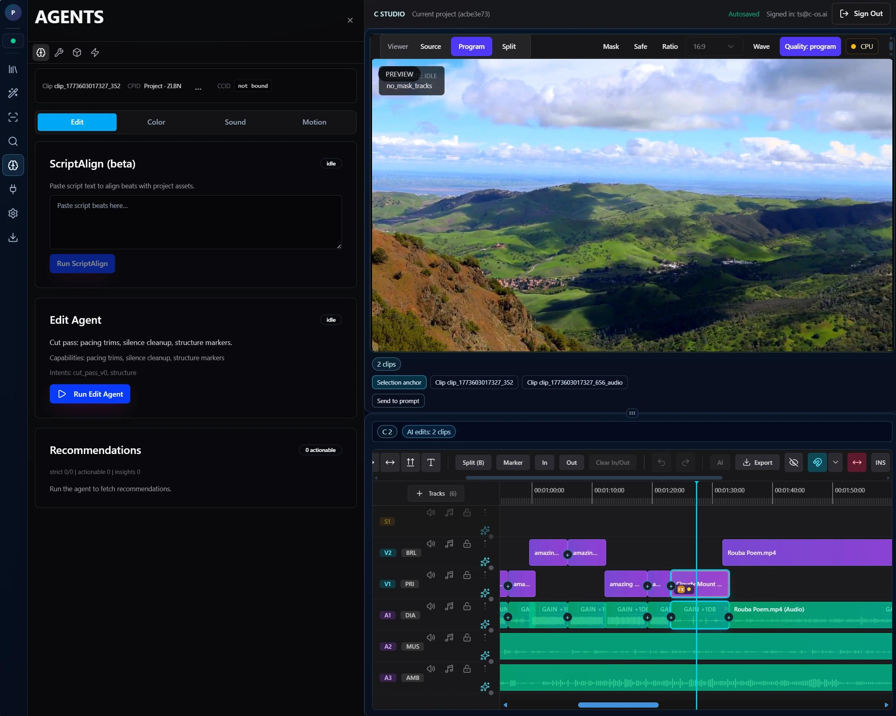
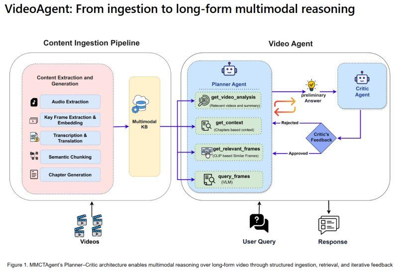
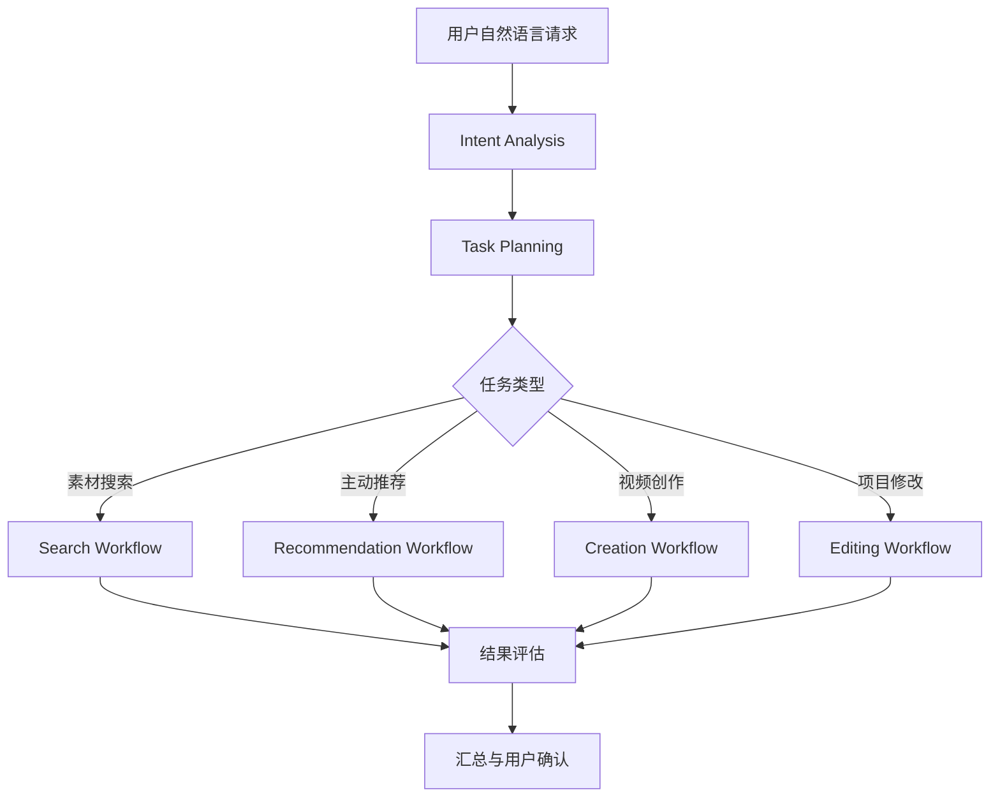
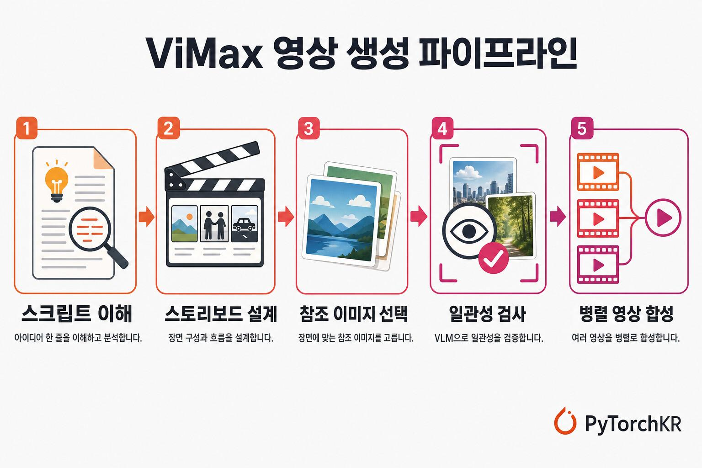
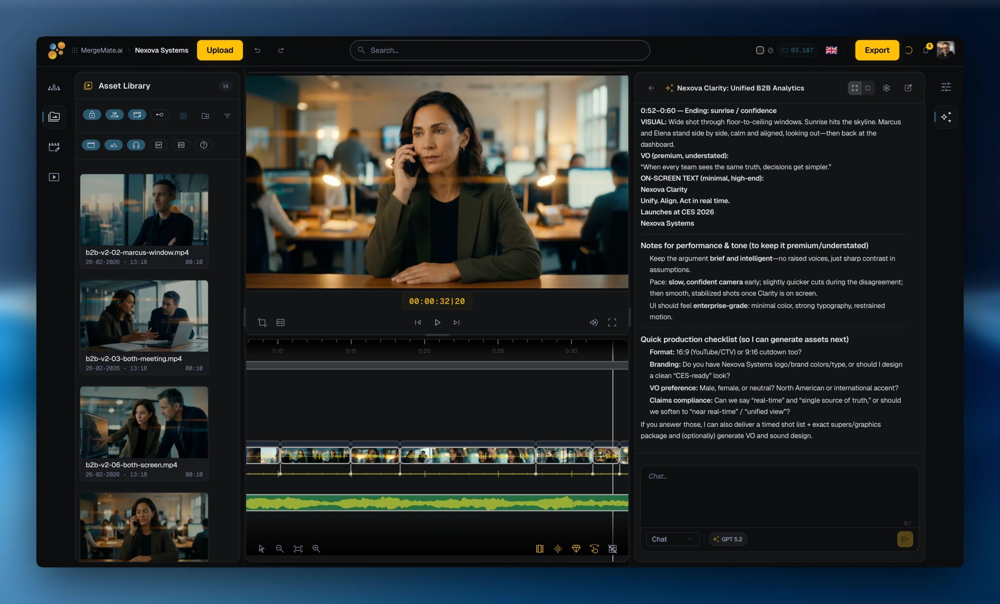
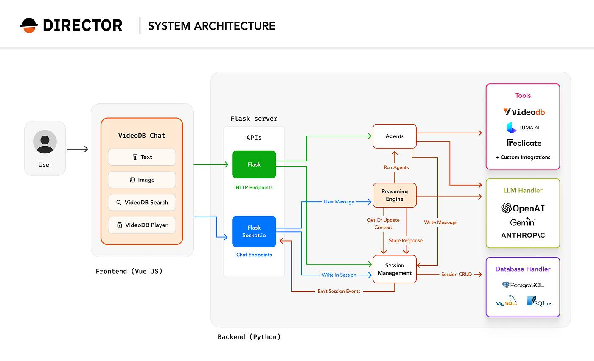
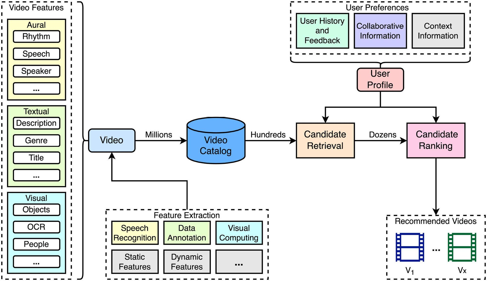
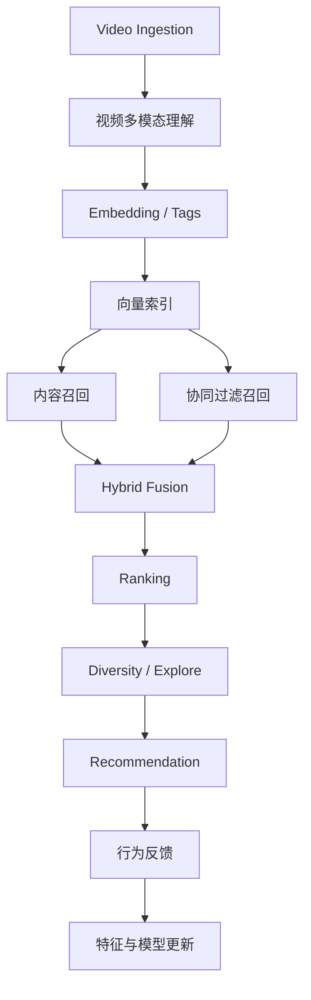

# 开源项目源码解析与设计指南

> **文档定位：** 本文件是开源调研与借鉴附录，**不是**目标架构、阶段计划、API 或技术选型权威。在文档地图中的地位见根目录 [README.md](README.md)。与 `00` 架构设计总纲、`01` URRE、`02` Agent Runtime、`03` Video Domain Pack，以及 `implementation/` 冲突时，以后者为准。已吸收进主文的结论，以主文与实施文档的表述为准；本章仅保留调研证据与对照说明。

> **本次交付映射：** 调研项目自身可以使用不同的内部术语；映射到本项目时，素材对象统一为 `Video -> Clip`，创作计划使用 `ClipPlan / ClipRequirement`。本附录中的时间线、媒体渲染、外部平台和跨领域内容不属于本次交付。

## 0. 执行摘要

本文研究的不是单一的 AI 视频生成工具，而是一个完整的 **Video Intelligence Agent System**：用户通过自然语言提出素材搜索、素材推荐、视频策划、自动剪辑和修改需求，Agent 理解任务、规划步骤、调用专业能力、维护项目状态，并通过可验证的执行引擎交付结果。

### 0.1 核心结论

1.  **Agent 不应取代搜索和推荐模型。** 千万级素材库需要向量检索、倒排检索、协同过滤、Two-Tower、序列推荐和排序模型承担高吞吐计算；Agent 负责意图理解、策略选择、任务编排、结果解释和反馈闭环。
2.  **优先采用"单主 Agent + 有边界的专业 Agent/服务 + 图工作流"。** 不建议一开始就建设大量自治 Agent。高频、确定性、可测试的能力应做成服务或工具；只有确实需要独立上下文、独立决策或独立质量目标的任务，才升级为专业 Agent。
3.  **将创作决策与媒体执行分离。** LLM 输出结构化的 EditDecision / Storyboard / SearchPlan；确定性编译器和 FFmpeg/NLE 执行具体操作。
4.  **项目状态必须持久化。** 对话历史不是项目记忆。用户偏好、项目目标、素材理解、搜索结果、分镜、时间线、审核意见和执行状态应有独立结构。
5.  **搜索与推荐要围绕创作任务闭环。** 推荐的对象不只是"相似视频"，而是能共同完成一段视频的Clip组合：开场、主体、细节、情绪、转场、收尾。
6.  **每次 Agent 行为都应可追踪、可回放、可评估。** 保存计划、工具参数、工具结果、模型版本、耗时、成本、失败原因和用户反馈。

### 0.2 推荐研究的开源项目

| 优先级 | 项目 | 最值得学习的部分 | 适用边界 |
| --- | --- | --- | --- |
| S | [VEA (Video Editing Agent)](https://github.com/Memories-ai-labs/vea-open-source) | Agent Loop、工具调用、Scratchpad、EditDecision、FCPXML 编译 | 视频理解依赖外部 Datalake 服务 |
| S | [VideoAgent](https://github.com/HKUDS/VideoAgent) | 意图分析、意图到 Agent 映射、图驱动动态工作流、多模态查询 | 重点研究其论文/README 描述与具体代码实现差异 |
| S | [ViMax](https://github.com/HKUDS/ViMax) | 长链路创作规划、Agent Loop、会话恢复、制片流程、并行生成 | 更偏生成式视频创作，不是大规模素材推荐系统 |
| A | [MAPO](https://github.com/Yichen727/Multi-Agent-Production-Orchestrator) | Ingest → Search → Curation → Selection → Deliver 的完整后期流程 | 学术原型、固定阶段、规模较小 |
| A | [Director](https://github.com/video-db/Director) | 视频 Agent 平台、动态 Agent 编排、视频基础设施抽象 | 深度依赖 VideoDB 的 Video-as-Data 基础设施 |
| A | [VideoRecommender](https://github.com/sumitgohil/VideoRecommender) | 多模态内容理解、混合召回、协同过滤、排序、多样性 | 推荐系统参考实现，不是 Agent 框架 |

本文的源码解析范围仅限上述六个开源项目。

### 0.3 调研归纳的一句话（非实施权威）

以下一句话是本章对开源项目的归纳，**不是**目标架构权威。正式原则与分层见 [`00_架构设计总纲.md`](00_架构设计总纲.md)。

**调研归纳：** Video Domain Agent 负责理解和规划；Search / Recommendation / Creation / Editing / Evaluation 等领域能力负责专业决策。检索推荐和媒体执行属于参考项目的扩展方向，不在本次交付范围。

------------------------------------------------------------------------

## 1. 调研范围与阅读方法

### 1.1 系统边界

本指南覆盖四类任务：

-   **素材检索**：理解自然语言、拆分查询、跨模态召回、时间片段定位、结果解释。
-   **素材推荐**：基于当前项目、用户偏好和行为反馈推荐素材及素材组合。
-   **视频创作**：创意分析、脚本、分镜、Clip规划、素材匹配、时间线生成。
-   **视频执行**：片段裁切、字幕、配音、音乐、转场、渲染、预览、导出和迭代修改。

不把单纯的文生视频模型包装成完整 Video Agent。文生视频只是创作执行能力之一。

### 1.2 证据分级

阅读开源项目时，必须区分：

-   **代码已实现**：可在仓库具体文件、函数、接口或测试中找到。
-   **项目文档声明**：README、架构文档或论文描述，但尚未逐项核对实现。
-   **本文设计建议**：为了适配目标业务而提出的方案，不代表参考项目已经实现。

本次公开资料核验主要依据各仓库 README、VEA 的架构文档、项目目录说明及推荐系统说明。仓库持续变化，正式选型前应固定 commit SHA，并对关键路径做本地源码复核。本文不把 GitHub Star 数当成技术成熟度或生产可用性的证明。

### 1.3 源码阅读的统一模板

对每个项目按以下顺序阅读：

1.  `README` / 技术报告：先确定产品目标和架构边界。
2.  入口文件：CLI、API、WebSocket、前端事件入口。
3.  Orchestrator / Agent Runtime：任务如何进入循环或图。
4.  Prompt / Role / Tool Definitions：模型被允许做什么。
5.  Tool Executor：工具如何验证、执行和返回结果。
6.  State / Memory / Persistence：上下文和任务状态如何保存。
7.  Domain Services：搜索、推荐、视频分析、时间线、渲染。
8.  Schemas / Models：Agent 与服务之间的数据契约。
9.  Tests / Logs：失败路径、重试、边界条件和可观测性。

不要只读提示词。真正决定系统可靠性的通常是状态模型、工具执行器、数据契约和错误处理。

------------------------------------------------------------------------

## 2. 重点开源项目源码解析

## 2.1 VEA（Video Editing Agent）：工具调用式视频编辑 Agent

仓库：[Memories-ai-labs/vea-open-source](https://github.com/Memories-ai-labs/vea-open-source)\
重点文档：[docs/architecture.md](https://github.com/Memories-ai-labs/vea-open-source/blob/main/docs/architecture.md)\
许可：仓库 README 标注 MIT。使用前仍应核对当前分支及其依赖服务的许可。

### 2.1.1 它解决什么问题

VEA 面向长视频、故事型素材的自然语言剪辑。用户把视频放入项目，和 Agent 对话；Agent 理解素材、制定剪辑计划、搜索片段、细化时间戳、生成结构化剪辑决策，再通过编译器生成 FCPXML 并渲染预览。

VEA 的价值不在于它拥有最多 Agent，而在于它清楚展示了一个 Agent 如何控制一组专业工具，并把创作意图转成可执行的剪辑工程。

### 2.1.2 系统结构

架构文档给出的主要组件：

-   React Dashboard：对话、时间线、预览、Scratchpad 面板。
-   FastAPI Backend：项目会话、WebSocket 事件、Agent Session。
-   AgentSession：维护对话历史并运行 Agent Loop。
-   ScratchpadManager：读写项目级持久化工作记忆。
-   ToolExecutor：执行工具调用。
-   Video Datalake：视频索引、问答和片段搜索。
-   LLM Provider：负责推理和 Function Calling。
-   FCPXML Compiler：把结构化 EditDecision 转成标准剪辑工程。
-   FFmpeg / DaVinci Resolve：负责渲染。

关键设计决策：

1.  V2 采用"LLM 作为 Agent"，而不是固定的 `理解 → 规划 → 生成` 流水线。
2.  Scratchpad 弥补上下文窗口有限的问题。
3.  LLM 只产生结构化 EditDecision，确定性编译器负责 FCPXML。
4.  每个项目拥有独立 Workspace，隔离素材、状态、记忆、日志和输出。

### 2.1.3 Agent Loop

根据架构文档，单轮用户消息触发的核心过程可以概括为：

``` text
handle_user_message(text)
  ├─ 将用户消息加入 history
  └─ agent_loop()
       ├─ 重建 system prompt（注入 scratchpads）
       ├─ 调用 LLM（history + tool declarations）
       ├─ 若返回 function calls
       │    ├─ 逐个执行 ToolExecutor
       │    ├─ 记录 tool_call / tool_result 事件
       │    ├─ 将 tool result 写回 history
       │    └─ 进入下一轮模型调用
       └─ 若返回文本或 finish_turn
            └─ 结束当前轮次
```

VEA 文档描述的每条用户消息最多执行 40 轮 Agent Loop；对话历史有上限，并持久化到项目目录。具体上限属于当前版本实现参数，不应视为所有 Agent 的通用最佳值。

**学习重点：**

-   工具调用不是简单的"模型输出 JSON 后执行一次"，而是模型---工具---结果---模型的循环。
-   工具返回值必须回到模型上下文，否则模型无法根据执行结果继续规划。
-   应区分 `message_user`（向用户发进度消息）和 `finish_turn`（结束任务轮次）。
-   需要限制最大循环轮数、工具超时、单轮 token 和累计成本，防止无限调用。

### 2.1.4 工具系统

VEA 文档列出的工具包括：

------------------------------------------------------------------------------------
  工具                       职责                             设计启发
-------------------------- -------------------------------- ------------------------
  `ask_memories`             对已索引素材进行自然语言问答     适合项目级素材理解

  `search_footage`           语义搜索片段，返回时间戳和转录   将检索封装成领域工具

  `refine_clip_timestamps`   精细确定素材 in/out 点           粗召回后增加精定位步骤

  `update_scratchpad`        更新项目记忆                     记忆修改显式化

  `generate_fcpxml`          校验片段并生成剪辑工程           LLM 决策与确定性编译分离

  `generate_narration`       生成旁白                         外部媒体能力工具化

  `select_music`             选择/生成音乐                    仅在用户需要时调用

  `generate_subtitles`       生成字幕                         将可选能力按需激活

  `message_user`             发送中间消息                     长任务可观察

  `finish_turn`              明确结束任务                     生命周期控制
  ------------------------------------------------------------------------------------

对于你们的系统，应将工具按风险和成本分级：

-   低风险只读：搜索、读取项目、获取素材详情。
-   中风险计算：推荐、排序、分析、生成分镜。
-   高风险写入：创建项目、修改时间线、覆盖工程。
-   高成本执行：批量转码、视频生成、长视频渲染。

高风险操作应加入用户确认或可撤销机制。

### 2.1.5 Scratchpad：项目持久化记忆

VEA 将记忆分为四个 Markdown Scratchpad：

  Scratchpad             作用       典型内容
---------------------- ---------- --------------------------------
  `comprehension`        素材理解   视频摘要、人物、事件、可用Clip
  `creative_direction`   创作方向   用户偏好、风格、时长、约束
  `planning`             当前计划   叙事结构、Clip列表、素材分配
  `fcpxml`               输出状态   编辑决策、导出内容、修订记录

这比把所有信息都塞进聊天记录更合理，但对生产系统还需要进一步结构化：

-   Markdown 用于人类可读的摘要和推理上下文。
-   数据库保存权威状态、版本号和关联关系。
-   JSON Schema / Pydantic 保存可校验的执行对象。
-   对话历史用于追溯，不应作为唯一事实来源。

**对本系统的改造建议：**

不要将全量用户画像、千万级素材信息写入 Scratchpad。只保留当前项目相关的摘要、偏好和引用 ID；详细数据仍从业务服务按需读取。

### 2.1.6 EditDecision：最值得借鉴的设计

VEA 的 LLM 输出结构化 EditDecision，包含：

-   TimelineSettings：帧率、分辨率、时间线名称。
-   ClipDecision：源文件、起止时间、轨道、速度、变换、转场等。
-   NarrationSegment：旁白文件、时间偏移和时长。
-   MusicTrack：音乐文件和时间范围。
-   TextOverlay：字幕或标题内容、位置、持续时间和样式。

之后由确定性编译器生成 FCPXML。这样可以避免让 LLM 直接拼接复杂 XML。

推荐本系统也采用类似的中间表示：

``` text
自然语言创作意图
       ↓
Storyboard / ClipPlan
       ↓
MaterialAssignment
       ↓
EditDecision JSON
       ↓
Schema Validation
       ↓
Timeline Compiler
       ↓
FFmpeg / NLE / Render Worker
```

关键原则：**LLM 可以提出创作决策，但不应绕过校验器直接执行任意文件操作或生成不可控的命令。**

### 2.1.7 局限与适用性

-   视频理解与检索依赖 Memories.ai Video Datalake；开源 Agent 不等于整个视频理解基础设施完全本地开源。
-   项目更关注单项目剪辑，不等于具备千万级多租户素材检索和推荐能力。
-   Scratchpad 的 Markdown 方式适合小规模项目上下文，但不能替代规范化项目数据库。
-   FCPXML 是一种输出适配方式；你们应抽象通用 Timeline IR，再适配 Premiere、Final Cut、DaVinci 或自研播放器。

**结论：VEA 是学习 Agent Loop、Tool Executor、项目记忆和"LLM 决策 + 确定性编译器"的首选项目。**

------------------------------------------------------------------------

## 2.2 VideoAgent：意图分析与图驱动动态工作流

仓库：[HKUDS/VideoAgent](https://github.com/HKUDS/VideoAgent)\
中文 README：[readme_zh.md](https://github.com/HKUDS/VideoAgent/blob/main/readme_zh.md)

### 2.2.1 它的核心思想

VideoAgent 把视频理解、编辑和重塑放在统一的多模态 Agent 框架中。README 重点描述三项机制：

1.  意图分析：识别用户显性和隐性子意图。
2.  自主工具使用与规划：通过图驱动工作流选择 Agent 和执行顺序。
3.  多模态理解：把原始用户输入转换为视觉、语义对齐的细粒度查询。

它最值得学习的不是某个具体视频模型，而是**如何将用户表达转化为一张可执行任务图**。

### 2.2.2 从意图到工作流

例如用户提出：

> 帮我制作一个关于智能机器人的 30
> 秒宣传视频，风格要有科技感，最好体现工业应用和人机协作。

意图分析不应只抽取关键词，而应形成结构化目标：

``` json
{
  "task_type": "video_creation",
  "duration_seconds": 30,
  "theme": ["智能机器人", "工业应用", "人机协作"],
  "style": ["科技感", "现代", "商业宣传"],
  "sub_intents": [
    "展示机器人外观",
    "展示机械臂工作",
    "展示人机协作",
    "形成有节奏的宣传叙事"
  ],
  "deliverables": [
    "creative_brief",
    "storyboard",
    "material_set",
    "edit_timeline"
  ]
}
```

之后映射到能力节点：

``` text
Intent Analysis
      ↓
Task Type = Video Creation
      ↓
Create Task Graph
      ├─ Creative Brief
      ├─ Storyboard Planning
      ├─ Material Search
      ├─ Recommendation
      ├─ Material Review
      ├─ Timeline Planning
      ├─ Timeline Validation
      └─ Render
```

### 2.2.3 图工作流与固定 Pipeline 的区别

固定 Pipeline：

``` text
A → B → C → D
```

所有请求都必须经过相同步骤。

动态工作流：

``` text
                    ┌→ Search → Rank ────────┐
User → Intent → Plan ├→ Recommend → Rerank ──┼→ Evaluate
                    ├→ Storyboard ──────────┤
                    └→ Edit / Render ───────┘
```

实际任务可以跳过不需要的节点，也可以根据结果增加节点。例如：

-   "找一些适合科技宣传片的素材"不需要启动剪辑 Agent。
-   "把这些素材剪成 30 秒视频"需要启动分镜、素材分配、时间线和审核。
-   "第二段换成更有未来感的城市Clip"只需修改局部 ClipPlan，重新检索和审核相关Clip。

### 2.2.4 如何借鉴到本系统

建议将图节点分为四种：

| 节点类型 | 示例 | 是否由 LLM 决策 |
| --- | --- | --- |
| 意图/规划节点 | Intent Parser、Task Planner | 是 |
| 领域决策节点 | Query Planner、Recommendation Policy | 可由规则/模型混合 |
| 确定性工具节点 | Search API、Rank API、FFmpeg | 否 |
| 质量/人工节点 | Evaluate、Human Approval | 规则/模型/人工混合 |

任务图应是有类型、有版本、有状态的执行计划，而不是只存在模型上下文中的一段文本。

### 2.2.5 需要特别验证的内容

README 描述了意图到 Agent 映射、图驱动工作流和自适应反馈循环。进行源码复核时，建议定位：

-   意图解析 Prompt / Schema；
-   Agent 注册表或 Agent Mapping；
-   Graph 构建入口；
-   节点执行器；
-   边条件与动态分支；
-   反馈循环和终止条件；
-   多模态查询生成逻辑。

如果代码中某些能力仅存在于论文描述或 README，应标注为"文档提出"，不要写成已经完整实现。

**结论：VideoAgent 是学习任务规划、动态路由和多模态查询拆解的首选项目。**

------------------------------------------------------------------------

## 2.3 ViMax：长链路创作 Agent 与项目级连续性

仓库：[HKUDS/ViMax](https://github.com/HKUDS/ViMax)

### 2.3.1 它解决的问题

ViMax 关注从创意、剧本、角色、分镜、Clip到最终视频生成的连续生产流程。README 描述了：

-   Idea2Video；
-   Script2Video；
-   Novel2Video；
-   AutoCameo；
-   Agent Loop 和交互式会话；
-   项目、素材、Storyboard、Artifact 和渲染状态；
-   多Clip生成的并行化与连续性管理。

它比素材检索系统更偏生成式视频创作，但其长链路任务状态管理非常值得借鉴。

### 2.3.2 创作链路拆解

``` text
Creative Idea
    ↓
Narrative / Script
    ↓
Character & Scene Design
    ↓
Storyboard
    ↓
Clip Design
    ↓
Reference / Keyframe Generation
    ↓
Video Generation
    ↓
Continuity Check
    ↓
Final Assembly
```

每个阶段都有不同的输入和输出，不应只依靠一段越来越长的 Prompt 维持整个创作过程。

### 2.3.3 对素材系统的启发

将 ViMax 的生成链路映射到"真实素材检索 + 推荐 + 剪辑"：

  ViMax 创作对象    素材系统对应对象
----------------- ------------------------------
  Script            创作脚本 / 旁白
  Scene             场景需求
  Storyboard        分镜计划
  Clip              ClipRequirement
  Reference Image   参考素材 / 风格参考
  Generated Video   检索到的真实素材或生成素材
  Continuity        Clip连续性、风格和叙事一致性
  Final Assembly    时间线和成片

特别要注意：生成式视频中的"角色一致性"与真实素材剪辑中的"叙事连续性"不是同一问题，但可以复用相似的状态管理思路。

### 2.3.4 Agent Loop 与项目恢复

ViMax README 说明其 Agent Loop 支持交互式计划修改、会话恢复、渲染控制和上下文压缩；Web UI 和 TUI 使用同一 Agent Runtime、会话和工具。

本系统可以借鉴：

-   项目拥有稳定 `project_id`；
-   每次执行拥有 `run_id`；
-   用户修改产生新的计划版本；
-   任务中断后从持久化状态恢复；
-   生成物以 Artifact 形式保存；
-   渲染有独立状态和检查点；
-   多个Clip/素材任务可并行执行，但汇总前要经过一致性检查。

**结论：ViMax 适合研究复杂创作任务如何分阶段、持久化、恢复和并行执行。**

------------------------------------------------------------------------

## 2.4 MAPO：从素材入库到剪辑工程的业务闭环

仓库：[Yichen727/Multi-Agent-Production-Orchestrator](https://github.com/Yichen727/Multi-Agent-Production-Orchestrator)

### 2.4.1 业务流程

MAPO 将后期制作拆成四个阶段：

``` text
Ingest → Search → Curation → Selection → Deliver
```

-   Ingest：使用 ffprobe、FFmpeg、视觉理解和 Embedding 建立素材目录。
-   Search：自然语言搜索素材，返回相关片段、相关度和检索理由。
-   Curation：用户在 Media Pool 中确认哪些候选素材进入下一阶段。
-   Selection：根据剪辑意图把已确认素材组织成时间线。
-   Deliver：生成 Premiere Pro 可导入的 FCP7 XML 和 JSON。

### 2.4.2 代码目录值得怎样读

README 给出的目录结构清楚地区分了 Agent、Service、Schema 和 State：

``` text
app/
  orchestrator/
    production_orchestrator.py
  agents/
    ingest_agent.py
    search_agent.py
    selection_agent.py
    delivery_agent.py
  services/
    retrieval_service.py
    catalogue_resolver.py
    database_service.py
    ffmpeg_service.py
    vision_service.py
    timeline_service.py
    premiere_export_service.py
  models/
    schemas.py
    state.py
```

重点不是照搬它的四个 Agent，而是学习职责边界：

-   Agent 决定阶段目标和业务策略；
-   Service 实现具体能力；
-   Schema 定义阶段间的数据契约；
-   State 维护流程上下文；
-   Orchestrator 控制阶段顺序和人工检查点。

### 2.4.3 Human-in-the-loop

MAPO 在素材确认和导出等位置保留人工控制。对专业素材生产系统而言，这比完全自动化更现实：

-   Agent 可以找出候选素材；
-   用户可以将候选加入/移出项目素材池；
-   Agent 根据确认后的集合生成剪辑方案；
-   用户确认后才导出或覆盖工程。

### 2.4.4 局限

MAPO 是学术项目原型，采用固定阶段，且 README 展示的是本地 SQLite 素材目录等设计。它适合学习业务流程和接口边界，不适合作为千万级检索服务的直接架构模板。

**结论：MAPO 是理解"搜索结果如何转化为剪辑工程"的最佳流程参考。**

------------------------------------------------------------------------

## 2.5 Director：视频 Agent 平台化和基础设施抽象

仓库：[video-db/Director](https://github.com/video-db/Director)

### 2.5.1 核心定位

Director 将自己定位为视频 Agent 框架，支持搜索、剪辑、编译、生成等视频工作流。README 描述了 20 多种预置 Agent、对话式 UI、Reasoning Engine 和动态 Agent 编排。

其架构可抽象为：

``` text
Chat UI
   ↓
Reasoning Engine
   ↓
Agent Orchestration
   ↓
Specialized Video Agents
   ↓
VideoDB Infrastructure
   ↓
Search / Clip / Stream / Generate
```

### 2.5.2 值得借鉴的地方

-   将视频能力抽象成可扩展的 Agent；
-   使用统一 Reasoning Engine 接收用户自然语言；
-   Agent 负责组合复杂视频任务；
-   UI 能显示任务进展和视频结果；
-   视频存储、索引、检索和流媒体由基础设施层承担。

### 2.5.3 不能忽略的边界

Director 基于 VideoDB 的 Video-as-Data 基础设施。研究时必须分开评估：

1.  Director 自身的 Agent 编排代码；
2.  VideoDB 提供的索引、存储、检索和流媒体服务；
3.  需要外部模型或 API 的能力。

如果目标是自建素材平台，应重点借鉴 Agent 插件化和能力编排，不要默认可以无成本替换其视频基础设施。

**结论：Director 适合研究产品化的视频 Agent 平台，不应被视为独立的完整视频数据平台。**

------------------------------------------------------------------------

## 2.6 VideoRecommender：Agent 背后的推荐算法引擎

仓库：[sumitgohil/VideoRecommender](https://github.com/sumitgohil/VideoRecommender)

### 2.6.1 为什么必须研究它

素材推荐系统不能只靠 LLM 逐条判断视频。推荐服务应在毫秒到百毫秒级完成候选召回和排序，Agent 只负责在需要时调用它。

该项目 README 描述的推荐栈包括：

-   多模态内容理解：视觉嵌入、目标检测、语音转录与 LLM 文本分析；
-   Milvus 向量候选召回；
-   Item-based / User-based Collaborative Filtering；
-   自适应混合融合；
-   排序模型和启发式回退；
-   多样性过滤与探索；
-   可选 NCF、SASRec、LightGCN；
-   FastAPI、任务队列、缓存和离线评估。

### 2.6.2 推荐链路

``` text
Video Ingestion
   ↓
Visual / Audio / Text Understanding
   ↓
Tag Fusion + Embedding
   ↓
Vector Index
   ↓
┌─────────────────┬──────────────────┐
│ Content Recall  │ Collaborative    │
│                 │ Recall           │
└────────┬────────┴────────┬─────────┘
         └────────┬────────┘
                  ↓
           Hybrid Fusion
                  ↓
               Ranking
                  ↓
          Diversity / Explore
                  ↓
          Recommendation Result
```

### 2.6.3 Agent 应该如何调用推荐服务

不建议把每个候选素材都交给 LLM 打分。应由 Agent 构造上下文和策略参数，再调用推荐 API：

``` json
{
  "scene_id": "scene_02",
  "query": "工业机械臂与工程师协同工作的近景",
  "project_id": "project_123",
  "user_id": "user_456",
  "constraints": {
    "duration_min": 3,
    "duration_max": 8,
    "orientation": "landscape"
  },
  "strategy": {
    "content_relevance": 0.45,
    "project_fit": 0.25,
    "user_preference": 0.15,
    "diversity": 0.10,
    "freshness": 0.05
  },
  "top_k": 100
}
```

注意：权重仅为示例。生产权重应由离线实验、线上 A/B 和业务目标确定，不应由 LLM 任意编造。

### 2.6.4 推荐信号与反馈

至少区分：

-   曝光；
-   点击；
-   预览开始；
-   预览时长；
-   收藏；
-   加入项目；
-   加入时间线；
-   下载；
-   实际使用；
-   删除/跳过；
-   完成导出。

素材业务中，"加入时间线"和"最终成片实际使用"通常比普通点击更接近真实价值。必须保留曝光上下文和位置，否则无法正确解释未点击和点击行为。

**结论：VideoRecommender 可作为传统推荐链路的学习样本，但需结合你们已有 Two-Tower、DNN、生成式推荐等方案扩展。**

------------------------------------------------------------------------

## 3. 跨项目架构模式归纳

### 3.1 五种常见模式

| 模式 | 代表项目 | 核心机制 | 适用情况 |
| --- | --- | --- | --- |
| Agent Loop + Tools | VEA | 模型循环调用工具并接收结果 | 对话式编辑、交互式检索 |
| Dynamic Graph | VideoAgent | 意图驱动任务图和动态路由 | 多类型复杂任务 |
| Multi-stage Creative Workflow | ViMax | 分阶段创作、项目状态、并行生成 | 长链路创作 |
| Explicit Pipeline + Human Gate | MAPO | 阶段编排、结构化 State、人工确认 | 稳定可控的生产流程 |
| Reasoning Engine + Agent Platform | Director | 统一入口、Agent 能力扩展 | 平台化视频智能服务 |

### 3.2 不要把"多 Agent"当作目标

多 Agent 不是越多越好。增加 Agent 会带来：

-   更多模型调用和上下文传递成本；
-   Agent 之间的状态同步；
-   重复规划和职责冲突；
-   调试和评估难度；
-   错误传播与重试放大。

建议先采用一个主 Agent，领域能力以服务和工具形式存在。满足以下条件时再拆成独立 Agent：

1.  任务有独立的专业上下文；
2.  任务有独立的决策目标和评价指标；
3.  任务需要独立的模型或工具权限；
4.  任务能独立运行、重试和审计；
5.  拆分后能明确降低复杂度或提升质量。

### 3.3 Agent、Tool、Service、Workflow 的边界

-------------------------------------------------------------------------------------------------
  类型                    应承担的责任                         不应承担的责任
----------------------- ------------------------------------ ------------------------------------
  Agent                   意图理解、策略选择、复杂判断、协调   大规模逐条检索、确定性转码

  Tool                    给 Agent 暴露可调用能力              保存复杂业务状态或承载全部业务逻辑

  Service                 稳定业务能力、算法、数据访问         自主决定整个用户任务

  Workflow                状态、依赖、重试、超时、人工检查点   依赖模型隐式记忆执行进度

  Model                   预测、Embedding、生成、排序          代替业务权限和数据校验
  -------------------------------------------------------------------------------------------------

------------------------------------------------------------------------

## 4. 面向千万级素材系统的调研架构建议（非实施权威）

本章是开源调研后的架构设想，**不是**目标架构或开工依据。已吸收的原则、分层与职责边界见 `00`–`03`；实施阶段与技术选型见 `implementation/`。与主文或实施文档冲突时，以后者为准。

## 4.1 设计目标

-   支持千万级视频及其 Clip 索引；
-   支持本地素材库和互联网素材来源；
-   支持自然语言搜索、搜索增强推荐和主动推荐；
-   支持创作项目驱动的素材推荐；
-   支持从脚本、分镜到时间线和渲染；
-   支持曝光、点击、预览、下载、加入项目、实际使用等反馈；
-   Agent 规划与算法执行解耦；
-   多租户、权限和授权可控；
-   任务可追踪、可恢复、可回放。

## 4.2 总体分层

``` text
┌───────────────────────────────────────────────────────┐
│                    User Experience                    │
│ Conversational Search | Task Creation | Project Editor│
└───────────────────────────┬───────────────────────────┘
                            │
┌───────────────────────────▼───────────────────────────┐
│                Video Domain Agent                     │
│ Intent | Planning | Routing | Memory | Evaluation     │
└───────────────────────────┬───────────────────────────┘
                            │
┌───────────────────────────▼───────────────────────────┐
│                 Domain Agent / Workflow               │
│                                                       │
│ Search | Recommendation | Creation | Editing | Review │
│ Learning / Feedback                                   │
└───────────────────────────┬───────────────────────────┘
                            │
┌───────────────────────────▼───────────────────────────┐
│                 Domain Service / Model                │
│                                                       │
│ Hybrid Retrieval | Two-Tower | Ranker | SASRec / GNN  │
│ Video Understanding | Embedding | Rerank | Diversity │
│ Timeline Compiler | FFmpeg | NLE Adapter              │
└───────────────────────────┬───────────────────────────┘
                            │
┌───────────────────────────▼───────────────────────────┐
│                    Data Platform                      │
│ Asset DB | Clip Index | Vector DB | Behavior | Project │
│ User Profile | Event Log | Artifact Store              │
└───────────────────────────────────────────────────────┘
```

## 4.3 Director Agent

职责：

-   识别用户当前是搜索、推荐、创作、修改还是项目管理任务；
-   读取当前项目上下文；
-   生成结构化任务计划；
-   决定调用哪些领域能力；
-   处理任务失败和结果不满足；
-   决定何时向用户澄清或请求确认；
-   汇总结果并说明依据。

不负责：

-   遍历千万级视频；
-   自己计算 Embedding；
-   自己执行排序模型；
-   直接拼接 FFmpeg 命令；
-   直接修改数据库底层记录。

### Intent Schema 示例

``` json
{
  "intent_id": "intent_xxx",
  "task_type": "search | recommend | create | edit | project_qa",
  "goal": "为科技产品宣传片寻找素材",
  "project_id": "project_123",
  "constraints": {
    "duration_seconds": 30,
    "aspect_ratio": "16:9",
    "style": ["科技感", "商业"]
  },
  "deliverables": [
    "material_candidates",
    "storyboard"
  ],
  "needs_clarification": false
}
```

## 4.4 Search Planner

职责：

1.  解析查询意图；
2.  识别主体、动作、场景、Clip类型、情绪、时间、地域和技术约束；
3.  生成多个检索子查询；
4.  选择检索通道；
5.  调用混合召回；
6.  组织候选和解释。

检索通道：

-   BM25 / 倒排索引；
-   文本 Embedding；
-   图像/视频 Embedding；
-   OCR / ASR 文本检索；
-   标签和元数据过滤；
-   Clip 级 / 时间片段级检索；
-   外部互联网搜索；
-   用户指定素材库或项目范围。

建议输出 `SearchPlan`：

``` json
{
  "query": "工程师与工业机械臂协同工作",
  "sub_queries": [
    {
      "query": "工程师操作工业机械臂近景",
      "clip_type": "close_up",
      "weight": 0.35
    },
    {
      "query": "智能工厂机械臂生产线全景",
      "clip_type": "wide",
      "weight": 0.35
    },
    {
      "query": "人机协作机器人工作过程",
      "clip_type": "medium",
      "weight": 0.30
    }
  ],
  "filters": {
    "orientation": "landscape"
  }
}
```

### 关键原则

Search Planner 只在复杂查询中做受约束的查询规划，不负责把所有查询逐条执行。Search Service 并行处理子查询、合并候选、去重和重排；简单查询直接调用 Search API。

## 4.5 Recommendation Strategy

Recommendation Strategy 不等于推荐模型或自治 Agent。它属于领域策略，主要任务是选择推荐场景、组织推荐目标、确定约束和评估口径；实际召回、排序和重排由 Recommendation Service 执行。

建议划分三种策略：

#### A. Search-augmented Recommendation

用户有明确搜索词：

-   搜索召回；
-   语义扩展；
-   个性化重排；
-   多样性补充。

#### B. Task-driven Recommendation

用户有明确创作项目：

-   读取脚本和分镜；
-   将项目拆解为场景/Clip需求；
-   每个Clip独立召回；
-   结合用户偏好、项目风格和素材质量重排；
-   生成跨Clip的互补素材组合。

#### C. Proactive Recommendation

用户没有明确查询：

-   用户兴趣画像；
-   最近行为序列；
-   历史项目偏好；
-   热门/趋势内容；
-   新素材探索；
-   当前项目上下文（如果存在）。

### 创作型推荐与相似推荐的区别

普通推荐：

``` text
用户喜欢机器人视频
        ↓
推荐更多机器人视频
```

创作型推荐：

``` text
用户要制作机器人宣传片
        ↓
分镜拆解
  ├─ 开场：未来工厂全景
  ├─ 主体：机器人外观
  ├─ 细节：机械臂动作
  ├─ 应用：人机协作
  └─ 收尾：品牌/产品英雄Clip
        ↓
每个Clip分别召回和排序
        ↓
跨Clip组合优化
```

推荐目标从"单素材相关性"扩展为"素材集合对创作目标的覆盖度和互补性"。

### 推荐目标函数建议

候选素材集合 \(S\) 可以考虑如下调研用示意公式（非正式生产门槛，也不是实施指标权威）：

$$\mathrm{Score}(S)=\alpha R(S)+\beta P(S)+\gamma C(S)+\delta D(S)+\epsilon Q(S)$$

其中：

-   (R)：单素材与Clip需求的相关性；
-   (P)：与用户偏好和项目风格的匹配度；
-   (C)：分镜覆盖和创作完整性；
-   (D)：素材多样性、互补性；
-   (Q)：画质、可用性和技术质量。

权重必须通过数据和实验确定。创作型推荐可先使用约束优化/启发式方法建立基线，再评估 Learning-to-Rank、集合推荐或生成式推荐。

## 4.6 Creation Agent

负责：

-   Creative Brief；
-   Script / Narration；
-   Storyboard；
-   Scene Plan；
-   Clip Plan；
-   Clip节奏和叙事结构；
-   每个Clip的素材需求；
-   生成素材和真实素材之间的选择。

建议把创作产物保存为版本化 Artifact：

``` text
Project
 ├─ CreativeBrief v1
 ├─ Script v1
 ├─ Storyboard v1
 │   ├─ Scene 01
 │   │   ├─ Clip 01
 │   │   └─ Clip 02
 │   └─ Scene 02
 ├─ MaterialAssignments v1
 ├─ EditDecision v1
 └─ Render v1
```

## 4.7 Editing Agent

负责把已确认素材和创作计划转成结构化时间线。

建议分成：

-   Timeline Planner：规划时间线；
-   Clip Refiner：细化片段起止点；
-   Audio Planner：旁白、音乐和音效；
-   Subtitle Planner：字幕；
-   Timeline Validator：检查时长、重叠、素材可用性和轨道关系；
-   Render Coordinator：提交渲染任务。

LLM 输出 Timeline IR，执行引擎负责实际操作。

## 4.8 Evaluation Agent

至少区分三种评估：

1.  **检索质量评估**：是否找到了相关素材？
2.  **推荐质量评估**：推荐集合是否满足项目需求、是否多样？
3.  **成片质量评估**：叙事、节奏、Clip连续性、画面、音频、字幕是否达标？

不要只让生产 Agent 自己给自己评分。建议使用独立 Evaluator，必要时由不同模型、规则或人工共同评估。

------------------------------------------------------------------------

## 5. 调研用数据模型与接口设想（非实施权威）

本章示例**不是**实施契约，也不得作为与 `implementation/01` 并行的建议 API。字段级权威见 [`implementation/01_API与数据契约.md`](implementation/01_API与数据契约.md)；领域对象见 [`03_VideoDomain架构设计.md`](03_VideoDomain架构设计.md)。下列路径与对象名仅作调研举例。

## 5.1 核心实体

  实体                   说明
---------------------- ------------------------------------
  `UserProfile`          用户长期偏好、行为统计和兴趣向量
  `Project`              当前创作项目
  `CreativeBrief`        创作目标和约束
  `Scene`                场景
  `Clip`                 Clip需求
  `Asset`                原始视频素材
  `Clip`                 素材中的可检索片段
  `SearchPlan`           检索计划
  `RecommendationSet`    一次推荐结果及其策略
  `MaterialAssignment`   素材与Clip的匹配关系
  `EditDecision`         结构化剪辑决策
  `AgentRun`             一次 Agent 任务运行
  `AgentEvent`           工具调用、状态变化和结果事件
  `Artifact`             脚本、分镜、时间线、渲染等产物
  `FeedbackEvent`        曝光、点击、预览、下载、使用等反馈

## 5.2 AgentRun

``` json
{
  "run_id": "run_20261110_001",
  "project_id": "project_123",
  "user_id": "user_456",
  "task_type": "video_creation",
  "status": "running",
  "plan_version": 3,
  "current_node": "material_search",
  "started_at": "2026-11-10T10:00:00Z",
  "deadline_at": "2026-11-10T10:10:00Z",
  "model_profile": "balanced",
  "budget": {
    "max_llm_calls": 20,
    "max_tool_calls": 80,
    "max_cost": 2.0
  }
}
```

## 5.3 AgentEvent

``` json
{
  "event_id": "event_001",
  "run_id": "run_20261110_001",
  "sequence": 12,
  "event_type": "tool_result",
  "node_id": "material_search",
  "tool_name": "search_clips",
  "input_ref": "artifact://search-plan/123",
  "output_ref": "artifact://search-result/456",
  "status": "success",
  "duration_ms": 842,
  "created_at": "2026-11-10T10:00:08Z"
}
```

大结果应存对象存储或业务数据库，事件只保存引用，避免把大量候选 JSON 塞进 Agent State。

## 5.4 Tool Contract

每个工具至少定义：

-   `name`；
-   `description`；
-   `input_schema`；
-   `output_schema`；
-   `timeout`；
-   `idempotency_key`；
-   `permission_scope`；
-   `side_effect_level`；
-   `retry_policy`；
-   `observability_fields`。

示例：

``` json
{
  "name": "search_clips",
  "description": "Search indexed video clips using text and structured constraints",
  "input_schema": {
    "type": "object",
    "required": ["query", "top_k"],
    "properties": {
      "query": {"type": "string"},
      "project_id": {"type": "string"},
      "top_k": {"type": "integer", "minimum": 1, "maximum": 500},
      "filters": {"type": "object"}
    }
  },
  "side_effect_level": "read_only",
  "timeout_seconds": 8
}
```

## 5.5 调研用 API 路径举例（非正式契约）

下列路径仅用于对照开源项目的能力切分，**不是**建议契约，实施时不得照此开工。正式 API 以 `implementation/01` 为准。


``` text
POST /api/v1/search/plan
POST /api/v1/search/clips
POST /api/v1/recommendations
POST /api/v1/recommendations/task-driven
POST /api/v1/projects
POST /api/v1/projects/{project_id}/brief
POST /api/v1/projects/{project_id}/storyboards
POST /api/v1/projects/{project_id}/material-assignments
POST /api/v1/projects/{project_id}/edit-decisions
POST /api/v1/projects/{project_id}/renders
POST /api/v1/feedback/events
GET  /api/v1/agent-runs/{run_id}
GET  /api/v1/agent-runs/{run_id}/events
POST /api/v1/agent-runs/{run_id}/resume
POST /api/v1/agent-runs/{run_id}/cancel
```

Agent 服务调用领域 API，不应直接访问推荐模型内部数据库或绕过业务权限。

------------------------------------------------------------------------

## 6. 任务编排、状态管理与记忆设计

## 6.1 调研建议：显式 State Graph（非实施权威）

业务接入以 Runtime Java SDK 为基线，任务编排和 Mock 工程边界以 [`02 Agent Runtime`](02_AgentRuntime架构设计.md) §13 与 [`implementation/02`](implementation/02_技术选型与服务部署.md)为准。Runtime 服务端内部实现不是本次交付依赖。本节的「显式 State Graph」只是调研对照，**不得**据此改写主文或实施计划。


建议采用显式 State Graph 作为工作流实现方式，可使用自研状态图运行时，但业务状态模型不要绑定具体实现。

示例：

``` text
START
  ↓
Intent Parse
  ↓
Need Clarification?
  ├─ Yes → Ask User → Resume
  └─ No
      ↓
Task Planner
      ↓
Task Type?
  ├─ Search → Query Plan → Search → Evaluate → Return
  ├─ Recommend → Strategy → Candidate Recall → Rank → Diversity → Return
  ├─ Create → Brief → Script → Storyboard
  │                         ↓
  │                  Material Search
  │                         ↓
  │                  Material Assignment
  │                         ↓
  │                  Human Approval
  │                         ↓
  │                  EditDecision → Validate → Render
  │                         ↓
  │                  Quality Review → Revise / Complete
  └─ Edit → Read Current Timeline → Patch Plan → Validate → Render
```

### 图节点设计规则

-   节点输入输出必须结构化；
-   节点应尽可能幂等；
-   需要外部副作用的节点应有执行记录；
-   长任务节点要支持超时、取消和恢复；
-   条件边由明确状态决定，不依赖自然语言猜测；
-   每个节点记录耗时、模型成本和结果引用。

## 6.2 项目记忆分层

建议分成：

### A. User Memory

长期偏好：

-   喜欢的视觉风格；
-   常用画幅、分辨率和节奏；
-   偏好的素材类型；
-   常用创作模板。

用户可以查看、修改和删除。

### B. Project Memory

项目范围：

-   当前目标；
-   受众；
-   风格；
-   脚本；
-   分镜；
-   素材选择；
-   用户确认过的约束。

### C. Working Memory

当前 Agent Run：

-   当前计划；
-   已完成节点；
-   当前工具结果摘要；
-   下一步；
-   重试次数；
-   预算消耗。

### D. Event / Episodic Memory

历史任务事实：

-   用户曾选择哪些素材；
-   哪些推荐被跳过；
-   哪个版本被导出；
-   用户提出过哪些修改。

注意：历史行为是证据，不应直接等同于用户永久偏好。

## 6.3 记忆写入原则

-   只有经过验证的事实才写入长期记忆；
-   临时意图只保存在项目或当前任务；
-   用户显式纠正优先级高于模型推断；
-   记忆要有来源、时间、置信度和版本；
-   记忆更新必须可审计；
-   不把完整聊天记录反复注入 Prompt。

------------------------------------------------------------------------

## 7. 反事实推理与 Agent 质量优化

Agent 的目标不是生成更长的思维链，而是减少会影响任务结果的关键错误。

建议把反事实推理作为受控的质量检查机制，而不是每个任务都进行昂贵的多轮自我辩论。

### 7.1 三类反事实问题

#### A. 搜索反事实

-   如果查询中"机器人"指的是机械臂而非人形机器人，候选是否变化？
-   如果去掉某个关键词，是否仍能找到真正相关的Clip？
-   如果只按文本相似度排序，是否遗漏视觉上更合适的素材？

#### B. 推荐反事实

-   如果不考虑用户历史偏好，推荐集合是否仍满足当前项目？
-   如果只看相关性，是否会出现十个几乎相同的Clip？
-   如果替换其中一个素材，分镜覆盖是否更完整？

#### C. 创作反事实

-   如果开场Clip不够强，是否有替代素材？
-   如果某段素材时长不足，是否有可行的剪辑方案？
-   如果删掉一个Clip，叙事是否仍然连贯？

### 7.2 受控评估流程

``` text
Candidate Plan
    ↓
Rule Validation
    ↓
Independent Evaluation
    ↓
Counterfactual Check (only when risk/uncertainty is high)
    ↓
Accept / Revise / Ask Human
```

建议为反事实检查设定触发条件：

-   任务结果置信度低；
-   不同召回通道结果冲突；
-   关键Clip缺失；
-   结果存在明显重复；
-   执行代价高且不可逆；
-   用户明确要求高质量交付。

### 7.3 质量门槛与重试

可参考你们已有的多 Agent 对抗式审核思想：

-   生产 Agent 生成结果；
-   独立 Evaluator 打分；
-   达到阈值则通过；
-   未通过时输出明确的失败维度；
-   最多有限次数重试；
-   保留历史最佳版本；
-   仍未达标则交给用户确认。

不要只输出一个总分。应给出分项分数和证据：

``` json
{
  "overall_score": 82,
  "dimensions": {
    "semantic_relevance": 90,
    "clip_coverage": 78,
    "visual_quality": 85,
    "diversity": 70
  },
  "issues": [
    {
      "dimension": "diversity",
      "severity": "medium",
      "evidence": "前 5 个候选中 4 个为相同景别的机械臂特写"
    }
  ],
  "decision": "revise"
}
```

分数阈值应通过人工标注集和线上效果校准，不要直接把示例分数当作生产标准。

------------------------------------------------------------------------

## 8. 性能、成本与安全边界

## 8.1 千万级素材库的性能原则

**禁止让 LLM 对全量素材逐条推理。**

推荐链路：

``` text
Query / Task
    ↓
LLM Query Planning (small output)
    ↓
Parallel Candidate Retrieval
    ├─ BM25
    ├─ Vector Search
    ├─ Metadata Filter
    ├─ Collaborative Recall
    └─ Trend / External Search
    ↓
Candidate Merge + Dedup
    ↓
Model Ranker
    ↓
Diversity / Business Constraints
    ↓
Optional LLM Explanation / Small-set Review
```

LLM 只处理有限候选的摘要或疑难案例。大规模排序应交给专用模型。

## 8.2 成本控制

建议设置：

-   每次 Agent Run 的最大模型调用次数；
-   最大工具调用次数；
-   最大总 token；
-   最大任务时间；
-   每类模型的调用预算；
-   单次视频分析最大时长和采样帧数；
-   低置信度时才升级更昂贵模型；
-   缓存查询理解、视频摘要和静态分析结果。

可将模型分层：

  任务             模型策略
---------------- -----------------
  意图分类         小模型 / 规则
  查询扩展         小到中型模型
  复杂创作规划     高能力模型
  视觉时间戳精修   视频/视觉模型
  推荐排序         专用排序模型
  质量审核         独立模型 + 规则

## 8.3 安全和权限

-   工具按最小权限授权；
-   搜索工具默认只读；
-   文件路径必须由服务端解析和校验；
-   禁止模型直接执行任意 Shell；
-   FFmpeg 参数由受控模板生成；
-   外部网页内容视为不可信数据；
-   用户确认前不覆盖原始工程；
-   所有写操作有幂等键、审计日志和撤销策略；
-   多租户检索必须严格隔离用户和组织数据。

## 8.4 可靠性

-   Tool timeout；
-   Exponential backoff；
-   最大重试次数；
-   Circuit breaker；
-   Idempotency key；
-   Dead-letter queue；
-   Run checkpoint；
-   Resume / Cancel；
-   Partial result；
-   Fallback strategy。

不要让 Agent 自己无限重试。重试策略应由运行时和工作流控制器约束。

------------------------------------------------------------------------

## 9. 评估指标体系

## 9.1 Agent 任务质量

  指标                      定义
------------------------- ------------------------------
  Task Completion Rate      成功完成任务比例
  Plan Validity             计划结构和依赖是否合法
  Tool Success Rate         工具调用成功比例
  Tool Recovery Rate        失败后恢复成功比例
  Human Intervention Rate   需要人工介入比例
  Cost per Completed Task   每个成功任务的模型和工具成本
  P50/P95 Latency           任务耗时分位数

## 9.2 搜索质量

-   Recall@K；
-   Precision@K；
-   NDCG@K；
-   MRR；
-   Clip Boundary Accuracy；
-   Query Reformulation Success；
-   Search Zero-result Rate。

## 9.3 推荐质量

-   CTR；
-   Preview Rate；
-   Preview Completion；
-   Add-to-Project Rate；
-   Download Rate；
-   Actual Usage Rate；
-   Diversity；
-   Coverage；
-   Novelty；
-   Long-term User Satisfaction。

注意：点击率不能单独代表推荐质量。曝光位置、素材质量、用户任务和实际使用情况都要纳入分析。

## 9.4 创作质量

-   Storyboard Coverage；
-   Material Assignment Acceptance；
-   Timeline Validity；
-   Render Success Rate；
-   Revision Count；
-   Human Quality Score；
-   Final Export Rate；
-   User Edit Distance（用户对 Agent 时间线修改幅度）。

## 9.5 离线评估集

建议建立四类数据集：

1.  查询---相关片段标注集；
2.  用户---素材行为序列；
3.  创作 brief---分镜---素材组合标注集；
4.  EditDecision---人工审核结果集。

每次 Prompt、模型、检索策略和排序模型升级，都运行固定评估集，避免只凭 Demo 判断效果。

------------------------------------------------------------------------

## 10. 调研中的技术选型对照与阶段设想（非实施权威）

本章是调研阶段的对照与设想，**不是**技术选型或分阶段实施的权威。业务接入基线以 [`02 Agent Runtime`](02_AgentRuntime架构设计.md)文首 / §12 与 [`runtime-sdk/java/overview.md`](runtime-sdk/java/overview.md) 为准；本次工程和 Mock 边界见 [`implementation/02`](implementation/02_技术选型与服务部署.md)，交付阶段见 [`implementation/03`](implementation/03_实施路线图与验收基线.md)。下文 Phase 0–4 与 `video-agent-*` 服务名仅供对照，不得当作开工计划。

## 10.1 Agent 框架选择

调研时建议先做小规模 PoC 对比，不要先把整个业务绑定某个 Agent SDK。实施选型已见 `implementation/02`，本节不再另立主方案。

| 方案 | 优点 | 风险/限制 | 建议用途 |
| --- | --- | --- | --- |
| AgentScope | 面向多 Agent 消息协作，适合角色化协同 | 需要验证与现有服务体系集成及运行治理 | 专业 Agent 协作 PoC |
| 自研轻量 Runtime | 业务可控、依赖少 | 状态、恢复、追踪、重试都要自己实现 | 简单工具 Agent 或已有成熟平台 |
| VideoAgent 思路 | 意图到动态任务图 | 需要自行实现领域节点和执行器 | 规划与动态路由参考 |
| VEA 思路 | Loop + Tool + Scratchpad | 需补强多租户、任务队列和规模化服务 | 对话式执行参考 |

调研过程中曾对照过如下组合，**不是**已采纳的主方案；不得据此把「自研显式状态图」写入主文或实施计划：

-   **显式状态图（调研对照）**：用于讨论长任务流程的状态、路由与恢复；
-   **单主 Agent**：负责用户对话、意图和计划；
-   **领域 Agent**：仅在复杂任务需要独立推理时使用；
-   **算法服务**：独立部署搜索、推荐和排序；
-   **媒体执行服务**：独立任务队列和 Worker。

## 10.2 服务拆分的调研设想

下列 `video-agent-*` 名称只是调研示意，**不是**本平台工程目录或服务清单。正式服务拆分以 `implementation/02` 为准。

``` text
video-agent-gateway
video-agent-orchestrator
video-agent-memory
video-search-service
video-recommendation-service
video-understanding-service
video-creation-service
video-timeline-service
video-render-service
video-evaluation-service
video-event-service
```

MVP 不需要一次性拆成十几个微服务。可以先按模块化单体或少量服务实现，边界稳定后再拆分。

## 10.3 调研用阶段设想（非实施路线图）

下列 Phase 0–4 **不是**正式实施阶段，也不能替代 [`implementation/03`](implementation/03_实施路线图与验收基线.md)的当前交付阶段。仅保留为开源验证与能力对照的历史设想。


### Phase 0：源码验证与技术 PoC（1--2 周）

任务：

-   Clone VEA、VideoAgent、ViMax、MAPO；
-   固定 commit SHA；
-   运行最小 Demo；
-   画出真实代码调用链；
-   验证工具调用、状态持久化和恢复；
-   对比 AgentScope 与自研 Runtime 的实现边界。

交付：

-   源码阅读笔记；
-   关键时序图；
-   框架 PoC；
-   选型决策记录。

验收：

-   可以从一次用户输入追踪到工具执行和结果返回；
-   可以恢复一次中断的任务；
-   可以解释每个关键模块的职责。

### Phase 1：Search Planner MVP（2--3 周）

任务：

-   意图识别；
-   Query Planner；
-   多通道检索工具；
-   候选合并、去重、排序；
-   搜索结果解释；
-   用户反馈事件采集。

验收：

-   自然语言请求能正确映射到检索条件；
-   多子查询能并行执行；
-   每个候选都有素材 ID、片段时间戳和来源；
-   不让 LLM 遍历全量素材；
-   搜索指标有离线基线。

### Phase 2：Task-driven Recommendation（2--4 周）

任务：

-   项目上下文；
-   用户画像读取；
-   分镜/Clip需求拆解；
-   推荐策略选择；
-   召回和排序服务接入；
-   多样性和Clip覆盖评估。

验收：

-   能针对不同 Clip 产生不同推荐集合；
-   推荐集合不只是相似素材堆叠；
-   可以解释每个素材匹配哪个Clip需求；
-   曝光、点击、预览、加入项目和实际使用可追踪。

### Phase 3：Creation + Editing（3--5 周）

任务：

-   Creative Brief；
-   Script / Storyboard；
-   Material Assignment；
-   EditDecision；
-   Timeline Compiler；
-   FFmpeg 预览；
-   用户修改和版本管理。

验收：

-   可以从创作目标生成分镜；
-   分镜可以匹配素材；
-   可以生成结构化时间线；
-   时间线通过规则校验后才执行；
-   用户可以修改局部Clip并重新生成。

### Phase 4：Evaluator + Learning Loop（持续迭代）

任务：

-   独立质量评估；
-   反事实检查；
-   有限重试；
-   历史最佳版本；
-   用户行为回流；
-   推荐模型持续训练和 A/B 测试。

验收：

-   Agent 的失败原因可解释；
-   高风险操作有人工确认；
-   每次任务成本和成功率可统计；
-   用户反馈能进入推荐评估和训练数据。

------------------------------------------------------------------------

## 11. 源码实操：建议的阅读清单

### 11.1 VEA

仓库：[vea-open-source](https://github.com/Memories-ai-labs/vea-open-source)

优先定位：

-   `docs/architecture.md`
-   `src/pipelines/v2/agent/`
-   `tool_definitions.py`
-   `tools.py`
-   `scratchpad.py`
-   `schemas.py`
-   FCPXML compiler
-   WebSocket Agent endpoint
-   Dashboard 的 Agent Chat / Timeline / Scratchpad

阅读问题：

1.  AgentSession 在哪里创建和缓存？
2.  每次用户消息如何进入 `_agent_loop`？
3.  工具调用结果如何回写 history？
4.  Scratchpad 如何注入 system prompt？
5.  如何处理工具失败和最大循环次数？
6.  EditDecision 如何校验？
7.  编译器如何验证素材时长和时间线？
8.  WebSocket 如何把事件推送给前端？
9.  项目并发会话如何隔离？
10. 哪些依赖是本地实现，哪些依赖外部服务？

### 11.2 VideoAgent

仓库：[HKUDS/VideoAgent](https://github.com/HKUDS/VideoAgent)

优先定位：

-   README 中的 Intent Analysis；
-   Intent-to-Agent Mapping；
-   Graph Workflow；
-   自适应反馈循环；
-   Storyboard Agent / Query Decomposition；
-   Agent / Tool 注册和执行入口。

阅读问题：

1.  意图 Schema 如何定义？
2.  显性和隐性子意图如何区分？
3.  Agent Mapping 是规则、LLM 还是混合？
4.  Graph 是预定义模板还是运行时生成？
5.  节点之间传递什么 State？
6.  失败后如何回退或重新规划？
7.  自我评估是否有独立 Evaluator？
8.  多模态 Query 如何与索引字段对齐？

### 11.3 ViMax

仓库：[HKUDS/ViMax](https://github.com/HKUDS/ViMax)

优先定位：

-   Agent Loop；
-   TUI / Web UI 会话入口；
-   Idea2Video；
-   Script2Video；
-   Novel2Video；
-   Storyboard 和 Clip 相关模块；
-   Artifact 和 Render 状态；
-   Provider / Generator 抽象。

阅读问题：

1.  不同创作模式共享哪些 Agent 能力？
2.  会话如何保存和恢复？
3.  上下文压缩如何实现？
4.  Storyboard 和 Clip 如何版本化？
5.  多Clip如何并行生成？
6.  角色、场景、Clip一致性如何表达？
7.  渲染任务状态如何持久化？
8.  用户修改如何影响已有 Artifact？

### 11.4 MAPO

仓库：[Multi-Agent-Production-Orchestrator](https://github.com/Yichen727/Multi-Agent-Production-Orchestrator)

优先定位：

-   `app/orchestrator/production_orchestrator.py`
-   `app/agents/`
-   `app/services/retrieval_service.py`
-   `app/services/timeline_service.py`
-   `app/models/schemas.py`
-   `app/models/state.py`

阅读问题：

1.  四个阶段如何调用？
2.  阶段间 State 如何传递？
3.  Search Planner 的输出是否复用统一 `SearchPlan` Schema？
4.  Curation 如何进入 Selection？
5.  Timeline 如何保证合法？
6.  FCP7 XML 如何编译？
7.  人工操作节点如何暂停和恢复？

### 11.5 VideoRecommender

仓库：[VideoRecommender](https://github.com/sumitgohil/VideoRecommender)

优先定位：

-   `src/tagging/`
-   `src/recommendation/candidate_gen.py`
-   `src/recommendation/collaborative.py`
-   `src/recommendation/hybrid_fusion.py`
-   `src/recommendation/ranking.py`
-   `src/recommendation/diversity.py`
-   `src/models/`
-   `scripts/offline_evaluate.py`

阅读问题：

1.  内容召回和协同召回如何合并？
2.  冷启动如何处理？
3.  行为权重如何计算？
4.  排序模型和启发式 fallback 如何切换？
5.  多样性如何约束？
6.  离线评估如何组织？
7.  如何将其 API 封装为 Agent Tool？

------------------------------------------------------------------------

## 12. 调研用工程目录设想（非实施权威）

下列 `video-agent/` 目录树仅为调研示意，**不是**本平台工程目录，也不得写入实施计划。正式工程结构以 `implementation/02` 为准。

``` text
video-agent/
├── apps/
│   ├── api/
│   └── worker/
├── agent/
│   ├── runtime/
│   │   ├── session.py
│   │   ├── loop.py
│   │   └── event_bus.py
│   ├── director/
│   │   ├── intent.py
│   │   ├── planner.py
│   │   └── router.py
│   ├── domains/
│   │   ├── search/
│   │   ├── recommendation/
│   │   ├── creation/
│   │   ├── editing/
│   │   └── evaluation/
│   ├── tools/
│   ├── memory/
│   └── prompts/
├── workflows/
│   ├── search_graph.py
│   ├── recommendation_graph.py
│   └── creation_graph.py
├── contracts/
│   ├── intent.py
│   ├── search_plan.py
│   ├── recommendation.py
│   ├── storyboard.py
│   ├── edit_decision.py
│   └── events.py
├── services/
│   ├── search_client.py
│   ├── recommendation_client.py
│   ├── asset_client.py
│   ├── timeline_client.py
│   └── render_client.py
├── persistence/
│   ├── run_repository.py
│   ├── project_repository.py
│   └── artifact_repository.py
├── observability/
│   ├── tracing.py
│   ├── metrics.py
│   └── audit.py
└── tests/
    ├── unit/
    ├── integration/
    ├── evals/
    └── fixtures/
```

------------------------------------------------------------------------

## 13. 调研结论对照（非最终架构决策）

本章**不是**最终架构决策，也不得作为开工依据。已吸收的结论见 `00`–`03` 与 `implementation/`。Runtime 接入以 Runtime Java SDK 为准，具体工程边界见 [`02 Agent Runtime`](02_AgentRuntime架构设计.md) §13 / [`implementation/02`](implementation/02_技术选型与服务部署.md)。「显式 State Graph」只是调研选项，**不得**把「自研 State Graph 为任务编排主方案」写进主文或实施计划。

### 13.1 调研对照组合

| 层 | 调研对照 | 理由 |
| --- | --- | --- |
| Agent 交互入口 | 单主 Director Agent | 统一对话上下文和用户体验 |
| 任务编排 | 显式 State Graph（仅调研对照，非已采纳主方案） | 用于讨论显式任务状态、条件路由和恢复 |
| Agent 执行循环 | VEA 式 Tool Loop | 工具调用结果可以驱动下一轮决策 |
| 长期项目状态 | 数据库 + Artifact Store | 不依赖聊天记录和 Prompt |
| Search | 现有混合检索服务 | 高吞吐、可评估 |
| Recommendation | 现有推荐模型 + 策略服务 | 模型负责预测，Agent 负责策略 |
| Creation | 结构化 Brief / Storyboard | 可修改、可复用、可审查 |
| Editing | EditDecision / Timeline IR | 与具体 NLE 解耦 |
| Media execution | FFmpeg + NLE Adapter + Worker | 确定性执行 |
| Evaluation | 独立 Evaluator + 规则 + 人工 | 防止生产者自评偏差 |
| Observability | Run / Event / Trace 全链路记录 | 可调试、可回放、可计费 |

### 13.2 最重要的架构原则

1.  一个统一入口，不等于一个 Agent 包办所有工作。
2.  多 Agent 是按职责拆分，不是按功能名称堆数量。
3.  搜索、推荐、排序和视频处理必须是独立的专业服务。
4.  Agent 的计划和结果必须结构化、版本化。
5.  LLM 不直接执行任意系统命令或绕过权限。
6.  长任务必须持久化、可恢复、可取消。
7.  高成本、高风险和不可逆操作需要预算与确认机制。
8.  评估要独立于生产过程。
9.  用户反馈要绑定曝光上下文和项目任务。
10. 创作型推荐要优化素材组合，而不只是单条素材相似度。

### 13.3 建议先做的最小闭环

不要第一阶段就实现所有 Agent。先实现这个闭环：

``` text
用户：
“帮我制作一条 30 秒的智能机器人宣传片”
          ↓
Director Agent
          ↓
Creative Brief + Storyboard
          ↓
Search Planner
          ↓
Search / Recommendation Services
          ↓
Material Assignment
          ↓
User Curation
          ↓
EditDecision
          ↓
Timeline Validation
          ↓
FFmpeg Preview
          ↓
Independent Evaluation
          ↓
用户修改 / 确认导出
```

这个闭环能够验证最重要的产品价值：**Agent 能否从创作目标出发，持续发现、推荐、组织和使用素材，最终形成可编辑的视频成果。**

------------------------------------------------------------------------

## 14. 参考资料与项目链接

### 核心源码

1.  VEA：<https://github.com/Memories-ai-labs/vea-open-source>
2.  VEA Architecture：<https://github.com/Memories-ai-labs/vea-open-source/blob/main/docs/architecture.md>
3.  VideoAgent：<https://github.com/HKUDS/VideoAgent>
4.  VideoAgent 中文 README：<https://github.com/HKUDS/VideoAgent/blob/main/readme_zh.md>
5.  ViMax：<https://github.com/HKUDS/ViMax>
6.  MAPO：<https://github.com/Yichen727/Multi-Agent-Production-Orchestrator>
7.  Director：<https://github.com/video-db/Director>
8.  VideoRecommender：<https://github.com/sumitgohil/VideoRecommender>

### 相关框架与基础设施

-   AgentScope：<https://github.com/agentscope-ai/agentscope>
-   Milvus：<https://github.com/milvus-io/milvus>
-   PySceneDetect：<https://github.com/Breakthrough/PySceneDetect>

### 源码核验记录

本指南的项目事实主要参考上述公开仓库的 README、VEA `docs/architecture.md`、MAPO 项目结构说明、VideoRecommender 推荐栈说明。项目分支可能持续更新，实施前请重新检查：

-   最新 commit；
-   License；
-   依赖服务；
-   模型/API 供应商；
-   安装和运行方式；
-   实际代码是否与 README 描述一致。

------------------------------------------------------------------------

## 15. 与 2.0 主文的衔接说明

本章只说明开源调研与当前 Video Domain Agent 主文、实施文档的对应关系，**不是**第二套目标架构、阶段计划或技术选型权威。业务接入与技术映射以 [`02 Agent Runtime`](02_AgentRuntime架构设计.md)文首、§12、§13 及 [`implementation/02`](implementation/02_技术选型与服务部署.md) 为准。Runtime SDK 是公开接入契约，服务端内部实现不在本次交付依赖中。与主文或实施文档冲突时，以后者为准。

### 15.1 各项目到主文的映射

#### 1. VEA：重点借鉴 Agent 执行机制



**VEA**

[GitHub 源码](https://github.com/Memories-ai-labs/vea-open-source)

优先研究 Agent Loop、Scratchpad、Tool Executor、EditDecision

VEA 最值得学习的不是它的模型，而是它把 LLM 的创作决策和实际媒体执行分开的方式。

建议映射如下：

| VEA 设计 | 新平台对应实现 |
|--------|--------|
| Agent Loop | AgentScope ReAct Agent / Harness |
| Tool Executor | AgentScope Toolkit / Tool |
| Agent Session | AgentScope Session |
| Scratchpad | Task Context + Workspace + Memory |
| Project Workspace | Video Project Workspace |
| EditDecision | 结构化 EditDecision Schema |
| FCPXML Compiler | Timeline Compiler |
| FFmpeg / DaVinci | Media Execution Service |

调研建议保留 VEA 的 Scratchpad 思想。

但不要简单照搬 Markdown 文件作为全部项目记忆，而是采用三层结构：

1. 数据库保存权威项目状态、计划版本和素材引用。
2. JSON Schema 保存 Storyboard、ClipPlan、MaterialAssignment、EditDecision 等可验证对象。
3. Workspace / Scratchpad 保存面向 Agent 的项目摘要、阶段结论和工作笔记。

这样 AgentScope 负责运行，业务系统负责持久化，二者不会混淆。

#### 2. VideoAgent：重点借鉴动态任务路由



**VideoAgent**

[GitHub 源码](https://github.com/HKUDS/VideoAgent)

优先研究 Intent Analysis、Agent Mapping、Graph Workflow

该项目的意图分析与动态任务图思路，对 Platform Agent / Video Agent 的设计较有参考价值。

例如用户说：

“帮我制作一条 30 秒的智能机器人宣传片。”

系统不能只提取“智能机器人”几个关键词，而应该识别：

- 用户目标：视频创作。
- 创作主题：智能机器人。
- 创作风格：科技感、商业宣传。
- 子目标：机器人外观、机械臂、人机协作、应用场景。
- 交付物：创意简报、分镜、素材集合、时间线草稿。

然后根据任务生成执行图：



业务接入契约以 Runtime Java SDK 为准，具体映射见 [`02 Agent Runtime`](02_AgentRuntime架构设计.md) §13 和 [`implementation/02`](implementation/02_技术选型与服务部署.md)。调研映射时**不建议再把 LangGraph 作为第二套核心 Agent Runtime 引入**。本节只做对照，不重新做选型裁决。

可以学习 VideoAgent 的动态任务图思想，再使用 AgentScope 2.0 的 Agent、Workflow、Harness 等能力实现；如果某些复杂业务流程需要显式状态机，则由独立的 Workflow / Task Orchestrator 负责状态、重试和恢复。

这样避免双 Runtime、双状态管理和双套调试体系。

#### 3. ViMax：重点借鉴创作任务的生命周期



**ViMax**

[GitHub 源码](https://github.com/HKUDS/ViMax)

优先研究项目状态、分阶段创作、并行执行、会话恢复

ViMax 虽然偏生成式视频创作，但它的工作流对我们的真实素材创作系统很有参考价值。

建议把它的创作阶段映射成：

| ViMax | 我们的视频创作系统 |
|--------|--------|
| Idea | 用户创作目标 |
| Script | 创作脚本 |
| Scene | 场景需求 |
| Storyboard | 分镜计划 |
| Clip Design | ClipRequirement |
| Video Generation | 真实素材检索或生成 |
| Continuity Check | Clip连续性与叙事一致性 |
| Final Assembly | 时间线与成片 |

有一项值得在主文对照中继续关注的能力：

**推荐对象不应只有单条视频或单个Clip，还应该包括能够共同完成一个创作目标的素材组合。**

例如一条机器人宣传片需要：

- 开场：未来工厂全景。
- 主体：机器人外观。
- 细节：机械臂运动。
- 应用：工程师与机器人协作。
- 收尾：产品英雄Clip。

每个Clip分别检索和推荐，最终再做跨Clip组合优化。

这实际上是从 Item Recommendation 走向 Task-aware Set Recommendation / Creative Composition。

#### 4. MAPO：重点借鉴人工确认与生产闭环



**MAPO**

[GitHub 源码](https://github.com/Yichen727/Multi-Agent-Production-Orchestrator)

优先研究 Ingest → Search → Curation → Selection → Deliver

MAPO 的核心价值是明确区分 Agent、Service、Schema、State 和 Orchestrator。

建议保留它的业务闭环：


尤其是 Curation 环节，不建议完全自动化。

专业素材工作流里，Agent 可以负责寻找和组织候选，用户保留素材确认、修改时间线和最终导出的控制权。

#### 5. Director：重点借鉴产品入口和能力组织



**Director**

[GitHub 源码](https://github.com/video-db/Director)

优先研究 Reasoning Engine、Agent 编排、用户交互

Director 的参考价值主要是产品架构：

- 统一对话入口。
- 专业视频能力模块化。
- Agent 按任务动态组合。
- 任务进度和执行结果可视化。
- 视频基础设施与 Agent 编排分层。

但是不要把 VideoDB 作为我们的基础设施前提。我们需要自建 URRE 和视频资产索引，借鉴它的能力抽象与交互方式即可。

#### 6. VideoRecommender：重点借鉴算法链路



**VideoRecommender**

[GitHub 源码](https://github.com/sumitgohil/VideoRecommender)

优先研究 candidate generation、hybrid fusion、ranking、diversity

这是旧指南中与 URRE 最直接相关的项目。

它展示的推荐链路包括：



这个项目适合学习推荐算法的模块化实现，但不应直接作为千万级推荐引擎使用。

需要进一步结合我们之前研究过的 Two-Tower、YouTube DNN、序列推荐、生成式推荐等方案，把它提升为可扩展的推荐架构。

特别是：

- 多路召回：内容、协同、语义、视觉、任务上下文。
- 排序：领域模型与多目标排序。
- 重排：多样性、Clip 互补性和质量约束。
- 反馈：曝光、点击、预览、下载、加入时间线、最终采用。

旧指南中“不要把每个候选素材交给 LLM 打分”的原则应予保留；该原则的权威表述以 `00` / `01` 为准。

---

### 15.2 已写入 `03` 的设计

以下三项不是本章另行发布的目标架构，而是已经（或应核对后视为已经）写入 `03`（及必要时 `01`）的设计。此处只做调研到主文的对照，不再作为开工依据。

#### 1. Video / Clip 两级检索体系

视频素材不能只按 Video 粒度建立索引。

| 数据层级 | 检索目标 | 示例 |
|--------|--------|--------|
| Video | 找整条视频 | 找一条机器人生产线视频 |
| Clip | 找连续片段 | 找视频第 12～17 秒的机械臂特写 |

建议在 Video Domain Pack 中明确：

```text
Video Domain
├── Video Asset
│   ├── Metadata
│   ├── Global Embedding
│   └── Video Summary
└── Clips
    ├── Start / End Time
    ├── Scene / Action / Camera
    ├── Embedding / Evidence
    └── Quality
```

这样可以同时满足资产级搜索和 Clip 级精准定位，不引入第三层素材对象。

这也为未来接入互联网视频素材、本地素材库以及生成式素材提供统一的对象模型。

#### 2. 创作型推荐：从单素材推荐升级为素材组合推荐

这是旧指南中最值得与主文对照的设计之一，相关结论以 `03` 与 `01` 为准。

普通推荐算法主要回答：

> 用户可能喜欢哪个素材？

创作型推荐需要回答：

> 为了完成当前创作任务，应该推荐哪些素材，它们如何组合？

建议增加一个独立的能力：

**Creative Composition / Material Assignment Service**

它不是取代 URRE，而是建立在 URRE 之上的领域服务。

**创作型推荐示例：机器人宣传片**

用户目标：制作一条 30 秒宣传视频


**01 · 开场**

未来工厂全景


**02 · 主体**

机器人产品展示


**03 · 细节**

机械臂精准作业


**04 · 应用**

人机协作场景

示意素材组合，不代表实际检索结果。

实现上可以拆为：

1. LLM 将脚本和创作目标拆成Clip需求。
2. URRE 对每个Clip需求独立召回和排序。
3. Material Assignment 将候选素材分配到Clip。
4. Composition Evaluator 评价完整素材组合。
5. 用户确认或调整。
6. 将采用结果回传推荐系统。

组合评估不仅看单条素材相关性，还要看：

- Clip覆盖完整性。
- 叙事逻辑。
- Clip之间的互补性。
- 视觉风格一致性。
- 时间长度和节奏。
- 素材质量、证据和可用性。

这会让我们的系统从“素材搜索推荐工具”升级为“创作任务驱动的素材组织系统”。

#### 3. 结构化创作中间表示（IR）

VEA 的 EditDecision 思想和 MAPO 的 Schema/State 思想，可以结合起来形成统一的创作中间表示。

建议建立：

```text
CreativeBrief
     ↓
Storyboard
     ↓
ClipPlan
     ↓
MaterialAssignment
     ↓
EditDecision
     ↓
TimelineIR
     ↓
Timeline Compiler
     ↓
Premiere / DaVinci / FFmpeg
```

所有阶段都有明确的 Schema、版本和校验规则。

LLM 负责创作决策，但不能直接生成任意 FFmpeg 命令、任意文件操作或未经验证的时间线。

这个设计不仅有利于视频创作，也为以后扩展其他领域的结构化工作流提供经验。

---
这些参考项目大多以 Python 生态为主。本次只复用其 Agent、Schema、Mock 和评测设计，不移植整套服务；Runtime 边界以 [`02 Agent Runtime`](02_AgentRuntime架构设计.md) §13 和 [`implementation/02`](implementation/02_技术选型与服务部署.md)为准。真实模型服务不属于本次交付。

------------------------------------------------------------------------

## 附录 A：一次源码阅读任务的记录模板

每读完一个项目，复制填写：

``` markdown
# 项目名称

## 1. 项目定位
- 解决的问题：
- 目标用户：
- 是否真正包含 Agent：
- 是否可以本地运行：

## 2. 代码入口
- API / CLI：
- Agent Runtime：
- Orchestrator：
- Tool Executor：

## 3. Agent 机制
- 意图识别：
- 任务规划：
- Agent 路由：
- 工具调用：
- State：
- Memory：
- Handoff：
- Retry：
- Human-in-the-loop：

## 4. 领域能力
- 视频理解：
- 素材检索：
- 推荐：
- 分镜：
- 时间线：
- 渲染：

## 5. 关键数据结构
- 输入：
- 中间状态：
- 输出：
- 持久化：

## 6. 工程能力
- 日志：
- Trace：
- 错误处理：
- 并发：
- 恢复：
- 权限：

## 7. 可借鉴设计
- 值得直接采用：
- 需要改造：
- 不建议采用：

## 8. 代码证据
- 文件路径：
- 类 / 函数：
- 测试：
- Commit SHA：
```

## 附录 B：实施前必须回答的十个问题

1.  Agent 的唯一入口和会话边界是什么？
2.  搜索、推荐和创作任务如何分类？
3.  哪些能力是 Tool，哪些能力是独立 Agent？
4.  任务计划和项目状态保存在哪里？
5.  如何在不重复执行副作用的情况下恢复任务？
6.  Agent 如何调用千万级搜索和推荐服务？
7.  如何让推荐结果满足分镜覆盖和素材多样性？
8.  如何将创作计划转换成可验证的时间线？
9.  谁负责独立审核，失败后如何有限重试？
10. 如何将曝光、预览、下载和实际使用反馈回流到推荐系统？

**如果这十个问题有明确答案，Video Agent 的整体架构就已经具备进入工程实施阶段的基础。**
