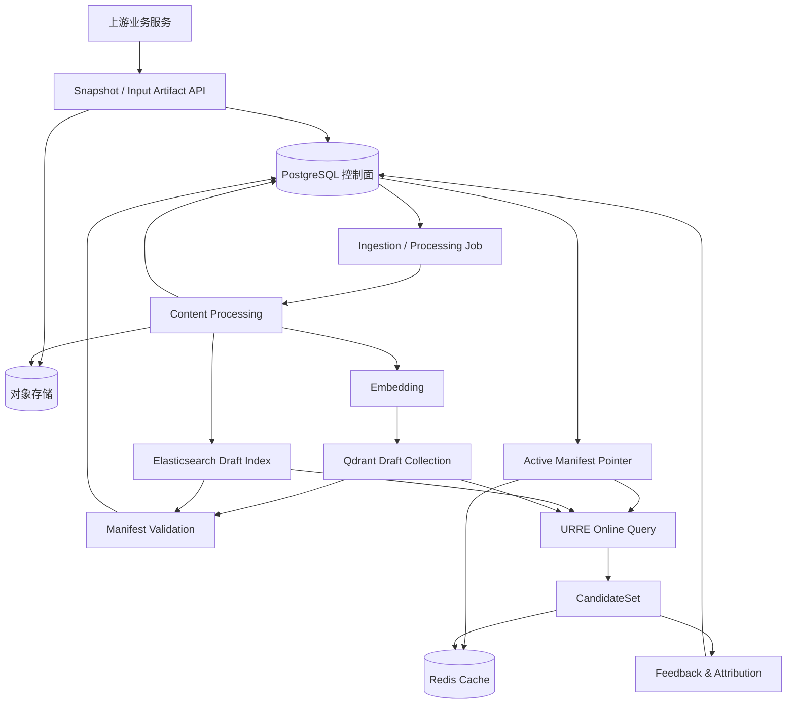
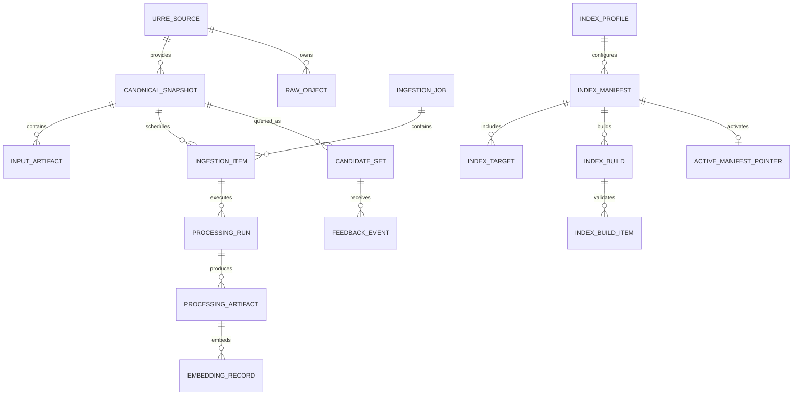
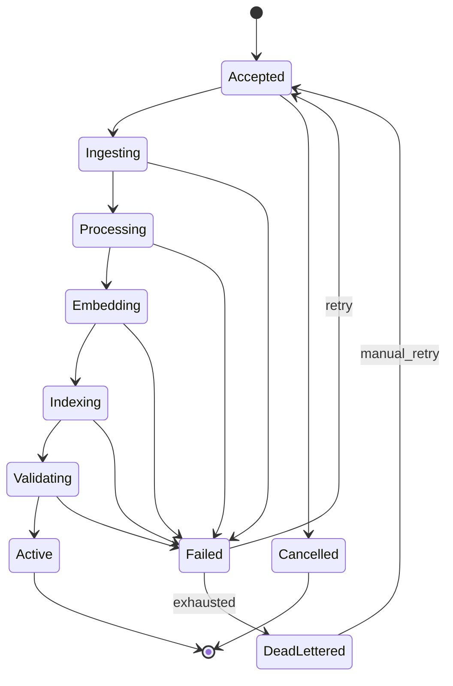
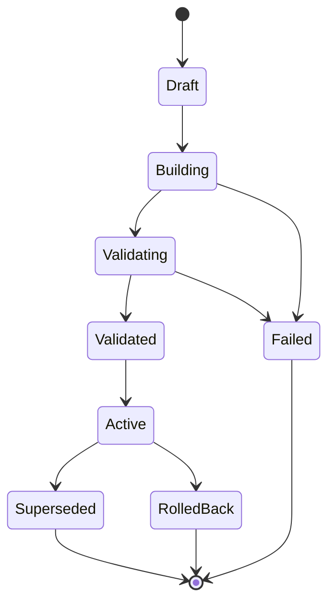

# URRE 数据与存储模型设计

**定位：** 真实 URRE 2.0 的数据加工、控制面、检索投影和存储模型基线。

**适用范围：** 原材料接入、Canonical Snapshot、Search Projection、Embedding、索引构建、Manifest 发布、候选结果和反馈归因。

**模型约束：** 视频素材只使用 `Video -> Clip` 两级对象。Storyboard、ClipPlan、ClipRequirement 和 MaterialAssignment 属于计划侧，不进入 URRE 素材索引。

**交付关系：** 本文描述未来真实 URRE 的数据和存储模型，不构成本次 Video Domain Agent Mock 交付的门禁。当前交付仍以 [交付范围与 Video/Clip 模型](implementation/00_交付范围与VideoClip模型.md) 和 [工程契约与研发 Backlog](implementation/05_VideoDomainAgent_工程契约与研发Backlog.md) 为准。

**上游基线：** 平台分层与能力边界见 [URRE 架构设计](01_URRE架构设计.md)；业务事实与领域对象边界见 [Video Domain 架构设计](03_VideoDomain架构设计.md) 和 [架构设计总纲](00_架构设计总纲.md)。

**阅读路径：** 先看 §2–§6 建立事实源、版本链和实体关系；再看 §7–§8 冻结 API；随后按 §9–§13 落地 PostgreSQL、对象存储、ES、Qdrant 和 Redis；最后用 §14–§17 验证一致性与安全。

## 1. 设计目标

本设计回答以下问题：

1. 原材料、上游业务快照、技术元数据和加工产物分别如何建模。
2. 哪个存储是事实源，哪些存储可以重建。
3. 上游如何登记资料来源、提交快照、触发加工和查询任务。
4. Video / Clip 如何生成全文、向量和过滤字段。
5. Elasticsearch、Qdrant 和 Redis 分别保存什么，键和字段如何设计。
6. 如何保证同一份加工快照生成一致的 ES 文档和 Qdrant Point。
7. 如何支持增量加工、索引重建、原子切换和回滚。
8. 如何把请求、候选、曝光、采用和替换反馈关联到同一策略与索引版本。

## 2. 范围与非目标

### 2.1 本文覆盖

- Source、Snapshot、Raw Object、Input Artifact 的元数据模型。
- Processing Profile、Ingestion Job、Processing Run 和 Processing Artifact。
- Embedding、Index Profile、Index Manifest、Index Build 和 Active Manifest。
- 上游数据接入 API 与检索 API 的参数模型。
- PostgreSQL 控制面模型。
- 对象存储目录与生命周期。
- Elasticsearch Mapping、Qdrant Collection / Payload 和 Redis Key 模型。
- 数据血缘、幂等、一致性、权限、可观测性和验收。

### 2.2 本文不覆盖

- 本次 Video Domain Agent 的 Mock 实现和验收阻断标准。
- 真实视频转码、抽帧、ASR、OCR、视觉理解模型的算法实现。
- 推荐训练、排序模型训练和 A/B 实验平台。
- 前端工作台、媒体渲染、时间线和导出。
- 版权、许可、地域可用性和商业用途过滤。
- 具体 Embedding 模型、向量维度和排序模型的最终选型。

### 2.3 存储职责

| 存储 | 权威性 | 保存内容 | 重建能力 |
|---|---|---|---|
| PostgreSQL 控制面 | 权威 | Source、Snapshot、Profile、Job、Artifact、Manifest、配额、反馈索引 | 必须备份，不可由 ES/Qdrant 重建 |
| 对象存储 | 内容权威 | 原始二进制、转码文件、抽帧、文本产物、向量产物 | 可从原始对象和 Profile 重新生成派生内容 |
| Elasticsearch | 派生 | 全文检索字段、结构化过滤字段、排序字段 | 可从 Snapshot 和 Search Projection 重建 |
| Qdrant | 派生 | 文本、视觉和多模态向量及过滤 Payload | 可从加工产物和 Embedding 重新构建 |
| Redis | 非权威 | 查询缓存、候选快照、限流、锁、Manifest 指针缓存 | 可以全部丢失并回源 |

核心原则：

- PostgreSQL 保存“发生了什么、使用了哪个版本、是否已发布”。
- 对象存储保存不可变内容和加工产物。
- Elasticsearch 和 Qdrant 只保存可重建的检索投影。
- Redis 只保存短生命周期状态，不能承担一致性事实。
- 任何在线查询都必须固定到同一个 `index_manifest_id`。

### 2.4 与现有文档的缺口对照

| 现有文档状态 | 缺口 | 本文落点 |
|---|---|---|
| `01` 已定义能力、召回流水线和发布原则 | 缺少 Source、Snapshot、Raw Object 和 Input Artifact 字段 | §5.2–§5.5 |
| `01` 已定义 Processing Profile 和状态原则 | 缺少 Job、Item、Run、Artifact 的持久化模型 | §5.6–§5.8、§9.3–§9.5 |
| `01` 只描述 Input / Query 能力 | 缺少数据接入和查询参数模型 | §7、§8 |
| `implementation/05` 只有 Video Domain Agent 业务表 | 缺少 URRE 控制面 DDL | §9 |
| `01` 已选择 ES/Qdrant 分工 | 缺少 ES Mapping 和 Qdrant Payload | §11、§12 |
| 现有文档没有 Redis 数据模型 | 缺少 Key、TTL、缓存失效和锁 | §13 |
| `01` 已定义 Active Manifest 原则 | 缺少 Manifest、Target、Build 和 Active Pointer 表 | §5.10–§5.11、§9.6 |
| `01` 只提出未来验收条件 | 缺少可执行的存储一致性和故障验收 | §14、§17 |
| 当前 `implementation/` 继续使用 Mock | 需要明确真实 Adapter 的迁移路径 | §20 |

## 3. 总体数据架构



数据平面分为四个工作区：

1. **接入区：** 接收业务快照、原始对象引用和上游稳定产物。
2. **加工区：** 生成技术元数据、Clip 切分、文本、视觉标签、ASR/OCR、Search Projection 和 Embedding。
3. **索引区：** 从加工产物生成 ES 文档和 Qdrant Point，构建不可变索引世代。
4. **发布区：** 校验索引后通过 Active Manifest 原子切换在线读取目标。

## 4. 命名、主键与版本规则

### 4.1 通用命名

- JSON、数据库和事件字段统一使用 `snake_case`。
- 时间戳使用 UTC，字段以 `_at` 结尾。
- 毫秒字段以 `_ms` 结尾。
- 版本字段以 `_version` 结尾。
- 主键以 `_id` 结尾。
- 枚举值使用小写 `snake_case`。
- 业务 ID 保留上游原始字符串，不重新编码。
- 内部瞬时对象优先使用 UUIDv7；需要稳定派生 ID 时使用 UUIDv5。

### 4.2 逻辑对象键

```text
logical_key =
  tenant_id
  + domain
  + entity_type
  + entity_id
```

Video 和 Clip 的 `entity_type` 只能是 `video` 或 `clip`。

Clip 的逻辑键必须同时保留父 Video 关系：

```text
clip_logical_key =
  tenant_id
  + domain=video
  + entity_type=clip
  + video_id
  + clip_id
```

### 4.3 版本链

```text
content_version
  → 原始二进制或上游内容发生合法替换时递增

metadata_version
  → 上游权威标题、标签、属性或业务状态变化时递增

snapshot_version
  → 由 content_version + metadata_version + entity_schema_version
     形成的不可变业务快照

processing_profile_version
  → 加工步骤、模型、分块和提示词配置的固定版本

embedding_model_version
  → 单个 Embedding 空间的模型版本

index_profile_version
  → ES Mapping、Qdrant Collection 配置和字段投影规则的固定版本

index_manifest_id
  → 一组已校验 ES/Qdrant 物理资源的原子发布单元
```

### 4.4 幂等键

```text
snapshot_key =
  tenant_id + domain + entity_type + entity_id
  + content_version + metadata_version + entity_schema_version

processing_key =
  snapshot_hash + processing_profile_id + processing_profile_version

embedding_key =
  processing_artifact_hash + embedding_space + embedding_model_id
  + embedding_model_version

index_item_key =
  tenant_id + index_profile_version + index_target
  + entity_type + entity_id + metadata_version
  + processing_artifact_hash + index_embedding_outputs_hash

job_idempotency_key =
  tenant_id + operation_type + source_id + selector_hash
  + profile_version + index_profile_version
```

Request 级别幂等键只用于防止重复提交，不替代 Snapshot、Processing、Embedding 或 Index Item 的版本键。

### 4.5 Hash 计算

- 所有 `*_sha256` 和 `*_hash` 使用小写十六进制 SHA-256，长度 64。
- JSON 内容按稳定键排序、UTF-8 编码后进行 hash。
- `business_payload_hash` 只覆盖上游业务 Payload。
- `snapshot_hash` 覆盖 Snapshot 信封、业务 Payload hash、Raw Object hash、Input Artifact hashes 和版本字段。
- `processing_artifact_hash` 覆盖加工产物的规范内容或不可变对象 hash。
- `projection_hash` 覆盖完整 Search Projection。
- `source_snapshot_hash` 覆盖 Manifest 中参与构建的 Snapshot hash 集合。

hash 算法或规范化规则变化必须升级 Schema 版本，不能在原版本上静默改变。

## 5. 核心数据实体

### 5.1 实体关系



### 5.2 Source

`Source` 描述一个可接入的上游来源或外部平台。

关键字段：

- `source_id`
- `tenant_id`
- `domain`
- `source_type`：`business_service`、`object_storage`、`external_platform`
- `display_name`
- `credential_ref`：只保存密钥引用，不保存明文凭据
- `supported_operations`
- `default_processing_profile_id`
- `status`
- `config_json`
- `config_hash`
- `created_at` / `updated_at`

### 5.3 Canonical Snapshot

`CanonicalSnapshot` 是上游权威对象在某一时刻的不可变快照。

关键字段：

- `snapshot_id`
- `tenant_id`
- `source_id`
- `domain`
- `entity_type`
- `entity_id`
- `video_id`：Clip 必填
- `entity_schema_version`
- `content_version`
- `metadata_version`
- `business_payload_json`
- `business_payload_hash`
- `snapshot_hash`
- `raw_object_id`
- `status`：`accepted`、`superseded`、`deleted`、`rejected`
- `captured_at`
- `superseded_by_snapshot_id`

规则：

- Snapshot 一旦被加工引用就不可修改。
- 上游业务字段只读，数据加工平面不得静默纠正。
- 发现 Schema 或 hash 冲突时拒绝快照，并返回可归因错误。

Video 的 `business_payload_json` 至少包含：

- `video_id`
- `title`
- `source_type`
- `duration_ms`
- `width` / `height` / `fps`
- `preview_ref`
- `availability`
- `tags`
- `status`
- `created_at`

Clip 的 `business_payload_json` 至少包含：

- `clip_id`
- `video_id`
- `start_ms` / `end_ms` / `duration_ms`
- `preview_ref`
- `keyframe_ref`
- `semantic_summary`
- `tags`
- `quality_flags`
- `availability`
- `feature_version`
- `model_versions`

业务 Payload 只保存上游事实和必要元数据。ES 文档、Qdrant Payload 和 Search Projection 都是其检索侧投影，不得反向成为业务事实。

### 5.4 Raw Object

`RawObject` 表示不可变原始内容，可按内容 hash 去重。

关键字段：

- `raw_object_id`
- `tenant_id`
- `source_id`
- `storage_uri`
- `storage_class`
- `content_sha256`
- `mime_type`
- `byte_size`
- `technical_metadata_json`
- `encryption_key_ref`
- `retention_policy_id`
- `created_at`

`storage_uri` 是内部对象地址，不允许直接返回给调用方。

Source Adapter 必须校验：

- URI Scheme、主机和路径前缀位于 Source 允许列表内。
- 禁止 `file://`、本机路径和任意公网 URL。
- 外部临时 URL 只在接入时使用，不能持久化为长期地址。

### 5.5 Input Artifact

`InputArtifact` 表示上游已经生成、可被 URRE 直接复用的稳定产物。

典型类型：

- `clip_segmentation`
- `asr_transcript`
- `ocr_result`
- `visual_labels`
- `keyframe_manifest`
- `embedding_bundle`

关键字段：

- `input_artifact_id`
- `tenant_id`
- `snapshot_id`
- `artifact_type`
- `schema_version`
- `storage_uri`
- `content_sha256`
- `producer`
- `producer_version`
- `metadata_json`
- `status`

规则：

- Schema、hash、来源和权限校验通过后优先复用。
- 只有缺少可用产物或检索侧需要不同表示时，才重新生成 Search Projection。

### 5.6 Processing Profile

`ProcessingProfile` 是不可变、可发布的加工配置。

关键字段：

- `processing_profile_id`
- `version`
- `domain`
- `display_name`
- `status`：`draft`、`published`、`deprecated`
- `input_schema_versions`
- `stage_graph_json`
- `text_chunking_config`
- `visual_sampling_config`
- `embedding_profile_ids`
- `output_projection_types`
- `config_hash`
- `published_at`

规则：

- 已发布版本不可原地修改。
- 修改任一阶段、模型、分块或提示词配置必须产生新版本。
- 在线请求只能引用 `published` 版本。

### 5.7 Ingestion Job 与 Item

`IngestionJob` 是批次级控制对象，`IngestionItem` 是单个实体或单个处理单元。

Job 关键字段：

- `job_id`
- `tenant_id`
- `source_id`
- `domain`
- `mode`：`batch`、`incremental`、`backfill`、`rebuild`
- `selector_json`
- `processing_profile_id` / `processing_profile_version`
- `index_profile_id` / `index_profile_version`
- `idempotency_key`
- `status`
- `priority`
- `deadline_at`
- `total_item_count` / `succeeded_item_count` / `failed_item_count`
- `created_by`

Item 关键字段：

- `item_id`
- `tenant_id`
- `job_id`
- `snapshot_id`
- `item_key`
- `status`
- `current_stage`
- `attempt`
- `last_error_code`
- `started_at` / `finished_at`

### 5.8 Processing Run 与 Artifact

`ProcessingRun` 表示某个 Item 在某个加工阶段的执行记录。

关键字段：

- `processing_run_id`
- `tenant_id`
- `item_id`
- `stage`
- `processing_profile_id` / `version`
- `input_hash`
- `output_hash`
- `status`
- `attempt`
- `model_id` / `model_version`
- `error_code`
- `error_detail_json`
- `started_at` / `finished_at`

`ProcessingArtifact` 表示可复用产物：

- `processing_artifact_id`
- `tenant_id`
- `processing_run_id`
- `artifact_type`
- `schema_version`
- `storage_uri`
- `content_sha256`
- `input_artifact_ids`
- `metadata_json`
- `created_at`

`SearchProjection` 是 Indexing Worker 唯一接受的跨存储规范输入：

```json
{
  "schema_version": "1.0",
  "projection_id": "proj_clip_003_v7",
  "tenant_id": "tenant_demo",
  "domain": "video",
  "entity_type": "clip",
  "entity_id": "clip_003",
  "video_id": "video_002",
  "content_version": 3,
  "metadata_version": 7,
  "processing_profile_version": "1.0",
  "filter_fields": {
    "availability": "available",
    "tags": ["human_robot_collaboration"],
    "subjects": ["engineer", "industrial_robot_arm"],
    "actions": ["collaborative_assembly"],
    "duration_ms": 7000,
    "start_ms": 2000,
    "end_ms": 9000
  },
  "text_units": [
    {
      "text_unit_id": "tu_summary_001",
      "text_type": "semantic_summary",
      "language": "zh-CN",
      "text": "工程师与机械臂协作完成精密装配",
      "char_start": 0,
      "char_end": 17,
      "content_hash": "0123456789abcdef0123456789abcdef0123456789abcdef0123456789abcdef"
    }
  ],
  "visual_units": [
    {
      "visual_unit_id": "vu_frame_001",
      "sample_ms": 4500,
      "image_ref": "urre/evidence/tenant_demo/video/clip/clip_003/frame_4500.jpg",
      "labels": ["assembly", "close_up"],
      "content_hash": "abcdef0123456789abcdef0123456789abcdef0123456789abcdef0123456789"
    }
  ],
  "evidence_refs": ["evidence/clip_003/frame_001"],
  "projection_hash": "89abcdef0123456789abcdef0123456789abcdef0123456789abcdef01234567"
}
```

规则：

- `SearchProjection` 必须包含 Indexing Worker 需要的全部字段。
- Indexing Worker 不得临时回查业务数据库或重新执行内容理解。
- `filter_fields` 与 ES/Qdrant 的过滤字段使用同一套字段名。
- 每个 `text_unit` 和 `visual_unit` 必须有稳定 ID 与内容 hash。

### 5.9 Embedding Record

`EmbeddingProfile` 固定向量空间和模型配置：

- `embedding_profile_id`
- `version`
- `domain`
- `embedding_space`
- `model_id`
- `model_version`
- `dimension`
- `distance_metric`
- `normalization`
- `max_batch_size`
- `status`
- `config_hash`
- `published_at`

`EmbeddingRecord` 描述一个向量空间的输出，不把 PostgreSQL 当向量数据库。

关键字段：

- `embedding_record_id`
- `tenant_id`
- `processing_artifact_id`
- `embedding_space`
- `embedding_profile_id` / `embedding_profile_version`
- `model_id`
- `model_version`
- `dimension`
- `distance_metric`
- `normalization`
- `vector_uri`
- `vector_sha256`
- `status`
- `created_at`

规则：

- 文本、视觉和多模态向量分别计算。
- 不同模型主版本不得写入同一个 Collection。
- PostgreSQL 只保存向量产物引用、模型版本和 hash。

### 5.10 Index Profile、Manifest 与 Build

`IndexProfile` 固定字段投影和物理索引配置。

关键字段：

- `index_profile_id`
- `version`
- `domain`
- `es_index_template_version`
- `qdrant_collection_template_version`
- `field_projection_version`
- `mapping_hash`
- `status`
- `published_at`

`IndexProfile` 是领域级配置，覆盖 Video 和 Clip 的字段投影及模板；具体 Entity Target 由 `IndexTarget` 表达。

`IndexManifest` 是跨 Elasticsearch 与 Qdrant 的唯一发布单元。

关键字段：

- `manifest_id`
- `pool_id`
- `domain`
- `index_profile_id` / `index_profile_version`
- `source_watermark_json`
- `source_snapshot_hash`
- `status`
- `expected_entity_count`
- `expected_document_count`
- `expected_point_count`
- `validation_summary_json`
- `created_at` / `validated_at` / `activated_at`

`source_snapshot_hash` 是该 Manifest 所覆盖 Snapshot 按逻辑键稳定排序后形成的聚合 hash，用于证明 ES 和 Qdrant 来自同一批输入。

`IndexTarget` 描述 Manifest 中的单个物理目标：

- `index_target_id`
- `manifest_id`
- `target_kind`：`elasticsearch`、`qdrant`
- `entity_type`
- `vector_space`：ES Target 为空
- `physical_name`
- `alias_name`
- `schema_version`
- `model_version`
- `expected_count`
- `actual_count`
- `content_hash`
- `status`

`IndexBuild` 与 `IndexBuildItem` 保存构建和校验过程：

- `index_build_id`
- `manifest_id`
- `index_target_id`
- `status`
- `expected_count` / `written_count` / `validated_count` / `failed_count`
- `validation_report_uri`
- `started_at` / `finished_at`

### 5.11 Active Manifest

在线读取不能直接依赖“最新索引”，必须依赖显式指针。

关键字段：

- `pool_id`
- `domain`
- `manifest_id`
- `manifest_epoch`
- `updated_by`
- `updated_at`

一个 `pool_id + domain` 对应一个 Active Manifest，Manifest 内部包含 Video 和 Clip 的全部 ES/Qdrant Target。这样跨层级 Search 仍能固定到同一版本。

`manifest_epoch` 每次切换必须单调递增。Redis 缓存、请求日志和 CandidateSet 都应记录该值。

Manifest 的激活范围是 `pool_id + domain`，属于索引池级发布动作。共享 Pool 中的租户 Job 只能写入 Draft Target，不能自行激活 Manifest；只有控制面在完整校验后可以切换。专用 Pool 可以由该租户的受控运维动作发布。

### 5.12 CandidateSet 与 Feedback

CandidateSet 是检索请求的不可变响应快照，用于展示、解释和后续反馈归因。

关键字段：

- `candidate_set_id`
- `tenant_id`
- `request_id`
- `domain`
- `capability`
- `strategy_id` / `strategy_version`
- `index_manifest_id` / `manifest_epoch`
- `project_id` / `task_id` / `storyboard_clip_id`
- `handled_by`
- `items_json` 或 `content_uri`
- `warnings_json`
- `expires_at`

Feedback 必须能定位到候选集合和具体候选：

- `feedback_id`
- `tenant_id`
- `event_type`
- `source`
- `occurred_at`
- `request_id`
- `candidate_set_id`
- `candidate_id`
- `entity_type` / `entity_id`
- `video_id` / `clip_id`
- `exposure_position`
- `strategy_id` / `strategy_version`
- `index_manifest_id`
- `idempotency_key`
- `properties_json`

## 6. 状态机

### 6.1 Ingestion Item



规则：

- `Active` 只表示 Item 已进入一个已校验索引目标，不表示 Manifest 已全局在线。
- 重试必须复用原 Item 和 Processing Key。
- 超过重试上限进入 `DeadLettered`，不能无限占用主队列。

### 6.2 Index Manifest



规则：

- `Draft`、`Building` 和 `Validating` 的索引不可被在线请求读取。
- 只有控制面通过 CAS 更新 Active Pointer 后，Manifest 才可标记为 `Active`。
- 切换失败时保留原 Active Manifest。
- 回滚是把旧 Manifest 重新激活，不是修改旧索引。

## 7. 上游数据接入 API

以下路径为真实 URRE 2.0 的建议契约，当前 Mock 交付不强制实现。

统一前缀：

```text
/open/v1/urre
```

### 7.1 公共请求约束

所有接口使用：

```http
Authorization: Bearer <service-token>
X-Tenant-Id: <trusted-gateway-injected>
X-Request-Id: <request-id>
Idempotency-Key: <required-for-mutation>
Traceparent: <w3c-trace-context>
Content-Type: application/json
```

禁止客户端在请求体中覆盖 `tenant_id`、`user_id` 或 `project_scope`。

数据接入、Profile 发布、Manifest 和索引重建接口必须使用独立的服务管理权限；普通检索调用方不能调用这些接口。

### 7.2 注册 Source

```http
POST /open/v1/urre/sources
```

```json
{
  "schema_version": "1.0",
  "domain": "video",
  "source_type": "business_service",
  "display_name": "Video Business Service",
  "credential_ref": "vault://urre/source-video-business",
  "supported_operations": ["snapshot", "artifact"],
  "default_processing_profile": {
    "profile_id": "video-default",
    "version": "1.0"
  },
  "config": {}
}
```

响应至少返回：

```json
{
  "source_id": "src_video_business",
  "status": "active",
  "config_hash": "0123456789abcdef0123456789abcdef0123456789abcdef0123456789abcdef",
  "created_at": "2026-11-13T00:00:00Z"
}
```

### 7.3 提交 Canonical Snapshot

```http
POST /open/v1/urre/snapshots
```

```json
{
  "schema_version": "1.0",
  "source_id": "src_video_business",
  "domain": "video",
  "entity_type": "clip",
  "entity_id": "clip_003",
  "video_id": "video_002",
  "entity_schema_version": "video-clip.v1",
  "content_version": 3,
  "metadata_version": 7,
  "business_payload": {
    "video_id": "video_002",
    "clip_id": "clip_003",
    "title": "人机协作装配",
    "start_ms": 2000,
    "end_ms": 9000,
    "duration_ms": 7000,
    "availability": "available",
    "tags": ["human_robot_collaboration"]
  },
  "raw_object": {
    "storage_uri": "s3://video-source/tenant_demo/video_002/source.mp4",
    "content_sha256": "0123456789abcdef0123456789abcdef0123456789abcdef0123456789abcdef",
    "mime_type": "video/mp4",
    "byte_size": 104857600,
    "technical_metadata": {
      "width": 1920,
      "height": 1080,
      "fps": 25,
      "duration_ms": 58000
    }
  },
  "input_artifact_refs": []
}
```

响应至少返回：

```json
{
  "snapshot_id": "snap_video_002_clip_003_v3_7",
  "snapshot_hash": "abcdef0123456789abcdef0123456789abcdef0123456789abcdef0123456789",
  "status": "accepted",
  "processing_required": true,
  "accepted_input_artifacts": []
}
```

冲突处理：

- 相同 Snapshot 重放返回原结果。
- 相同版本但 `business_payload_hash` 不同返回 `409 SNAPSHOT_CONFLICT`。
- Schema 校验失败返回 `422 SNAPSHOT_SCHEMA_INVALID`。

### 7.4 登记 Input Artifact

```http
POST /open/v1/urre/input-artifacts
```

```json
{
  "schema_version": "1.0",
  "source_id": "src_video_business",
  "snapshot_id": "snap_video_002_clip_003_v3_7",
  "artifact_type": "asr_transcript",
  "artifact_schema_version": "asr.v1",
  "storage_uri": "s3://video-derived/tenant_demo/clip_003/asr.json",
  "content_sha256": "0123456789abcdef0123456789abcdef0123456789abcdef0123456789abcdef",
  "producer": "upstream-asr",
  "producer_version": "2.1.0",
  "metadata": {
    "language": "zh-CN"
  }
}
```

### 7.5 创建 Ingestion Job

```http
POST /open/v1/urre/ingestion/jobs
```

```json
{
  "schema_version": "1.0",
  "source_id": "src_video_business",
  "domain": "video",
  "mode": "batch",
  "selector": {
    "snapshot_ids": [
      "snap_video_001_v1",
      "snap_video_002_v1"
    ]
  },
  "processing_profile": {
    "profile_id": "video-default",
    "version": "1.0"
  },
  "index_profile": {
    "profile_id": "video-search-default",
    "version": "1.0"
  },
  "priority": "normal",
  "deadline_at": "2026-11-14T00:00:00Z",
  "dry_run": false
}
```

Selector 至少支持：

- 明确 `snapshot_ids`
- `entity_ids`
- 上游更新时间范围
- Source 全量
- 失败集合
- 指定 `ingestion_item_ids`

单个 Job 的对象数量和扫描范围必须受限，超限时要求拆分。

### 7.6 Job 与 Manifest 查询

```http
GET /open/v1/urre/ingestion/jobs/{jobId}
POST /open/v1/urre/ingestion/jobs/{jobId}/cancel
POST /open/v1/urre/ingestion/jobs/{jobId}/retry
GET /open/v1/urre/index-manifests/{manifestId}
```

Job 状态响应至少包含：

```json
{
  "job_id": "job_001",
  "status": "running",
  "counts": {
    "total": 1200,
    "succeeded": 850,
    "failed": 3,
    "dead_lettered": 0
  },
  "stage_counts": {
    "ingesting": 2,
    "processing": 120,
    "embedding": 80,
    "indexing": 145
  },
  "started_at": "2026-11-13T00:00:00Z",
  "deadline_at": "2026-11-14T00:00:00Z"
}
```

### 7.7 触发索引重建

```http
POST /open/v1/urre/index-rebuilds
```

```json
{
  "schema_version": "1.0",
  "domain": "video",
  "index_profile": {
    "profile_id": "video-search-default",
    "version": "2.0"
  },
  "source_selector": {
    "source_ids": ["src_video_business"],
    "metadata_updated_after": "2026-01-01T00:00:00Z"
  },
  "processing_profile": {
    "profile_id": "video-default",
    "version": "1.0"
  },
  "reason": "embedding_model_upgrade",
  "dry_run": false
}
```

`activate` 属于受控运维动作，不应作为普通上游 API 暴露。需要启用时必须经过独立权限、审批和 CAS 校验。

## 8. 检索 API 参数模型

检索接口沿用当前公开契约：

```text
POST /api/v1/retrieval/search
POST /api/v1/retrieval/recommend
POST /api/v1/retrieval/similar
POST /api/v1/retrieval/feedback
POST /api/v1/evidence/resolve
```

Search、Recommendation、Similarity 和未来的 Explore 共享分页、追踪、错误和 CandidateSet 约定，但不得共享同一套目标函数和评估集。

### 8.1 SearchRequest

```json
{
  "schema_version": "1.0",
  "domain": "video",
  "query": "工程师与机械臂协作装配的近景",
  "target_levels": ["clip", "video"],
  "filters": {
    "duration_ms": {"gte": 3000, "lte": 10000},
    "availability": ["available"],
    "tags_any": ["human_robot_collaboration"]
  },
  "soft_preferences": {
    "orientation": "landscape"
  },
  "recall": {
    "channels": ["keyword", "semantic", "visual", "metadata"],
    "candidate_budget": 200
  },
  "ranking": {
    "strategy_id": "video-hybrid",
    "strategy_version": "1.0"
  },
  "page": {
    "size": 20,
    "cursor": null
  },
  "deadline_ms": 8000
}
```

请求字段约束：

| 字段 | 类型 | 必填 | 说明 |
|---|---|---|---|
| `schema_version` | string | 是 | 请求契约版本 |
| `domain` | string | 是 | 本期固定 `video` |
| `query` | string | 是 | 原始 Query，最长 500 字符 |
| `target_levels` | string[] | 是 | `video`、`clip` |
| `filters` | object | 否 | 硬过滤，必须在排序前生效 |
| `soft_preferences` | object | 否 | 可降级偏好 |
| `recall.channels` | string[] | 否 | 未指定时使用策略默认通道 |
| `recall.candidate_budget` | integer | 否 | 进入排序前的候选上限 |
| `ranking.strategy_id` | string | 否 | 必须能在策略注册表解析 |
| `ranking.strategy_version` | string | 否 | 未指定时使用当前已发布版本 |
| `page.cursor` | string | 否 | 不透明游标 |
| `deadline_ms` | integer | 否 | 在线请求总预算 |

`filters` 只允许 Domain Schema 注册的字段和操作符，不允许透传任意 ES Query DSL。

### 8.2 RecommendationRequest

```json
{
  "schema_version": "1.0",
  "domain": "video",
  "scene": "clip_candidate",
  "context": {
    "project_id": "project_001",
    "task_id": "task_001",
    "clip_plan_id": "clipplan_001",
    "storyboard_clip_id": "sb_clip_003",
    "clip_requirement": {
      "storyboard_clip_id": "sb_clip_003",
      "narrative_role": "proof",
      "visual_goal": "人机协作完成精密装配",
      "clip_type": "close_up",
      "duration_target_ms": 5000,
      "hard_constraints": {},
      "soft_preferences": {},
      "fallback_requirements": {},
      "evidence_requirements": []
    },
    "selected": [],
    "excluded_clip_ids": [],
    "covered_storyboard_clip_ids": []
  },
  "strategy": {
    "strategy_id": "video-clip-fit",
    "strategy_version": "1.0"
  },
  "limit": 20,
  "deadline_ms": 8000
}
```

约束：

- `covered_storyboard_clip_ids` 只允许计划侧 `sb_clip_*`。
- `selected` 与 `covered_storyboard_clip_ids` 必须一致；如不一致，Schema 拒绝。
- `excluded_clip_ids` 只允许素材 `clip_id`。
- 已选、已覆盖和排除条件必须出现在反馈归因上下文中。

### 8.3 SimilarRequest

```json
{
  "schema_version": "1.0",
  "domain": "video",
  "seed": {
    "entity_type": "clip",
    "video_id": "video_002",
    "clip_id": "clip_003"
  },
  "similarity_targets": ["semantic", "visual"],
  "filters": {
    "availability": ["available"]
  },
  "strategy": {
    "strategy_id": "video-similar",
    "strategy_version": "1.0"
  },
  "limit": 20,
  "deadline_ms": 5000
}
```

响应必须明确记录实际生效的 `similarity_targets`，并禁止返回 Seed 自身。

### 8.4 ExploreRequest

Explore 不属于当前 Video Domain Agent 交付，但数据模型预留：

```json
{
  "schema_version": "1.0",
  "domain": "video",
  "context": {
    "project_id": "project_001",
    "task_id": "task_001"
  },
  "exploration": {
    "goal": "coverage",
    "novelty_weight": 0.3,
    "max_distance": 0.45
  },
  "filters": {},
  "limit": 20
}
```

Explore 结果必须在 CandidateSet 中显式标记探索原因，不能伪装成高相关性 Search 结果。

### 8.5 CandidateSet 响应

当前 CandidateSet 的字段可以继续使用，但真实 URRE 需要补齐来源和索引版本：

```json
{
  "schema_version": "1.1",
  "candidate_set_id": "cs_001",
  "request_id": "req_001",
  "domain": "video",
  "capability": "search",
  "handled_by": "fast_path",
  "strategy_id": "video-hybrid",
  "strategy_version": "1.0",
  "index_manifest_id": "manifest_video_20261113_01",
  "manifest_epoch": 42,
  "items": [
    {
      "candidate_id": "cand_001",
      "entity_type": "clip",
      "entity_id": "clip_003",
      "video_id": "video_002",
      "clip_id": "clip_003",
      "start_ms": 2000,
      "end_ms": 9000,
      "rank": 1,
      "score": 0.923,
      "score_breakdown": {
        "keyword": 0.84,
        "semantic": 0.94,
        "visual": null,
        "metadata": 0.90
      },
      "score_normalization_version": "rrf-v1",
      "candidate_origins": ["search", "recommendation"],
      "source_candidate_set_ids": ["cs_search_001", "cs_rec_001"],
      "matched_requirements": ["human_robot_collaboration"],
      "matched_similarity_targets": [],
      "recall_channels": ["keyword", "semantic"],
      "evidence": {
        "summary": "工程师与机械臂协作装配",
        "evidence_refs": ["evidence/clip_003/frame_001"]
      },
      "availability": "available",
      "versions": {
        "feature_version": "fixture-v1",
        "model_versions": ["text-embed-v1"],
        "index_profile_version": "1.0"
      }
    }
  ],
  "trace": {
    "query_version": "qp-v1",
    "latency_ms": 86,
    "degraded_channels": [],
    "model_versions": ["text-embed-v1"],
    "index_manifest_id": "manifest_video_20261113_01"
  },
  "page": {
    "next_cursor": null,
    "has_more": false
  },
  "warnings": []
}
```

兼容策略：

- 当前 Mock 可以只实现 `schema_version: "1.0"` 的必需字段。
- 真实 URRE 应在 `1.x` 内增加可选的来源、索引和 trace 字段。
- 业务层不得依赖 Mock 分数与真实模型分数的绝对值可比。

### 8.6 FeedbackRequest

```json
{
  "schema_version": "1.0",
  "event_type": "recommendation.clicked",
  "source": "api",
  "occurred_at": "2026-11-13T10:00:00Z",
  "request_id": "req_001",
  "candidate_set_id": "cs_001",
  "candidate_id": "cand_001",
  "project_id": "project_001",
  "task_id": "task_001",
  "storyboard_clip_id": "sb_clip_003",
  "entity_type": "clip",
  "entity_id": "clip_003",
  "video_id": "video_002",
  "clip_id": "clip_003",
  "exposure_position": 1,
  "strategy_id": "video-clip-fit",
  "strategy_version": "1.0",
  "index_manifest_id": "manifest_video_20261113_01",
  "properties": {}
}
```

`Idempotency-Key` 同时进入 `FeedbackCommand` 的内部模型，真实 Adapter 重试时不得丢失。

## 9. PostgreSQL 控制面模型

以下 DDL 是逻辑基线，正式迁移文件仍需由 Schema 生成与评审流程产出。

### 9.1 多租户与 Source

```sql
CREATE TABLE urre_source (
  tenant_id              varchar(64) NOT NULL,
  source_id              varchar(64) NOT NULL,
  domain                 varchar(32) NOT NULL,
  source_type            varchar(32) NOT NULL,
  display_name           varchar(200) NOT NULL,
  credential_ref         varchar(500),
  supported_operations_json jsonb NOT NULL DEFAULT '[]'::jsonb,
  default_processing_profile_id varchar(64),
  default_processing_profile_version varchar(32),
  status                 varchar(32) NOT NULL,
  config_json            jsonb NOT NULL DEFAULT '{}'::jsonb,
  config_hash            char(64) NOT NULL,
  created_at             timestamptz NOT NULL DEFAULT now(),
  updated_at             timestamptz NOT NULL DEFAULT now(),
  PRIMARY KEY (tenant_id, source_id)
);

CREATE TABLE urre_raw_object (
  tenant_id              varchar(64) NOT NULL,
  raw_object_id          varchar(64) NOT NULL,
  source_id              varchar(64) NOT NULL,
  storage_uri            varchar(1000) NOT NULL,
  storage_class          varchar(32) NOT NULL,
  content_sha256         char(64) NOT NULL,
  mime_type              varchar(200) NOT NULL,
  byte_size              bigint NOT NULL CHECK (byte_size >= 0),
  technical_metadata_json jsonb NOT NULL DEFAULT '{}'::jsonb,
  encryption_key_ref     varchar(500),
  retention_policy_id    varchar(64),
  created_at             timestamptz NOT NULL DEFAULT now(),
  PRIMARY KEY (tenant_id, raw_object_id),
  UNIQUE (tenant_id, source_id, content_sha256),
  FOREIGN KEY (tenant_id, source_id)
    REFERENCES urre_source (tenant_id, source_id)
);
```

### 9.2 Canonical Snapshot 与 Input Artifact

```sql
CREATE TABLE urre_canonical_snapshot (
  tenant_id              varchar(64) NOT NULL,
  snapshot_id            varchar(80) NOT NULL,
  source_id              varchar(64) NOT NULL,
  domain                 varchar(32) NOT NULL,
  entity_type            varchar(16) NOT NULL CHECK (entity_type IN ('video','clip')),
  entity_id              varchar(64) NOT NULL,
  video_id               varchar(64),
  entity_schema_version  varchar(32) NOT NULL,
  content_version        bigint NOT NULL CHECK (content_version >= 0),
  metadata_version       bigint NOT NULL CHECK (metadata_version >= 0),
  business_payload_json  jsonb NOT NULL,
  business_payload_hash  char(64) NOT NULL,
  snapshot_hash          char(64) NOT NULL,
  raw_object_id          varchar(64),
  status                 varchar(32) NOT NULL,
  captured_at            timestamptz NOT NULL,
  superseded_by_snapshot_id varchar(80),
  created_at             timestamptz NOT NULL DEFAULT now(),
  PRIMARY KEY (tenant_id, snapshot_id),
  UNIQUE (
    tenant_id, domain, entity_type, entity_id,
    content_version, metadata_version, entity_schema_version
  ),
  FOREIGN KEY (tenant_id, source_id)
    REFERENCES urre_source (tenant_id, source_id),
  FOREIGN KEY (tenant_id, raw_object_id)
    REFERENCES urre_raw_object (tenant_id, raw_object_id),
  CHECK (
    (entity_type = 'video' AND video_id IS NULL)
    OR
    (entity_type = 'clip' AND video_id IS NOT NULL)
  )
);

CREATE TABLE urre_input_artifact (
  tenant_id              varchar(64) NOT NULL,
  input_artifact_id      varchar(80) NOT NULL,
  snapshot_id            varchar(80) NOT NULL,
  artifact_type          varchar(64) NOT NULL,
  schema_version         varchar(32) NOT NULL,
  storage_uri            varchar(1000) NOT NULL,
  content_sha256         char(64) NOT NULL,
  producer               varchar(100) NOT NULL,
  producer_version       varchar(64),
  metadata_json          jsonb NOT NULL DEFAULT '{}'::jsonb,
  status                 varchar(32) NOT NULL,
  created_at             timestamptz NOT NULL DEFAULT now(),
  PRIMARY KEY (tenant_id, input_artifact_id),
  FOREIGN KEY (tenant_id, snapshot_id)
    REFERENCES urre_canonical_snapshot (tenant_id, snapshot_id)
);
```

### 9.3 Profile

```sql
CREATE TABLE urre_processing_profile (
  processing_profile_id  varchar(64) NOT NULL,
  version                varchar(32) NOT NULL,
  domain                 varchar(32) NOT NULL,
  display_name           varchar(200) NOT NULL,
  status                 varchar(32) NOT NULL,
  input_schema_versions_json jsonb NOT NULL DEFAULT '[]'::jsonb,
  stage_graph_json       jsonb NOT NULL,
  text_chunking_config_json jsonb NOT NULL DEFAULT '{}'::jsonb,
  visual_sampling_config_json jsonb NOT NULL DEFAULT '{}'::jsonb,
  embedding_profile_ids_json jsonb NOT NULL DEFAULT '[]'::jsonb,
  output_projection_types_json jsonb NOT NULL DEFAULT '[]'::jsonb,
  config_hash            char(64) NOT NULL,
  published_at           timestamptz,
  created_at             timestamptz NOT NULL DEFAULT now(),
  PRIMARY KEY (processing_profile_id, version)
);

CREATE TABLE urre_index_profile (
  index_profile_id       varchar(64) NOT NULL,
  version                varchar(32) NOT NULL,
  domain                 varchar(32) NOT NULL,
  field_projection_version varchar(32) NOT NULL,
  es_index_template_version varchar(32) NOT NULL,
  qdrant_collection_template_version varchar(32) NOT NULL,
  mapping_hash           char(64) NOT NULL,
  status                 varchar(32) NOT NULL,
  published_at           timestamptz,
  created_at             timestamptz NOT NULL DEFAULT now(),
  PRIMARY KEY (index_profile_id, version)
);

CREATE TABLE urre_embedding_profile (
  embedding_profile_id   varchar(64) NOT NULL,
  version                varchar(32) NOT NULL,
  domain                 varchar(32) NOT NULL,
  embedding_space        varchar(64) NOT NULL,
  model_id               varchar(100) NOT NULL,
  model_version          varchar(64) NOT NULL,
  dimension              integer NOT NULL CHECK (dimension > 0),
  distance_metric        varchar(16) NOT NULL,
  normalization          varchar(32),
  max_batch_size         integer NOT NULL DEFAULT 64,
  status                 varchar(32) NOT NULL,
  config_hash            char(64) NOT NULL,
  published_at           timestamptz,
  created_at             timestamptz NOT NULL DEFAULT now(),
  PRIMARY KEY (embedding_profile_id, version)
);
```

### 9.4 Ingestion Job 与 Item

```sql
CREATE TABLE urre_ingestion_job (
  tenant_id              varchar(64) NOT NULL,
  job_id                 varchar(64) NOT NULL,
  source_id              varchar(64) NOT NULL,
  domain                 varchar(32) NOT NULL,
  mode                   varchar(32) NOT NULL,
  selector_json          jsonb NOT NULL,
  processing_profile_id  varchar(64) NOT NULL,
  processing_profile_version varchar(32) NOT NULL,
  index_profile_id       varchar(64) NOT NULL,
  index_profile_version  varchar(32) NOT NULL,
  idempotency_key        varchar(200) NOT NULL,
  status                 varchar(32) NOT NULL,
  priority               varchar(16) NOT NULL DEFAULT 'normal',
  deadline_at            timestamptz,
  total_item_count       bigint NOT NULL DEFAULT 0,
  succeeded_item_count   bigint NOT NULL DEFAULT 0,
  failed_item_count      bigint NOT NULL DEFAULT 0,
  created_by             varchar(64) NOT NULL,
  created_at             timestamptz NOT NULL DEFAULT now(),
  updated_at             timestamptz NOT NULL DEFAULT now(),
  PRIMARY KEY (tenant_id, job_id),
  UNIQUE (tenant_id, idempotency_key),
  FOREIGN KEY (tenant_id, source_id)
    REFERENCES urre_source (tenant_id, source_id),
  FOREIGN KEY (processing_profile_id, processing_profile_version)
    REFERENCES urre_processing_profile (processing_profile_id, version),
  FOREIGN KEY (index_profile_id, index_profile_version)
    REFERENCES urre_index_profile (index_profile_id, version)
);

CREATE TABLE urre_ingestion_item (
  tenant_id              varchar(64) NOT NULL,
  item_id                varchar(64) NOT NULL,
  job_id                 varchar(64) NOT NULL,
  snapshot_id            varchar(80) NOT NULL,
  item_key               varchar(200) NOT NULL,
  status                 varchar(32) NOT NULL,
  current_stage          varchar(32),
  attempt                integer NOT NULL DEFAULT 0,
  last_error_code        varchar(64),
  started_at             timestamptz,
  finished_at            timestamptz,
  created_at             timestamptz NOT NULL DEFAULT now(),
  PRIMARY KEY (tenant_id, item_id),
  UNIQUE (tenant_id, job_id, item_key),
  FOREIGN KEY (tenant_id, job_id)
    REFERENCES urre_ingestion_job (tenant_id, job_id),
  FOREIGN KEY (tenant_id, snapshot_id)
    REFERENCES urre_canonical_snapshot (tenant_id, snapshot_id)
);
```

### 9.5 Processing Run 与 Artifact

```sql
CREATE TABLE urre_processing_run (
  tenant_id              varchar(64) NOT NULL,
  processing_run_id      varchar(64) NOT NULL,
  item_id                varchar(64) NOT NULL,
  stage                  varchar(32) NOT NULL,
  processing_profile_id  varchar(64) NOT NULL,
  processing_profile_version varchar(32) NOT NULL,
  input_hash             char(64) NOT NULL,
  output_hash            char(64),
  status                 varchar(32) NOT NULL,
  attempt                integer NOT NULL DEFAULT 0,
  model_id               varchar(100),
  model_version          varchar(64),
  error_code             varchar(64),
  error_detail_json      jsonb NOT NULL DEFAULT '{}'::jsonb,
  started_at             timestamptz,
  finished_at            timestamptz,
  created_at             timestamptz NOT NULL DEFAULT now(),
  PRIMARY KEY (tenant_id, processing_run_id),
  FOREIGN KEY (tenant_id, item_id)
    REFERENCES urre_ingestion_item (tenant_id, item_id),
  FOREIGN KEY (processing_profile_id, processing_profile_version)
    REFERENCES urre_processing_profile (processing_profile_id, version)
);

CREATE TABLE urre_processing_artifact (
  tenant_id              varchar(64) NOT NULL,
  processing_artifact_id varchar(80) NOT NULL,
  processing_run_id      varchar(64) NOT NULL,
  artifact_type          varchar(64) NOT NULL,
  schema_version         varchar(32) NOT NULL,
  storage_uri            varchar(1000) NOT NULL,
  content_sha256         char(64) NOT NULL,
  input_artifact_ids_json jsonb NOT NULL DEFAULT '[]'::jsonb,
  metadata_json          jsonb NOT NULL DEFAULT '{}'::jsonb,
  created_at             timestamptz NOT NULL DEFAULT now(),
  PRIMARY KEY (tenant_id, processing_artifact_id),
  FOREIGN KEY (tenant_id, processing_run_id)
    REFERENCES urre_processing_run (tenant_id, processing_run_id)
);

CREATE TABLE urre_embedding_record (
  tenant_id              varchar(64) NOT NULL,
  embedding_record_id    varchar(80) NOT NULL,
  processing_artifact_id varchar(80) NOT NULL,
  embedding_space        varchar(64) NOT NULL,
  embedding_profile_id   varchar(64) NOT NULL,
  embedding_profile_version varchar(32) NOT NULL,
  model_id               varchar(100) NOT NULL,
  model_version          varchar(64) NOT NULL,
  dimension              integer NOT NULL CHECK (dimension > 0),
  distance_metric        varchar(16) NOT NULL,
  normalization          varchar(32),
  vector_uri             varchar(1000),
  vector_sha256          char(64) NOT NULL,
  status                 varchar(32) NOT NULL,
  created_at             timestamptz NOT NULL DEFAULT now(),
  PRIMARY KEY (tenant_id, embedding_record_id),
  FOREIGN KEY (tenant_id, processing_artifact_id)
    REFERENCES urre_processing_artifact (tenant_id, processing_artifact_id),
  FOREIGN KEY (embedding_profile_id, embedding_profile_version)
    REFERENCES urre_embedding_profile (embedding_profile_id, version)
);
```

### 9.6 Index Pool、Manifest 与 Active Pointer

```sql
CREATE TABLE urre_index_pool (
  pool_id                varchar(64) PRIMARY KEY,
  domain                 varchar(32) NOT NULL,
  isolation_mode         varchar(32) NOT NULL,
  description            varchar(500),
  status                 varchar(32) NOT NULL,
  created_at             timestamptz NOT NULL DEFAULT now()
);

CREATE TABLE urre_tenant_index_binding (
  tenant_id              varchar(64) NOT NULL,
  domain                 varchar(32) NOT NULL,
  pool_id                varchar(64) NOT NULL REFERENCES urre_index_pool(pool_id),
  created_at             timestamptz NOT NULL DEFAULT now(),
  PRIMARY KEY (tenant_id, domain)
);

CREATE TABLE urre_index_manifest (
  manifest_id            varchar(80) PRIMARY KEY,
  pool_id                varchar(64) NOT NULL REFERENCES urre_index_pool(pool_id),
  domain                 varchar(32) NOT NULL,
  index_profile_id       varchar(64) NOT NULL,
  index_profile_version  varchar(32) NOT NULL,
  source_watermark_json  jsonb NOT NULL DEFAULT '{}'::jsonb,
  source_snapshot_hash   char(64) NOT NULL,
  status                 varchar(32) NOT NULL,
  expected_entity_count  bigint NOT NULL DEFAULT 0,
  expected_document_count bigint NOT NULL DEFAULT 0,
  expected_point_count   bigint NOT NULL DEFAULT 0,
  validation_summary_json jsonb NOT NULL DEFAULT '{}'::jsonb,
  created_at             timestamptz NOT NULL DEFAULT now(),
  validated_at           timestamptz,
  activated_at           timestamptz,
  created_by             varchar(64) NOT NULL,
  FOREIGN KEY (index_profile_id, index_profile_version)
    REFERENCES urre_index_profile (index_profile_id, version)
);

CREATE TABLE urre_index_target (
  index_target_id        varchar(80) PRIMARY KEY,
  manifest_id            varchar(80) NOT NULL REFERENCES urre_index_manifest(manifest_id),
  target_kind            varchar(32) NOT NULL CHECK (target_kind IN ('elasticsearch','qdrant')),
  entity_type            varchar(16) NOT NULL CHECK (entity_type IN ('video','clip')),
  vector_space           varchar(64) NOT NULL DEFAULT '',
  physical_name          varchar(200) NOT NULL,
  alias_name             varchar(200),
  schema_version         varchar(32) NOT NULL,
  model_version          varchar(64),
  expected_count         bigint NOT NULL DEFAULT 0,
  actual_count           bigint NOT NULL DEFAULT 0,
  content_hash           char(64),
  status                 varchar(32) NOT NULL,
  UNIQUE (manifest_id, target_kind, entity_type, vector_space),
  CHECK (
    (target_kind = 'elasticsearch' AND vector_space = '')
    OR
    (target_kind = 'qdrant' AND vector_space <> '')
  )
);

CREATE TABLE urre_index_build (
  index_build_id         varchar(80) PRIMARY KEY,
  manifest_id            varchar(80) NOT NULL REFERENCES urre_index_manifest(manifest_id),
  index_target_id        varchar(80) NOT NULL REFERENCES urre_index_target(index_target_id),
  status                 varchar(32) NOT NULL,
  expected_count         bigint NOT NULL DEFAULT 0,
  written_count          bigint NOT NULL DEFAULT 0,
  validated_count        bigint NOT NULL DEFAULT 0,
  failed_count           bigint NOT NULL DEFAULT 0,
  validation_report_uri  varchar(1000),
  started_at             timestamptz,
  finished_at            timestamptz,
  created_at             timestamptz NOT NULL DEFAULT now()
);

CREATE TABLE urre_index_build_item (
  index_build_id         varchar(80) NOT NULL REFERENCES urre_index_build(index_build_id),
  item_key               varchar(250) NOT NULL,
  status                 varchar(32) NOT NULL,
  source_hash            char(64),
  written_hash           char(64),
  error_code             varchar(64),
  PRIMARY KEY (index_build_id, item_key)
);

CREATE TABLE urre_active_manifest (
  pool_id                varchar(64) NOT NULL REFERENCES urre_index_pool(pool_id),
  domain                 varchar(32) NOT NULL,
  manifest_id            varchar(80) NOT NULL REFERENCES urre_index_manifest(manifest_id),
  manifest_epoch         bigint NOT NULL,
  updated_by             varchar(64) NOT NULL,
  updated_at             timestamptz NOT NULL DEFAULT now(),
  PRIMARY KEY (pool_id, domain)
);
```

Active Pointer 切换必须使用乐观并发：

```sql
UPDATE urre_active_manifest
SET manifest_id = :new_manifest_id,
    manifest_epoch = manifest_epoch + 1,
    updated_by = :operator_id,
    updated_at = now()
WHERE pool_id = :pool_id
  AND domain = :domain
  AND manifest_id = :expected_old_manifest_id
  AND manifest_epoch = :expected_epoch;
```

### 9.7 CandidateSet、Feedback 与 Outbox

```sql
CREATE TABLE urre_candidate_set (
  tenant_id              varchar(64) NOT NULL,
  candidate_set_id       varchar(64) NOT NULL,
  request_id             varchar(128) NOT NULL,
  domain                 varchar(32) NOT NULL,
  capability             varchar(32) NOT NULL,
  strategy_id            varchar(64) NOT NULL,
  strategy_version       varchar(64) NOT NULL,
  index_manifest_id      varchar(80),
  manifest_epoch         bigint,
  project_id             varchar(64),
  task_id                varchar(64),
  storyboard_clip_id     varchar(64),
  handled_by             varchar(16) NOT NULL CHECK (handled_by IN ('fast_path','agent')),
  content_uri            varchar(1000),
  content_json           jsonb,
  content_hash           char(64) NOT NULL,
  warnings_json          jsonb NOT NULL DEFAULT '[]'::jsonb,
  expires_at             timestamptz NOT NULL,
  created_at             timestamptz NOT NULL DEFAULT now(),
  PRIMARY KEY (tenant_id, candidate_set_id),
  FOREIGN KEY (index_manifest_id)
    REFERENCES urre_index_manifest(manifest_id),
  CHECK (content_uri IS NOT NULL OR content_json IS NOT NULL)
);

CREATE TABLE urre_feedback_event (
  tenant_id              varchar(64) NOT NULL,
  feedback_id            varchar(64) NOT NULL,
  event_type             varchar(64) NOT NULL,
  source                 varchar(32) NOT NULL,
  occurred_at            timestamptz NOT NULL,
  request_id             varchar(128),
  candidate_set_id       varchar(64),
  candidate_id           varchar(64),
  project_id             varchar(64),
  task_id                varchar(64),
  storyboard_clip_id     varchar(64),
  entity_type            varchar(16),
  entity_id              varchar(64),
  video_id               varchar(64),
  clip_id                varchar(64),
  exposure_position      integer,
  strategy_id            varchar(64),
  strategy_version       varchar(64),
  index_manifest_id      varchar(80),
  idempotency_key        varchar(200) NOT NULL,
  properties_json        jsonb NOT NULL DEFAULT '{}'::jsonb,
  created_at             timestamptz NOT NULL DEFAULT now(),
  PRIMARY KEY (tenant_id, feedback_id),
  UNIQUE (tenant_id, idempotency_key)
);

CREATE TABLE urre_outbox_event (
  event_id               varchar(64) PRIMARY KEY,
  tenant_id              varchar(64),
  aggregate_type         varchar(64) NOT NULL,
  aggregate_id           varchar(80) NOT NULL,
  event_type             varchar(64) NOT NULL,
  payload_json           jsonb NOT NULL,
  status                 varchar(32) NOT NULL DEFAULT 'pending',
  attempt                integer NOT NULL DEFAULT 0,
  available_at           timestamptz NOT NULL DEFAULT now(),
  created_at             timestamptz NOT NULL DEFAULT now()
);

CREATE INDEX idx_urre_outbox_pending
  ON urre_outbox_event (status, available_at);
```

### 9.8 配额与死信

```sql
CREATE TABLE urre_quota_policy (
  tenant_id              varchar(64) NOT NULL,
  quota_id               varchar(64) NOT NULL,
  domain                 varchar(32) NOT NULL,
  resource_type          varchar(32) NOT NULL,
  limit_value            numeric(20,4) NOT NULL,
  window_seconds         bigint,
  status                 varchar(32) NOT NULL,
  created_at             timestamptz NOT NULL DEFAULT now(),
  PRIMARY KEY (tenant_id, quota_id)
);

CREATE TABLE urre_quota_usage (
  tenant_id              varchar(64) NOT NULL,
  quota_id               varchar(64) NOT NULL,
  window_start           timestamptz NOT NULL,
  used_value             numeric(20,4) NOT NULL DEFAULT 0,
  updated_at             timestamptz NOT NULL DEFAULT now(),
  PRIMARY KEY (tenant_id, quota_id, window_start),
  FOREIGN KEY (tenant_id, quota_id)
    REFERENCES urre_quota_policy (tenant_id, quota_id)
);

CREATE TABLE urre_dead_letter (
  tenant_id              varchar(64) NOT NULL,
  dead_letter_id         varchar(64) NOT NULL,
  job_id                 varchar(64),
  item_id                varchar(64),
  failure_stage          varchar(32) NOT NULL,
  error_code             varchar(64) NOT NULL,
  payload_uri            varchar(1000),
  attempt                integer NOT NULL DEFAULT 0,
  status                 varchar(32) NOT NULL,
  created_at             timestamptz NOT NULL DEFAULT now(),
  resolved_at            timestamptz,
  PRIMARY KEY (tenant_id, dead_letter_id)
);
```

Quota 必须在创建 Job 前检查，Dead Letter 必须有显式重放和关闭操作。

### 9.9 删除与失效

上游删除不能直接物理删除历史 Snapshot。应执行：

1. 写入新的 `deleted` Snapshot 或 Tombstone 事件。
2. 将旧 Snapshot 标记为被替代。
3. 新 Manifest 中不再包含对应 ES 文档和 Qdrant Point。
4. 切换 Active Manifest 后，旧版本和新版本均可追溯。
5. 按保留策略异步清理对象存储和旧索引。

在线权限撤销不能只等待重建索引。ES/Qdrant 中的 `visibility_scope` 只做粗过滤，最终敏感对象访问仍由在线授权和 Evidence Resolver 复核。

## 10. 对象存储模型

### 10.1 目录约定

```text
urre/
├── raw/
│   └── {tenant_id}/{source_id}/{content_sha256}/{filename}
├── derived/
│   └── {tenant_id}/{domain}/{entity_type}/{entity_id}/
│       └── {content_version}/{metadata_version}/{processing_profile_version}/
│           ├── technical-metadata.json
│           ├── clip-segmentation.json
│           ├── transcript.json
│           ├── ocr.json
│           ├── frames/
│           ├── thumbnails/
│           └── embeddings/
└── evidence/
    └── {tenant_id}/{domain}/{entity_type}/{entity_id}/{evidence_id}.json
```

### 10.2 对象规则

- 原始对象路径包含内容 hash，禁止覆盖。
- 派生产物路径必须包含加工 Profile 版本。
- 数据库只保存内部 URI、hash、大小和生命周期引用。
- 对外访问通过短期签名 URL 或 Evidence Resolver，不返回内部 URI。
- 对象存储启用版本化、服务端加密和租户级访问策略。
- 大向量批次、抽帧集合和转码文件不写入 PostgreSQL JSONB。

### 10.3 保留与清理

| 对象 | 默认保留 | 清理条件 |
|---|---|---|
| 原始对象 | 跟随业务生命周期 | 上游删除、合规要求、租约到期 |
| 转码和抽帧 | 可配置 | 仅被旧 Profile 引用且超过回滚期 |
| ASR/OCR/视觉产物 | 可配置 | 上游产物可重建或已废弃 |
| Embedding 向量 | 跟随索引世代 | 所有引用 Manifest 下线 |
| Evidence 元数据 | 跟随 Snapshot | 审计与删除策略允许 |

## 11. Elasticsearch 模型

### 11.1 索引粒度

ES 物理索引按 `pool + domain + entity_type + index_profile_version` 划分：

```text
physical:
  urre-{pool_id}-video-video-{profile_version}-{generation}
  urre-{pool_id}-video-clip-{profile_version}-{generation}

alias:
  urre-{pool_id}-video-video-search
  urre-{pool_id}-video-clip-search
```

Video 和 Clip 使用不同物理索引，避免两类对象字段差异污染 Mapping。跨层级检索由 URRE 分别查询后合并，不在 ES 中把 Clip 拼成第三级对象。

### 11.2 通用字段

| 字段 | ES 类型 | 说明 |
|---|---|---|
| `schema_version` | keyword | 文档 Schema 版本 |
| `pool_id` | keyword | 索引池 |
| `tenant_id` | keyword | 租户隔离 |
| `domain` | keyword | 本期固定 `video` |
| `entity_type` | keyword | `video` 或 `clip` |
| `entity_id` | keyword | 领域对象 ID |
| `source_id` | keyword | 上游来源 |
| `source_type` | keyword | 业务服务、对象存储或外部平台 |
| `status` | keyword | 业务状态投影 |
| `availability` | keyword | 可用性 |
| `visibility_scope` | keyword[] | 粗粒度权限范围 |
| `project_scope_ids` | keyword[] | 项目范围过滤 |
| `content_version` | long | 内容版本 |
| `metadata_version` | long | 元数据版本 |
| `processing_artifact_hash` | keyword | 加工产物 hash |
| `index_manifest_id` | keyword | 索引 Manifest |
| `created_at` | date | 创建时间 |
| `updated_at` | date | 更新时间 |
| `freshness_ts` | date | 新鲜度排序时间 |

### 11.3 Video 字段

| 字段 | ES 类型 | 说明 |
|---|---|---|
| `title` | text + keyword | 标题全文和精确匹配 |
| `semantic_summary` | text | 视频摘要 |
| `tags` | keyword[] | 标签 |
| `duration_ms` | long | 时长 |
| `width` / `height` | integer | 分辨率 |
| `fps` | scaled_float | 帧率 |
| `clip_count` | integer | Clip 数量 |
| `quality_flags` | keyword[] | 质量标记 |
| `preview_ref` | keyword | 受控预览引用 |

### 11.4 Clip 字段

| 字段 | ES 类型 | 说明 |
|---|---|---|
| `video_id` | keyword | 父 Video |
| `clip_id` | keyword | Clip ID |
| `start_ms` / `end_ms` / `duration_ms` | long | 时间区间 |
| `title` | text + keyword | Clip 标题 |
| `semantic_summary` | text | 语义摘要 |
| `asr_text` | text | 语音转写 |
| `ocr_text` | text | 画面文字 |
| `tags` | keyword[] | 标签 |
| `subjects` | keyword[] | 主体 |
| `actions` | keyword[] | 动作 |
| `scenes` | keyword[] | 场景 |
| `clip_type` | keyword | 景别和片段类型 |
| `camera_motion` | keyword | 运镜 |
| `mood` | keyword[] | 情绪 |
| `quality_flags` | keyword[] | 质量标记 |
| `keyframe_ref` | keyword | 关键帧引用 |
| `preview_ref` | keyword | 预览引用 |

### 11.5 Mapping 约束

```json
{
  "dynamic": "strict",
  "properties": {
    "schema_version": {"type": "keyword"},
    "pool_id": {"type": "keyword"},
    "tenant_id": {"type": "keyword"},
    "domain": {"type": "keyword"},
    "entity_type": {"type": "keyword"},
    "entity_id": {"type": "keyword"},
    "video_id": {"type": "keyword"},
    "clip_id": {"type": "keyword"},
    "source_id": {"type": "keyword"},
    "status": {"type": "keyword"},
    "availability": {"type": "keyword"},
    "visibility_scope": {"type": "keyword"},
    "project_scope_ids": {"type": "keyword"},
    "title": {
      "type": "text",
      "analyzer": "zh_search",
      "fields": {
        "keyword": {"type": "keyword", "ignore_above": 512}
      }
    },
    "semantic_summary": {"type": "text", "analyzer": "zh_search"},
    "asr_text": {"type": "text", "analyzer": "zh_search"},
    "ocr_text": {"type": "text", "analyzer": "zh_search"},
    "start_ms": {"type": "long"},
    "end_ms": {"type": "long"},
    "duration_ms": {"type": "long"},
    "content_version": {"type": "long"},
    "metadata_version": {"type": "long"},
    "processing_artifact_hash": {"type": "keyword"},
    "index_manifest_id": {"type": "keyword"},
    "created_at": {"type": "date"},
    "updated_at": {"type": "date"}
  }
}
```

`zh_search` 必须由 Index Profile 固定分析器配置和插件版本。没有统一中文分析器时，先使用经过验收的替代分析器，不能在多个索引世代中隐式切换。

Mapping 规则：

- 所有硬过滤字段必须是 `keyword`、数值或日期，不能依赖 `text`。
- 禁止动态字段，未知字段写入应失败并进入数据质量告警。
- `_source` 只保存检索投影，不保存原始二进制和长期签名地址。
- Highlight 字段由 Index Profile 明确声明。

## 12. Qdrant 模型

### 12.1 Collection 粒度

```text
urre_{pool_id}_{domain}_{vector_space}_{model_major}
```

示例：

```text
urre_default_video_text_v1
urre_default_video_visual_v1
urre_default_video_multimodal_v1
```

同一 Collection 只允许：

- 同一向量空间；
- 同一维度；
- 同一距离度量；
- 同一 Embedding 模型主版本。

模型升级必须创建新 Collection 和新的 Manifest，不允许在原 Collection 中混写不同维度或不同模型主版本。

### 12.2 Point ID

```text
point_id = uuid_v5(
  namespace = urre_{pool_id}_{vector_space},
  name = tenant_id
       + domain
       + entity_type
       + entity_id
       + projection_id
       + chunk_id
       + embedding_space
)
```

Point ID 必须稳定，重试写同一份向量时不得生成新 Point。

### 12.3 Payload

| 字段 | Qdrant Index | 说明 |
|---|---|---|
| `tenant_id` | keyword | 必选 |
| `pool_id` | keyword | 必选 |
| `domain` | keyword | 必选 |
| `entity_type` | keyword | 必选 |
| `entity_id` | keyword | 必选 |
| `video_id` | keyword | Clip 必选 |
| `clip_id` | keyword | Clip 必选 |
| `start_ms` / `end_ms` | integer | Clip 时间区间 |
| `source_id` | keyword | 来源 |
| `status` | keyword | 状态 |
| `availability` | keyword | 可用性 |
| `visibility_scope` | keyword[] | 权限 |
| `project_scope_ids` | keyword[] | 项目范围 |
| `tags` | keyword[] | 标签 |
| `subjects` | keyword[] | 主体 |
| `actions` | keyword[] | 动作 |
| `quality_flags` | keyword[] | 质量 |
| `content_version` | integer | 内容版本 |
| `metadata_version` | integer | 元数据版本 |
| `processing_artifact_hash` | keyword | 加工产物 |
| `index_manifest_id` | keyword | Manifest |
| `embedding_model_version` | keyword | 模型版本 |
| `projection_id` | keyword | 文本/视觉投影 |
| `chunk_id` | keyword | 分块 |
| `sample_ms` | integer | 视觉采样时间 |
| `evidence_ref` | keyword | 受控证据引用 |

### 12.4 Collection 配置

```json
{
  "vectors": {
    "size": 1024,
    "distance": "Cosine",
    "hnsw_config": {
      "m": 32,
      "ef_construct": 256
    }
  },
  "optimizers_config": {
    "default_segment_number": 4
  },
  "on_disk_payload": true
}
```

最终参数必须通过数据规模、召回率和延迟基准确认。

### 12.5 检索流程

1. 从 Active Manifest 取得 Pool、Collection 和模型版本。
2. Query 使用同一 Embedding Model 版本生成向量。
3. 将 `tenant_id`、`availability`、对象状态和粗粒度权限作为 Payload Filter 下推。
4. 返回 Point 和 score。
5. 按 `entity_type + entity_id` 聚合，保留最高分和全部来源。
6. 与 ES 结果进行 RRF 或校准后融合。
7. 最终授权和 Evidence 解析在候选返回前完成。

Qdrant 原始相似度不能跨模型直接与 ES BM25 分数相加。

## 13. Redis 模型

Redis 只用于短生命周期状态和高频读取缓存，不保存权威业务数据。

### 13.1 Key 命名

```text
urre:{pool_id}:manifest:{domain}
urre:{pool_id}:manifest_epoch:{domain}
urre:{tenant_id}:query:{manifest_epoch}:{query_parser_version}:{capability}:{strategy_version}:{request_hash}
urre:{tenant_id}:candidate_set:{candidate_set_id}
urre:{tenant_id}:entity:{entity_type}:{entity_id}:{metadata_version}
urre:{tenant_id}:idempotency:{operation}:{idempotency_key}
urre:{tenant_id}:rate:{principal_id}:{capability}:{window}
urre:{pool_id}:lock:manifest:{domain}
urre:{pool_id}:lock:index_build:{manifest_id}
```

### 13.2 数据类型与 TTL

| Key 类型 | Value | 默认 TTL | 失效方式 |
|---|---|---|---|
| Manifest 指针 | Hash / JSON | 60 秒 | Active Manifest 切换后主动失效 |
| Manifest Epoch | integer | 300 秒 | CAS 更新后递增 |
| Query Cache | CandidateSet JSON 或引用 | 30–120 秒 | Manifest、权限或策略变化 |
| Candidate Set Snapshot | JSON 或对象存储引用 | 10–30 分钟 | 过期或显式删除 |
| Entity Hot Cache | 摘要 JSON | 60–300 秒 | 元数据或可用性变化 |
| Idempotency | 状态和响应引用 | 24 小时 | 按业务保留策略 |
| Rate Limit | Counter | 窗口长度 | 自动过期 |
| Distributed Lock | owner + lease | 10–60 秒 | 自动过期和安全接管 |

### 13.3 缓存规则

- Query Cache Key 必须包含 `manifest_epoch` 和 `query_parser_version`，防止索引或 Query 理解规则切换后命中旧版本。
- CandidateSet 缓存必须包含 `tenant_id`，禁止跨租户复用。
- 缓存 Value 不包含 Token、长期签名地址、敏感原文和内部对象路径。
- Manifest 切换通过 Outbox 事件推动 Redis 失效；TTL 只是兜底。
- Redis 不可用时必须直接回源，不能阻断在线检索。
- 禁止使用 Redis 扫描全量 Key 做业务查询。
- 查询缓存可以按 LRU 淘汰；幂等记录、锁和 CandidateSet 快照必须使用独立命名空间和淘汰策略，不能被查询缓存挤掉。

### 13.4 锁与任务协调

- 分布式锁只用于减少并发重复工作，不能替代数据库状态和幂等键。
- 锁必须有租约、owner 和 fencing token。
- Manifest 激活最终以 PostgreSQL CAS 为准，Redis 锁成功不代表发布成功。

## 14. 跨存储一致性

### 14.1 写入链路

```text
1. 接收 Snapshot，校验 Schema、hash、权限和版本
2. 写入 PostgreSQL 控制面
3. 写入或确认不可变 Raw Object
4. 创建 Ingestion Job / Item
5. Worker 生成 Processing Artifact
6. 生成 Embedding Record
7. 写入 Draft ES 物理索引和 Draft Qdrant Collection
8. 对两侧分别校验数量、主键、hash 和关键字段
9. 控制面将 Manifest 标记为 Validated
10. PostgreSQL CAS 切换 Active Manifest 并递增 epoch
11. Outbox 通知 Redis、查询服务和监控系统失效缓存
12. 新请求固定使用新 Manifest
```

### 14.2 一致性不变量

- ES 文档数不要求与 Qdrant Point 数机械相等，但两者必须覆盖同一逻辑对象集合。
- 每条 ES 文档和 Qdrant Point 必须包含相同的 `manifest_id`、`tenant_id` 和逻辑对象键。
- 同一逻辑对象的 `metadata_version` 和 `processing_artifact_hash` 必须一致。
- 任一 target 失败时，Manifest 不能进入 `Active`。
- Active Pointer 未切换前，旧 Manifest 必须继续可读。
- 同一查询请求只使用一个 Manifest Epoch。

### 14.3 增量更新

小批量增量允许复用当前索引世代，但必须：

1. 写入新的 ES 文档和 Qdrant Point 版本。
2. 完成双侧写入和差异校验。
3. 由控制面推进同步水位。
4. 记录 Item 级可见性状态。

如果无法提供 Item 级可见性隔离，不得声称跨存储增量是原子的。需要严格原子发布时，必须创建新的 Manifest。

### 14.4 查询链路

```text
1. 根据 tenant_id + domain 找到 pool_id
2. 从 Redis 或 PostgreSQL 读取 Active Manifest
3. 固定 manifest_id、manifest_epoch 和 target resources
4. 生成 Query Embedding（如需要）
5. 并行调用 ES 与 Qdrant
6. 硬过滤与候选合并
7. RRF / 校准 / 主排序 / 重排
8. 最终授权和 Evidence Resolve
9. 写入 CandidateSet
10. 缓存不可变 CandidateSet
```

### 14.5 重建与回滚

- 全量重建总是生成新 Manifest。
- 回滚是重新激活历史 Manifest，不修改历史 ES 索引或 Qdrant Collection。
- 旧 Manifest 的保留时间必须覆盖回滚窗口、审计窗口和反馈归因窗口。
- 删除物理资源前必须确认没有 Active 或回滚候选引用。

## 15. 权限与安全

### 15.1 身份与租户

- `tenant_id`、用户和项目范围由服务端可信上下文注入。
- 所有 PostgreSQL 表、Redis Key、ES 文档和 Qdrant Payload 都必须带租户范围。
- 所有数据库查询必须包含 `tenant_id`，不能只按全局 ID 查询。
- 跨租户引用在数据库层使用复合外键或 RLS 阻止。

### 15.2 内容安全

- Source 凭据只保存引用，不进入数据库明文、日志或索引。
- 原始对象和长期签名地址不进入 ES/Qdrant。
- Evidence Resolver 在返回预览前重新校验租户、项目和对象权限。
- 视频标题、Clip 摘要、ASR、OCR 和视觉标签都视为不可信数据。
- Prompt Injection 文本只能作为检索内容，不能改变 Tool、Filter 或权限。

### 15.3 权限过滤

```text
第一层：在线可信上下文
  tenant_id + user_id + project_scope

第二层：ES/Qdrant 粗过滤
  tenant_id + availability + status + visibility_scope

第三层：最终对象授权
  Project Membership + Document ACL + Evidence Resolver
```

索引中的 `visibility_scope` 不是最终授权事实源。撤销权限必须能在不等待全量重建的情况下生效。

## 16. 可观测性

### 16.1 关联键

所有日志、指标和事件至少包含：

- `request_id`
- `trace_id`
- `tenant_id`
- `pool_id`
- `domain`
- `source_id`
- `snapshot_id`
- `job_id`
- `item_id`
- `processing_run_id`
- `manifest_id`
- `manifest_epoch`
- `candidate_set_id`

### 16.2 数据加工指标

- 队列积压和等待时间。
- 各阶段吞吐、成功率和失败分类。
- 单对象处理耗时和模型调用耗时。
- Dead Letter 数量。
- 处理到可检索延迟。
- 每个 Profile 版本的产物数量和成本。

### 16.3 索引指标

- ES 文档数、Qdrant Point 数和逻辑对象覆盖数。
- ES/Qdrant 主键集合差异。
- Manifest 构建、校验、激活和回滚耗时。
- 索引延迟、增量同步水位和旧 Manifest 引用数。
- Collection / Index 大小、分片、副本和慢查询。

### 16.4 在线指标

- Search、Recommendation、Similar、Explore 的 P95/P99。
- 各召回通道可用率、超时率和降级次数。
- 零结果率、候选覆盖率、证据完整率。
- Redis 命中率、回源率和旧 epoch 命中次数。
- 跨租户拒绝数和越权尝试数。

## 17. 验收基线

真实 URRE 数据与存储模型至少通过以下验收。

### 17.1 数据模型

1. 每个 Snapshot 可追溯到 Source、Raw Object 和 Processing Profile。
2. 每个 Processing Artifact 可追溯到输入 Snapshot、Input Artifact 和 Profile 版本。
3. 每个 Embedding 可追溯到 Processing Artifact、模型和向量空间。
4. 每个 ES 文档和 Qdrant Point 可追溯到同一 Manifest。

### 17.2 幂等与重试

1. 重复 Snapshot 不生成重复记录。
2. 重复 Job 返回原 Job。
3. Worker 重启不产生重复 Artifact 或 Point。
4. 重试不改变未发生变化对象的版本。
5. Feedback 使用相同 `Idempotency-Key` 重放不新增事件。

### 17.3 索引一致性

1. 同一逻辑对象在 ES 和 Qdrant 中的版本字段一致。
2. 任意 target 写入失败时 Manifest 不激活。
3. Active Pointer 切换在数据库事务中完成。
4. 查询请求不会跨两个 Manifest。
5. 回滚能重新使用历史 Manifest。

### 17.4 Redis 与故障

1. Redis 清空后在线检索仍可回源。
2. Manifest 切换后不会继续命中旧 epoch 查询缓存。
3. 缓存中不出现 Token、长期 URL 或敏感原文。
4. Redis 锁超时不会产生重复 Active Manifest。

### 17.5 权限与安全

1. 跨租户引用在 API、数据库、ES、Qdrant 和 Redis 层均被拒绝。
2. 权限撤销在在线链路及时生效。
3. 未授权 Evidence 不泄露对象是否存在。
4. 任意一侧失败都不能暴露 Draft Manifest。

### 17.6 可重建性

1. 从 Snapshot、Profile 和模型版本可重建 Search Projection。
2. 从 Search Projection 和 Embedding 可重建 ES 文档和 Qdrant Point。
3. 重建后逻辑对象覆盖和关键字段 hash 与源快照一致。
4. 旧 Manifest 在新 Manifest 验证完成前保持在线。

## 18. 实施顺序

### 阶段 A：控制面与原始接入

- Source、Raw Object、Snapshot、Input Artifact。
- Ingestion Job / Item 和状态机。
- PostgreSQL 迁移、对象存储目录、幂等和 Outbox。

### 阶段 B：文本加工与 ES

- Processing Profile。
- Video / Clip Search Projection。
- ES Mapping、Alias、Bulk 写入和校验。
- 单 Manifest 的 Draft / Validated / Active 流程。

### 阶段 C：Embedding 与 Qdrant

- Embedding Record 和向量空间管理。
- Qdrant Collection、Payload Index 和稳定 Point ID。
- ES + Qdrant 双召回、去重和 RRF 融合。

### 阶段 D：Redis 与反馈

- Manifest / Query 缓存。
- CandidateSet 快照。
- Feedback 幂等、归因和缓存失效。

### 阶段 E：增量、回填与重建

- 增量同步水位。
- 定向回填。
- 全量重建、Manifest 回滚和旧资源清理。

### 阶段 F：排序与实验

- 校准后的 DNN Ranker。
- Reranker 和多样性策略。
- 离线评估、线上实验和长期反馈。

## 19. 架构决策

| ID | 决策 |
|---|---|
| URRE-DM-ADR-01 | PostgreSQL 控制面是 Source、Job、Artifact、Manifest 和配额的权威事实源 |
| URRE-DM-ADR-02 | 上游 Snapshot 不可变，数据加工平面不得静默修改业务事实 |
| URRE-DM-ADR-03 | ES 和 Qdrant 都是可重建投影，不是业务事实源 |
| URRE-DM-ADR-04 | Active Index Manifest 是跨 ES/Qdrant 的唯一原子发布单元 |
| URRE-DM-ADR-05 | 每次查询固定一个 `index_manifest_id` 和 `manifest_epoch` |
| URRE-DM-ADR-06 | Redis 只保存缓存、幂等、限流、锁和短暂状态 |
| URRE-DM-ADR-07 | 物理索引按领域和实体类型拆分 |
| URRE-DM-ADR-08 | Qdrant Collection 按向量空间和 Embedding 模型主版本拆分 |
| URRE-DM-ADR-09 | 索引文档和向量 Point 必须包含租户、版本和 Manifest 追溯字段 |
| URRE-DM-ADR-10 | 删除使用 Tombstone 和新 Manifest，不物理覆盖历史 Snapshot |
| URRE-DM-ADR-11 | 索引权限字段只做粗过滤，最终授权由在线服务复核 |
| URRE-DM-ADR-12 | CandidateSet 必须保存策略、Manifest 和候选来源，以支持反馈归因 |

## 20. 与当前 Video Domain Agent 实施的关系

### 20.1 当前交付

当前 `implementation/` 使用：

- `FakeRetrievalGateway`
- 固定 Video / Clip Fixture
- 固定 CandidateSet
- PostgreSQL 业务表和 `video_feedback_event`

以上内容可以继续按现有文档实施，不依赖本文的 ES、Qdrant、Redis、Manifest 或 Processing Profile。

### 20.2 未来替换路径

```text
当前 FakeRetrievalGateway
  → 同 Port 的真实 UrreRetrievalAdapter
  → 读取 Active Manifest
  → 并行查询 ES + Qdrant
  → 合并 CandidateSet
  → Evidence Resolver
```

上层 Agent、Workflow 和 Artifact 不需要因为替换 Adapter 而修改，但 CandidateSet 需要逐步补齐：

- `index_manifest_id`
- `manifest_epoch`
- `candidate_origins`
- `source_candidate_set_ids`
- `matched_requirements`
- `matched_similarity_targets`
- `trace`

这些字段应先作为可选字段加入，避免破坏当前 Mock 路径。

### 20.3 不得回流到领域模型的内容

- ES Mapping 不能新增第三级素材对象。
- Qdrant Payload 不能改变 Video / Clip 业务语义。
- Plan、Storyboard 和 ClipPlan 不得写入素材索引。
- Redis 中的 CandidateSet 不替代数据库中的 Task 和 Artifact。
- 索引版本不能替代业务对象的 `metadata_version` 和 `content_version`。

## 21. 待基准验证的技术决策

以下内容不影响逻辑模型，但在真实实现前必须通过基准测试确定：

1. Qdrant 与 Milvus / OpenSearch Vector 的最终选型。
2. 中文全文分析器、词典和插件版本。
3. 文本分块长度、重叠和视觉采样密度。
4. Embedding 维度、距离度量和 HNSW 参数。
5. ES 分片、副本和 Qdrant 分段参数配置。
6. 共享索引池与租户隔离级别。
7. Redis 集群部署模式和最大缓存容量。
8. 增量更新采用 Item 级可见性还是新 Manifest 切换。
9. 旧 Manifest 的保留和回滚窗口。
10. 反馈事件的批量聚合与训练样本生成周期。

