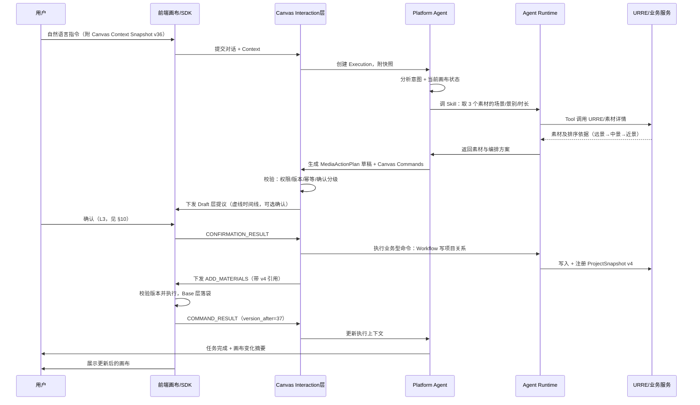

# Agent–Canvas Interaction 综合设计方案（v2）

> **地位：** 本文件取代 `Agent运行时与前端画布联动设计方案.md`（v1，2026-11-17）成为画布联动的现行方案。v1 不删除，留作前身记录。
>
> **综合来源（三份）：**
> 1. 最新 Agent 方案 `~/workspace/user/files/Agent___Skill.md`——一个 Platform Agent + Skill Registry + Agent Runtime + Tools / Workflows；@Skill 明确优先；Skill ≠ Agent；检索推荐交给 URRE；Artifact 为结构化结果。
> 2. `search-rec-docs/03_Agent架构设计.md`——P05 跨域只交换 Artifact Ref、P06 Task 是业务权威、Run 只是投影、P07 Agent 不直接持久化业务状态、P10 Run 完成 ≠ 业务完成、P11 副作用分级治理；Canvas 在 §1.4 被明确列为“本版不承诺，单独纳入产品与前端交付计划”。
> 3. 用户 2026-11-17 的提案——把联动做成 Agent Platform 的独立核心能力 **Agent–Canvas Interaction**，四种机制 Context / Command / Event / State Sync，Canvas Interaction Layer + 前端 Canvas SDK，WebSocket + HTTP + Kafka，AgentScope 2.0 的 `CanvasToolAdapter`。
>
> **一句话结论：** 联动层是 Agent Platform 的独立协议与协调层，不是第二个 Agent，也不是前端功能。它让 Agent 从“只能回文本”升级为“能理解、操作、观察、协同控制业务界面”的系统，但 Agent 依然只负责理解、规划和决策，Runtime 负责执行和治理，前端负责渲染、交互和状态呈现。

---

## 0. 决策总表：v1 与用户提案如何取舍

综合不是两份拼起来。凡是冲突处，本文件都做了裁决，理由写在表里，后续评审直接对着这张表吵，不用再翻两份文档。

| 议题 | v1 的做法 | 用户提案的做法 | **v2 裁决** | 理由 |
|---|---|---|---|---|
| 联动层的定位 | Runtime 与画布之间的联动层（投影器 + 命令入口 + 事件总线） | Agent Platform 的独立核心能力 Agent–Canvas Interaction | **采纳提案**：正式子系统，六个子模块（§2） | v1 只解决了“怎么连”，提案给了“是什么”——协议层值得独立演进、独立复用到选品/投放画布 |
| 交互抽象 | 双向两条路：推送（事件）+ 命令（REST） | 四种机制 Context / Command / Event / State Sync | **采纳提案的四种机制**，作为全篇骨架（§3–§6） | 四种机制覆盖了 v1 没单列的 Context（Agent 怎么知道画布有什么），且与用户提案的语言一致 |
| 传输 | SSE 默认，WS 以后 | WS 为主 + HTTP + Kafka | **WS 为主，HTTP 为辅，Kafka 只在服务端**（§9） | 多轮协作需要双向实时，SSE 单向不够；但命令的提交与重试不能依赖一条易断的 WS 连接，见 §9.1 的分工表 |
| 命令的性质 | 画布写命令直接路由到 Skill / Workflow | Canvas Command 是独立抽象，Skill 调 Tool 后生成 Command，前端执行 | **两者都对，但要拆分**：命令分业务型与呈现型（§4.2） | 不拆分会出大问题：若 `ADD_MATERIALS` 只在前端执行，项目关系就只存在于浏览器里，违反 P06/P07；若全部走 Workflow，选中、高亮、视图调整这些纯呈现操作也要进业务库，同样荒谬 |
| 上下文 | Artifact Ref + 版本，序号在服务端解析 | 三层：Full State / Snapshot / Reference | **采纳三层，但加硬约束**（§3） | LLM 绝不能拿 Full State；快照要有白名单字段与 token 预算，否则上下文随画布变大而失控 |
| 状态同步 | revision 乐观锁 + 409 + 全量重同步 | expected_version + objectVersion + 乐观更新 + 事件确认 | **两者合并**：canvas revision + object version + WS sequence 三级（§6） | 只校验画布版本挡不住“同一对象被两个人各改一半”；只校验对象版本又管不了整画布被替换 |
| 确认分级 | L1–L4（沿用 03 P11） | L1–L3 | **用 L1–L4**（§10） | 03 已冻结 L4 发布/导出强审批，提案的 L3 把“删大量内容”和“发布扣费”混在一级，风险等级不同，必须分开 |
| 撤销 | 撤销本身是一条新命令 | Operation Record + inverse_command + 快照引用 | **采纳提案的 Operation Record**，并明确撤销 = 补偿命令（§10.2） | 只记“再执行一次反向操作”会在部分成功时算错账；快照引用让撤销有据可查 |
| AgentScope 集成 | 未涉及 | Runtime 增加 `CanvasToolAdapter` | **采纳**，但加三条护栏（§11） | Adapter 是隔离框架与协议的关键；没有护栏它会退化成“Agent 直接调 React” |
| 分阶段 | Phase 1–3 | P1–P5 | **合并为 P1–P5**（§13），v1 的验收标准并入对应阶段 | 提案的五阶段更细，能先跑通闭环再补可靠性；v1 的三阶段验收点不能丢 |
| v1 的 Draft 层 | Agent 提议只进 Draft 层，确认后落袋 | 提案没有 Draft 层，确认绑定 Command | **保留 Draft 层**（§5、§7） | 这是 v1 最重要的一条，提案的确认机制缺了“提议态”的落点；没有 Draft 层，Agent 的编排方案在画布上无处安放，只能要么直接改、要么只存聊天里 |

**v1 留下的三个待决，本文件关闭两个，剩一个改问法：**

- 实时通道 SSE 还是 WS？——**关闭：WS 为主**（用户提案已选，且多轮协作确实需要双向通道），HTTP 负责快照与命令提交，SSE 只作降级 fallback。
- 画布是哪种工作面？——**基本关闭：P1 范围是视频时间轴 + 素材看板双画布**（用户提案的例子就是这两块，§5.1）。图片/选品/投放画布进 P2 以后按 Adapter 扩展，不在 P1 里。
- L3“加入项目”按批确认还是逐个确认？——**关闭：默认按批一次确认**，确认卡列出全部节点；单批超过阈值（建议 20 个，P1 可调）时自动拆批。

---

## 1. 定位与边界

### 1.1 它是什么

**Agent–Canvas Interaction 是 Agent 与可视化业务界面之间的统一交互基础设施。** 它由四部分组成（§2），服务于所有画布类型：视频时间轴、素材看板，未来还有选品画布、投放工作台、图片设计画布。

三句话划清边界：

1. **不是 Agent。** 它不理解意图、不选 Skill、不做业务决策、不拼 SearchPlan。Agent 的决策进来时，它只做校验、分发与反馈。
2. **不是业务服务。** 项目、时间轴、素材关系的权威数据仍在业务服务手里（§12）。联动层只维护交互所需的状态、版本与引用，不产生第二套项目数据。
3. **不是前端组件库。** 它不规定用 React 还是 Vue，不直接操作 DOM。前端通过 Canvas SDK + Adapter 接入，Agent Runtime 不需要知道前端的实现。

### 1.2 三条红线（继承两套已冻结方案，不可绕过）

| 红线 | 来源 | 含义 |
|---|---|---|
| 画布不持有业务权威状态 | 03 P06/P07/P10；新方案 §7.4、§14.1 | Task / Project / Assignment 是权威，Run / Execution 只是执行投影，画布状态是它们的再投影。前端不直接调业务 API、不直接写数据库 |
| 一切业务变更走 Runtime | 新方案 §9、§14；03 P07 | 用户在画布上的写操作先变成带幂等键的命令，进 Runtime 做权限校验，再调 Skill / Tool / Workflow；画布只做乐观显示，服务端回执才是生效依据 |
| Agent 只产 Artifact 与 Command，不直接改画布 | 新方案 §11、§12；03 P05 | Agent 的输出是结构化 Artifact（带 `artifact_id + version + content_hash`）与 Canvas Command；跨域只交换 Artifact Ref 和版本。Agent 想改项目，先出 MediaActionPlan 草稿，走审批，再由 Workflow 执行 |

---

## 2. 总体架构

```text
                          用户
                           │
              ┌────────────┴────────────┐
              ▼                         ▼
     ┌────────────────┐        ┌────────────────────────┐
     │  Agent Chat UI │        │  前端应用层             │
     │  对话 / @Skill  │        │  Canvas Editor ·        │
     │  执行状态条     │        │  Timeline · Material    │
     └───────┬────────┘        │  Board                  │
             │                 └───────┬────────────────┘
             │                         │ WS + HTTP
             ▼                         ▼
     ┌──────────────────────────────────────────────────┐
     │  Agent–Canvas Interaction 层（独立核心能力）       │
     │                                                    │
     │  ┌──────────────┐  ┌──────────────┐               │
     │  │Canvas Context│  │Command       │               │
     │  │快照/引用/版本 │  │Gateway       │               │
     │  └──────────────┘  │校验/分发/路由 │               │
     │  ┌──────────────┐  └──────────────┘               │
     │  │Event Gateway │  ┌──────────────┐               │
     │  │事件采集/归档  │  │State Sync    │               │
     │  └──────────────┘  │版本/序列/重同步│               │
     │  ┌──────────────┐  └──────────────┘               │
     │  │Permission &  │  ┌──────────────┐               │
     │  │Confirm       │  │Operation     │               │
     │  │权限/确认/风险 │  │History       │               │
     │  └──────────────┘  │记录/撤销/重做 │               │
     └──────────────┬───────────────────┬───────────────┘
                    │                   │
                    ▼                   ▼
     ┌──────────────────────────┐  ┌───────────────────┐
     │  Agent Platform / Runtime │  │ Business Services │
     │  Platform Agent（决策）   │  │ + URRE            │
     │  Skill Registry / Skill   │  │ 素材检索 · 推荐 ·  │
     │  Tool / Workflow Engine   │  │ 项目管理 · 视频处理│
     │  Execution 管理 / 审计     │  │ 素材数据服务      │
     └──────────────────────────┘  └───────────────────┘
```

**数据流向只有两条，写死不许反向：**

- **向上（前端 → Agent）：** 画布状态与事件（Context + Event），经 Event Gateway 归档后进入 Runtime 的任务上下文。
- **向下（Agent → 前端）：** 操作指令（Command）与状态投影（State Sync），经 Command Gateway 校验后下发。

模块与 v1 的对应关系（实现时不用推翻 v1 的三个构件，只是改名归位）：v1 的 Canvas Projection Service → 本层的 State Sync + Canvas Context；v1 的 Canvas Command Handler → Command Gateway；v1 的 Canvas Event Bus → Event Gateway + WS Gateway。

**部署建议（沿用新方案 §17.1）：** 第一阶段六个模块是逻辑模块，放在模块化单体里，不拆微服务。Kafka 只在服务端出现（事件归档、审计、跨服务事件），浏览器永远不直连 Kafka。

---

## 3. 机制一：Context——画布上下文（前端 → Agent）

Agent 要操作画布，先要知道画布当前是什么。不知道就动手，是所有“Agent 乱改画布”事故的根源。

### 3.1 三层上下文（采纳提案，加硬约束）

| 层 | 放在哪 | 内容 | 谁能读 |
|---|---|---|---|
| Full State | 前端 State Store + 业务服务 | 完整画布状态：全部对象、全部属性、工程文件 | LLM **永远不读**；只供前端渲染与服务端校验 |
| Context Snapshot | Context Service 按任务现算 | 当前任务相关的精简快照（§3.2） | Platform Agent（进提示词的唯一画布输入） |
| Context Reference | Artifact Service / 业务服务 | 大对象、素材集合、历史操作，只传 ID 引用 | Agent 按需调 Tool 拉取，不进提示词 |

**硬约束（三条，P1 就要做到）：**

1. 快照字段白名单制：只有 §3.2 列出的字段能进快照，新增字段要改白名单并评审，不许前端“顺手多传一点”。
2. 快照有 token 预算：默认上限建议 4k token（P1 可调），超限时按“选中对象 > 时间轴现状 > 候选区摘要 > 历史”的优先级裁剪，宁可少给，不可截断成半条记录。
3. 快照带版本号：每次快照都带 `canvas_version + snapshot_id + taken_at`，Agent 的后续 Command 必须引用它（`preconditions.expected_version`），不许拿着旧快照持续改画布。

### 3.2 快照结构（视频时间轴 + 素材看板）

```json
{
  "canvas_id": "canvas_1001",
  "canvas_type": "video_editor",
  "project_id": "project_2001",
  "conversation_id": "conv_001",
  "execution_id": "exec_10001",
  "version": 36,
  "snapshot_id": "snap_36",
  "taken_at": "2026-11-17T13:00:00+08:00",
  "selection": {
    "type": "material",
    "ids": ["video_001", "video_002"],
    "source": "canvas",
    "source_artifact_ref": { "artifact_id": "artifact_456", "version": 3 }
  },
  "viewport": { "mode": "timeline", "zoom": 1.2, "current_time": 12.5 },
  "timeline_summary": {
    "track_count": 2,
    "clip_count": 8,
    "total_duration": 96.5,
    "tracks": [{ "track_id": "track_1", "clip_ids": ["video_001"], "duration": 15 }]
  },
  "candidates_summary": {
    "artifact_ref": { "artifact_id": "artifact_456", "version": 3 },
    "total": 30,
    "top_ids": ["video_003", "video_004", "video_005"]
  },
  "pending": { "running_executions": ["exec_10001"], "draft_plan_ref": null }
}
```

注意两点：候选区只给摘要 + 前 N 个 ID，全量 CandidateSet 永远走 Artifact 引用，Agent 需要详情时调 `video.material.detail`；`selection` 必须带来源 Artifact 版本，这是新方案 §11.2 “把第 3 个加入项目”的解法——序号在服务端对照快照版本解析，画布选中态与对话引用不一致时，以 Artifact 版本为准并向用户明示，不猜。

### 3.3 上下文更新时机

不是每次画布变化都全量推快照。三种触发，够用且不吵：

- 用户发新一轮对话时，前端随消息附带最新快照（或 `snapshot_id`，服务端按 ID 取）。
- Agent 明确请求时（`canvas.get_context()`），现算一份。
- 画布版本变化且有进行中的 Execution 时，Event Gateway 推一个轻量 `CONTEXT_UPDATE`（只含 version + selection + 摘要 diff，不含全量）。

---

## 4. 机制二：Command——画布操作指令（Agent → 前端）

这是整个系统最重要的部分，也是 v1 与提案分歧最大的地方，先把性质定死，再谈注册表。

### 4.1 一个 Agent Task 与多个 Canvas Command

```text
Agent Task（用户目标，如“把 3 个夜景素材按远近排进时间轴”）
    │
    ├─ ① 查：Skill 调 URRE / Tool 取素材详情与场景、景别、时长
    ├─ ② 划：Agent 生成编排方案（远景 → 中景 → 近景），产出 MediaActionPlan 草稿 Artifact
    ├─ ③ 执：Runtime 生成一组 Canvas Command（业务型 + 呈现型，见 §4.2）
    ├─ ④ 验：前端回执 + 新画布版本，Runtime 校验“3 个是否全进、顺序是否对”
    └─ ⑤ 报：Agent 向用户展示画布变化及操作摘要
```

一个 Task 可以产生多个 Command，也可以在执行中根据回执动态调整（例如第 2 个素材放不进轨道 1，改放轨道 2 并告诉用户）。**Command 是原子操作，Task 是目标；不许把整个 Task 塞进一个 Command 里，也不许让 Agent 为每个像素发一个 Command。**

### 4.2 命令分两类：业务型 vs 呈现型（v2 的核心裁决）

| 类别 | 定义 | 执行方 | 示例 | 版本/确认要求 |
|---|---|---|---|---|
| **业务型命令** | 会改变业务事实（项目关系、素材归属、资产）的操作 | 必须先走 Skill / Workflow 写业务库、产出新 Artifact，**再**下发呈现指令 | `ADD_MATERIALS`、`REMOVE_MATERIAL`、`REORDER_OBJECTS`（落盘的排序） | 必须带 `execution_id + business_artifact_ref`；L2–L4 按 §10 确认；幂等键必填 |
| **呈现型命令** | 只改变画布的看法，不改变业务事实 | 前端 Command Handler 直接执行，不进业务库 | `SELECT_OBJECTS`、`SET_VIEWPORT`、`APPLY_LAYOUT`（草稿层布局）、`HIGHLIGHT`、`GENERATE_PREVIEW`（预览请求本身不落盘） | 也要版本校验与审计，但不进 Workflow；L1 自动执行 |

**`ADD_MATERIALS` 的正确走法（拿提案的例子说清楚）：**

```text
Agent 生成编排方案
  → Skill video.material.add → Material Assignment Workflow
      （权限 → 素材检查 → 项目检查 → 写入项目关系 → 审计）
  → Artifact Service 注册 ProjectSnapshot v4
  → Runtime 下发 Canvas Command ADD_MATERIALS
      （带 execution_id + ProjectSnapshot v4 引用，前端按 v4 投影渲染）
  → 前端回执 COMMAND_RESULT（version_after=37）
```

前端绝不能只凭一条 `ADD_MATERIALS` 就宣称“素材已加入项目”。业务事实的唯一证据是 Workflow 的执行记录 + ProjectSnapshot 新版本，画布上的节点只是它的投影。反过来，`SELECT_OBJECTS` 这种呈现型命令也不必进 Workflow，否则每点一次卡片都要走一遍业务审批。

### 4.3 Command 统一结构

```json
{
  "command_id": "cmd_10001",
  "execution_id": "exec_10001",
  "canvas_id": "canvas_1001",
  "command_type": "ADD_MATERIALS",
  "command_kind": "business",
  "target": { "type": "timeline", "track_id": "track_1" },
  "payload": {
    "material_ids": ["video_003", "video_004", "video_005"],
    "insert_mode": "sequential",
    "order_basis": "远景 → 中景 → 近景"
  },
  "business_binding": {
    "skill_id": "video.material.add",
    "artifact_ref": { "artifact_id": "artifact_457", "version": 4 }
  },
  "preconditions": { "expected_version": 36, "expected_object_versions": { "track_1": 12 } },
  "requires_confirmation": false,
  "confirmation_id": null,
  "idempotency_key": "idem_cmd_10001",
  "timeout_ms": 30000
}
```

字段说明：`command_kind` 是 v2 新增的必填字段（`business | presentation`）；`business_binding` 业务型必填、呈现型为空；`preconditions` 同时校验画布版本与对象版本（§6）；`requires_confirmation` 由服务端按 §10 的分级算出，不由 Agent 自填——Agent 说“不用确认”不算数。

**执行结果统一回执：**

```json
{
  "command_id": "cmd_10001",
  "status": "SUCCEEDED",
  "canvas_id": "canvas_1001",
  "version_before": 36,
  "version_after": 37,
  "result": { "added_count": 3, "object_ids": ["object_001", "object_002", "object_003"] },
  "error": null
}
```

**Command 生命周期状态机（前后端共用一套）：**

```text
PENDING → RUNNING → SUCCEEDED
                 → FAILED
PENDING → REJECTED（前置条件不满足 / 权限拒绝 / 版本冲突）
PENDING → WAITING_CONFIRMATION →（确认）RUNNING /（拒绝/过期）CANCELLED
RUNNING → CANCELLED（用户取消；取消是请求，不是瞬时保证，见 §6.4）
```

### 4.4 Command Registry（统一注册表，领域差异靠扩展）

| Command | 类别 | 用途 |
|---|---|---|
| `ADD_MATERIALS` | 业务型 | 添加素材（先走 Workflow，见 §4.2） |
| `REMOVE_MATERIAL` | 业务型 | 删除素材 |
| `MOVE_OBJECT` | 业务型* | 移动对象（*跨轨道/跨项目算业务型，同轨道内拖动排序若只改呈现顺序可降级为呈现型，由 Command Gateway 按 target 判定） |
| `REORDER_OBJECTS` | 业务型 | 调整顺序（落盘） |
| `UPDATE_PROPERTIES` | 业务型 | 修改对象属性（时长、裁剪等落盘属性） |
| `CREATE_TRACK` | 业务型 | 创建轨道 |
| `APPLY_LAYOUT` | 呈现型 | 应用布局（草稿层） |
| `GENERATE_PREVIEW` | 呈现型 | 生成预览 |
| `SELECT_OBJECTS` | 呈现型 | 选择对象 |
| `HIGHLIGHT` | 呈现型 | 高亮对象（Agent 解释“我说的是这个”时用） |
| `SET_VIEWPORT` | 呈现型 | 调整画布视图 |

**注册规则：** 不同画布类型注册自己的 Handler（视频时间轴注册 `ADD_MATERIALS`，图片画布注册 `ADD_IMAGE` / `RESIZE_ELEMENT`，选品画布注册 `ADD_PRODUCT` / `GROUP_PRODUCTS`）。Agent Runtime 不需要知道前端是 React 还是 Vue、是哪个编辑器——它只发标准 Command，Handler 在前端注册表里找。**新增一个画布类型 = 新增一个 Adapter + 一组 Handler，不改 Runtime、不改协议。** 这是提案 §12 “统一协议、领域差异靠 Adapter 扩展”的落地点，也是本方案要求优先确定的设计决策。

### 4.5 Command 与 Skill、Tool 的关系（三者不许混）

| 抽象 | 职责 | 示例 |
|---|---|---|
| Skill | 面向业务目标的能力封装 | 视频素材编排 Skill |
| Tool | Agent 可调用的业务工具 | 获取素材详情 Tool、调用 URRE 的 Tool |
| Canvas Command | 对画布产生实际变更的操作 | `ADD_MATERIALS` |

一个 Skill 可以先调 Tool 查数据，再生成多个 Canvas Command；Command 最终由前端的 Command Handler 执行。Skill 不直接发 Command 给 DOM，Command 也不直接调 URRE——三者各管一段，URRE、Agent、前端互不耦合。

---

## 5. 画布模型：四层 + 多 Adapter

### 5.1 画布是什么（P1 范围）

P1 只做两种画布，同一个 Canvas Interaction 层服务两者：

- **视频时间轴画布**（`canvas_type=video_editor`）：轨道 + 片段，Agent 编排的落点。
- **素材看板画布**（`canvas_type=material_board`）：CandidateSet 的落点，卡片网格 + 多选。

图片画布、选品画布、投放工作台不在 P1，用同一个 Adapter 接口进 P2（§13）。

### 5.2 CanvasState 与四层（保留 v1 的四层）

```json
{
  "canvas_id": "canvas_1001",
  "canvas_type": "video_editor",
  "project_id": "project_2001",
  "conversation_id": "conv_001",
  "version": 37,
  "base_artifact_ref": { "artifact_id": "artifact_457", "version": 4 },
  "nodes": ["node_..."],
  "selection": { "node_ids": ["object_001"], "source": "canvas" },
  "draft_layer": { "plan_ref": null, "nodes": [] },
  "updated_at": "2026-11-17T13:00:00+08:00"
}
```

| 层 | 内容 | 谁能写 |
|---|---|---|
| Base 层 | 已提交的项目状态（ProjectSnapshot 投影） | 只有 Workflow 执行成功后经 State Sync 写 |
| Candidate 层 | 本次检索的 CandidateSet（候选区） | Runtime 发布新 Artifact 时整体替换，不做增量拼凑 |
| Draft 层 | Agent 的 MediaActionPlan 草稿提议（虚线 / 半透明） | Agent 只出草稿；用户确认后经 Workflow 落到 Base 层；拒绝则清空，无业务副作用 |
| Interaction 层 | 选中态、高亮、拖拽占位、执行进度条 | 前端本地状态，不持久化、不参与业务状态 |

**Draft 层是 Agent 提议在画布上的唯一落点。** 没有它，Agent 的编排方案要么直接改 Base 层（违反 P08 Plan 冻结后不可静默修改），要么只能留在聊天记录里、用户看不见摸不着。P1 必须有 Draft 层，哪怕第一版只支持“接受 / 拒绝整个方案”。

### 5.3 CanvasNode

| 字段 | 说明 |
|---|---|
| `node_id` / `object_id` | 画布内唯一 ID（`canvas:` 前缀），与业务 ID 分离 |
| `kind` | `candidate` / `timeline_clip` / `storyboard_frame` / `proposal` |
| `material_id` | 业务素材 ID（草稿占位可空） |
| `artifact_ref` | 来源 Artifact + 版本 |
| `slot` / `track_id` / `position` | 在项目区的位置 |
| `object_version` | 对象级版本号（§6 冲突校验用） |
| `status` | `ready` / `pending` / `running` / `failed` / `blocked` / `draft` |
| `evidence` | 渲染用证据：分数、来源、排序依据摘要（只读展示，不参与排序） |
| `origin` | `user` / `agent` / `system`，用于审计与防循环（§7） |

---

## 6. 机制四：State Sync——状态同步（双向）

### 6.1 权威链（谁说了算，写死）

```text
Task / Project / Assignment（业务权威）
        │ 唯一事实源
        ▼
Execution / Workflow Instance / Action Invocation（执行事实源）
        │ 由 State Sync 聚合
        ▼
CanvasState（投影，可从权威状态 + 事件重建）
        │ 前端缓存
        ▼
画布 DOM（纯渲染）
```

- Agent 与 Workflow 不直接写对方的状态字段，聚合状态一律由 State Sync 计算。
- `Run completed ≠ 业务完成`（03 P10）：节点只有在 Task 状态机 + Quality Gate 通过后才标 `succeeded`；Workflow 还在跑时标 `running`，哪怕单个 Tool 已返回。
- 前端 Store 只是 CanvasState 的缓存，刷新即丢弃重拉，不依赖 localStorage 里的画布状态做业务判断。

### 6.2 三级版本（v1 + 提案合并）

| 级别 | 字段 | 校验什么 |
|---|---|---|
| 画布级 | `version`（revision） | 整画布是否被整体替换过（如新 CandidateSet 到来） |
| 对象级 | `object_version` | 单个对象是否被别人改过 |
| 消息级 | WS `sequence` | 消息是否丢、是否乱序、断线后从哪补 |

**规则：** 每个 Command 都带 `preconditions.expected_version`（画布级，必填）与 `expected_object_versions`（涉及的对象，业务型必填）。服务端发现任一不符即拒绝（`REJECTED`，不是静默覆盖），返回最新快照；Runtime 重新取 Context、必要时重新规划，再向用户说明。不允许 Agent 基于旧快照持续修改已经发生变化的画布，也不允许 Agent 静默覆盖用户刚刚完成的操作。

**同步策略（提案的四步，采纳并加一条）：** 前端乐观更新 + 服务端版本校验 + 事件确认 + 必要时快照重同步。加的一条是：**L3/L4 业务型命令不做乐观落袋**——先标 `pending`，等服务端回执 + 新 Artifact 再落袋；失败则回滚并提示原因，不留“假成功”。L1/L2 呈现型与轻写可以乐观更新。

### 6.3 冲突规则（用户手改 vs Agent 执行中）

| 场景 | 规则 |
|---|---|
| 用户拖拽排序，Agent 的 Workflow 同在写同一项目 | 用户操作先行受理，但以服务端版本为准：Workflow 已提交新版本时用户命令 409/REJECTED 回滚并提示“项目刚被更新，请再确认” |
| Agent 的 Draft 提议与用户手改重叠同一 slot | Draft 层与 Base 层分层显示，不互相覆盖；用户确认 Draft 时做一次合并校验，冲突项单列出来逐项确认 |
| 长 Workflow 执行中用户又发新命令 | 新命令正常受理（不锁画布），但同一 `material_id + project_id` 的写命令用同一幂等键去重 |
| 部分成功 | 成功节点落袋，失败节点标 `failed/blocked`，下游 `blocked/skipped`，不伪装成功，不删除已成功的人工编辑结果 |

### 6.4 长任务与断线恢复

- Execution 与 Command 状态持久化，不以 WS 连接状态为生命周期。WS 断开不等于任务取消。
- 重连时带 `last_sequence + last_version`，服务端按序补发未收到的消息；缺口过大 → 下发 `STATE_SYNC_REQUIRED` + 全量快照重建。
- 服务端重启后依据 Artifact、Invocation、幂等键与 Adapter 查询能力恢复，不盲目重提交。
- 取消走 `cancel_requested` 语义：未启动的直接取消，运行中的向 Adapter 发取消请求，不支持取消时保持 `cancel_requested` 等待返回或超时（03 §5）。

---

## 7. 机制三：Event——画布事件反馈（前端 → Agent）

画布不是被动接受指令的对象。用户随时会手动删素材、拖片段、改时长、切选中、点撤销——这些都要变成标准事件回流，Agent 才能继续推理、而不是对着旧世界自说自话。

### 7.1 事件结构与来源三分法

```json
{
  "event_id": "evt_10001",
  "canvas_id": "canvas_1001",
  "event_type": "OBJECT_MOVED",
  "source": "user",
  "causation_id": "cmd_10001",
  "object_id": "video_003",
  "payload": { "old_position": 10, "new_position": 20 },
  "canvas_version": 37,
  "timestamp": 1794900000
}
```

| 来源 | 含义 | Agent 如何处理 |
|---|---|---|
| `user` | 用户直接操作 | 可能打断当前 Task：Runtime 判断是继续、重规划，还是向用户解释 |
| `agent` | Agent 指令引起的操作 | **不触发新一轮 Agent 推理**，只更新执行上下文（防循环的核心） |
| `system` | 系统自动变化（Workflow 推进、超时、外部回调） | 更新状态，不触发用户可见的解释 |

**防循环规则（v1 与提案都提到，v2 写死）：** 每个事件带 `source + causation_id`（由哪条 Command 引起）。`source=agent` 的事件只进执行上下文，不进 Agent 的意图识别；`source=user` 的事件才可能触发重规划。没有 `causation_id` 的 `agent` 事件视为协议违规，直接丢弃并记审计。另加去重：`event_id` 幂等，重复投递只处理一次。

### 7.2 事件类型（最小集，P1）

| 事件 | 触发 |
|---|---|
| `OBJECT_ADDED` / `OBJECT_REMOVED` / `OBJECT_MOVED` / `OBJECT_UPDATED` | 画布对象增删改移 |
| `SELECTION_CHANGED` | 选中变化（Agent 据此更新“用户现在指哪个”） |
| `COMMAND_RESULT` | 前端回执某条 Command 的执行结果（成功/失败 + version_after） |
| `OPERATION_UNDONE` / `OPERATION_REDONE` | 用户撤销/重做 |
| `CONTEXT_UPDATE` | 快照版本变化的轻量通知（§3.3） |
| `CONFIRMATION_RESULT` | 用户对确认请求的回答（§10） |

事件只带变化的引用 + 新版本，不带大数据；需要全量时按 Artifact 引用另拉。事件先归档（Event Gateway → 服务端事件日志/Kafka），再推送给 Runtime——归档先于推送，断线重连才能补发。

---

## 8. 完整执行流程：从对话到画布变化

以提案的例子为准，用户说：“把刚才推荐的三个城市夜景素材添加到时间轴，按照从远景到近景的顺序排列。”



**两个层次要分清（提案 §3 末，保留）：** Agent Task 是目标，Canvas Command 是原子操作。一个 Task 产生多个 Command，执行中可根据回执动态调整——例如第 2 个素材放不进轨道 1，Runtime 改放轨道 2 并在摘要里告诉用户，而不是静默换位置或直接失败。

---

## 9. 通信机制：WebSocket + HTTP（+ 服务端 Kafka）

### 9.1 分工表（v2 裁决：WS 为主不是 WS 包办一切）

| 通信方式 | 使用场景 | 不用于 |
|---|---|---|
| **HTTP** | 创建任务、提交上下文、获取完整快照、提交业务型命令（POST，幂等键重试安全） | 实时推送 |
| **WebSocket** | Agent 流式状态、Command 下发、Event 回传、确认请求、执行进度 | 命令的唯一提交通道（断线会丢）；快照全量传输 |
| **Kafka** | 服务端异步事件、操作审计、执行日志、跨服务事件 | 浏览器与画布之间的任何直接通信 |

**为什么命令提交走 HTTP 而下发走 WS：** 提交需要幂等重试与审计，HTTP POST + `idempotency_key` 是成熟做法，WS 断线重发容易重复执行；下发需要服务端主动推，WS 是正途。两者用同一命令信封（§4.3），前端收到 WS 的 `CANVAS_COMMAND` 后执行，再经 WS 或 HTTP 回 `COMMAND_RESULT`，以先到为准、按 `command_id` 去重。

**降级：** WS 不可用时，退化为 HTTP 轮询事件（`GET /events?last_sequence=`）+ SSE 推送，功能不变、实时性降级；P1 就要实现降级路径，不许“WS 断了画布就失联”。

### 9.2 WebSocket 信封与消息类型

```json
{
  "message_id": "msg_001",
  "message_type": "CANVAS_COMMAND",
  "conversation_id": "conv_001",
  "execution_id": "exec_001",
  "canvas_id": "canvas_001",
  "sequence": 15,
  "timestamp": 1794900000,
  "data": {}
}
```

| 消息类型 | 方向 | 用途 |
|---|---|---|
| `CONTEXT_UPDATE` | 前端 → 后端 | 上下文更新（轻量，§3.3） |
| `CANVAS_EVENT` | 前端 → 后端 | 用户操作事件（§7） |
| `CANVAS_COMMAND` | 后端 → 前端 | Agent 操作指令（§4） |
| `COMMAND_RESULT` | 前端 → 后端 | 指令执行结果 |
| `EXECUTION_STATUS` | 后端 → 前端 | 任务状态（只展示必要状态：理解中 / 执行中 / 完成 / 失败） |
| `CONFIRMATION_REQUEST` | 后端 → 前端 | 请求用户确认（§10） |
| `CONFIRMATION_RESULT` | 前端 → 后端 | 用户确认结果 |
| `STATE_SYNC_REQUIRED` | 双向 | 触发状态重同步（§6.4） |

`sequence` 由服务端单调递增，前端按序应用、乱序缓存、断线后按 `last_sequence` 补发（§6.4）。

---

## 10. 前端如何接收和执行 Agent 指令：Canvas SDK

不要让每个页面自己监听 Agent 消息、解析指令、改组件状态。前端只实现一个独立的 Canvas Runtime SDK，页面只注册 Adapter。

```text
Frontend Canvas SDK
    │
    ├── Command Dispatcher（指令分发、Handler 注册）
    ├── Canvas State Store（画布状态管理，四层，§5.2）
    ├── Event Publisher（事件采集与上报，§7）
    ├── Operation History（操作记录、撤销与重做，§10.2）
    └── Canvas Adapter（统一 Command → 具体画布实现的操作）
            ├── Video Timeline Adapter
            ├── Material Board Adapter
            ├── Image Canvas Adapter（P2）
            └── Workflow Canvas Adapter（P2）
```

### 10.1 核心接口（TypeScript，采纳提案并补齐版本校验）

```typescript
interface CanvasCommand {
  commandId: string;
  executionId: string;
  canvasId: string;
  commandType: string;
  commandKind: "business" | "presentation";
  payload: Record<string, unknown>;
  expectedVersion: number;
  expectedObjectVersions?: Record<string, number>;
  idempotencyKey: string;
}

interface CanvasCommandHandler {
  execute(command: CanvasCommand, context: CanvasContext): Promise<CommandResult>;
}

interface CanvasAdapter {
  getSnapshot(): CanvasSnapshot;
  applyCommand(command: CanvasCommand): Promise<CommandResult>;
  subscribe(listener: (event: CanvasEvent) => void): () => void;
  undo(operationId: string): Promise<void>;
  redo(operationId: string): Promise<void>;
}
```

页面注册 Handler 的方式不变：

```typescript
commandRegistry.register("ADD_MATERIALS", addMaterialsHandler);
commandRegistry.register("MOVE_OBJECT", moveObjectHandler);
commandRegistry.register("REORDER_OBJECTS", reorderObjectsHandler);
```

**SDK 的三条硬规则：** Dispatcher 收到 Command 先校验 `expected_version` 与幂等键，版本不符直接回 `REJECTED` 不执行；业务型命令执行前先确认 `business_binding.artifact_ref` 已在本地（不在则先拉 Artifact，不凭空渲染）；所有执行结果必须回 `COMMAND_RESULT`，不许“执行了但不告诉 Runtime”。

---

## 11. 权限、确认、撤销与审计

### 11.1 确认分级（L1–L4，沿用 03 P11，覆盖提案的 L1–L3）

| 等级 | 画布操作 | 策略 |
|---|---|---|
| L1 | 选中对象、调整视图、展开面板、高亮 | 自动执行 |
| L2 | 添加素材、调整排序、修改属性、收藏、反馈 | 默认自动执行，可配置为确认；可撤销；审计记录 |
| L3 | 删除大量内容、覆盖项目、采纳 Agent 草稿、批量移除 | **必须确认**：确认卡绑定具体 Command（不是一段自然语言描述），列出影响节点与撤销说明 |
| L4 | 导出资产、发布、扣费类操作 | **强审批**：确认 + 明确授权 + 二次确认；Agent 不持有媒体执行凭证 |

- 确认请求由服务端下发 `CONFIRMATION_REQUEST`，卡片显示服务端校验过的操作摘要；用户确认后前端发 `CONFIRMATION_RESULT`（带原 `confirmation_id + command_id + idempotency_key`）。
- **确认会过期：** 确认后若画布版本或操作参数发生变化，执行前重新校验，不直接执行过期的确认；确认本身也有超时（建议 5 分钟，P1 可调），超时按拒绝处理。
- 确认策略由服务端配置，不只依赖 Agent 提示词（新方案 §14.3）。

### 11.2 撤销与回滚（Operation Record）

每个成功操作生成一条 Operation Record，历史不可删、撤销本身记为新的状态变更：

```json
{
  "operation_id": "op_001",
  "command_id": "cmd_001",
  "execution_id": "exec_10001",
  "before_state_ref": "snapshot_36",
  "after_state_ref": "snapshot_37",
  "inverse_command": {
    "command_type": "REMOVE_MATERIALS",
    "payload": { "object_ids": ["object_001"] }
  },
  "reversible": true
}
```

- 用户可以一次撤销整个 Agent 操作批次（按 `execution_id` 成组撤销）；复杂操作支持批量事务，中间失败时执行补偿操作。
- 不可逆操作（L4 发布等）必须事先确认，`reversible=false` 的操作在确认卡上明示。
- 撤销不是“再执行一次反向 Command”那么简单：执行前要校验 `before_state_ref` 是否仍是当前状态的祖先，中间已被用户改过时，撤销要逐项提示冲突，不静默覆盖。

### 11.3 审计

所有业务型命令与确认进 `audit_log`：`user_id / command_id / idempotency_key / material_ids / base_version / execution_id / source / 结果`。Agent 的提议、用户的确认、Workflow 的执行分开记，事后可追溯“谁提议、谁批准、谁执行”。

---

## 12. 与 AgentScope 2.0 的集成

结合项目计划使用 AgentScope 2.0（按 2026-11-16 已关闭的 U-2 决策：Acore Runtime SDK 是公司内部对 AgentScope Java 2.0 的封装，URRE 直接基于 Acore Runtime SDK 0.2.0 构建，不直连 AgentScope），在 Runtime 中增加一个 `CanvasToolAdapter`。

```text
Video Agent / Platform Agent（AgentScope 2.0 Agent）
        │
        ▼
CanvasToolAdapter（把平台能力封装为 AgentScope 可调用的 Tool）
        │
        ▼
Canvas Command Gateway（权限检查 · 参数校验 · 版本检查 · 指令路由）
        │
        ▼
Frontend Canvas SDK（Command Dispatcher · Adapter · State Store）
```

Agent 可调用的工具只给六个入口，全部是平台能力的入口，不是画布操作本身：

```text
canvas.get_context()
canvas.add_materials()
canvas.move_object()
canvas.update_properties()
canvas.request_confirmation()
canvas.get_operation_result()
```

**三条护栏：** AgentScope 的 Tool 不直接操作浏览器、不直接调用 React 组件、不直接写业务库——真正执行操作的还是 Command Gateway 与前端 SDK；Tool 的返回值是 Command 引用与执行状态，不是 DOM 操作结果；未来替换 Agent 框架时，只换 Adapter，不重写前端画布交互体系与协议。

---

## 13. 后端模块与 API 划分

### 13.1 模块（六个，逻辑模块，P1 不拆微服务）

| 模块 | 核心职责 |
|---|---|
| Canvas Context Service | 画布快照、上下文引用、版本管理（§3） |
| Canvas Command Service | 指令校验、分发、执行状态管理（§4） |
| Canvas Event Service | 事件接收、事件归档、事件推送（§7） |
| Canvas Session Service | 画布会话、连接管理、断线恢复（§6.4） |
| Canvas Operation Service | 操作历史、撤销、重做（§10.2） |
| Canvas Permission Service | 用户授权、确认和风险控制（§10.1） |

### 13.2 API

| API | 方法 | 用途 |
|---|---|---|
| `/api/canvases/{id}/snapshot` | GET | 获取画布快照（全量，§5.2） |
| `/api/canvases/{id}/context` | POST | 提交画布上下文（快照或 snapshot_id） |
| `/api/canvases/{id}/commands` | POST | 提交画布指令（业务型命令的 HTTP 提交通道，幂等） |
| `/api/canvases/{id}/events` | POST | 上报画布事件（WS 不可用时的备用通道） |
| `/api/canvases/{id}/operations` | GET | 查询操作历史 |
| `/api/canvases/{id}/operations/{opId}/undo` | POST | 撤销操作 |
| `/api/executions/{id}/cancel` | POST | 取消 Agent 执行 |

WebSocket 负责实时推送和双向事件通信（§9.2）。错误码沿用 Runtime 的统一错误码：参数缺失、权限不足、版本冲突（409 + 最新快照）、幂等重放（200 + 原回执）、执行不确定（返回执行状态查询入口，不盲目重试）。

### 13.3 数据模型（最小集）

| 实体 | 说明 |
|---|---|
| Canvas | 画布身份、类型、所属项目、当前版本 |
| CanvasSnapshot | 画布状态快照（§3.2、§5.2） |
| CanvasObject | 画布对象及属性（含 object_version） |
| CanvasCommand | Agent 操作指令（§4.3） |
| CanvasEvent | 用户及系统操作事件（§7） |
| CanvasOperation | 操作记录与逆向操作（§10.2） |
| CanvasSession | 连接与协作会话 |

**容易忽略的一点（提案 §10 末，保留并强调）：** CanvasSnapshot 和 CanvasObject 不一定要由 Agent Platform 持久化。如果视频编辑业务服务已经有自己的项目和时间轴数据模型，继续让业务服务持有权威数据，联动层只维护交互所需的状态、版本和引用。出现两套项目数据是本方案明确要避免的失败形态。

---

## 14. 分阶段落地（P1–P5，合并 v1 与提案）

| 阶段 | 建设内容 | 验收目标 |
|---|---|---|
| **P1：闭环跑通** | Canvas Context、Command、Result、WebSocket（+ HTTP 提交与降级）；视频时间轴 + 素材看板；`ADD/REMOVE/MOVE/REORDER/SELECT` 基础命令；Draft 层 | Agent 能控制画布完成基础操作；“把 3 个夜景素材按远近排进时间轴”端到端跑通；刷新重建一致；“第 3 个”解析可追溯到 Artifact 版本 |
| **P2：多画布复用** | Canvas SDK、Command Registry、Adapter；图片画布、选品画布接入 | 多种画布复用统一协议；新增画布类型不改 Runtime、不改协议 |
| **P3：协同操作** | Event 全量、版本校验（三级）、Operation History、对象级版本 | 用户和 Agent 能协同操作；用户手改与 Agent 执行冲突时拒绝旧操作、不静默覆盖；批量撤销可用 |
| **P4：生产可靠性** | 确认机制（L1–L4）、撤销回滚、断线恢复、降级路径、审计 | 满足生产环境可靠性；L3/L4 有确认卡且确认会过期；WS 断线后任务不丢、画布可重建 |
| **P5：复杂编排** | 多 Agent 协作、复杂 Workflow、智能编排、跨画布任务 | 支持复杂业务场景；Agent Task 可跨时间轴与看板协同，仍受同一套版本与确认治理 |

**P1 的最小命令集（只做这 8 个，跑通再扩）：** 获取当前画布上下文、获取当前选中素材、添加素材、删除素材、移动素材、调整素材顺序、修改素材属性、撤销 Agent 操作。

---

## 15. 最终定位

**Agent–Canvas Interaction 是 Agent Platform 的正式子系统，不是零散放在某个 Video Agent 里的功能。**

```text
Agent 侧：Context Builder · Canvas Tools · Command Planner · Execution Coordinator
协议侧：Context Protocol · Command Protocol · Event Protocol · State Sync Protocol
Runtime 侧：Command Gateway · Permission Manager · Version Manager · Operation Manager
前端侧：Canvas SDK · Command Dispatcher · State Store · Canvas Adapter
```

它把 Agent 从“只能通过对话返回文本的系统”，升级为“能够理解、操作、观察和协同控制业务界面的智能系统”。三个领域的业务 Command 不同，但底层的 Context、Command、Event、State Sync 和 Runtime 治理机制统一：

- 视频素材 Agent：在素材画布和时间轴上编排素材、调整顺序、生成预览。
- 商品选品 Agent：在选品画布上添加商品、调整商品分组、修改筛选条件。
- 广告投放 Agent：在投放工作台上创建计划、调整预算、修改定向条件。

**最值得优先确定的设计决策（提案的结论，本方案赞同并已落实为 §4.4 的注册表规则）：统一交互协议，领域差异通过 Canvas Adapter 和 Command Registry 扩展，而不是为每个业务领域重新开发一套 Agent 与前端联动机制。**

---

## 附录 A：两方案对照速查（评审用）

| 维度 | v1 | 用户提案 | v2 |
|---|---|---|---|
| 定位 | 联动层 | 独立核心能力 | 独立核心能力（§1–§2） |
| 交互抽象 | 推送 + 命令 | Context/Command/Event/State Sync | 四种机制（§3–§7） |
| 传输 | SSE 默认 | WS + HTTP + Kafka | WS 主 + HTTP 辅 + Kafka 仅服务端（§9） |
| 命令性质 | 路由到 Skill/Workflow | 独立 Command，前端执行 | 业务型/呈现型拆分（§4.2） |
| Draft 层 | 有 | 无 | 保留（§5.2） |
| 确认 | L1–L4 | L1–L3 | L1–L4（§10.1） |
| 撤销 | 新命令 | Operation Record | Operation Record + 补偿命令（§10.2） |
| 阶段 | Phase 1–3 | P1–P5 | P1–P5（§14） |

## 附录 B：仍待你定的事（只剩三件，都是 P1 前要拍板的）

1. **L2 的默认策略：** 添加素材、调整排序默认自动执行还是先确认一次？本文件默认自动执行、可配置；若你的业务要求更严，P1 就把 L2 也改成默认确认，改一行配置，不改协议。
2. **快照预算与批量阈值：** 快照 token 上限（默认 4k）与按批确认的拆批阈值（默认 20 个）是否接受？这两个数只影响 P1 的默认配置。
3. **P1 是否包含 GENERATE_PREVIEW：** 预览生成涉及媒体服务 Mock 还是真实服务（03 §1.4：真实渲染/转码未承诺，先走 Mock 验收）。若 P1 不做预览，把它从 P1 命令集里划掉，不影响其余 7 个命令。
