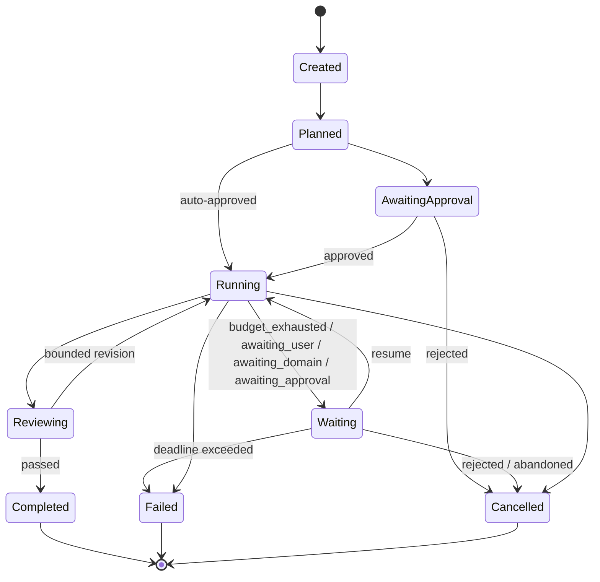

# 03 Agent Runtime 与 Video Domain Agent（最终版 v1.0）

> 权威顺序第 4 位。字段级权威见 `04`。
> 来源：02 Runtime + 03 VideoDomain + impl_04 + impl_07，合并后修正冲突、补数值。

## 1. Runtime 总体架构

Acore Runtime Java SDK **0.2.0**（`/open/v1`，JDK 17+）+ 平台治理层。

### 1.1 SDK 原生 vs 平台自建（冻结边界）

| 能力 | 归属 |
|---|---|
| AgentSpec / AgentRevision、Session、Run、ActionRequest、RunOutput / SessionArtifact（文件型）、Models.Budget（maxTurns、timeout） | **SDK 原生** |
| Plan API、通用 Checkpoint API、Workflow Engine、多 Agent 团队调度器 / 共享黑板、Policy Gateway、统一 Tool Registry、跨 Run 预算总账、领域 Artifact 注册表 / 血缘、质量门 | **平台自建**（SDK 不提供） |

> **注意：** AgentScope Java 2.0 仅为未验证的服务端实现可能，**不得作为业务依赖**（ADR-11）。

### 1.2 java-examples 引用核实（修正 B 组 P0-4）

经核对 `java-examples/README.md`：

- **属实：** E01–E21、E22（两个类，须每次写全名）、E23、E24 均存在；E19 `forwardTo`、E23 MCP `JSON_RPC` 兼容模式、E18 逐轮指定 `specVersion`、E13 会话文件上传、E24 `ProgressRun` 为业务模板投影，均与 README 一致。
- **降级为“待对源码核验”，不得作为已验证证据：** `CallerToolContinuation`、`RuntimeConversationRunner` 在 README 中**零出现**，02 §12.8 称其为“示例源码验证的真实模式”属超前断言，本最终版删除该断言，改为“待对 `java-examples` 源码核验后方可引用”。
- **删除：** 附件上限“16 / 图片 8 / 工作区文件 64”（02 §12.4）在 README 中无出处；README 仅给单文件 32 MiB（实测 30 MB 通过）。v1.0 只采用“单文件 ≤32 MiB”这一有据值。
- **降级：** E01/E02/E06/E07 归为“对 `tasks`”、E03/E04/E05/E18 归为“Session + Run”均为推断，README 未逐项写明调用方式；v1.0 改为“推断，待核验”。
- **README 内部矛盾，02 未降级，现补：** E24 同段称指定版本 `liveVersion=1.1.1`，又称默认目标 `@1.3.0`，二者冲突；同段明言“实际业务取数尚未测试，日期字符串格式仍未验证”。v1.0 将 E24 降级为**演示级证据**，不得作为“精确版本运行”的证据。
- E22 歧义：有两个同前缀类（`E22FilteredConversationDetail`、`E22ProductHighlights`），引用时须每次写全名，单写 E22 无效。

## 2. Session / Plan / Task / Checkpoint / Artifact

- Session：只管交互连续性。
- Plan：平台自建，版本化、冻结，批准后改动须新版本 + 重审批；Plan Schema 见 `04` §5.2。
- Task：平台侧业务任务聚合，状态机 9 态（见 `01` §5），**含 Waiting→Running 恢复边**。
- Checkpoint：平台自建，只存最小充分状态，不存模型内部推理链；Checkpoint Schema 见 `04` §5.3。
- Artifact：SDK 文件型 Artifact + 平台领域 Artifact 注册表；跨域 Artifact Envelope 8 类（见 `01` §6）。

## 3. Task 状态机（冻结，与 02 §4.2 原图一致）

> **纠正（评审 R-01）：** 02 §4.2 原图**已有** `Waiting --> Running: resume`，B 组分析称“02 图缺失恢复边”是误读，impl_04 图与 02 图在恢复边上一致。本节按 02 原图完整复现，不再称“修正 02 图缺失”。

本图是 Task 的唯一正式状态集。**不设独立 `Paused` 或 `WAITING_USER`。**

- `waiting_reason` 冻结 4 个：`awaiting_user` / `budget_exhausted` / `awaiting_domain` / `awaiting_approval`。
- 恢复规则：Waiting 的恢复须用显式迁移（`Waiting→Running`），并记录决议（谁、何时、什么决议）；不得静默恢复。
- 审批分流（新增）：`requires_action` → 用户确认类 `awaiting_user`；业务审批类 `awaiting_approval`；预算类 `budget_exhausted`；领域等待类 `awaiting_domain`。

## 4. Video Domain Agent 设计

### 4.1 职责（冻结）

只做：意图理解、检索规划、Storyboard、ClipPlan、素材分配。
不做：直接调用跨域、不读 Fixture/DB/索引、不遍历全量候选、不改候选分数、不直接写项目库、不执行媒体操作。

### 4.2 Agent Tool（8 个，冻结）

| Tool | 副作用 | 说明 |
|---|---|---|
| `get_project_context` | L0 | 项目上下文 |
| `search_clips` | L0 | 经 Retrieval Port 检索 |
| `recommend_clips` | L0 | 仅 `clip_candidate` 场景 |
| `similar_clips` | L0 | semantic / visual |
| `get_clip_detail` | L0 | 单 Clip 详情 |
| `create_storyboard` | L1 | 创建 Storyboard（计划侧） |
| `create_clip_plan` | L1 | 创建 ClipPlan（计划侧） |
| `assign_material` | L1 | 素材分配（计划侧，不写项目库） |

跨域调用**不是** Agent Tool（见 INV-01）。

### 4.3 请求路由

见 `01` §4（R0–R4 可编码路由表）。

## 5. 预算与重试（冻结数值）

### 5.1 单 Run 默认值（唯一值，impl_04 §6.5）

`max_turns=12`、`timeout_seconds=900`、`max_tool_calls=40`、`max_replans=1`、`max_tool_error_streak=2`。

### 5.2 任务级预算（新增，单 Run 值之上）

| 维度 | 上限 |
|---|---|
| Planner 调用 / 任务 | ≤20 |
| 检索工具调用 / 任务 | ≤120（按最多 3 个 Run 计，每 Run ≤40；单 Run 任务仍受单 Run 上限 40 约束） |
| 子 Agent / 任务 | ≤3 |
| Critic 修订轮数 | ≤2 |
| 跨 Run Token / 成本帽 | v1.0 不设数值（无计费接入），记录用量，超量告警 |

### 5.3 重试口径（冻结，三处“2”分别计数）

- 领域调用重试：最多 **2 次**（含首次共 3 次尝试，指数退避 500ms → 1000ms）。
- Critic 修订：最多 **2 轮**，保留最佳版本。
- 连续工具错误：**2 轮**即停。
- 三者分别计数，不累计、不混用。

### 5.4 幂等键（三层，冻结）

| 层 | 键 | 冲突处理 |
|---|---|---|
| API 层 | `requestId`（同键不同体 → 409） | 见 `04` §6 |
| Step 层 | `idempotency_key`（Step 存储） | 重放返回原结果，不重复执行 |
| 领域调用层 | `invocation_id + input_hash` | 同键同体 → 返回缓存结果；同键不同体 → 409 |

恢复时先回读原 Run（02 §4.3、03 §10、impl_04 §11 一致）。

## 6. 质量门（6 类，阈值 80 分，冻结换算）

| 门 | 检查内容 |
|---|---|
| Schema | 输出符合 JSON Schema |
| Contract | 符合 `04` 的 API / Artifact 契约 |
| Evidence | 每个候选有证据（score_breakdown + origin） |
| Technical | 评分公式、时长、格式合规 |
| Policy | 副作用等级、权限、脱敏合规 |
| Human | 人工审批（L4 / 发布） |

**换算公式（冻结）：** 质量分 = `clip_fit` 与 `collection_fit` 的加权和（权重和为 1，见 `04` §5.4）；80 分为通过线；低于 80 分进入修订，最多 2 轮，保留最佳版本。
**注意：** impl_04 §9 的权重是“可配置策略示例”，v1.0 冻结为默认值，改动须走 ADR；02 §9 的“80 分阈值”此前无换算公式，现补齐。
Agent Eval 固定集：验收表 A18（内容见 `08_附录_核心契约正文.md` §6，源 impl_06），固定集用例数与通过线须在阶段 4 开始前冻结并写入 `08` 附录。

## 7. 多 Agent 协作（v1.0 实例化）

- 模式：主协调 + 子 Agent 围绕独立产物、Artifact 契约交接。
- 子 Agent 上限：≤3 / 任务；并发策略：子 Agent 并行执行，失败隔离（一个子 Agent 失败不阻断其余）；无共享黑板（SDK 不提供，平台不自建黑板 v1.0）。
- Video Agent 侧：全程单 Agent 为默认；子 Agent 仅在 L3 路由时启用（见 `01` §4）。

## 8. 跨域编排（CreativeProductionWorkflow）

- 主 Workflow 两种类型：`video_only` / `cross_domain_campaign`。
- 默认依赖图：Product 先行 → Video / Landing Page 并行 → Copy fan-in → Ads 最后。
- **最小可用（定义，新增）：** Product：`product-brief` 已发布；Video：`video-plan` 已发布；Landing Page：`landing-page-package` 草稿已生成且含主图与标题。Copy 在三者均达最小可用后执行。
- **Ads 前置条件（修正冲突）：** Ads 须等引用 Artifact 全部 `ready`；`partial` 缺失时**阻塞 Ads**，进入 `review-package` 的是 Review 环节，不是 Ads 执行（修正 impl_07 §7.2 与 §9.3 的冲突）。
- Step 结构：含 `join_policy` / `timeout_ms` / `idempotency_key`。
- 审批范围 5 个：`video_plan` / `copy` / `landing_page` / `ads_draft` / `publish`；发布须独立 Action。
- 状态映射、重试、部分成功、补偿：见 `04` §5.5 与 `05` §5。
