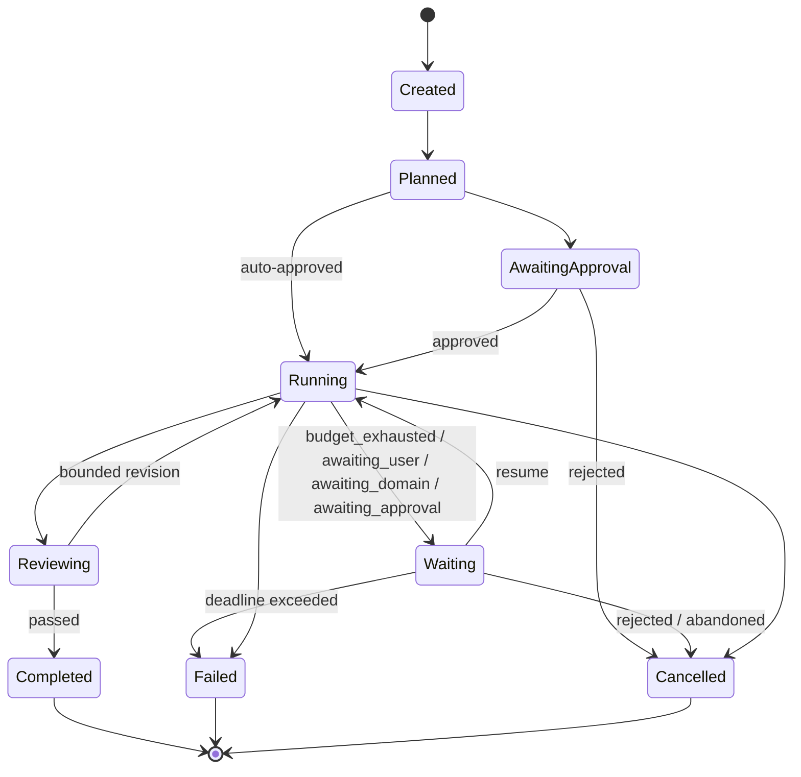

# 08 附录：核心契约正文

> 本附录补写评审 R-02/R-07/R-09 要求的核心正文。源文件以原始文档为准；与 `00`–`05` 冲突时，以 `00`–`05` 为准。

## 1. Task 状态机（全文，源 02 §4.2 / impl_04 §3.1，两图一致）



`waiting_reason` 冻结 4 个：`awaiting_user` / `budget_exhausted` / `awaiting_domain` / `awaiting_approval`（Video-only 与跨域均用同一 4 个）。

## 2. CandidateSet JSON Schema v1.0 与请求示例

```json
{
  "$schema": "http://json-schema.org/draft-07/schema#",
  "title": "CandidateSet v1.0",
  "type": "object",
  "required": ["candidate_id", "clip_id", "candidate_origin", "score", "score_breakdown", "evidence", "trace"],
  "properties": {
    "candidate_id": {"type": "string"},
    "clip_id": {"type": "string"},
    "candidate_origin": {"type": "string"},
    "score": {"type": "number"},
    "score_breakdown": {"type": "object", "properties": {"visual": {"type": ["number", "null"]}}},
    "evidence": {"type": "object"},
    "trace": {"type": "object", "required": ["query_version"], "properties": {"query_version": {"type": "string"}}},
    "index_manifest_id": {"type": "string"},
    "manifest_epoch": {"type": "integer"},
    "score_normalization_version": {"type": "string", "const": "rrf-v1"}
  }
}
```

Search 请求示例（v1.0 冻结值）：

```json
{
  "query": "雨夜城市街景",
  "channels": ["keyword", "semantic", "visual", "attribute", "context"],
  "filters": {"status": "available"},
  "candidate_budget": 100,
  "deadline_ms": 8000,
  "ranking": {"strategy_id": "video-hybrid", "strategy_version": "1.0"},
  "schema_version": "1.0"
}
```

Recommendation 请求示例（v1.0 冻结值）：`strategy_id` 为 `video_mock_clip_fit_v1`，`objective` 为 `task_fit_then_diversity`，`selected` 与 `covered_storyboard_clip_ids` 必须一致。

## 3. 错误码表（14 类，见 `04` §6）

完整 14 类逐类映射见 `04` §6（`validation` / `authentication` / `authorization` / `policy` / `not_found` / `conflict` / `rate_limited` / `dependency_timeout` / `domain_unavailable` / `dependency_failed` / `approval_required` / `model_error` / `budget_exhausted` / `internal`）。本附录不重复抄录，以 `04` §6 为唯一权威。

## 4. 完成定义 15 条（源 impl_00 §6 原文）

1. 所有 Video 领域机器契约中只存在 `Video` 和 `Clip` 两级视频对象；跨域领域对象不进入该层级。
2. 简单 Search、Recommendation 和 Similar 不启动 Agent，直接走 Mock Port；复杂搜索和创作任务进入 Agent。
3. Agent 能生成 TaskBrief、CreativeBrief、Storyboard、ClipPlan 和 MaterialAssignment。
4. Search、Recommendation 和 Similar 均通过 Mock Port 工作。
5. 用户替换或修改某个计划槽位（`storyboard_clip_id`）时，只重算受影响的需求、候选和 Assignment。
6. Task 等待、恢复、幂等、预算和 Tool 审计通过。
7. Agent Eval 覆盖澄清、零结果、局部替换、工具失败和 Prompt Injection。
8. 不依赖真实数据加工、媒体渲染、前端或外部平台即可完成端到端 Demo。
9. Feedback 经 Mock Port 可写、可审计，且不依赖前端。
10. 跨域请求由 `CreativeProductionWorkflow` 编排，Video Domain Agent 不调用其他领域。
11. Product、Landing Page、Copy、Ads 通过 `DomainInvocationPort` 调用并有 Mock/Adapter。
12. 主 Workflow 支持依赖并行、fan-in、部分成功、领域重试、Artifact stale 和恢复。
13. Video-only 请求仍可直接使用 Video Workflow，不被跨域逻辑污染。
14. 用户审批按领域和发布动作拆分，Ads 草稿不得自动发布。
15. 无依赖领域失败时，其他领域结果保留且可继续交付。

## 5. DDL 表清单与索引（源 05 §9，25 张表）

表名（按 05 §9 顺序）：`urre_source`、`urre_raw_object`、`urre_canonical_snapshot`、`urre_input_artifact`、`urre_processing_profile`、`urre_index_profile`、`urre_embedding_profile`、`urre_ingestion_job`、`urre_ingestion_item`、`urre_processing_run`、`urre_processing_artifact`、`urre_embedding_record`、`urre_index_pool`、`urre_tenant_index_binding`、`urre_index_manifest`、`urre_index_target`、`urre_index_build`、`urre_index_build_item`、`urre_active_manifest`、`urre_candidate_set`、`urre_feedback_event`、`urre_outbox_event`、`urre_quota_policy`、`urre_quota_usage`、`urre_dead_letter`。
DDL 全文以原始 05 §9 为准（本最终版不逐字重印 25 张表；迁移顺序见 `04` §5.1：V1 核心表 → V2 URRE 表 → V3 Task/Workflow 表 → V4 反馈/Outbox）。

必补索引（v1.0 新增，阶段 0 落地）：
- `idx_urre_outbox_pending`（原始 05 唯一索引，原样保留）
- `tenant_id, entity_id`（租户+实体）
- `manifest_id`
- `tenant_id, event_type, created_at`（反馈归因）
- `video_task(waiting_reason, status)`
- `creative_task(waiting_reason, status)`

## 6. 纵向切片验收 A01–A31（源 impl_06 §10）

| 编号 | 验收项 | 判定（摘要） |
|---|---|---|
| A01 | Video/Clip Schema | 只有两级对象 |
| A02 | Clip 时间不变量 | `duration_ms = end_ms - start_ms`，且 `end_ms <= Video.duration_ms` |
| A03 | 简单 Search、Recommendation 和 Similar 不启动 Agent | 均不创建新的 Agent Run，`handled_by=fast_path` |
| A04 | 复杂请求路由 | Video-only 进入固定 AgentSpec；跨域任务进入 CreativeProductionWorkflow |
| A05 | Storyboard 结构 | 使用 clip_requirements |
| A06 | ClipPlan 结构 | 使用 storyboard_clip_id |
| A07 | Search Mock | 返回 Video/Clip、`handled_by`、`recall_channels` 和嵌套证据 |
| A08 | Recommendation Mock | Context 影响排序 |
| A09 | Similar Mock | 按 `01` §4.4 请求；不以 Seed 自身返回；不启动 Agent |
| A10 | Assignment | 每个计划槽位有首选/替代；素材 Clip 只作为分配对象 |
| A11 | 局部替换 | 只重算目标计划槽位 |
| A12 | 证据与质量 | 低证据候选标记待审核，不静默确认 |
| A13 | 等待与恢复 | 原 Run/Action 可定位；Video-only 与跨域均用 4 个已冻结 waiting_reason，不创建重复 Run |
| A14 | SSE | 断线重放无重复副作用 |
| A15 | 预算 | 耗尽进入 Waiting |
| A16 | Prompt Injection | 权限与 Tool 不变 |
| A17 | 数据隔离 | 跨租户不可见 |
| A18 | Agent Eval | 固定集全部通过（用例数与通过线须在阶段 4 开始前冻结） |
| A19 | Event Catalog | 与 API 契约 §8 必要事件一致 |
| A20 | DDL 不变量 | Video/Clip 候选身份与 Assignment 类型约束生效 |
| A21 | Feedback 写入 | 经 `writeFeedback` 落入 `video_feedback_event`；`Idempotency-Key` 重放幂等；Direct 路径 `task_id` 为空，任务路径有 `task_id` |
| A22 | 双路径路由 | Video-only 不创建 creative_task；跨域请求进入 CreativeProductionWorkflow |
| A23 | 领域边界 | Video Agent 不调用 Product、Landing Page、Copy、Ads |
| A24 | DomainInvocation | 领域调用有唯一 ID、输入 hash、状态和 Artifact 输出 |
| A25 | Workflow DAG | Product 先行，Video/Landing Page 并行，Copy fan-in，Ads 等待依赖 |
| A26 | Artifact Envelope | owner、schema、version、hash、parent、validation 完整 |
| A27 | 部分成功 | 单领域失败不阻塞无依赖分支；缺口进入 ReviewPackage |
| A28 | Artifact stale | 只标记依赖下游；stale Artifact 阻止发布 |
| A29 | 范围化审批 | Ads Draft 与 Publish 审批不可复用 |
| A30 | 跨域恢复 | 不重复 DomainInvocation，已完成 Artifact 保留 |
| A31 | Video-only 回归 | 原 Video 验收全部保持通过 |

12 项阻断项与 Demo 脚本以原始 impl_06 §11–§12 为准。

## 7. Mock 场景触发方式

| 场景 | 触发方式 |
|---|---|
| 稳定成功 | 默认（固定 Fixture） |
| 零结果 | 查询命中空集的固定用例 |
| 超时 | `mock-timeout`（impl_05 §11） |
| 重复候选 | `mock-duplicate`（impl_05 §11） |
| 空集 | `mock-empty`（impl_05 §11） |
| 非法参数 | 固定非法参数用例（impl_00 §4） |
| 非法 Tool 参数 | `mock-illegal-param`（**新增设计决策**，无原始依据；触发词在阶段 0 冻结） |

## 8. ADR 映射与 Ticket/Sprint 对照

ADR 42 行映射见 `07` §4；Ticket/Sprint 对照见 `05` §5；Sprint 数 8 个，阶段 3 拆为 S4/S5。
