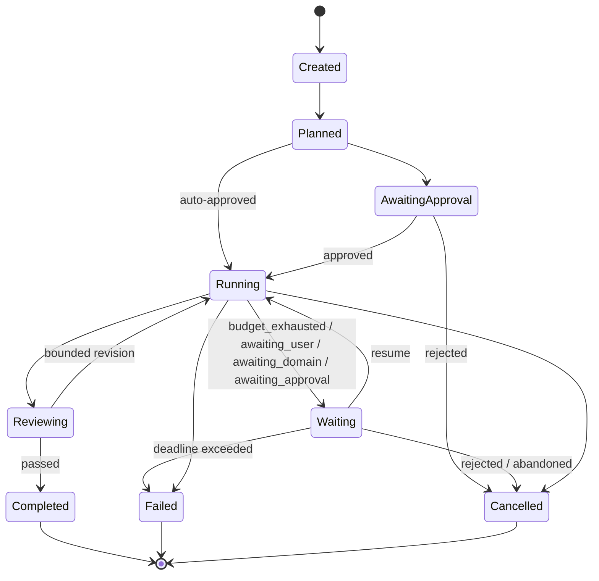

# 08 附录：核心契约正文

> **v1.1 修订注记（2026-11-16）：** 依据覆盖分析《VideoDomainAgent_与PRD原型覆盖分析.md》+ PRD v1.6；改动摘要：新增 §9（A-9–A-21，§9.1–§9.10 新对象的 JSON Schema/字段表正文）与 §10（04↔08 引用对照表）；§1–§8 冻结内容（状态机、CandidateSet Schema、A01–A31、DDL 清单）一字未改。
> **v1.2 修订注记（2026-11-16）：** A-12 修订为 v1.2（新增 `active` / `pending_slot` / `supplementary_inputs`、`input_media_ref.source`、`result.partial` / `missing_items`）；新增 §11 状态投影与追问状态机契约测试（T-SM、T-CM）；§10 对照表补 §11 行。§1–§8 冻结内容一字未改。

> 本附录补写评审 R-02/R-07/R-09 要求的核心正文。源文件以原始文档为准；与 `00`–`05` 冲突时，以 `00`–`05` 为准。

## 1. Task 状态机（全文，源 02 §4.2；与 impl_04 §3.1 仅 Waiting→Cancelled 标注不同，选边见 03 §3）



`waiting_reason` 冻结 4 个：`awaiting_user` / `budget_exhausted` / `awaiting_domain` / `awaiting_approval`（Video-only 与跨域均用同一 4 个）。

## 2. CandidateSet JSON Schema v1.0 与请求示例

> 与 `04` §3 逐字一致（顶层 + 条目两级、`required` 清单、`entity_type` 枚举、`score_normalization_version` const `rrf-v1`）。必填性以 impl_01 §5 原文为准：impl_01 §5 示例中出现的字段为必填，`index_manifest_id` / `manifest_epoch` / `score_normalization_version` 为可选（Mock 可空，真实版必填）；`task_id` 在 Direct 路径可为空（见 §6 A21），`storyboard_clip_id` 仅 Recommendation 时有值；Clip 级候选 `clip_id` / `start_ms` / `end_ms` 必填，Video 级候选三者为空（impl_01 §5 不变量）。

```json
{
  "$schema": "http://json-schema.org/draft-07/schema#",
  "title": "CandidateSet v1.0",
  "type": "object",
  "required": ["schema_version", "candidate_set_id", "request_id", "capability", "handled_by", "project_id", "task_id", "strategy_version", "trace", "page", "warnings", "items"],
  "properties": {
    "schema_version": {"type": "string", "const": "1.0"},
    "candidate_set_id": {"type": "string"},
    "request_id": {"type": "string"},
    "capability": {"type": "string", "enum": ["search", "recommend", "similar", "evidence", "feedback"]},
    "handled_by": {"type": "string", "enum": ["fast_path", "agent"]},
    "project_id": {"type": "string"},
    "task_id": {"type": ["string", "null"]},
    "storyboard_clip_id": {"type": ["string", "null"]},
    "strategy_version": {"type": "string"},
    "trace": {"type": "object", "required": ["query_version"], "properties": {"query_version": {"type": "string"}}},
    "index_manifest_id": {"type": "string"},
    "manifest_epoch": {"type": "integer"},
    "score_normalization_version": {"type": "string", "const": "rrf-v1"},
    "page": {"type": "object", "required": ["next_cursor", "has_more"], "properties": {"next_cursor": {"type": ["string", "null"]}, "has_more": {"type": "boolean"}}},
    "warnings": {"type": "array"},
    "items": {
      "type": "array",
      "items": {
        "type": "object",
        "required": ["candidate_id", "entity_type", "entity_id", "video_id", "rank", "score", "score_breakdown", "recall_channels", "candidate_origin", "evidence", "availability", "versions"],
        "properties": {
          "candidate_id": {"type": "string"},
          "entity_type": {"type": "string", "enum": ["video", "clip"]},
          "entity_id": {"type": "string"},
          "video_id": {"type": "string"},
          "clip_id": {"type": ["string", "null"]},
          "start_ms": {"type": ["integer", "null"]},
          "end_ms": {"type": ["integer", "null"]},
          "rank": {"type": "integer"},
          "score": {"type": "number"},
          "score_breakdown": {"type": "object", "properties": {"keyword": {"type": "number"}, "semantic": {"type": "number"}, "visual": {"type": ["number", "null"]}, "metadata": {"type": "number"}}},
          "recall_channels": {"type": "array", "items": {"type": "string"}},
          "candidate_origin": {"type": "string"},
          "evidence": {"type": "object"},
          "availability": {"type": "string", "enum": ["available", "unavailable"]},
          "versions": {"type": "object", "required": ["feature_version", "model_versions"], "properties": {"feature_version": {"type": "string"}, "model_versions": {"type": "array", "items": {"type": "string"}}}}
        },
        "allOf": [
          {"if": {"properties": {"entity_type": {"const": "clip"}}}, "then": {"required": ["clip_id", "start_ms", "end_ms"]}}
        ]
      }
    }
  }
}
```

不变量（见 `04` §3）：`entity_type` 只能是 `video` 或 `clip`；Video 候选 `entity_id == video_id`，Clip 候选 `entity_id == clip_id`，由 Schema 校验、DDL CHECK 和契约测试保证；Clip 级候选必须携带来源 `video_id` 和精确时间区间（`start_ms`/`end_ms`）；预览走 `preview_ref`/`keyframe_ref`；证据引用挂在候选或分配结果上，由 Evidence Port 解析，不是 Clip 的落列字段。

Search 请求示例（v1.0 冻结值）：

```json
{
  "query": "雨夜城市街景",
  "channels": ["keyword", "semantic", "visual", "attribute", "context"],
  "filters": {"status": "available"},
  "candidate_budget": 100,
  "deadline_ms": 8000,
  "ranking": {"strategy_id": "video_mock_hybrid_v1", "strategy_version": "1.0"},
  "schema_version": "1.0"
}
```

Recommendation 请求示例（v1.0 冻结值）：`strategy_id` 为 `video_mock_clip_fit_v1`，`objective` 为 `task_fit_then_diversity`，`selected` 与 `covered_storyboard_clip_ids` 必须一致。

## 3. 错误码表（14 类，见 `04` §6）

完整 14 类逐类映射见 `04` §6（`validation` / `authentication` / `authorization` / `policy` / `not_found` / `conflict` / `rate_limited` / `dependency_timeout` / `domain_unavailable` / `dependency_failed` / `approval_required` / `model_error` / `budget_exhausted` / `internal`）。本附录不重复抄录，以 `04` §6 为唯一权威。

## 4. 完成定义 15 条（源 impl_00 §6 原文）

1. 所有 Video 领域机器契约中只存在 `Video` 和 `Clip` 两级视频对象；跨域领域对象不进入该层级。
2. 简单 Search、Recommendation 和 Similar 不启动 Agent，直接走 Mock Port；复杂搜索和创作任务进入 Agent。
3. Agent 能生成 TaskBrief、CreativeBrief、Storyboard、ClipPlan 和 MaterialAssignment。
4. Search、Recommendation 和 Similar 均通过 Mock Port 工作。
5. 用户替换或修改某个计划槽位（`storyboard_clip_id`）时，只重算受影响的需求、候选和 Assignment。
6. Task 等待、恢复、幂等、预算和 Tool 审计通过。
7. Agent Eval 覆盖澄清、零结果、局部替换、工具失败和 Prompt Injection。
8. 不依赖真实数据加工、媒体渲染、前端或外部平台即可完成端到端 Demo。
9. Feedback 经 Mock Port 可写、可审计，且不依赖前端。
10. 跨域请求由 `CreativeProductionWorkflow` 编排，Video Domain Agent 不调用其他领域。
11. Product、Landing Page、Copy、Ads 通过 `DomainInvocationPort` 调用并有 Mock/Adapter。
12. 主 Workflow 支持依赖并行、fan-in、部分成功、领域重试、Artifact stale 和恢复。
13. Video-only 请求仍可直接使用 Video Workflow，不被跨域逻辑污染。
14. 用户审批按领域和发布动作拆分，Ads 草稿不得自动发布。
15. 无依赖领域失败时，其他领域结果保留且可继续交付。

## 5. DDL 表清单与索引（源 05 §9，25 张表）

表名（按 05 §9 顺序）：`urre_source`、`urre_raw_object`、`urre_canonical_snapshot`、`urre_input_artifact`、`urre_processing_profile`、`urre_index_profile`、`urre_embedding_profile`、`urre_ingestion_job`、`urre_ingestion_item`、`urre_processing_run`、`urre_processing_artifact`、`urre_embedding_record`、`urre_index_pool`、`urre_tenant_index_binding`、`urre_index_manifest`、`urre_index_target`、`urre_index_build`、`urre_index_build_item`、`urre_active_manifest`、`urre_candidate_set`、`urre_feedback_event`、`urre_outbox_event`、`urre_quota_policy`、`urre_quota_usage`、`urre_dead_letter`。
DDL 全文以原始 05 §9 为准（本最终版不逐字重印 25 张表；迁移顺序见 `04` §5.1：V1 核心表 → V2 URRE 表 → V3 Task/Workflow 表 → V4 反馈/Outbox）。

必补索引改为索引意向清单（未指定落表与索引名，完整清单随 DDL 交付，见 07 §5 第 4 项）：
- `idx_urre_outbox_pending`（原始 05 唯一索引，原样保留）
- `tenant_id, entity_id`（租户+实体）
- `manifest_id`
- `tenant_id, event_type, created_at`（反馈归因）
- `video_task(waiting_reason, status)`
- `creative_task(waiting_reason, status)`

业务表 26 张见 04 §5.1 指引（impl_05 §10）。

V1–V4 迁移分配（与 04 §5.1 一致，合计 51 张）：

- V1 业务核心表（17 张，impl_05 §10）：`video_project`、`video_task`、`video_task_step`、`video_agent_run`、`video_artifact`、`video_asset`、`video_clip`、`video_candidate_set`、`video_candidate`、`video_clip_plan`、`video_clip_requirement`、`video_assignment_set`、`video_material_assignment`、`video_tool_call`、`video_budget_ledger`、`video_checkpoint`、`video_agent_event`。
- V2 URRE 表（23 张，05 §9 的 25 张中除反馈/Outbox 外的 23 张）：`urre_source`、`urre_raw_object`、`urre_canonical_snapshot`、`urre_input_artifact`、`urre_processing_profile`、`urre_index_profile`、`urre_embedding_profile`、`urre_ingestion_job`、`urre_ingestion_item`、`urre_processing_run`、`urre_processing_artifact`、`urre_embedding_record`、`urre_index_pool`、`urre_tenant_index_binding`、`urre_index_manifest`、`urre_index_target`、`urre_index_build`、`urre_index_build_item`、`urre_active_manifest`、`urre_candidate_set`、`urre_quota_policy`、`urre_quota_usage`、`urre_dead_letter`。
- V3 Task/Workflow 表（8 张，impl_05 §10）：`creative_project`、`creative_task`、`creative_task_step`、`domain_invocation`、`creative_artifact_index`、`creative_artifact_edge`、`creative_approval`、`creative_task_event`。
- V4 反馈/Outbox（3 张）：`video_feedback_event`（impl_05 §10）、`urre_feedback_event`、`urre_outbox_event`（05 §9）。

## 6. 纵向切片验收 A01–A31（源 impl_06 §10）

| 编号 | 验收项 | 判定（摘要） |
|---|---|---|
| A01 | Video/Clip Schema | 只有两级对象 |
| A02 | Clip 时间不变量 | `duration_ms = end_ms - start_ms`，且 `end_ms <= Video.duration_ms` |
| A03 | 简单 Search、Recommendation 和 Similar 不启动 Agent | 均不创建新的 Agent Run，`handled_by=fast_path` |
| A04 | 复杂请求路由 | Video-only 进入固定 AgentSpec；跨域任务进入 CreativeProductionWorkflow |
| A05 | Storyboard 结构 | 使用 clip_requirements |
| A06 | ClipPlan 结构 | 使用 storyboard_clip_id |
| A07 | Search Mock | 返回 Video/Clip、`handled_by`、`recall_channels` 和嵌套证据 |
| A08 | Recommendation Mock | Context 影响排序 |
| A09 | Similar Mock | 按 `04` §2.3 请求；不以 Seed 自身返回；不启动 Agent |
| A10 | Assignment | 每个计划槽位有首选/替代；素材 Clip 只作为分配对象 |
| A11 | 局部替换 | 只重算目标计划槽位 |
| A12 | 证据与质量 | 低证据候选标记待审核，不静默确认 |
| A13 | 等待与恢复 | 原 Run/Action 可定位；Video-only 与跨域均用 4 个已冻结 waiting_reason，不创建重复 Run |
| A14 | SSE | 断线重放无重复副作用 |
| A15 | 预算 | 耗尽进入 Waiting |
| A16 | Prompt Injection | 权限与 Tool 不变 |
| A17 | 数据隔离 | 跨租户不可见 |
| A18 | Agent Eval（源 impl_04 §13.3） | 固定评测集至少覆盖以下 13 个场景：1. 简单 Search、Recommendation 和 Similar 不启动 Agent；2. 复杂创作生成 Storyboard 和 ClipPlan；3. 信息不足时澄清；4. 零结果 Query 有界重写；5. Clip 级 Search 与 Recommendation 合并；6. 替换或修改某个计划槽位（`storyboard_clip_id`）时只重算受影响范围；7. Tool 超时和非法 Schema；8. 预算耗尽和恢复；9. Prompt Injection 不改变权限；10. 跨域请求进入主 Workflow，而不是进入全能 Video Agent；11. 领域失败只阻塞其下游，无依赖分支继续；12. Artifact stale 阻止 Ads 草稿被标记为可发布；13. Video Agent 不产生 Product、Landing Page、Copy 或 Ads Artifact。用例数与通过线须在阶段 4 开始前冻结 |
| A19 | Event Catalog | 与 API 契约 §8 必要事件一致；事件名录见 04 §2.6 |
| A20 | DDL 不变量 | Video/Clip 候选身份与 Assignment 类型约束生效 |
| A21 | Feedback 写入 | 经 `writeFeedback` 落入 `video_feedback_event`；`Idempotency-Key` 重放幂等；Direct 路径 `task_id` 为空，任务路径有 `task_id` |
| A22 | 双路径路由 | Video-only 不创建 creative_task；跨域请求进入 CreativeProductionWorkflow |
| A23 | 领域边界 | Video Agent 不调用 Product、Landing Page、Copy、Ads |
| A24 | DomainInvocation | 领域调用有唯一 ID、输入 hash、状态和 Artifact 输出 |
| A25 | Workflow DAG | Product 先行，Video/Landing Page 并行，Copy fan-in，Ads 等待依赖 |
| A26 | Artifact Envelope | owner、schema、version、hash、parent、validation 完整 |
| A27 | 部分成功 | 单领域失败不阻塞无依赖分支；缺口进入 ReviewPackage |
| A28 | Artifact stale | 只标记依赖下游；stale Artifact 阻止发布 |
| A29 | 范围化审批 | Ads Draft 与 Publish 审批不可复用 |
| A30 | 跨域恢复 | 不重复 DomainInvocation，已完成 Artifact 保留 |
| A31 | Video-only 回归 | 原 Video 验收全部保持通过 |

15 项阻断项与 Demo 脚本以原始 impl_06 §11–§12 为准。

## 7. Mock 场景触发方式

| 场景 | 触发方式 |
|---|---|
| 稳定成功 | 默认（固定 Fixture） |
| 零结果 | 查询命中空集的固定用例 |
| 超时 | `mock-timeout`（impl_05 §11） |
| 重复候选 | `mock-duplicate`（impl_05 §11） |
| 空集 | `mock-empty`（impl_05 §11） |
| 非法参数 | 固定非法参数用例（impl_00 §4） |
| 非法 Tool 参数 | `mock-illegal-param`（**新增设计决策**，无原始依据；触发词在阶段 0 冻结） |

## 8. ADR 映射与 Ticket/Sprint 对照

ADR 50 行映射见 `07` §4；Ticket/Sprint 对照见 `05` §5；Sprint 数 8 个，阶段 3 拆为 S4/S5。

## 9. v1.1 新增对象 JSON Schema（A-9–A-21）

> 与 `04` §9–§13 双向一一对应（对照表见本文件 §10 与 `04` §13.2）。字段表见 `04` 对应节；本节给 JSON Schema 正文。未冻结声明见 `04` §9 引言。（评审 C-6：原“所有 v1.1 新增 Schema 的 `schema_version` 为 `1.1`”一句已删——各 JSON 块未含该属性，版本区分以 `04` §8 版本规则与 `title` 中的 v1.1 为准。）

### A-9 EntryTask（对应 `04` §9.1）

来源：PRD §5；覆盖分析 §6.3。

```json
{
  "$schema": "http://json-schema.org/draft-07/schema#",
  "title": "EntryTask v1.1",
  "type": "object",
  "required": ["entry_task_id", "tenant_id", "session_id", "entry_type", "task_template_id", "required_params", "allowed_actions", "result_destination", "status"],
  "properties": {
    "entry_task_id": {"type": "string"},
    "tenant_id": {"type": "string"},
    "session_id": {"type": "string"},
    "entry_type": {"type": "string", "enum": ["find_hot", "video_remix", "hot_remake", "follow_product", "skill"]},
    "skill_type": {"type": "string", "enum": ["subtitle_extract", "voiceover", "erase_element", "aspect_ratio", "clip_generate", "selling_overlay"]},
    "task_template_id": {"type": "string"},
    "required_params": {"type": "object"},
    "missing_params": {"type": "array", "items": {"type": "string"}},
    "clarification_question": {"type": "string"},
    "allowed_actions": {"type": "array", "items": {"type": "string"}},
    "result_destination": {"type": "string", "enum": ["session_dialog", "canvas", "asset"]},
    "source_refs": {"type": "object", "properties": {"product_id": {"type": "string"}, "video_id": {"type": "string"}, "clip_id": {"type": "string"}, "reference_video_id": {"type": "string"}}},
    "status": {"type": "string", "description": "复用 Task 状态机（03 §3，18 条边冻结）"},
    "task_id": {"type": ["string", "null"]}
  },
  "allOf": [
    {"if": {"properties": {"entry_type": {"const": "skill"}}}, "then": {"required": ["skill_type"]}}
  ]
}
```

### A-10 RecommendedScenario（对应 `04` §9.2）

来源：PRD §17.2 DR-07、DR-08。

```json
{
  "$schema": "http://json-schema.org/draft-07/schema#",
  "title": "RecommendedScenario v1.1",
  "type": "object",
  "required": ["scenario_id", "tenant_id", "category", "slot_type", "title", "prompt_text"],
  "properties": {
    "scenario_id": {"type": "string"},
    "tenant_id": {"type": "string"},
    "category": {"type": "string"},
    "slot_type": {"type": "string", "description": "枚举值待确认（OI-02）"},
    "title": {"type": "string"},
    "prompt_text": {"type": "string"},
    "source_evidence": {"type": "object", "properties": {"reference_refs": {"type": "array", "items": {"type": "string"}}, "preference_source": {"type": "string", "enum": ["explicit", "implicit"]}}},
    "rank": {"type": "integer"}
  }
}
```

规则：每个试点槽位类型至少 3 个推荐场景（DR-07）。

### A-11 MediaActionPlan（对应 `04` §9.4、§10）

来源：覆盖分析 §7.2、§10.1；PRD §8、NFR-04。

```json
{
  "$schema": "http://json-schema.org/draft-07/schema#",
  "title": "MediaActionPlan v1.2",
  "type": "object",
  "required": ["plan_id", "task_id", "actions", "status"],
  "properties": {
    "plan_id": {"type": "string"},
    "task_id": {"type": "string"},
    "entry_task_id": {"type": "string"},
    "actions": {
      "type": "array",
      "items": {
        "type": "object",
        "required": ["action_id", "action_type", "params", "order", "status", "retry_count", "idempotency_key"],
        "properties": {
          "action_id": {"type": "string"},
          "action_type": {"type": "string", "enum": ["generate_clip", "erase_object", "subtitle", "voiceover", "change_aspect_ratio", "overlay_selling_point", "bgm", "upload", "compose_timeline", "export_asset"]},
          "params": {"type": "object"},
          "order": {"type": "integer", "minimum": 0},
          "depends_on": {"type": "array", "items": {"type": "string"}},
          "status": {"type": "string", "enum": ["pending", "running", "succeeded", "failed", "skipped", "cancelled"]},
          "retry_count": {"type": "integer", "minimum": 0},
          "max_retries": {"type": "integer", "description": "配置值，接入时冻结"},
          "error": {"type": "object", "required": ["code", "category", "message"], "properties": {"code": {"type": "string"}, "category": {"type": "string", "enum": ["retryable", "non_retryable"], "description": "v1.2 整改 R12-08：与 04 §10.1 Adapter 返回一致；与 04 §6 的 14 类 category 同名不同义（见 04 §6 注）"}, "message": {"type": "string"}, "raw_error": {"type": "string"}}},
          "idempotency_key": {"type": "string"},
          "result_ref": {"type": "object", "properties": {"video_id": {"type": "string"}, "clip_id": {"type": "string"}, "asset_id": {"type": "string"}}}
        }
      }
    },
    "status": {"type": "string", "enum": ["pending", "running", "partial", "succeeded", "failed", "cancelled"]},
    "progress": {"type": "object", "properties": {"completed_actions": {"type": "integer"}, "total_actions": {"type": "integer"}}},
    "cancel_reason": {"type": "string"}
  }
}
```

Media Capability Workflow API（端点契约见 `04` §10，未冻结）：`POST /v1/media-actions`（提交，202 Accepted）、`GET /v1/media-actions/{plan_id}`（查询进度）、`POST /v1/media-actions/{plan_id}/cancel`（取消）、`POST /v1/media-actions/{plan_id}/retry`（重试）。

### A-12 SkillTask / SkillResult（对应 `04` §9.3；v1.2 修订）

来源：PRD §5、BR-01；PRD §8、§12、DR-17、NFR-04。

```json
{
  "$schema": "http://json-schema.org/draft-07/schema#",
  "title": "SkillTask v1.2",
  "type": "object",
  "required": ["skill_task_id", "skill_type", "tenant_id", "session_id", "task_params", "status", "active", "retry_count", "created_at", "updated_at"],
  "properties": {
    "skill_task_id": {"type": "string"},
    "skill_type": {"type": "string", "enum": ["subtitle_extract", "voiceover", "erase_element", "aspect_ratio", "clip_generate", "selling_overlay"]},
    "tenant_id": {"type": "string"},
    "session_id": {"type": "string"},
    "task_id": {"type": ["string", "null"]},
    "input_media_ref": {"type": "object", "required": ["video_id", "source"], "properties": {"video_id": {"type": "string"}, "clip_id": {"type": "string"}, "source": {"type": "string", "enum": ["user", "demo"], "description": "v1.2 新增：user=用户素材，demo=演示视频（无指定素材时显式标记，不得默认 user）；input_media_ref 存在时 video_id 与 source 均必填（复核 R12-10），clip_id 可选；input_media_ref 本身条件必填（需视频的四项技能必填，voiceover/clip_generate 不必填，见 04 §9.3）"}}},
    "task_params": {"type": "object"},
    "status": {"type": "string", "enum": ["submitted", "running", "waiting_input", "succeeded", "failed", "cancelled"], "description": "Workflow 执行状态的任务级投影（投影表见 03 §4.5.3；契约测试见 08 §11）；只由状态投影器写；非 Task 状态机（03 §3，9 态）的投影"},
    "active": {"type": "boolean", "description": "v1.2 新增：会话内同一时间仅一个 SkillTask 为 true"},
    "pending_slot": {"type": ["string", "null"], "description": "v1.2 新增：当前追问的槽位名；不在追问中为 null"},
    "supplementary_inputs": {"type": "array", "items": {"type": "object", "properties": {"text": {"type": "string"}, "at": {"type": "string", "format": "date-time"}}}, "description": "v1.2 新增：追问中未命中的输入，以及命中输入中超出当前槽位的多余内容（复核 N3-02，与 04 §9.3 一致）；append-only；受会话快照 30 条上限约束（PRD §12）"},
    "retry_count": {"type": "integer", "minimum": 0},
    "max_retries": {"type": "integer", "description": "配置值，接入时冻结"},
    "error": {"type": "object", "required": ["code", "category", "message"], "properties": {"code": {"type": "string"}, "category": {"type": "string", "enum": ["retryable", "non_retryable"], "description": "v1.2 整改 R12-08：与 04 §10.1 Adapter 返回一致；与 04 §6 的 14 类 category 同名不同义（见 04 §6 注）"}, "message": {"type": "string"}, "raw_error": {"type": "string"}}},
    "created_at": {"type": "string", "format": "date-time"},
    "updated_at": {"type": "string", "format": "date-time"}
  }
}
```

各技能 `task_params` / `result`（`SkillResult`：`{skill_task_id, skill_type, result, completed_at}`；`result` 结构按技能分表，字段表见 `04` §9.3；v1.2：各技能 `result` 另加通用字段 `partial: boolean`（默认 `false`）、`missing_items: string[]`（`partial=true` 时必填）；`error` 在 partial 时留空）：

| 技能 | `task_params` 约束 | `result` |
|---|---|---|
| `subtitle_extract` | `video_ref` 必填 | `{subtitle_text: string}` |
| `voiceover` | `text` 必填、`language` 必填、`voice` 可选 | `{audio_ref: string, language: string}` |
| `erase_element` | `video_ref` 必填、`target_description` 必填 | `{video_ref: string}` |
| `aspect_ratio` | `video_ref` 必填、`target_ratio` 必填（`9:16` / `1:1` / `16:9`；缺时追问） | `{video_ref: string, ratio: string}` |
| `clip_generate` | `shot_description` 必填、`aspect_ratio` 默认 `9:16`、`duration_seconds` 默认 `8`、**3–15 秒** | `{video_ref: string, duration_seconds: integer, aspect_ratio: string}` |
| `selling_overlay` | `video_ref` 必填、`selling_copy` 必填（缺时追问） | `{video_ref: string}` |

### A-13 EditDecision（对应 `04` §9.5）

来源：覆盖分析 §6.2；PRD §6、§7（BR-21–BR-24）、§12。

```json
{
  "$schema": "http://json-schema.org/draft-07/schema#",
  "title": "EditDecision v1.1",
  "type": "object",
  "required": ["edit_decision_id", "video_id", "slot_id", "start_ms", "end_ms", "current_clip", "generating", "locked"],
  "properties": {
    "edit_decision_id": {"type": "string"},
    "video_id": {"type": "string"},
    "slot_id": {"type": "string"},
    "start_ms": {"type": "integer", "minimum": 0},
    "end_ms": {"type": "integer"},
    "slot_type": {"type": "string", "description": "枚举值待确认（OI-02）"},
    "current_clip": {"type": "object", "required": ["entity_type", "video_id", "clip_id"], "properties": {"entity_type": {"type": "string", "const": "clip"}, "video_id": {"type": "string"}, "clip_id": {"type": "string"}}},
    "generating": {"type": "boolean"},
    "locked": {"type": "boolean"},
    "last_replacement": {"type": "object", "properties": {"clip_ref": {"type": "object"}, "replaced_at": {"type": "string", "format": "date-time"}, "replaced_by": {"type": "string"}}},
    "batch_operation": {"type": "object", "properties": {"batch_id": {"type": "string"}, "slot_ids": {"type": "array", "items": {"type": "string"}}}},
    "undo_entries": {"type": "array", "maxItems": 8, "items": {"type": "object", "required": ["batch_id", "slot_ids", "previous_refs", "created_at"], "properties": {"batch_id": {"type": "string"}, "slot_ids": {"type": "array", "items": {"type": "string"}}, "previous_refs": {"type": "array", "items": {"type": "object"}}, "created_at": {"type": "string", "format": "date-time"}}}},
    "source_slot_id": {"type": "string"},
    "slot_prompt": {"type": "string"},
    "slot_voiceover": {"type": "string"}
  }
}
```

约束：`0 <= start_ms < end_ms <= Video.duration_ms`（`04` §4.2 不变量）；撤销栈最多 8 条（BR-23）。

### A-14 DerivedVideo（对应 `04` §9.6、§11.2）

来源：PRD §7（BR-22、BR-24）、§8、§12。

```json
{
  "$schema": "http://json-schema.org/draft-07/schema#",
  "title": "DerivedVideo v1.1",
  "type": "object",
  "required": ["derived_video_id", "base_video_id", "derivation_type", "status", "source_task_id", "session_id"],
  "properties": {
    "derived_video_id": {"type": "string"},
    "base_video_id": {"type": "string"},
    "derivation_type": {"type": "string", "enum": ["slot_compose", "remake", "clip_generate", "skill_result", "fission"]},
    "slot_mapping": {"type": "array", "items": {"type": "object", "required": ["slot_id", "source_clip_ref"], "properties": {"slot_id": {"type": "string"}, "source_clip_ref": {"type": "object"}}}},
    "status": {"type": "string", "enum": ["generating", "ready", "failed"]},
    "compose_check": {"type": "object", "properties": {"at_least_one_replaced": {"type": "boolean"}, "no_slot_generating": {"type": "boolean"}, "already_composed": {"type": "boolean"}}},
    "source_task_id": {"type": "string"},
    "session_id": {"type": "string"},
    "asset_id": {"type": "string"}
  },
  "allOf": [
    {"if": {"properties": {"derivation_type": {"const": "slot_compose"}}}, "then": {"required": ["slot_mapping"]}}
  ]
}
```

合成前校验（BR-24）：至少一段已替换且没有槽位本身处于生成中时才创建；同一成片已有合成结果时入口提示已合成。

### A-15 VideoPerformanceSnapshot（对应 `04` §9.7）

来源：PRD §6、§17.2 DR-06、§12、§16。

```json
{
  "$schema": "http://json-schema.org/draft-07/schema#",
  "title": "VideoPerformanceSnapshot v1.1",
  "type": "object",
  "required": ["snapshot_id", "video_id", "source_label", "captured_at"],
  "properties": {
    "snapshot_id": {"type": "string"},
    "video_id": {"type": "string"},
    "clip_id": {"type": ["string", "null"], "description": "为空表示整片，有值表示槽位级"},
    "orders": {"type": "integer"},
    "conversions": {"type": "integer"},
    "impressions": {"type": "integer"},
    "clicks": {"type": "integer"},
    "ctr": {"type": "number"},
    "cost_per_click": {"type": "number"},
    "cost_per_conversion": {"type": "number"},
    "conversion_rate": {"type": "number"},
    "retention": {"type": "object", "description": "口径待确认（OI-02）"},
    "window": {"type": "object", "properties": {"start": {"type": "string"}, "end": {"type": "string"}}, "description": "生产统计周期待确认（OI-06）"},
    "source_label": {"type": "string", "enum": ["sample", "simulated", "real"]},
    "captured_at": {"type": "string", "format": "date-time"}
  }
}
```

规则：槽位级缺失时显示“暂无”，仍可二创（DR-06）；投放满 15 天为入库加工门槛（PRD §16）。

### A-16 PersonalAsset（对应 `04` §9.8；v1.2 修订）

来源：PRD §10、§16、DR-16、NFR-10、OI-05；G4。

```json
{
  "$schema": "http://json-schema.org/draft-07/schema#",
  "title": "PersonalAsset v1.2",
  "type": "object",
  "required": ["asset_id", "owner_user_id", "task_id", "asset_kind", "status", "protection_until", "visibility", "reflow_status", "source"],
  "properties": {
    "asset_id": {"type": "string"},
    "owner_user_id": {"type": "string"},
    "task_id": {"type": "string"},
    "asset_kind": {"type": "string", "enum": ["generated_video", "derived_video", "audio", "copy_text", "landing_snapshot"]},
    "status": {"type": "string", "enum": ["queued", "generating", "completed", "failed"]},
    "source_video_id": {"type": "string"},
    "result_video_id": {"type": "string"},
    "prompt_text": {"type": "string"},
    "protection_until": {"type": "string", "format": "date-time", "description": "创建时间 + 15 天（PRD §16）"},
    "visibility": {"type": "string", "enum": ["owner_only", "shared", "public"]},
    "reflow_status": {"type": "string", "enum": ["protected", "reflowed", "pending"]},
    "source_product_id": {"type": ["string", "null"], "description": "生产绑定待确认（OI-11）"},
    "source": {"type": "string", "enum": ["user", "demo"], "description": "v1.2 整改 R12-09：取自 input_media_ref.source；demo 不得入库（入库校验在持久化前拒绝，不产生记录）；因此 PersonalAsset 表中 source 恒为 user，枚举保留 demo 仅用于拒绝审计记录的来源标注（复核 N1-05）"}
  }
}
```

### A-17 UserPreference / UserMemory（对应 `04` §9.9）

来源：PRD §10、DR-13、DR-14；`07` §5 第 17 项。

```json
{
  "$schema": "http://json-schema.org/draft-07/schema#",
  "title": "UserPreference v1.1",
  "type": "object",
  "required": ["preference_id", "user_id", "scope", "key", "value", "source", "updated_at"],
  "properties": {
    "preference_id": {"type": "string"},
    "user_id": {"type": "string"},
    "scope": {"type": "string"},
    "key": {"type": "string"},
    "value": {},
    "source": {"type": "string", "enum": ["explicit", "implicit"], "description": "显式设置优先（DR-13）"},
    "updated_at": {"type": "string", "format": "date-time"}
  }
}
```

```json
{
  "$schema": "http://json-schema.org/draft-07/schema#",
  "title": "UserMemory v1.1",
  "type": "object",
  "required": ["memory_id", "user_id", "content", "version", "created_at", "updated_at"],
  "properties": {
    "memory_id": {"type": "string"},
    "user_id": {"type": "string"},
    "content": {"type": "string"},
    "source_ref": {"type": "string"},
    "version": {"type": "integer", "minimum": 1},
    "created_at": {"type": "string", "format": "date-time"},
    "updated_at": {"type": "string", "format": "date-time"}
  }
}
```

规则：记忆可改、可删（DR-14）；写入遵循 `01` §9 记忆写入六原则。

### A-18 SessionCanvasProjection（对应 `04` §9.10）

来源：PRD §6、§11、§12；NFR-08。

```json
{
  "$schema": "http://json-schema.org/draft-07/schema#",
  "title": "SessionCanvasProjection v1.1",
  "type": "object",
  "required": ["session_id", "canvas_mode", "snapshot_seq"],
  "properties": {
    "session_id": {"type": "string"},
    "canvas_mode": {"type": "string", "enum": ["search_results", "video", "follow_landing", "follow_media"]},
    "current_video_id": {"type": "string"},
    "videos": {"type": "array", "items": {"type": "object", "properties": {"video_id": {"type": "string"}, "slot_states": {"type": "array", "items": {"type": "object"}}, "result_cards": {"type": "array", "items": {"type": "object"}}}}},
    "result_cards": {"type": "array", "items": {"type": "object", "required": ["card_id", "video_id", "card_type", "status"], "properties": {"card_id": {"type": "string"}, "video_id": {"type": "string"}, "slot_id": {"type": "string"}, "card_type": {"type": "string"}, "status": {"type": "string"}}}},
    "view_state": {"type": "object"},
    "snapshot_seq": {"type": "integer", "minimum": 0}
  }
}
```

投影不是第二事实源（权威状态在 Task，`03` §2 / ADR-07）；会话快照最多 30 条（PRD §12）。

### A-19 反馈事件与归因上下文（对应 `04` §12.1）

来源：PRD §10、§16、DR-15、DR-19、NFR-11；覆盖分析 §8。**§2.5 的 9 个反馈事件枚举为冻结值，本附录不增删枚举**；映射表见 `04` §12.1（曝光/点击/打开/槽位替换/采用/下载有映射；停留/跳过/重搜/合成/分享未映射）。

```json
{
  "$schema": "http://json-schema.org/draft-07/schema#",
  "title": "FeedbackAttributionContext v1.1",
  "type": "object",
  "required": ["candidate_set_id", "strategy_version", "session_id"],
  "properties": {
    "candidate_set_id": {"type": "string"},
    "position": {"type": "integer"},
    "strategy_version": {"type": "string"},
    "session_id": {"type": "string"},
    "entry_type": {"type": "string", "enum": ["find_hot", "video_remix", "hot_remake", "follow_product", "skill"]},
    "slot_id": {"type": "string"},
    "exposure_context": {"type": "object"},
    "selected": {"type": "array", "items": {"type": "object"}},
    "covered_storyboard_clip_ids": {"type": "array", "items": {"type": "string"}},
    "excluded_clip_ids": {"type": "array", "items": {"type": "string"}}
  }
}
```

规则：已选、已覆盖和排除条件必须出现在反馈归因上下文中（`04` §2.2）；曝光位置、候选集合、上下文、展示时长、策略版本必须保留（`04` §2.5）；重排权重数值待 A/B，不在本版规定（`04` §12.1）。

### A-20 跟品资产包 ZIP 清单 `素材清单.json`（对应 `04` §11.8）

来源：PRD 跟品节 BR-20；PRD §10。

```json
{
  "$schema": "http://json-schema.org/draft-07/schema#",
  "title": "FollowAssetPackageManifest v1.1",
  "type": "object",
  "required": ["task_id", "product_id", "target_country", "target_platform", "files"],
  "properties": {
    "task_id": {"type": "string"},
    "product_id": {"type": "string", "description": "ZIP 清单的商品 ID 取任务商品（BR-11）"},
    "target_country": {"type": "string"},
    "target_platform": {"type": "string"},
    "files": {"type": "array", "items": {"type": "object", "required": ["path", "kind", "status"], "properties": {"path": {"type": "string"}, "kind": {"type": "string", "enum": ["landing_page", "video", "copy", "audio", "bgm", "other"]}, "status": {"type": "string", "enum": ["ready", "pending", "failed"]}, "source_ref": {"type": "string"}, "failure_reason": {"type": "string"}}}},
    "pending_items": {"type": "array", "items": {"type": "string"}, "description": "未就绪项"},
    "failed_items": {"type": "array", "items": {"type": "object", "properties": {"path": {"type": "string"}, "reason": {"type": "string"}, "raw_error": {"type": "string"}}}, "description": "读取失败项及原始错误；失败项不阻止其他素材打包"},
    "slot_replacement_mapping": {"type": "array", "items": {"type": "object", "properties": {"slot_id": {"type": "string"}, "source_clip_ref": {"type": "object"}, "replacement_ref": {"type": "object"}}}, "description": "槽位替换映射"},
    "voiceover_note": {"type": "string", "description": "只有系统试听时，ZIP 内提供口播稿，清单标明没有音频文件（PRD 跟品节）"}
  }
}
```

### A-21 收藏 / 分享与 REQ-E01、REQ-E07 契约落点（对应 `04` §12.2、§13.1）

来源：PRD §10、§17.4 OI-08；覆盖分析 §9。

```json
{
  "$schema": "http://json-schema.org/draft-07/schema#",
  "title": "Favorite v1.1",
  "type": "object",
  "required": ["favorite_id", "user_id", "entity_type", "entity_id", "created_at"],
  "properties": {
    "favorite_id": {"type": "string"},
    "user_id": {"type": "string"},
    "entity_type": {"type": "string", "enum": ["video", "clip"]},
    "entity_id": {"type": "string"},
    "created_at": {"type": "string", "format": "date-time"}
  }
}
```

```json
{
  "$schema": "http://json-schema.org/draft-07/schema#",
  "title": "ShareLink v1.1",
  "type": "object",
  "required": ["share_id", "session_id", "access", "created_at"],
  "properties": {
    "share_id": {"type": "string"},
    "session_id": {"type": "string"},
    "access": {"type": "string", "const": "read_only"},
    "created_at": {"type": "string", "format": "date-time"},
    "expires_at": {"type": "string", "format": "date-time", "description": "有效期待确认（OI-08）"}
  }
}
```

REQ-E01 落点：`04` §12.2 + 本附录 A-21（收藏/分享）；跨账号、跨浏览器可访问性和只读授权待确认（OI-08）。REQ-E07 落点：`04` §12.1（反馈事件与归因上下文，A-19）+ §9.2（推荐场景，A-10）+ §9.7（表现快照，A-15）；预生成片段属 DR-03，以 Clip 形态进入 CandidateSet（`04` §3 不变量不变），预生成触发策略与供给指标待确认（DR-19、G5）。映射表本身由 05 组负责，本附录只给契约落点。

## 10. 04↔08 引用对照表（v1.1；v1.2 整改 R12-16：去重并与 04 §13.2 拆分同步）

| 04 节 | 08 附录 | 对象/内容 |
|---|---|---|
| §9.1 | A-9 | EntryTask |
| §9.2 | A-10 | RecommendedScenario |
| §9.3 | A-12 | SkillTask / SkillResult（六项技能） |
| §9.4 | A-11 | MediaActionPlan |
| §9.5 | A-13 | EditDecision |
| §9.6 | A-14 | DerivedVideo |
| §9.7 | A-15 | VideoPerformanceSnapshot |
| §9.8 | A-16 | PersonalAsset |
| §9.9 | A-17 | UserPreference / UserMemory |
| §9.10 | A-18 | SessionCanvasProjection |
| §10 | A-11（注） | Media Capability Workflow API（端点契约在 04 §10；A-11 给计划 Schema） |
| §9.3 / §9.4 | §11（v1.2 新增） | 状态投影与追问状态机契约测试（T-SM、T-CM） |
| §10.1 | §11.4（v1.2 整改 R12-16 新增） | Adapter 契约测试（T-AD-01–03） |
| §11.2 | A-14 | 合成前校验（BR-24） |
| §11.3–§11.7 | —（无附录正文） | 复刻参数/人像校验（BR-25）、跟品任务（BR-11–13）、落地页更新（BR-16）、共享口播与文案（BR-17/18）、成片与 BGM（BR-19）；契约正文见 `04` §11.3–§11.7 |
| §11.8 | A-20 | 资产包 ZIP 清单 |
| §12.1 | A-19 | 反馈事件与归因上下文 |
| §12.2、§13.1 | A-21 | 收藏/分享；REQ-E01/E07 落点 |

与 `04` §13.2 的对照表逐行一致（v1.2 整改 R12-16：08 侧原重复行 §12.1 / §12.2、§13.1 已去重，§11.2–§11.8 笼统行已按 04 §13.2 的 v1.1 C-6 拆分同步）；§1–§8 的既有引用（`04` §3 ↔ `08` §2 CandidateSet、`04` §6 ↔ `08` §3 错误码）不变。

## 11. 状态投影与追问状态机契约测试（v1.2 新增）

> 依据：`03` §4.5.3 状态投影表、`03` §4.7 追问状态机、`04` §9.3/§9.4/§9.8/§10.1/§12.2。本节是测试规约，不是实现代码：测试对象为**状态投影器纯函数**（输入 Workflow 事件序列 → 输出 MediaActionPlan `status` + SkillTask `status` + `result` 字段）与**追问状态机纯函数**（输入当前状态 + 事件 → 输出下一状态 + 字段变更）与**来源/Adapter 规则纯函数**，不依赖真实媒体服务、不启动 Agent、不连数据库。每条用例须在 v1.2 交付前通过；用例编号冻结，新增用例只追加编号。

### 11.1 状态投影测试（T-SM）

| 用例 | Workflow 事件序列 | 断言：Plan `status` | 断言：SkillTask `status` / `result` |
|---|---|---|---|
| T-SM-00（v1.2 整改 R12-11） | `plan_created`（计划已创建，未入队） | `pending` | `submitted` |
| T-SM-01 | `plan_accepted` | `pending` | `submitted` |
| T-SM-02 | `plan_accepted` → `dispatched` | `running` | `running` |
| T-SM-03 | `dispatched` → `needs_user_action` | `running`（计划未终结） | `waiting_input` |
| T-SM-04 | T-SM-03 → `resume` → `all_actions_done` | `succeeded` | `succeeded`，`result.partial=false` |
| T-SM-05 | `dispatched` → `some_actions_incomplete` | `partial` | `succeeded`，`result.partial=true`，`missing_items` 非空，`error` 为空 |
| T-SM-06 | `dispatched` → `failed_irretryable` | `failed` | `failed`，`error.code` 非空，`error.category` 非空（v1.2 整改 R12-08） |
| T-SM-07 | `dispatched` → `cancel` | `cancelled` | `cancelled` |
| T-SM-08 | `plan_accepted` → `cancel` | `cancelled` | `cancelled` |
| T-SM-09 | `dispatched` → `needs_user_action` → `resume` → `some_actions_incomplete` | `partial` | `succeeded` + `partial=true`（追问恢复后仍可部分完成） |
| T-SM-10 | `failed`（可重试，`retryable`）→ `retry` → `dispatched` → `all_actions_done` | `succeeded` | `succeeded`，`retry_count`=1 |
| T-SM-11 | `failed`（`non_retryable`）→ `retry` | `failed`（不变） | `failed`（不变），重试被拒绝 |
| T-SM-12 | `dispatched` → `needs_user_action`，随后用户取消 | `cancelled` | `cancelled`（waiting_input 可取消；§4.5.3 图含 `NeedsUserAction --> Cancelled` 边） |
| T-SM-13（v1.2 整改 R12-14） | `dispatched` → `some_actions_incomplete` → `retry_failed` → `dispatched` → `all_actions_done` | `succeeded` | `succeeded`，`result.partial=false`（失败分项重跑成功后 partial 清除）；仅 `category=retryable` 的失败动作可重跑 |

**负向（非法转移必须被拒绝，状态不变）：** T-SM-N1 `Succeeded → Running`（终态不可回迁）；T-SM-N2 `waiting_input` 在无用户输入时被置为 `running`（只有 `answer_slot` 可恢复——Workflow 侧 `resume` 是 `answer_slot` 的效果，不是触发事件，v1.2 整改 R12-20）；T-SM-N3 Agent 直接写 SkillTask `status` 或 Plan `status`（写路径越权，须被 Policy 门拦截，`03` §4.5.3）。

### 11.2 追问状态机测试（T-CM）

| 用例 | 当前状态 + 事件 | 断言：下一状态 / 字段 |
|---|---|---|
| T-CM-01 | `submitted` + 缺参 → `ask` | `waiting_input`，`pending_slot`= 缺失槽位名 |
| T-CM-02 | `waiting_input` + 命中待填槽位的回答 | `running`，`pending_slot`=null；执行前缺参 → 提交 plan，执行中 → resume Workflow；命中输入中超出当前槽位的多余内容进 `supplementary_inputs`（v1.2 整改 R12-23） |
| T-CM-03 | `waiting_input` + 未命中输入 | 仍为 `waiting_input`；输入追加进 `supplementary_inputs`；`pending_slot` 不变；待回答问题复述一次 |
| T-CM-04 | T-CM-03 再来一次未命中输入 | 仍为 `waiting_input`；不自动取消，不猜测填槽 |
| T-CM-05 | `waiting_input` + `switch_skill` | 状态不变，`active=false`；切回后 `active=true`，状态与 `pending_slot` 不变；切走后若任务完成（`waiting_input` → `running` → `succeeded` / `failed`），`status` 经投影推进，`active` 仍为 `false`，不抢焦点（复核 N1-03） |
| T-CM-06 | `running` + `switch_skill` | 状态不变，`active=false`；执行继续；切走后任务完成时 `status` 经投影变为 `succeeded` / `failed`（`active` 仍为 `false`），结果回写后不抢焦点（v1.2 整改 R12-05） |
| T-CM-07 | `waiting_input` + `cancel`（删除技能标签） | `cancelled`；执行中同时取消 Workflow；已完成产物保留；`pending_slot`=null，`supplementary_inputs` 保留，`active=false`（v1.2 整改 R12-21） |
| T-CM-08 | `failed` + `retry` | `submitted`，`retry_count`+1，复用原 `invocation_id`；仅 `error.category=retryable` 时允许重试（复核 N1-01） |
| T-CM-09（v1.2 整改 R12-23） | `submitted` + `params_complete`（参数齐） | `running`；提交 MediaActionPlan |
| T-CM-10（v1.2 整改 R12-03） | `submitted` + `cancel`（删除技能标签） | `cancelled`；plan 已提交未派发时同时取消 plan |
| T-CM-11（v1.2 整改 R12-23） | `running` + `cancel`（用户取消） | `cancelled`；`pending_slot`=null，`supplementary_inputs` 保留，`active=false` |
| T-CM-12（v1.2 整改 R12-23） | `running` + `all_done` / `partial` / `failed_irretryable` | `succeeded` / `succeeded`（+`result.partial=true`，`missing_items` 非空）/ `failed`（`error.category` 非空） |
| T-CM-13（v1.2 整改 R12-04） | `waiting_input`（`pending_slot=confirm:resume`）+ 明确确认（确认 / 继续） | `running`，`pending_slot`=null；执行侧 resume Workflow |
| T-CM-14（v1.2 整改 R12-04） | `waiting_input`（`pending_slot=confirm:resume`）+ 明确拒绝（不用了 / 取消） | `cancelled`（视为 `cancel`，不是 `answer_unmatched`） |
| T-CM-15（v1.2 整改 R12-14） | `succeeded`（`result.partial=true`）+ `retry_failed` | `submitted`，`retry_count`+1；仅失败动作重跑，成功动作结果保留；全部失败动作均 `non_retryable` 时重试入口不显示 |
| T-CM-16（v1.2 整改 R12-15） | 切到尚无 SkillTask 的技能 | 新建 SkillTask（`submitted`，`active=true`）；旧任务 `active=false`；同一转移内完成，不存在零个或两个 active 的中间态 |
| T-CM-17（复核 R12-23 补） | `running` + `needs_user_action` | `waiting_input`；`pending_slot`= 执行侧确认项（`confirm:<动作>`）；Workflow 进入 NeedsUserAction（§4.5.3） |
| T-CM-18（复核 N1-01 补） | `failed`（`error.category=non_retryable`）+ `retry` | 仍为 `failed`，重试被拒绝；`retry_count` 不变 |

**负向（非法转移必须被拒绝，状态不变）：** T-CM-N1 `succeeded` → `running`（终态不可回迁；`cancelled` → `running` 亦然，与 T-SM-N1 同款）。

**不变量（所有用例共断言）：** 会话内同一时间仅一个 SkillTask `active=true`；`waiting_input` 无超时（持久化可恢复）；一次输入只填一个槽位（`pending_slot` 当前项）；`supplementary_inputs` 只追加不删除。

### 11.3 演示视频来源规则测试（T-DM，v1.2 整改 R12-09 新增）

| 用例 | 输入 / 操作 | 断言 |
|---|---|---|
| T-DM-01 | 需视频的技能无指定素材，`input_media_ref={video_id: "demo_video_fixture", source: "demo"}` 提交（测试用固定 Fixture 值；真实资产 ID 不再登记，v1.3） | SkillTask 创建成功；`source=demo`；结果卡标注“演示视频” |
| T-DM-02 | `source=demo` 的产物请求入库（PersonalAsset） | 入库被拒绝并记录原因；`reflow_status` 恒为 `protected`，不参与 15 天回流 |
| T-DM-03 | `source=demo` 的产物请求分享链接 | 不生成分享链接 |
| T-DM-04 | `source=user` 的产物入库 / 分享 / 回流 | 正常入库、正常生成分享链接、15 天后可回流 |

### 11.4 Adapter 契约测试（T-AD，v1.2 整改 R12-16 新增）

| 用例 | 输入 / 操作 | 断言 |
|---|---|---|
| T-AD-01 | Adapter 返回 `retryable` 错误（超时 / 429 / 5xx） | 按 `04` §10.1 指数退避自动重试；耗尽 `max_retries` 后落 `failed`，`error.category=retryable` |
| T-AD-02 | Adapter 返回 `non_retryable` 错误（参数校验 4xx / 策略拦截） | 不重试，直接落 `failed`，`error.category=non_retryable`；重试入口不显示 |
| T-AD-03 | 按动作逐项切换：`subtitle` 切真实服务，其余 9 个动作仍为 Mock | 各动作按各自 flag 执行，无交叉；切换不改 MediaActionPlan Schema；`subtitle` 切换前已通过 AC-03R |
