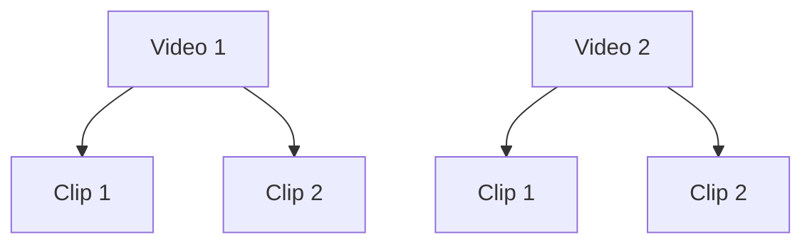

# 交付范围与 Video / Clip 模型基线

> **状态：** 已冻结，2026-11-12。
> **适用范围：** 本仓库所有架构、实施、接口、Backlog 和验收文档。
> **冲突处理：** 与本文冲突的旧版 `Shot / Segment / ShotPlan` 描述不再具有实施效力。

## 1. 最终交付范围

本项目的最终交付物是一个**通用 Video Domain Agent**。交付重点是 Agent 如何理解视频相关目标、调用受控工具、维护任务和结构化产物，而不是构建完整视频产品平台。

### 1.1 必须交付

- 一个可发布、可固定版本的 Video Domain Agent。
- Agent 定义、Prompt、输入输出 Schema、工具白名单和节点预算。
- Session、Task、Step、Checkpoint、Artifact 和 Run 的业务投影。
- `Video -> Clip` 两级视频领域对象。
- 视频、Clip 的搜索、推荐、相似发现和反馈工具契约。
- Storyboard、ClipPlan、ClipRequirement、MaterialAssignment 等 Agent 创作产物。
- 基于固定 Mock 数据的检索、推荐和相似发现 Adapter。
- Agent 路由、澄清、局部修改、预算、失败和恢复策略。
- 单元、契约、集成、Agent Eval 和故障注入测试。
- 可替换真实检索推荐服务的 Port/Adapter 边界，但真实服务不属于本次交付。

### 1.2 不包含

- AI 乘风引擎工作台、对话页面、画布、上传和前端交互。
- 广告优化师、商品、投放、跟品、落地页、口播、爆款 Hook 等产品化业务。
- Product Domain、Marketing Domain 和跨领域工作流。
- 真实视频入库、转码、切片、ASR、OCR、视觉理解、Embedding 和索引构建。
- Elasticsearch、OpenSearch、Qdrant、Kafka 等真实检索基础设施交付。
- 真实搜索引擎、推荐模型、排序模型、训练和 A/B 实验。
- 外部视频平台抓取、平台账号、鉴权和配额接入。
- 真实视频生成、擦除、字幕、换画幅、配音和媒体质检。
- 视频版权、许可、商业用途、地域可用性、署名和 Provenance 过滤。
- FFmpeg、Timeline Compiler、Render Worker、Export、NLE 和投放发布。
- 生产多租户计费、SLA、容量规划和大规模运维。
- 个人资产、公共素材库、15 天保护期和回流任务。

上述能力可以作为未来扩展保留接口，但不得成为本次开发、Demo 或验收的阻断依赖。

## 2. 领域对象只有 Video 和 Clip



### 2.1 Video

Video 是可播放、可引用的一级视频资产，例如完整成片、上传视频、生成视频或外部视频。

Video 至少包含：

- `video_id`
- `title`
- `source_type`
- `duration_ms`
- `width` / `height` / `fps`
- `preview_ref`
- `availability`
- `tags`
- `feature_version`
- `created_at`

只有单段素材时，仍可使用一个包含单个 Clip 的 Video 表示，从而保持两级模型一致。

### 2.2 Clip

Clip 是 Video 中可独立检索、推荐、引用和分配的连续时间片段，也是 PRD 中“片段”和“切片”的统一领域对象。

Clip 至少包含：

- `clip_id`
- `video_id`
- `start_ms`
- `end_ms`
- `duration_ms`
- `preview_ref`
- `keyframe_ref`
- `semantic_summary`
- `tags`
- `quality_flags`
- `availability`
- `feature_version`
- `model_versions`

约束：

- 每个 Clip 必须引用一个 Video。
- `0 <= start_ms < end_ms <= Video.duration_ms`。
- Clip 可以覆盖单个语义切分、跨切点片段或独立切片，但不再区分 Shot 和 Segment。
- 搜索和推荐候选的 `entity_type` 只能是 `video` 或 `clip`。
- Clip 级候选必须携带来源 `video_id` 和精确时间区间。
- 播放、预览和证据都通过受控 `preview_ref` / `evidence_ref` 获取。

### 2.3 概念映射

| 旧概念 | 新概念 |
|---|---|
| Shot | Clip |
| Segment | Clip |
| `shot_id` | `clip_id` |
| `segment_id` | `clip_id` |
| `shot_plan` / `ShotPlan` | `clip_plan` / `ClipPlan` |
| `ShotRequirement` | `ClipRequirement` |
| Video / Shot / Segment | Video / Clip |
| `entity_type: shot \| segment` | `entity_type: clip` |

不得在 API、Schema、数据库表、事件、Tool、Prompt 或代码包名中继续引入 Shot/Segment 层级。

## 3. 创作产物模型

Storyboard 仍表示叙事结构，但其执行单元改为 Clip：

```text
TaskBrief
  → CreativeBrief
  → Storyboard
  → ClipPlan（含 ClipRequirement）
  → CandidateSet per Clip
  → MaterialAssignment
```

### 3.1 Storyboard

Storyboard 的场景下使用 `clip_requirements` 表达叙事和执行需求，不再使用 `shots`。

### 3.2 ClipPlan

ClipPlan 是由 Storyboard 派生的可执行 Clip 需求集合。每条 `ClipRequirement` 至少包含：

- `storyboard_clip_id`：计划内唯一稳定 ID，不表示素材库 Clip。
- `narrative_role`
- `visual_goal`
- `duration_target_ms`
- `hard_constraints`
- `soft_preferences`
- `fallback_requirements`
- `evidence_requirements`

为避免计划 ID 与素材 Clip ID 冲突，计划侧统一使用 `storyboard_clip_id`，素材侧使用 `clip_id`；ID 值也应使用明确前缀，例如 `sb_clip_001` 与 `clip_001`。

### 3.3 MaterialAssignment

MaterialAssignment 将一个素材候选绑定到一个计划 Clip：

- `clip_plan_id`
- `storyboard_clip_id`
- `entity_ref`，类型为 `video` 或 `clip`
- `match_evidence`
- `alternatives`
- `selection_reason`
- `user_confirmed`

组装、渲染和时间线不属于本次 Agent 交付，因此 Agent 的默认终点是已确认的 MaterialAssignment 和可下载的结构化 Artifact。

## 4. Mock-first 开发约束

本次开发不等待真实检索推荐数据。以下能力必须先以确定性 Mock 实现：

- `FakeVideoCatalog`：固定 Video/Clip 数据。
- `FakeRetrievalGateway`：支持 Search、Similar 和零结果。
- `FakeRecommendationGateway`：按项目或 Clip 上下文返回稳定候选。
- `FakeEvidenceResolver`：返回固定证据摘要和预览引用。

Mock 必须与正式 Port 使用相同 Schema。切换真实 Adapter 时，上层 Agent、Workflow 和业务代码不得修改。

固定 Mock 数据最低要求：

- 至少 4 个 Video。
- 每个 Video 至少 2 个 Clip。
- 至少 1 个跨切点 Clip。
- 至少 1 个零结果查询。
- 至少 2 个语义相似但视觉不同的 Clip。
- 至少 1 个超时和 1 个非法 Tool 参数场景。

## 5. 完成定义

交付完成的必要条件是：

1. 所有机器契约中只存在 `Video` 和 `Clip` 两级视频对象。
2. 简单搜索不启动 Agent，复杂搜索和创作任务进入 Agent。
3. Agent 能生成 TaskBrief、CreativeBrief、Storyboard、ClipPlan 和 MaterialAssignment。
4. Search 和 Recommendation 均通过 Mock Port 工作。
5. 用户修改单个 Clip 时只重算受影响范围。
6. Task 等待、恢复、幂等、预算和 Tool 审计通过。
7. Agent Eval 覆盖澄清、零结果、局部替换、工具失败和 Prompt Injection。
8. 不依赖真实数据加工、媒体渲染、前端或外部平台即可完成端到端 Demo。
