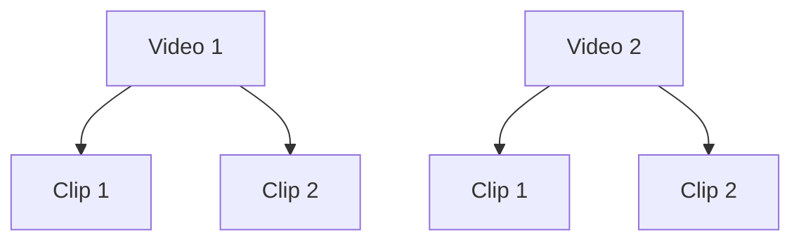

# 交付范围与 Video / Clip 模型基线

> **状态：** 已冻结，2026-11-13。
> **适用范围：** 本仓库所有架构、实施、接口、Backlog 和验收文档。
> **冲突处理：** 与本文冲突的旧版 `Shot / Segment / ShotPlan` 描述不再具有实施效力。

## 1. 最终交付范围

本项目交付**通用 Video Domain Agent**及承载其与 Product、Landing Page、Copy、Ads 协作的**跨域编排层**。Video Agent 仍只负责视频领域；主 Workflow 负责领域依赖、并行、汇总、审批和恢复。跨域领域首版通过 Mock/Adapter 接入，不构建完整视频产品平台。

### 1.1 必须交付

- 一个可发布、可固定版本的 Video Domain Agent。
- Agent 定义、Prompt、输入输出 Schema、工具白名单和节点预算。
- Session、Task、Step、Checkpoint、Artifact 和 Run 的业务投影。
- `Video -> Clip` 两级视频领域对象。
- 视频、Clip 的搜索、推荐、相似发现和反馈工具契约。
- Storyboard、ClipPlan、ClipRequirement、MaterialAssignment 等 Agent 创作产物。
- 基于固定 Mock 数据的检索、推荐和相似发现 Adapter。
- Recommendation 本次只交付 `clip_candidate` 场景；`project_home`、`search_complement`、`similar_alternative`、`continue_exploration` 为未来扩展。
- Agent 路由、澄清、局部修改、预算、失败和恢复策略。
- 单元、契约、集成、Agent Eval 和故障注入测试。
- 可替换真实检索推荐服务的 Port/Adapter 边界，但真实服务不属于本次交付。
- `CreativeProductionWorkflow`、跨域 Task/Step、依赖图和 fan-in。
- `DomainInvocationPort`、跨域 Artifact Envelope、状态映射和幂等。
- Product、Landing Page、Copy、Ads 领域契约及 Mock/Adapter。
- 范围化用户审批、Artifact staleness、部分成功、补偿和跨域恢复。
- Video Domain Agent 作为独立子工作流被主 Workflow 调用的边界。

### 1.2 不包含

- AI 乘风引擎工作台、对话页面、画布、上传和前端交互。
- Product、Landing Page、Copy、Ads 领域的真实业务实现。
- 外部商品库、真实落地页生成、真实广告账户和自动发布。
- 广告优化师、真实投放和外部平台运营工作簿。
- 把跨域业务逻辑塞入 Video Domain Agent。
- 真实视频入库、转码、切片、ASR、OCR、视觉理解、Embedding 和索引构建。
- Elasticsearch、OpenSearch、Qdrant、Kafka 等真实检索基础设施交付。
- 真实搜索引擎、推荐模型、排序模型、训练和 A/B 实验。
- 外部视频平台抓取、平台账号、鉴权和配额接入。
- 真实视频生成、擦除、字幕、换画幅、配音和媒体质检。
- 视频版权、许可、商业用途、地域可用性、署名和 Provenance 过滤。
- FFmpeg、Timeline Compiler、Render Worker、Export、NLE 和投放发布。
- 生产多租户计费、SLA、容量规划和大规模运维。
- 个人资产、公共素材库、15 天保护期和回流任务。

上述能力可以作为未来扩展保留接口，但不得成为本次开发、Demo 或验收的阻断依赖。

跨域编排的细节、领域职责和验收以 [跨域编排与领域子工作流设计](07_跨域编排与领域子工作流设计.md)为准。

## 2. Video 领域对象只有 Video 和 Clip

`Video -> Clip` 约束只适用于 Video 领域。跨域编排层和 Product、Landing Page、Copy、Ads 领域拥有各自的对象和 Schema，但不得把非视频对象伪装成 Video、Clip、Shot 或 Segment。



### 2.1 Video

Video 是可播放、可引用的一级视频资产，例如完整成片、上传视频、生成视频或外部视频。

Video 至少包含：

- `video_id`
- `title`
- `source_type`
- `duration_ms`
- `width` / `height` / `fps`
- `preview_ref`
- `availability`
- `tags`
- `feature_version`
- `created_at`

只有单段素材时，仍可使用一个包含单个 Clip 的 Video 表示，从而保持两级模型一致。

### 2.2 Clip

Clip 是 Video 中可独立检索、推荐、引用和分配的连续时间片段，也是 PRD 中“片段”和“切片”的统一领域对象。

Clip 至少包含：

- `clip_id`
- `video_id`
- `start_ms`
- `end_ms`
- `duration_ms`
- `preview_ref`
- `keyframe_ref`
- `semantic_summary`
- `tags`
- `quality_flags`
- `availability`
- `feature_version`
- `model_versions`

约束：

- 每个 Clip 必须引用一个 Video。
- `0 <= start_ms < end_ms <= Video.duration_ms`。
- `duration_ms` 必须等于 `end_ms - start_ms`，是落列字段，不是仅在示例中出现的派生值。
- Clip 可以覆盖单个语义切分、跨切点片段或独立切片，但不再区分 Shot 和 Segment。
- 搜索和推荐候选的 `entity_type` 只能是 `video` 或 `clip`。
- Clip 级候选必须携带来源 `video_id` 和精确时间区间。
- 预览走 `preview_ref` / `keyframe_ref`；证据引用挂在候选或分配结果上，由 Evidence Port 解析，不是 Clip 的落列字段。
- `availability` 只表达该 Video / Clip 是否可用，版权、许可、地域和署名过滤不在本次范围。
- 以上为逻辑模型最少字段，本次 Mock 与 API 表示层必填；列级可空和默认值以 `implementation/05` 为准，并在 DDL 旁注明可空理由。

### 2.3 概念映射

| 旧概念 | 新概念 |
|---|---|
| Shot | Clip |
| Segment | Clip |
| `shot_id` | `clip_id` |
| `segment_id` | `clip_id` |
| `shot_plan` / `ShotPlan` | `clip_plan` / `ClipPlan` |
| `ShotRequirement` | `ClipRequirement` |
| Video / Shot / Segment | Video / Clip |
| `entity_type: shot \| segment` | `entity_type: clip` |

PRD 用语与本次两级模型的对应关系（这是有意冻结，不是 PRD 原文分层）：

| PRD 用语 | 本次概念 |
|---|---|
| 成片 | Video |
| 切片 / 片段 / 镜头 | Clip |
| 分镜 / 槽位 | 计划侧 Storyboard / ClipRequirement，不是素材对象 |

不得在 API、Schema、数据库表、事件、Tool、Prompt 或代码包名中继续引入 Shot/Segment 层级，也不得把镜头做成第三层素材对象。

## 3. 创作产物模型

Storyboard 仍表示叙事结构，但其执行单元改为 Clip：

```text
TaskBrief
  → CreativeBrief
  → Storyboard
  → ClipPlan（含 ClipRequirement）
  → CandidateSet per Clip
  → MaterialAssignment
```

### 3.1 Storyboard

Storyboard 的场景下使用 `clip_requirements` 表达叙事和执行需求，不再使用 `shots`。这些条目与 ClipPlan 中的条目使用同一 `ClipRequirement` Schema，必填字段不得在 Storyboard 示例中削薄。

### 3.2 ClipPlan

ClipPlan 是由 Storyboard 派生的可执行 Clip 需求集合。每条 `ClipRequirement` 至少包含：

- `storyboard_clip_id`：计划内唯一稳定 ID，不表示素材库 Clip。
- `narrative_role`
- `visual_goal`
- `duration_target_ms`
- `hard_constraints`
- `soft_preferences`
- `fallback_requirements`
- `evidence_requirements`

为避免计划 ID 与素材 Clip ID 冲突，计划侧统一使用 `storyboard_clip_id`，素材侧使用 `clip_id`；ID 值也应使用明确前缀，例如 `sb_clip_001` 与 `clip_001`。

### 3.3 MaterialAssignment

MaterialAssignment 将一个素材候选绑定到一个计划 Clip：

- `clip_plan_id`
- `storyboard_clip_id`
- `entity_ref`，类型为 `video` 或 `clip`
- `match_evidence`
- `alternatives`
- `selection_reason`
- `user_confirmed`

组装、渲染和时间线不属于本次 Agent 交付，因此 Agent 的默认终点是已确认的 MaterialAssignment 和可下载的结构化 Artifact。

## 4. Mock-first 开发约束

本次开发不等待真实检索推荐数据。以下能力必须先以确定性 Mock 实现；Port 切分与接口命名以 `implementation/05` §7 为准：

- `FakeVideoCatalogPort`：固定 Video/Clip 数据。
- `FakeRetrievalGateway`：覆盖 Search、Recommendation、Similar 和零结果。Recommendation 按 `clip_candidate` 所需的计划槽位、已覆盖 Clip 等上下文返回稳定候选。
- `FakeEvidenceGateway`：返回固定证据摘要和预览引用。
- `FakeProductDomain`：固定商品事实、市场、Offer 和 Claim。
- `FakeLandingPageDomain`：固定页面、热区和诊断结果。
- `FakeCopyDomain`：固定广告语、口播稿和 Claim 引用。
- `FakeAdsDomain`：固定广告草稿、预算和审批状态。

Mock 必须与正式 Port 使用相同 Schema。切换真实 Adapter 时，上层 Agent、Workflow 和业务代码不得修改。

固定 Mock 数据最低要求：

- 至少 4 个 Video。
- 每个 Video 至少 2 个 Clip。
- 至少 1 个跨切点 Clip。
- 至少 1 个零结果查询。
- 至少 2 个语义相似但视觉不同的 Clip。

Mock 行为最低要求：

- 至少 1 个超时和 1 个非法 Tool 参数场景。
- 至少 1 个领域失败但无依赖分支继续成功的场景。
- 至少 1 个 Artifact stale 导致下游不可提交的场景。
- 至少 1 个领域要求 `needs_user_action` 的场景。
- 至少 1 个 Ads 草稿未经审批不可发布的场景。

## 5. 跨域编排对象

跨域编排不改变 Video 素材层级。主 Workflow 持有以下 Artifact：

- `campaign-brief`
- `workflow-plan`
- `product-context`
- `landing-page-plan`
- `copy-package`
- `video-creative-artifact`
- `ads-draft`
- `review-package`

统一 `Artifact Envelope` 至少包含：

- `artifact_ref`
- `artifact_type`
- `owner_domain`
- `content_schema`
- `version`
- `content_hash`
- `status`
- `parent_refs`
- `validation_status`
- `permission_scope`
- `created_at`

领域内部对象不嵌入其他领域实体。主 Workflow 只保存 Ref、hash、版本、状态和依赖边。

## 6. 完成定义

交付完成的必要条件是：

1. 所有 Video 领域机器契约中只存在 `Video` 和 `Clip` 两级视频对象；跨域领域对象不进入该层级。
2. 简单 Search、Recommendation 和 Similar 不启动 Agent，直接走 Mock Port；复杂搜索和创作任务进入 Agent。
3. Agent 能生成 TaskBrief、CreativeBrief、Storyboard、ClipPlan 和 MaterialAssignment。
4. Search、Recommendation 和 Similar 均通过 Mock Port 工作。
5. 用户替换或修改某个计划槽位（`storyboard_clip_id`）时，只重算受影响的需求、候选和 Assignment。
6. Task 等待、恢复、幂等、预算和 Tool 审计通过。
7. Agent Eval 覆盖澄清、零结果、局部替换、工具失败和 Prompt Injection。
8. 不依赖真实数据加工、媒体渲染、前端或外部平台即可完成端到端 Demo。
9. Feedback 经 Mock Port 可写、可审计，且不依赖前端。
10. 跨域请求由 `CreativeProductionWorkflow` 编排，Video Domain Agent 不调用其他领域。
11. Product、Landing Page、Copy、Ads 通过 `DomainInvocationPort` 调用并有 Mock/Adapter。
12. 主 Workflow 支持依赖并行、fan-in、部分成功、领域重试、Artifact stale 和恢复。
13. Video-only 请求仍可直接使用 Video Workflow，不被跨域逻辑污染。
14. 用户审批按领域和发布动作拆分，Ads 草稿不得自动发布。
15. 无依赖领域失败时，其他领域结果保留且可继续交付。
