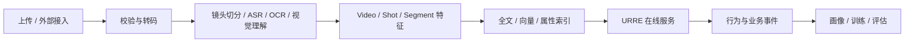

# 技术选型、服务部署与工程组织

> **文档层级：** 技术实施规范  
> **上位文档：** [00 平台总体架构](../00_检索推荐与Agent平台_架构设计2.0.md)  
> **专项文档：** [01 URRE](../01_URRE通用检索推荐引擎_架构设计2.0.md)、[02 Agent Runtime](../02_Agent_Runtime与任务治理_架构设计2.0.md)、[03 Video Domain Pack](../03_Video_Domain_Pack与创作执行_架构设计2.0.md)  
> **状态：** 候选技术方向，正式版本以项目启动时的 PoC、AD 和 Release 为准

## 1. 技术路线

在线业务采用：

- AgentScope Java 2.0 作为 Agent Runtime 技术方向。
- Spring Boot 承载业务 API、任务编排、Domain Pack 和 URRE 策略编排。
- Java 与 Python 分工，避免重复实现成熟模型生态。
- 搜索、向量、事件、关系数据和对象存储通过 Adapter 隔离。
- MVP 优先模块化单体或少量服务，不按逻辑模块一一拆微服务。

文档中的 `2.0` 指架构版本；`AgentScope Java 2.0` 是 Agent Runtime 技术方向，两者不是同一版本概念。

## 2. 推荐技术栈

| 层次 | 候选技术 | 说明 |
|---|---|---|
| Agent Runtime | AgentScope Java 2.0 | Java SDK 嵌入 Spring Boot |
| 业务后端 | Spring Boot | 用户、项目、任务、权限、反馈和审计 |
| 全文检索 | Elasticsearch / OpenSearch / Vespa | BM25、过滤、聚合和混合检索 |
| 向量检索 | Milvus / Elasticsearch Vector / Vespa | 按规模、过滤能力和运维成本选择 |
| 元数据 | PostgreSQL / MySQL | 业务事实、任务、配置和审计 |
| 对象存储 | S3 / MinIO | 原始视频、代理文件、缩略图和 Artifact |
| 事件流 | Kafka | 行为、入库、索引和异步任务 |
| 缓存 | Redis | 热点结果、在线特征和辅助会话 |
| 视频处理 | FFmpeg / FFprobe | 转码、抽帧、探测、预览和渲染 |
| 镜头切分 | PySceneDetect 或自研服务 | 通过服务接口封装 |
| 模型服务 | Python + FastAPI/gRPC | Embedding、ASR、OCR、视觉理解和 Reranker |
| 训练 | Python + PyTorch | 排序、推荐和离线评估 |
| 可观测性 | OpenTelemetry + Prometheus/Grafana | Trace、指标、日志和告警 |

选型要求：

1. 不以功能列表决定技术组件，必须使用真实数据、过滤条件、更新频率、延迟和运维成本做 PoC。
2. URRE 不直接依赖某一家搜索引擎或向量库。
3. 不同 Embedding 模型的原始分数不得未经校准直接相加。
4. 正式依赖应锁定版本、许可证和升级策略。

## 3. Java 与 Python 边界

### 3.1 Java/Spring Boot

建议承担：

- 平台业务 API。
- AgentScope Runtime 接入。
- Task/Workflow Orchestrator。
- Domain Pack 和策略注册。
- URRE 策略编排、工具接口和结果组装。
- 用户、项目、权限、反馈和审计。
- 事件接入和面向前端的 SSE/WebSocket。

### 3.2 Python

建议承担：

- 视频理解模型推理。
- ASR、OCR、视觉理解和 Embedding。
- Reranker 和推荐模型推理。
- 离线训练与评估。
- 强依赖 Python 生态的媒体 AI 处理。

媒体处理可以采用 Java 调度、Python Worker 或 FFmpeg Worker 执行的方式。不要为了语言统一而重复实现成熟模型生态。

## 4. 服务部署边界

MVP 建议先部署为少量服务：

| 部署单元 | 主要职责 |
|---|---|
| `business-api` | 用户、项目、任务、工作台和业务数据 API |
| `agent-service` | AgentScope Runtime、Director、Agent 编排、Tools |
| `retrieval-service` | URRE API、召回、融合、排序和领域策略 |
| `video-understanding-worker` | 视频解析、镜头切分、ASR、OCR 和特征生成 |
| `media-worker` | 代理文件、预览、时间线编译和渲染 |
| `model-service` | Embedding、Reranker、视觉模型等推理 |
| `event-service` | 事件接收、Kafka 投递、特征更新和反馈归因 |

初期允许逻辑模块运行在同一进程中，但必须保持接口边界：

- Agent 不直接连接索引。
- URRE 不依赖 AgentScope。
- Domain Pack 依赖平台 SPI，不反向依赖应用。
- 模型推理通过独立接口调用。
- 媒体执行由受控 Worker 完成，不接受 Agent 自由拼接的 shell 命令。

## 5. 工程模块组织

建议先使用 Monorepo，团队和发布边界明确后再拆分。

```text
ai-business-platform/
├── platform/
│   ├── platform-gateway/
│   ├── platform-auth/
│   ├── platform-tenant/
│   ├── platform-task/
│   ├── platform-event/
│   └── platform-observability/
├── retrieval-engine/
│   ├── retrieval-api/
│   ├── query-understanding/
│   ├── retrieval-planner/
│   ├── recall-engine/
│   ├── candidate-fusion/
│   ├── ranking-engine/
│   ├── reranking-engine/
│   ├── recommendation-engine/
│   ├── similarity-engine/
│   ├── explore-engine/
│   ├── feature-service/
│   └── feedback-service/
├── agent-platform/
│   ├── agent-runtime/
│   ├── platform-agent/
│   ├── agent-orchestrator/
│   ├── agent-toolkit/
│   ├── agent-policy/
│   ├── agent-memory/
│   ├── agent-permission/
│   └── agent-evaluation/
├── domain-packs/
│   ├── domain-spi/
│   ├── video/
│   ├── product/
│   └── marketing/
├── model-platform/
│   ├── embedding-service/
│   ├── reranker-service/
│   ├── model-registry/
│   └── model-serving/
├── data-platform/
│   ├── event-pipeline/
│   ├── feature-pipeline/
│   ├── indexing-pipeline/
│   └── evaluation-pipeline/
├── applications/
│   ├── video-workbench/
│   ├── product-workbench/
│   └── marketing-workbench/
├── contracts/
│   ├── api/
│   ├── events/
│   ├── schemas/
│   └── agent-tools/
├── deploy/
│   ├── docker/
│   ├── compose/
│   ├── kubernetes/
│   └── observability/
└── docs/
    ├── architecture/
    ├── adr/
    ├── api/
    ├── domain/
    └── runbooks/
```

依赖原则：

- Domain Pack 通过 SPI 注册，不直接修改 URRE 核心。
- Agent 通过 Tool/API 调用 URRE 和领域服务。
- URRE 不依赖 AgentScope。
- 应用通过公开 API 使用平台能力。
- 索引、模型和媒体服务通过 Adapter 隔离。
- API、事件和 Schema 契约统一管理，不在各模块复制。

## 6. 视频 Domain Pack 模块建议

```text
video-domain-pack/
├── video-domain-api/
├── video-domain-core/
├── video-agent/
├── video-agent-tools/
├── video-workflows/
├── video-understanding/
├── video-composition/
├── video-timeline/
└── video-evaluation/
```

各模块职责：

- `video-domain-api`：Schema、SPI 和对外契约。
- `video-domain-core`：Intent、Project、Task 和 Artifact 领域对象。
- `video-agent`：Director、Planner、Evaluator、Prompt 和策略。
- `video-agent-tools`：检索、推荐、组合、项目、时间线和媒体工具。
- `video-workflows`：Search、Recommendation、Creation、Editing 和 Delivery 工作流。
- `video-understanding`：入库、镜头切分、ASR、OCR、视觉和 Embedding。
- `video-composition`：素材分配、组合优化和组合评估。
- `video-timeline`：Timeline IR、校验、编译和编辑器适配。
- `video-evaluation`：检索、推荐、组合和成片评估。

## 7. 数据与索引流水线



离线或准实时链路与在线检索解耦。Agent 可以发起受控入库任务，但不执行转码、抽帧、理解、索引和状态管理本身。

索引至少分为：

- Video Index：资产级标题、描述、来源、许可和技术属性。
- Shot Index：镜头语义、场景、动作、运镜和时间区间。
- Segment Index：转写、OCR、字幕、精确时间区间。
- Vector Index：文本、视觉、多模态和音频表示。
- Behavior Store：用户、项目、候选和行为事件。
- Project Store：项目、任务、Artifact 和工作流状态。

## 8. 非功能要求

### 8.1 性能与稳定性

- PoC 后冻结正式 SLO。
- 监控 Search/Recommend 的 P50/P95/P99。
- 监控各召回通道耗时、超时率和可用率。
- 监控索引更新延迟、事件写入成功率和特征新鲜度。
- 监控 Agent 首 token、总耗时、Tool 成功率和任务恢复率。
- 召回通道可独立降级，不导致整条链路不可用。

### 8.2 多租户与安全

- 所有数据、事件和任务携带 `tenant_id`。
- 租户和项目权限由服务端可信上下文注入。
- Agent Tool 不能覆盖租户身份或路径范围。
- 索引、缓存、对象存储、日志和 Memory 均执行隔离。
- 外部内容按不可信输入处理。
- 写操作具备最小权限、幂等键、审计和撤销策略。
- 高风险操作经过 Policy Gateway 和人工审批。

### 8.3 可观测性

统一关联：

- `request_id`
- `task_id`
- `session_id`
- `agent_run_id`
- `tool_call_id`
- `artifact_id`

记录 Query、召回通道、候选数量、策略和模型版本、Agent 决策摘要、Tool 输入输出摘要、耗时、Token、成本和错误。敏感 Prompt、凭据和原始隐私数据按最小必要原则记录或脱敏。

### 8.4 版本与发布

- 策略、特征、模型、Prompt、Schema 和索引均需要版本。
- 升级执行灰度、回滚和固定评估集回归。
- 领域升级不得静默改变其他领域行为。
- 组件版本升级前验证许可证、兼容性和运维影响。

## 9. 组件引入门槛

引入新的搜索引擎、向量库、Agent 框架、媒体服务或模型供应商前，至少完成：

1. 固定版本和许可证检查。
2. 真实数据与过滤条件 PoC。
3. 质量、延迟、成本和运维对比。
4. 失败模式和降级方案。
5. 多租户、权限和审计验证。
6. 数据迁移与回滚方案。
7. ADR 和替换边界记录。

不把开源项目 README、论文或演示效果等同于生产可用能力。
