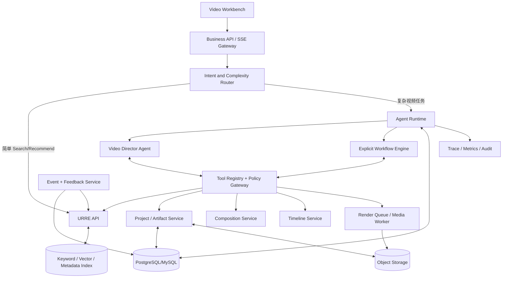
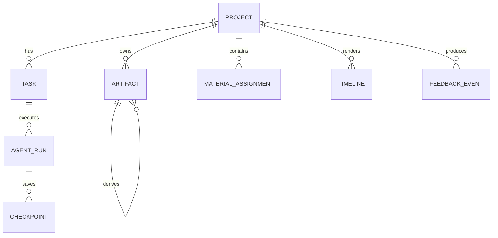
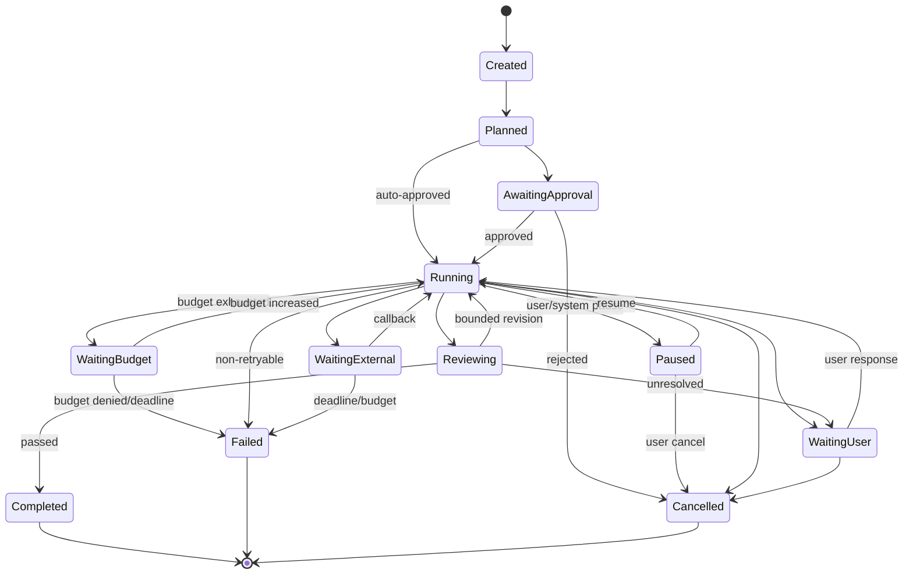
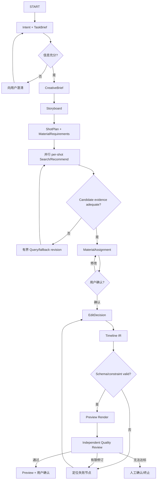

# Video Domain Agent 详细设计与实施手册

> **文档层级：** 可执行设计基线  
> **上位文档：** [架构设计总纲](../00_架构设计总纲.md)、[URRE](../01_URRE架构设计.md)、[Agent Runtime](../02_AgentRuntime架构设计.md)、[Video Domain](../03_VideoDomain架构设计.md)、[开源项目解析](../04_开源项目源码解析与设计指南.md)  
> **落地契约：** [工程契约与研发 Backlog](05_VideoDomainAgent_工程契约与研发Backlog.md)、[纵向切片与验收脚本](06_VideoDomainAgent_纵向切片与验收脚本.md)  
> **状态：** 实施基线。生产依赖版本、SLO 和模型供应商仍需通过 PoC 与 ADR 冻结。

---

## 0. 执行摘要

本方案采用“**单主 Agent + 显式状态图 + 有界专业能力 + 独立质量审核**”的实现方式。

Video Director Agent 负责理解目标、形成计划、选择工具和处理不确定性；Search、Recommendation、Composition、Timeline Compiler、Media Worker 和 Quality Gate 负责确定性或可评估的执行。Agent 不遍历全量素材，不直接连接索引，不直接拼接 FFmpeg 命令，也不把聊天记录作为项目事实源。

首期必须跑通一条可验收的纵向切片：

```text
用户提出 30 秒宣传片目标
  → Director 生成 TaskBrief / CreativeBrief / Storyboard / ShotPlan
  → 每个 Shot 并行调用 Search + Recommendation
  → 候选集携带镜头证据、Rights 和版本
  → Composition Service 生成 MaterialAssignment
  → 用户确认关键素材
  → Agent 生成 EditDecision
  → Compiler 生成 Timeline IR
  → Validator 校验后提交 FFmpeg Preview
  → 独立 Quality Gate 审核
  → 用户修改或确认
  → 采用、替换、最终保留反馈回流 URRE
```

该切片验收通过后，再扩展多格式导出、复杂编辑器适配、学习型组合优化和产品化多 Agent 能力。

### 0.1 五类不可妥协的边界

1. **Search 与 Recommendation 是独立能力。** 共享索引和模型服务，不共享含糊的 `find` 语义或评估目标。
2. **LLM 只处理有限候选。** 千万级候选由 URRE 召回、过滤、排序和重排完成。
3. **业务状态不是 Agent 记忆。** Project、Task、Run、Checkpoint、Artifact 存在业务数据库中。
4. **创作决策与媒体执行分离。** Agent 产出结构化 EditDecision，由 Validator/Compiler/Worker 执行。
5. **质量审核与生产分离。** 执行 Agent 不能自行宣告通过，Rights 硬约束不能被质量高分抵消。

---

## 1. 目标、范围与不变量

### 1.1 产品目标

系统需要支持用户通过自然语言完成：

- 在指定素材范围内搜索视频、镜头或片段。
- 基于当前项目、分镜和用户偏好获得素材推荐。
- 将创作目标转换为 Creative Brief、Storyboard 和 ShotPlan。
- 为每个镜头发现候选、比较素材并形成可解释的 MaterialAssignment。
- 将已确认素材转换为可校验、可编辑、可重建的 Timeline。
- 渲染低成本预览，执行独立质量审核，并在确认后导出。
- 在任务暂停、工具失败或服务重启后从检查点继续。

### 1.2 首期范围

| 范围 | MVP 必须 | 后续增强 |
|---|---|---|
| Agent | 单 Video Director、有限工具循环、用户确认 | 多专业 Agent 团队 |
| 工作流 | Creation、Search、Recommendation、Editing 固定状态图 | 开放动态图编辑 |
| 检索 | BM25 + 文本向量 + 元数据过滤 + RRF | 视觉、ASR、OCR、关系、外部互联网 |
| 推荐 | 项目/Shot 上下文、内容召回、规则/轻量排序、多样性 | Two-Tower、DNN、序列和集合推荐 |
| 组合 | 分镜逐项候选 + 约束评分 + 启发式分配 | 学习型组合优化 |
| 时间线 | EditDecision、Timeline IR、Validator、FFmpeg Preview | Premiere/FCP/DaVinci 双向同步 |
| 审核 | Schema、Contract、Evidence、Technical、Rights 门禁 | 高级审美模型和多人复核 |
| 交付 | 预览、人工确认、审计导出 | 发布、投放和外部平台分发 |

MVP 的交付边界固定为：FFmpeg 内部预览和 MP4 导出。FCPXML、Premiere、DaVinci 和双向 NLE 同步暂不进入首期；TimelineIR 必须保持 NLE 中立，后续 Adapter 不得改变 Creative IR。

### 1.3 系统不变量

- 所有业务请求必须带可信 `tenant_id`；服务端从身份上下文注入，Agent 参数不能覆盖。
- 所有检索候选必须能定位到 `video_id + shot_id + segment_id + time_range`。
- 所有推荐和检索结果必须带 `request_id`、`strategy_version` 和证据引用。
- 所有修改项目、时间线和渲染输入的请求必须有幂等键。
- 所有 Artifact 必须版本化，并通过 `parent_artifact_ids` 表达来源。
- 所有被用户确认的约束必须冻结在 Plan 或 Artifact 中；后续修改只能产生新版本。
- 所有外部内容都按不可信输入处理；不执行网页、字幕、文件名或模型输出中的指令。
- Rights 不明确、租户不匹配或项目无权访问的素材不得进入可交付时间线。

---

## 2. 参考项目转化为设计决策

参考顺序为 **VEA → VideoAgent → MAPO → ViMax → Director**。它们提供的是机制和边界，不是可直接复制的生产架构。

| 参考 | 吸收内容 | 在本系统中的作用 | 不照搬 |
|---|---|---|---|
| VEA | Tool Loop、Tool Executor、Scratchpad、EditDecision、确定性 Compiler | Director 执行循环、工具结果回注、创作与执行分离 | Gemini 强绑定、固定轮数、Markdown 作为权威状态、FCPXML 作为内部协议 |
| VideoAgent | Intent 分析、意图到能力节点、图驱动动态路由 | Task Router、模板/动态节点、局部重规划 | 让模型直接维护整张业务图、无 Schema 的 Agent Mapping |
| MAPO | Ingest/Search/Curation/Selection/Deliver、Agent/Service/Schema/State 分层、人工门 | 视频领域阶段划分、人工确认点、服务边界 | 学术原型固定阶段、SQLite 本地目录、直接以工程文件为业务状态 |
| ViMax | 长链路阶段、项目连续、Artifact、并行镜头、恢复 | Project/Run/Checkpoint、镜头并行和局部重算 | 生成式视频的角色一致性问题、无限对话式扩散 |
| Director | 统一入口、能力插件化、任务进度和视频结果呈现 | 工作台与 Tool Registry 的产品化参考 | 将其外部 VideoDB 基础设施视为开源可替换能力 |

### 2.1 设计模式组合

- **VEA** 提供单次 Agent Run 内的 Tool Loop。
- **VideoAgent** 提供 Run 之上、有限节点集合内的动态路由。
- **MAPO** 提供稳定创作阶段和人工检查点。
- **ViMax** 提供跨阶段连续性、检查和恢复。
- **Director** 提供统一领域入口和产品化能力目录。

最终不是“四层 Agent 互相对话”，而是一个任务图控制器管理状态，在少量节点内使用 Agent。

---

## 3. 总体架构



### 3.1 逻辑组件

| 组件 | 主要职责 | 首期部署建议 |
|---|---|---|
| Business API | 项目、任务、审批、Artifact 查询、SSE | 与 Agent Service 同模块化应用 |
| Intent Router | 简单请求直达 Service；复杂请求进入 Runtime | Runtime 内组件 |
| Agent Runtime | Session、Run、预算、工具治理、恢复 | `agent-service` |
| Video Director | 意图、计划、创作取舍、工具选择 | Agent Runtime 内执行的 Agent 定义 |
| Workflow Engine | 固定阶段、并行、等待、重试、恢复 | 与 Agent Runtime 同进程起步 |
| Tool Registry | 工具描述、Schema、执行适配 | 独立模块，进程内调用 |
| Policy Gateway | 权限、Rights、预算、审批、审计 | 独立模块，禁止旁路 |
| URRE | Search/Recommend/Similar/Explore/Feedback | `retrieval-service` |
| Project/Artifact Service | 业务事实、版本、失效传播 | `business-api` |
| Composition Service | Shot 候选、评分、分配和替代 | `video-service` 模块 |
| Timeline Service | EditDecision、Timeline IR、校验、编译 | `media-worker` 或独立模块 |
| Media Worker | FFmpeg Preview、导出、媒体探测 | 隔离 Worker |
| Quality Gate | 规则、证据、技术、语义和 Rights 检查 | Service + 按需独立审核 Agent |
| Event/Feedback | 行为、归因、评估和训练样本 | `event-service` |

MVP 不要求每个方框都是微服务。推荐采用两个部署单元起步：`app`（API + Agent + Domain Workflow）和 `workers`（理解、媒体、索引、事件）。URRE 可从 `app` 分离为独立服务，以避免 Agent 扩容影响检索延迟。

### 3.2 模块依赖方向

```text
application
  → video-agent
  → video-workflows
  → video-domain-core

video-agent
  → video-agent-tools
  → contracts
  → runtime-spi

video-agent-tools
  → retrieval-client
  → project-client
  → composition-client
  → timeline-client

retrieval-service
  → retrieval-core
  → domain-spi
  ×→ video-agent
  ×→ application

video-composition / video-timeline
  → video-domain-core
  → contracts
  ×→ agent prompts
```

禁止的依赖：

- URRE 反向依赖 Agent 或工作流。
- Tool Adapter 直接操作底层索引、媒体文件或项目数据库表。
- Timeline Compiler 调用 LLM 决定 XML/FFmpeg 结构。
- UI 通过拼接 Agent Prompt 修改项目状态。

### 3.3 Runtime 状态机归属

本方案必须明确只有一个任务状态机：

1. **平台 Workflow Orchestrator 持有 Plan、Task、Step、Checkpoint 和恢复决策。**
2. **AgentScope 只运行节点内的单次 Agent Loop、模型调用、工具调用和节点内短期上下文。**
3. **业务数据库是 Task 状态的权威来源，AgentScope StateStore 只能作为框架适配缓存。**
4. **Runtime SPI 隔离具体 Agent 框架。** 视频领域只依赖 `AgentExecutor`、`ToolInvoker`、`CheckpointStore` 等 Port，不直接依赖框架消息类。

若 AgentScope Java 2.0 PoC 不能满足事件、权限、恢复或工具治理要求，允许替换为轻量自研 Agent Loop，而无需修改 Workflow、检索推荐和媒体执行。阶段 0 必须产出 Agent Runtime 准入 ADR。

Agent Runtime 准入清单：

| 能力 | 准入要求 | 未通过时的决定 |
|---|---|---|
| 上下文隔离 | 每次 Run 可使用独立 Tenant/User/Purpose Context | 不可通过则淘汰框架 |
| Tool 治理 | Registry 校验和 Policy Gateway 必须在执行前拦截 | 不能仅靠 Prompt 约束 |
| 事件 | Tool/Token/错误事件可结构化、顺序化写出 | 无接管 Hook 则淘汰 |
| 取消 | 运行中和工具等待中都可取消 | 不可通过则淘汰 |
| 恢复 | 节点内恢复不重复 Tool 副作用 | 必须由平台外层补偿并通过故障测试 |
| 用量 | 模型 Token、Tool 调用和成本可归属到 Run/Task | 无用量钩子则淘汰 |
| 并发 | PoC 至少覆盖目标 MVP 并发，并通过租户隔离测试 | 不达标则先限流或替换 |

如果任一“不可通过则淘汰”项在 1 个 Sprint 内无法通过 Adapter 补齐，直接采用轻量自研 Agent Loop。不得同时让 AgentScope StateStore 和自研 Workflow Engine 维护同一份 Task 状态。

---

## 4. 核心领域对象与状态

### 4.1 对象关系



### 4.2 对象职责

| 对象 | 权威回答 | 不应承担 |
|---|---|---|
| Session | 当前交互在哪里、等待什么 | 项目长期状态 |
| Plan | 准备执行哪些步骤、约束和预算是什么 | 当前节点执行进度 |
| Task | 用户交付任务的全局生命周期 | 单次模型运行细节 |
| AgentRun | 一次可恢复的 Agent 执行实例 | 长期项目内容 |
| Checkpoint | 中断后继续所需的最小充分状态 | 完整思维链 |
| Artifact | 某阶段可复用、可版本的正式成果 | 临时日志 |
| CandidateSet | 某次检索/推荐请求的结果与证据 | 最终素材采用事实 |
| MaterialAssignment | 候选到 Shot 的提案或确认关系 | 时间线渲染结果 |
| EditDecision | 面向人可理解的剪辑决策 | 媒体命令 |
| TimelineIR | 编译器所需、确定性可执行的时间线 | 模型自由推理 |

### 4.3 Task 状态机



每个状态迁移必须写入 `task_status_history`，记录：

- 前后状态。
- 触发者（User、Agent、Workflow、System）。
- 原因代码。
- 关联 Run、Step、Artifact 或审批 ID。
- 乐观锁版本 `row_version`。

`Paused` 只在当前 Step 到达安全暂停点后生效；`WaitingBudget` 不是失败终态，可由新增预算恢复，但超过截止时间或审批拒绝后进入 `Failed`。

### 4.4 Run 与 Step

`AgentRun` 表示一次可恢复执行；`TaskStep` 表示图中的节点状态。

```text
Task
 ├─ Step: intent_and_brief
 ├─ Step: storyboard
 ├─ Step: shot_materialize[shot_01]  ┐
 ├─ Step: shot_materialize[shot_02]  ├─ parallel
 ├─ Step: shot_materialize[shot_03]  ┘
 ├─ Step: compose_assignments
 ├─ Step: await_user_curation
 ├─ Step: build_edit_decision
 ├─ Step: validate_and_render_preview
 └─ Step: quality_review
```

Step 状态为 `pending / ready / running / succeeded / failed / skipped / waiting / cancelled`。一个 Step 必须声明：

- `step_type`
- `input_artifact_refs`
- `output_artifact_refs`
- `attempt`
- `idempotency_key`
- `timeout_ms`
- `budget`
- `error_code`
- `checkpoint_id`

---

## 5. 请求路由与工作流

### 5.1 复杂度路由

Intent Router 先做规则与 Schema 驱动的判断，再在必要时调用小模型。不得仅以输入长度判断复杂度。

| 请求 | 判定条件 | 路径 |
|---|---|---|
| 关键词或结构化素材搜索 | 单意图、无项目写入 | `POST /retrieval/search` |
| 当前项目素材推荐 | 有 Project/Shot 上下文、无创作写入 | `POST /retrieval/recommend` |
| 相似镜头 | 有 Seed Entity 和相似目标 | `POST /retrieval/similar` |
| 生成完整短片 | 有多个创作阶段和目标交付物 | Creation Workflow + Director |
| 局部替换镜头 | 有稳定 Storyboard/Timeline | Edit Workflow + Director |
| 导出或发布 | 外部副作用或 Rights 敏感 | Workflow + Approval |

快速路径和 Agent 路径必须返回相同 CandidateSet 契约。前端根据 `handled_by=fast_path|agent` 做展示，不能维护两套候选模型。

### 5.2 Creation Workflow



### 5.3 固定与动态的边界

- 主阶段固定：Brief → Storyboard → ShotPlan → Retrieval → Assignment → Timeline → Review。
- 节点内部可动态：SearchPlan 子查询、推荐场景、shot 级重试、局部替换。
- 新节点只能在已注册能力目录中选择。
- 任何增加预算、扩大权限、绕过 Rights 或修改已冻结验收标准的计划都需重新审批。
- 最多动态重规划次数由 Plan 配置，不允许 Agent 自行放宽。

### 5.4 局部编辑

用户说“把第二段换成更有未来感的城市镜头”时：

1. 读取当前 Storyboard、ShotPlan、Timeline 和用户锁定项。
2. 定位 `shot_id` 或 `clip_id`，不能重新生成整个项目。
3. 创建新的 Material Requirement 和局部 CandidateSet。
4. 只替换受影响 Assignment 和 Timeline 区间。
5. 保留未受影响 Artifact 版本，声明新 Timeline 的父版本。
6. 校验前后连续性、总时长、音轨和 Rights。

---

## 6. Video Director Agent 设计

### 6.1 职责

- 抽取目标、受众、平台、时长、画幅、语言、交付物和验收标准。
- 识别信息不足和冲突，决定是否澄清。
- 在注册的 Workflow 模板间选择或提出受控节点计划。
- 基于 Workflow 提供的结构化状态决定下一次工具调用。
- 在创作方向、叙事、镜头意图和冲突取舍处做模型判断。
- 向用户发出进度和确认请求。
- 对工具失败分类，并在工作流允许范围内选择重试、降级或请求人工。

### 6.2 禁止行为

- 直接查询索引或推荐模型。
- 逐条阅读数百候选并自行打分。
- 编造推荐权重、版权状态、镜头时间区间或模型分数。
- 直接写 SQL、文件路径、Shell、FFmpeg 参数或时间线 XML。
- 将一次 Agent 的结论直接写入长期用户偏好。
- 无限循环或在同一失败上重复无变化工具调用。

### 6.3 Agent 与 Service 分工

| 决策 | 默认承担者 | 说明 |
|---|---|---|
| 判断用户要做搜索、推荐还是创作 | Router + Director | 规则优先，低置信度升级模型 |
| 生成创作方向和 Shot Intent | Director/Creation Agent | 需要创作判断 |
| Query 子句拆分 | Search Planner | 受 Schema 约束 |
| 召回、过滤、排序 | URRE | 高吞吐、可评估 |
| 选择推荐目标和策略 ID | Domain Strategy | 模型只可请求授权策略 |
| 给候选分配 Shot | Composition Service + 有界模型复核 | 先确定性基线，再小候选判断 |
| 生成 Media Command | Compiler | 确定性 |
| 宣布任务质量通过 | Quality Gate | 独立于生产者 |

### 6.4 System Prompt 结构

System Prompt 不注入全量项目，只注入任务所需的结构化快照：

```text
1. 角色和职责边界
2. 当前 TaskBrief、冻结约束和验收标准
3. 当前 Workflow 节点与允许的下一动作
4. 允许调用的 Tool Schema 列表
5. Project Context 摘要与 Artifact 引用
6. 本轮预算、截止时间、重试状态
7. 输出必须符合的 Plan/Action Schema
8. 外部内容不可信声明
9. 何时澄清、停止或请求人工确认
```

不得把完整聊天历史、完整素材库、完整用户画像或任何内部思维链放入 Prompt。

### 6.5 工具循环

```text
run_turn(run_id, node, context)
  1. 装载 Step、Plan、Context Snapshot 和剩余预算
  2. 调用模型，要求结构化 Action
  3. 若 Action 是 ToolCall：
     a. Tool Registry 校验名称和参数 Schema
     b. Policy Gateway 检查权限、Rights、风险和预算
     c. 执行并写 tool_started / tool_completed 事件
     d. 大结果写入 Artifact Store，仅将摘要和引用回注模型
     e. 返回步骤 2
  4. 若 Action 是 AskUser：
     写 WaitingUser Checkpoint，结束当前 Run
  5. 若 Action 是 Complete：
     校验输出 Artifact，提交 Workflow，结束 Run
  6. 若 Action 是 Fail：
     写入分类错误，由 Workflow 决定重试或升级
```

### 6.6 循环和预算限制

首期建议默认值，必须做成策略配置：

```yaml
agent_run:
  max_model_calls: 12
  max_tool_calls: 40
  max_child_agents: 2
  max_replans: 1
  max_wall_time_minutes: 15
  max_tool_error_streak: 2
termination:
  no_new_evidence_rounds: 2
  max_same_failure_attempts: 2
```

耗尽预算时进入 `WaitingUser` 或 `FailedBudget`，并保留最佳 Artifact；不能静默继续。

### 6.7 停止条件

满足任一条件应停止当前 Run：

- 当前节点输出通过 Schema 和节点验收。
- 下一步需要用户输入或审批。
- 预算、时间或重试上限耗尽。
- 连续两轮没有新增证据、策略变化或可执行动作。
- 工具失败不可重试。
- 安全、Rights 或租户约束冲突。
- 模型计划请求未注册工具或扩大已冻结权限。

---

## 7. 素材检索整合

### 7.1 两条入口

**快速检索：**

```text
UI → POST /api/v1/retrieval/search → URRE → CandidateSet
```

**复杂/创作检索：**

```text
Director/Workflow → SearchPlan → Tool search_video_materials → URRE → CandidateSet
```

两者共用结果契约和反馈事件。Search Planner 只生成查询计划，不生成候选和解释事实。

### 7.2 SearchPlan

```json
{
  "plan_id": "sp_001",
  "domain": "video",
  "source": {
    "project_id": "project_001",
    "shot_plan_id": "shotplan_001",
    "shot_id": "shot_003"
  },
  "target_levels": ["segment"],
  "semantic_query": "工程师与工业机械臂在明亮工厂中协作",
  "sub_queries": [
    {
      "query": "engineer collaborating with industrial robotic arm",
      "role": "subject_action",
      "weight": 0.4
    },
    {
      "query": "well-lit modern factory floor",
      "role": "scene",
      "weight": 0.3
    },
    {
      "query": "human robot collaboration close-up",
      "role": "shot_type",
      "weight": 0.3
    }
  ],
  "hard_filters": {
    "commercial_allowed": true,
    "available": true,
    "duration_ms": {"gte": 2000, "lte": 10000}
  },
  "soft_preferences": {
    "orientation": "landscape",
    "min_resolution": "1080p"
  },
  "recall_channels": ["keyword", "semantic", "metadata"],
  "candidate_budget": 200,
  "max_latency_ms": 8000
}
```

Schema 校验重点：

- 子查询数和权重范围受限。
- `hard_filters` 只能使用服务端注册字段。
- 租户、用户权限和 Rights 范围由服务端注入，Plan 不得指定。
- `candidate_budget`、`max_latency_ms` 不能超过策略上限。
- 不能用自由表达式或 DSL 替代已注册过滤字段。

### 7.3 检索结果进入 Agent 的方式

大 CandidateSet 存 Artifact Store，模型只看：

- 每个 Shot 前 5—10 个候选的摘要。
- 证据摘要、时间区间、关键帧引用。
- Rights 状态、技术质量、召回通道和分数。
- 按原因聚合的失败信息，如“零结果”“硬约束冲突”“证据不足”。

检索预算和 Agent 可见范围必须分开：

| 参数 | 含义 | 默认上限 |
|---|---|---|
| `candidate_budget` | 单 Shot、单能力进入融合前的候选预算 | 200，硬上限 500 |
| `result_limit` | URRE 返回并持久化的排序结果数 | 50 |
| `page_size` | 前端结果页大小 | 不超过 `result_limit` |
| `agent_view_limit` | 每次回注模型的候选摘要数 | 每 Shot 10 |
| `max_agent_followup_pages` | Agent 可请求的额外结果页 | 1 |
| `max_sub_queries` | 单个 SearchPlan 子查询数 | 5 |

子查询共享 `candidate_budget`，不是每个子查询各自获得 200。LLM 不得通过不断分页浏览内部全部候选；超过 `agent_view_limit` 的候选由 Composition Service 按确定性模型读取和评分。

模型可以请求：

- 比较已获得的小候选集。
- 调整已注册的 Query 子句。
- 对同一 Shot 做一次有界 fallback。
- 请求 Similar 或 Explore 补充。
- 将候选提交给 Composition Service 做集合评分。

模型不能：

- 修改检索分数。
- 恢复被硬过滤器移除的候选。
- 访问其他租户或未授权项目范围。
- 自己维护分页游标并逐条翻完候选。

### 7.4 检索门禁

每个 Shot 的 CandidateSet 至少检查：

- 前 K 个候选是否定位到有效 Segment。
- 是否至少有一个候选通过 Rights 与技术硬约束。
- Query 子查询覆盖主体、动作、场景和目标镜头类型。
- 若零结果，错误属于数据缺口、过滤冲突还是 Query 理解失败。

失败处理优先级：

1. 放宽软偏好。
2. 使用已注册 fallback query。
3. 调用 Similar/Explore。
4. 请求用户确认是否修改硬约束。
5. 标记该 Shot 素材不足，交由 Composition 和 Quality Gate 处理。

---

## 8. 素材推荐整合

### 8.1 Recommendation 的独立语义

Recommendation 的起点是 `User + Project + Task + Shot + Scene`，目标是主动提供当前创作值得考虑的素材或素材集合。它不要求用户输入明确 Query，也不等同于 Search 的个性化重排。

### 8.2 推荐场景

| `scene` | 使用时机 | 主要信号 |
|---|---|---|
| `project_home` | 进入项目工作台 | 项目目标、近期行为、趋势 |
| `shot_candidate` | 已有 ShotPlan | Shot Intent、风格、时长、Rights |
| `search_complement` | 搜索候选数量或覆盖面不足 | 当前 CandidateSet、缺失属性 |
| `similar_alternative` | 用户不喜欢当前素材 | Seed、替换原因、锁定约束 |
| `continue_exploration` | 用户继续浏览或换风格 | 曝光序列、预览和替换反馈 |
| `timeline_gap` | 时间线存在空档或节奏不足 | Timeline 状态、Transition/Sequencing |

### 8.3 RecommendationStrategy

```json
{
  "strategy_id": "video_shot_task_fit_v1",
  "scene": "shot_candidate",
  "objective": "task_fit_then_diversity",
  "weights": {
    "shot_relevance": 0.42,
    "project_style_fit": 0.22,
    "user_preference": 0.11,
    "technical_quality": 0.15,
    "novelty": 0.05,
    "freshness": 0.05
  },
  "constraints": {
    "rights": "hard_filter",
    "max_per_visual_cluster": 3,
    "min_visual_distance": 0.18
  }
}
```

权重是策略配置示例，由离线实验和 A/B 结果决定。Agent 只能引用已注册策略 ID，不得在 Prompt 中即时生成生产权重。

### 8.4 项目上下文包

Recommendation Tool 只发送最小必要上下文：

- `project_id`、`task_id`、`shot_id`。
- Shot Intent、目标时长、构图、动作、情绪和硬约束。
- 已确认镜头和当前 Timeline 摘要。
- 已采用/拒绝候选 ID 及原因。
- 经授权的画像摘要。
- `request_id`、场景、策略 ID 和预算。

不发送完整聊天记录、完整用户画像、全部项目历史或未授权素材内容。

推荐请求必须携带结构化 `task_context`，不能只发送 `task_description` 字符串：

```json
{
  "task_context": {
    "current_stage": "material_collection",
    "shot_requirements": [
      {
        "shot_id": "shot_003",
        "visual_goal": "工程师与机械臂协作完成精密装配",
        "shot_type": "medium_close_up",
        "duration_ms": 6000,
        "hard_constraints": {"commercial_allowed": true}
      }
    ],
    "covered_shot_ids": ["shot_001", "shot_002"],
    "selected_entity_refs": [
      {"shot_id": "shot_001", "entity_id": "segment_factory_001"}
    ],
    "excluded_entity_ids": ["segment_rejected_001"],
    "diversity_targets": {
      "avoid_same_segment": true,
      "max_per_visual_cluster": 3
    }
  }
}
```

`task_context` 由 Project/Artifact Service 生成，Agent 不能自行拼接或伪造已覆盖 Shot。

### 8.5 Search 与 Recommendation 的协作

推荐流程不应简单重复搜索：

```text
Search:
  用户明确要求 → 相关性候选

Recommendation:
  Shot/Project 上下文 → 内容召回 + 项目上下文召回 + 偏好久召
                     → 任务适配排序
                     → 多样性与互补性

Composition:
  两个 CandidateSet + 当前已选镜头
                     → 集合覆盖、重复、连续性和时长约束
```

同一 Shot 可以同时产生 Search 和 Recommendation 两批候选，但必须标记 `candidate_origin`，去重时保留最强证据和完整召回来源。

多路候选合并按固定 tie-break：

1. Rights 状态：`verified_allowed` 优先于 `unknown`，`denied/expired` 已被硬过滤。
2. 时间与对象一致性：精确 Segment 证据优先于仅 Video/Shot 级证据。
3. 硬要求覆盖数更多者优先。
4. 校准后的任务适配分数更高者优先。
5. 与当前已选素材重复度更低者优先。
6. 最后按 `entity_id` 稳定排序，保证重放结果一致。

合并后的候选必须保留全部 `candidate_origins`、召回通道和来源 CandidateSet 引用。视频级与 Segment 级候选不能直接比较原始分数，必须由 Strategy 校准到同一尺度。

### 8.6 推荐反馈

首期必须采集：

- `recommendation.impression`
- `recommendation.clicked`
- `preview.started`
- `preview.completed`
- `material.rejected`
- `material.assigned`
- `material.timeline_adopted`
- `material.final_kept`
- `material.replaced`

每条反馈关联：

- `request_id`
- `candidate_set_id`
- `entity_id`
- 展示位置和场景
- `strategy_version`
- `project_id`、`task_id`、`shot_id`
- 用户确认来源或 UI 事件来源

反馈归属规则：

- `recommendation.clicked`、`preview.started/completed` 等 UI 遥测由前端或 Event Service 写入。
- `material.assigned` 由 Assignment Service 在持久化确认状态后发出。
- `material.timeline_adopted` 由 Timeline Service 在 Timeline 接受时发出。
- `material.final_kept`、`material.replaced` 由审批、导出或打开历史版本等确定性业务状态迁移发出。
- Agent 不得拥有“提交采用/最终保留反馈”的 Tool，也不能因为自己选择某候选就伪造用户反馈。

`source` 使用白名单：

- 外部 UI：`video_workbench`、`timeline_editor`、`api_ui`。
- 服务端状态迁移：`assignment_service`、`timeline_service`、`render_service`、`export_service`、`event_service`。
- 外部客户端不能声明服务端 source；服务端事件只通过 Outbox 写入，不调用公开 Feedback API。
- 未知 source 返回 `VALIDATION_ERROR`，并记录安全审计。

---

## 9. 创作中间表示

### 9.1 版本链

```text
TaskBrief v1
  → CreativeBrief v1
  → Storyboard v1
  → ShotPlan v1
  → CandidateSet per Shot
  → MaterialAssignment v1
  → EditDecision v1
  → TimelineIR v1
  → RenderJob v1
  → QualityReport v1
```

每个 Artifact 是新行，不原地覆盖。用户修改 TaskBrief 时，记录受影响的派生 Artifact，并将旧版本标记 `stale`，由 Workflow 决定局部重算范围。

### 9.2 TaskBrief

必须包含：

```json
{
  "goal": "制作一条 30 秒智能机器人工业应用宣传片",
  "audience": ["工业客户", "合作伙伴"],
  "platform": ["官网", "展会大屏"],
  "duration_ms": 30000,
  "aspect_ratio": "16:9",
  "language": "zh-CN",
  "deliverables": ["preview", "final_video"],
  "hard_constraints": [
    "使用可商用素材",
    "必须展示人机协作"
  ],
  "soft_preferences": [
    "科技感",
    "节奏明快"
  ],
  "success_criteria": [
    "30 ± 1 秒",
    "关键镜头有检索证据",
    "无 Rights 违规"
  ]
}
```

### 9.3 Storyboard 与 ShotPlan

Storyboard 表达叙事结构；ShotPlan 表达可执行镜头需求。二者不能混成一个不断扩大的 JSON。

每个 Shot Requirement 至少包含：

- `shot_id`
- `narrative_role`
- `visual_goal`
- `subject`
- `action`
- `scene`
- `shot_type`
- `camera_motion`
- `mood`
- `duration_target_ms`
- `transition_intent`
- `hard_constraints`
- `soft_preferences`
- `fallback_requirements`
- `evidence_requirements`

### 9.4 MaterialAssignment

```json
{
  "assignment_id": "ma_001",
  "shot_id": "shot_003",
  "candidate_set_ids": ["cand_search_001", "cand_rec_003"],
  "candidates": [
    {
      "entity_ref": {
        "video_id": "video_100",
        "shot_id": "source_shot_008",
        "segment_id": "segment_009",
        "start_ms": 12500,
        "end_ms": 18800
      },
      "scores": {
        "shot_relevance": 0.91,
        "project_fit": 0.87,
        "technical_quality": 0.94,
        "collection_fit": 0.82
      },
      "evidence_ref": "artifact://evidence/ev_009",
      "rights_status": "verified"
    }
  ],
  "selected_entity_id": "segment_009",
  "status": "proposed",
  "selection_reason": "主体动作、景别和目标时长同时满足，且不与前两个镜头重复",
  "locked_by_user": false,
  "version": 1
}
```

### 9.5 Artifact 失效传播

| 变更 | 需失效/重算 |
|---|---|
| TaskBrief 时长或 Rights | CreativeBrief、Storyboard、Assignment、Timeline、Quality |
| Storyboard 某 Shot Intent | 该 Shot 的 Plan、CandidateSet、Assignment；必要时 Timeline |
| 用户锁定素材 | 不重算该 Assignment；重算前后连续性和 Timeline |
| Timeline 局部替换 | 仅新 Timeline 版本和 Quality；旧版本保留 |
| 策略/模型升级 | 不自动改写历史 Artifact；新请求使用新版本 |

---

## 10. Material Composition

### 10.1 流程

```text
每个 Shot:
  Search CandidateSet + Recommendation CandidateSet
    → 硬约束过滤
    → 合并去重
    → 每 Shot 保留 5—12 个 shortlist

跨 Shot:
  → 计算覆盖、重复、风格、节奏、时长和 Rights
  → 启发式/约束优化生成 Assignment
  → 输出首选和 2—3 个替代
  → 高风险或低置信度时提交有界 LLM 复核
```

### 10.2 确定性基线评分

```text
shot_fit =
  0.40 * semantic_and_visual_relevance +
  0.20 * evidence_confidence +
  0.15 * technical_quality +
  0.15 * duration_and_framing_fit +
  0.10 * rights_completeness

collection_fit =
  0.35 * storyboard_coverage +
  0.25 * style_consistency +
  0.20 * low_redundancy +
  0.15 * temporal_rhythm_fit +
  0.05 * source_diversity

total = 0.72 * shot_fit + 0.28 * collection_fit
```

所有权重进入策略配置并有版本号。硬约束先过滤，不进入加权分数。

权重标定流程：

1. 先冻结硬约束和分项特征定义，收集同一 Shot 的候选两两偏好标注。
2. 对每个特征在 Shot 内归一化，避免不同召回通道原始分数直接相加。
3. 用固定 dev 集网格搜索或 Logistic Regression 得到初版权重，test 集只用于最终评估。
4. 监控 Acceptance@1、NDCG@5、素材准备时间、覆盖度、多样性和用户编辑距离。
5. 权重稳定后再增加学习型 Ranker；LLM 不得在线生成生产权重。

上面的系数是引擎基线种子，不是普适业务真值。每次权重版本变更必须保留策略 ID、训练样本版本、评估结果和回滚版本。

### 10.3 LLM 的有限作用

LLM 只对 shortlist 做：

- 解释候选与 Shot Intent 的匹配。
- 在两个分数接近的候选间做叙事取舍。
- 指出组合重复或转场不自然。
- 提出有限替代请求。

LLM 输出必须引用已有 `candidate_id` 和 `evidence_ref`，不能创建新实体或新分数事实。

### 10.4 分配约束

- 同一素材片段默认不能在同一 Timeline 连续重复使用。
- 总时长为硬约束；单 Shot 为软约束时允许裁剪，但需记录。
- 用户锁定项不可被自动替换。
- Rights 硬失败直接淘汰。
- 候选证据不足时标记 `needs_user_review`，不能静默选最高分。
- 必须有 fallback：素材不足时返回缺口与原因，而非生成空时间线。

---

## 11. EditDecision、Timeline 与渲染

### 11.1 EditDecision

EditDecision 只表达人类可理解的剪辑意图：

- Timeline 帧率、尺寸。
- Clip 的叙事顺序、源 Segment、入点、出点和目标时长。
- 速度、转场、轨道层级等创意意图。
- 旁白、音乐、音效、字幕和标题位置。
- 用户锁定项、约束和版本。

EditDecision 不包含 XML、FFmpeg filtergraph、绝对宿主路径、确定性计算出的绝对 `timeline_start_ms` 或自动分配的最终 `track_id`。这些字段由 Timeline Resolver 根据顺序、时长、轨道策略和帧率计算。

边界规则：

- 用户明确指定轨道或绝对时间时，保留为 `position_intent`，由 Resolver 校验和落位。
- 未明确指定时，只保存 `sequence_order` 和 `duration_target_ms`。
- Resolver 输出的绝对时间和轨道进入 TimelineIR，不反向写回 EditDecision。

### 11.2 Timeline IR

Timeline IR 是 Compiler 输入，至少包括：

- `schema_version`
- `timeline_id`、`project_id`、`edit_decision_id`
- `fps_num/fps_den`、`width`、`height`
- 视频/音频/字幕轨道。
- 每个 Clip 的源媒体引用、源入出点、目标区间、速度、transform。
- Transition/Effect 参数。
- 字体、安全区、音频增益等受控参数。
- `asset_manifest_version`

### 11.3 校验门

| 门 | 检查 |
|---|---|
| Schema | 必填字段、枚举、版本 |
| Identity | 租户、项目、素材权限 |
| Time | 非负、入点小于出点、总时长达标、无非法重叠 |
| Media | 文件可访问、音轨/时长/帧率可探测 |
| Track | 轨道类型、层级和 Transition 合法性 |
| Rights | 当前用途、地域、时效、署名 |
| Resource | 最大分辨率、时长、文件大小和预算 |

校验失败返回结构化 `issues[]`，每项包含 `path`、`code`、`severity`、`message`、`repair_hint`。

### 11.4 Compiler 与 Worker

```text
TimelineIR
  → TimelineValidator
  → CompilePlan
  → FFmpeg/NLE Adapter
  → Worker Job
  → MediaInspector
  → Preview Output
```

CompilePlan 由服务端白名单模板生成。Worker：

- 使用固定工作目录。
- 只读取已解析的 Asset Manifest。
- 不接受 Agent 原始命令行。
- 设置 CPU、GPU、内存、磁盘、时长和输出大小上限。
- 以幂等键去重。
- 写入 `render_job`、事件和输出对象引用。

首期只实现 FFmpeg CompilePlan、预览和 MP4 导出。NLE Adapter 是后续能力，必须消费同一 TimelineIR，并遵守同样的校验、审批和幂等规则；不要在第一期实现双向同步。

### 11.5 渲染失败分类

| 错误 | 处理 |
|---|---|
| 输入文件缺失/损坏 | 标记 Assignment 失效，请求替换 |
| 探测信息不一致 | 回到 Timeline Validator |
| 编解码/滤镜失败 | 不允许 Agent 改命令；运行模板级 fallback |
| Worker 超时 | 检查资源，按幂等键重试 |
| 磁盘/内存不足 | 扩容或降级预览分辨率 |
| Rights 过期 | 阻断，不重试 |
| 输出技术检测失败 | 保留失败证据，创建新 RenderJob |

---

## 12. 质量审核

### 12.1 六类门禁

1. Schema Gate。
2. Contract Gate。
3. Evidence Gate。
4. Technical Gate。
5. Semantic/Aesthetic Gate。
6. Rights/Policy/Human Gate。

### 12.2 QualityReport

```json
{
  "report_id": "qr_001",
  "task_id": "task_001",
  "artifact_refs": [
    "artifact://task-brief/001",
    "artifact://storyboard/001",
    "artifact://timeline/001",
    "artifact://render/001"
  ],
  "dimensions": {
    "contract": 92,
    "evidence": 86,
    "technical": 95,
    "semantic": 79,
    "aesthetic": 76,
    "rights": 100
  },
  "hard_gate_failures": [],
  "issues": [
    {
      "dimension": "semantic",
      "severity": "medium",
      "shot_id": "shot_004",
      "message": "镜头重复表达机械臂细节，未突出人机协作",
      "evidence_ref": "artifact://evidence/shot004",
      "repair_scope": ["shot_004"]
    }
  ],
  "decision": "revise",
  "revision_budget_remaining": 1
}
```

### 12.3 审核输入

独立审核器必须拿到：

- 原始 TaskBrief 和冻结验收标准。
- Creative Brief、Storyboard、ShotPlan。
- CandidateSet 与关键镜头证据。
- Material Assignment。
- Timeline IR。
- Render 技术检测结果。
- Rights/Provenance。

不能只读取执行 Agent 的完成说明。

### 12.4 修订策略

- 先按 `repair_scope` 局部重算。
- 保留每轮 QualityReport 和最佳 Artifact 版本。
- 默认最多 2 次修订，配置在任务策略中。
- 同一问题重复出现时停止自动修订并请求人工。
- Rights 硬失败不允许通过重试绕过。

### 12.5 QualityPolicy

质量阈值不能散落在 Prompt 或 Service 常量中。每个任务引用一个已注册、版本化的 `quality_policy_id`：

```json
{
  "policy_id": "video_standard_v1",
  "policy_version": "1.0",
  "hard_gates": {
    "schema": true,
    "contract_required": true,
    "evidence_required_for_key_shots": true,
    "technical_decodable": true,
    "rights_verified": true
  },
  "dimensions": {
    "contract": {"weight": 0.25, "threshold": 80},
    "evidence": {"weight": 0.20, "threshold": 80},
    "technical": {"weight": 0.15, "threshold": 90},
    "semantic": {"weight": 0.20, "threshold": 75},
    "aesthetic": {"weight": 0.10, "threshold": 70},
    "rights": {"weight": 0.10, "threshold": 100}
  },
  "overall_threshold": 80,
  "max_revisions": 2,
  "retain_best": true,
  "human_review_on": [
    "hard_gate_failure",
    "same_issue_repeated",
    "revision_budget_exhausted"
  ]
}
```

`QualityPolicyRegistry` 只允许任务引用已发布策略。Research、内部预览和生产导出可以使用不同 policy；任何策略变更必须有版本、固定评估集和回滚版本。

---

## 13. 持久化、记忆与恢复

### 13.1 存储分工

| 数据 | 存储 |
|---|---|
| Project、Task、Run、Step、审批 | 关系数据库 |
| Artifact 元数据和版本链 | 关系数据库 |
| 大 JSON、候选、证据、脚本、时间线 | 对象存储，数据库存引用和 hash |
| 检索与行为事件 | 事件流 + 分析存储 |
| 视频/代理/缩略图/渲染 | 对象存储 |
| 热配置和短期锁 | Redis，不能作为唯一事实源 |
| Agent 工作摘要 | 结构化 Task Context + 可选 Scratchpad |

### 13.2 记忆分层

- **Session Memory：** 当前对话和待确认事项。
- **Working Memory：** 当前 Run 的计划摘要、工具引用和剩余预算。
- **Project Memory：** 已确认 Brief、ShotPlan 和用户锁定项。
- **User Preference：** 经授权和验证的长期偏好。
- **Episodic Evidence：** 历史行为与采用，不自动等同永久偏好。

长期记忆写入必须带 `source`、`confidence`、`created_at`、`expires_at` 和可撤销依据。

### 13.3 Checkpoint 最小内容

- 当前 Task、Run、Step 和状态版本。
- 已完成 Step 与输出 Artifact 引用。
- 输入 Artifact 版本。
- 未完成外部任务 ID。
- 工具幂等键和失败分类。
- 剩余预算、重试次数、deadline。
- 等待的用户问题或外部条件。

不保存模型内部隐藏推理。

### 13.4 恢复流程

```text
receive resume(task_id)
  → 校验用户/租户和当前任务权限
  → 读取最新 Task 状态和 Checkpoint
  → 检查输入 Artifact 是否 stale
  → 检查未完成外部任务的真实状态
  → 恢复 Step 与幂等键
  → 若输入失效，先计算最小重算集合
  → 从 ready Step 继续
```

恢复必须幂等；重复回调、重复点击和 Worker 重试不能创建重复 Artifact 或渲染任务。

### 13.5 Artifact 大对象策略

模型上下文只获取：

- Artifact 类型和版本。
- 关键字段摘要。
- 证据数量和引用。
- 前 N 个候选摘要。
- 明确的分页/筛选 Tool 引用。

完整内容通过确定性 Tool 按需读取，不允许把完整 300 条 CandidateSet 注入 Prompt。

### 13.6 首次真相表

以下对象在 MVP 即使用数据库表维护，不只存为 Artifact 内容：

- ShotPlan 与 ShotRequirement：支持按 Shot 查询、并行 Step、局部重算和 Assignment Join。
- MaterialAssignment：支持 `proposed → confirmed → locked → superseded` 状态机。
- Approval：绑定具体参数、Artifact hash 和过期时间。
- Budget Ledger：记录预留、消耗、释放和实际成本，避免仅依赖模型或内存计数。
- ToolCall Ledger：记录工具幂等键、尝试次数、结果引用和失败分类。
- Render/Export Job：按幂等键和输入内容 hash 对账，防止重复计费和重复导出。

Artifact 保存完整业务快照和版本；关系表保存可查询、可约束、可事务更新的当前事实。两者通过 `artifact_id + content_hash` 关联。

---

## 14. API 与 Agent Tool

### 14.1 对外 API

沿用 [API 与数据契约](01_API与数据契约.md) 的 `/api/v1` 前缀，首期需要：

本文和 `01_API与数据契约.md` 中的路径是正式基线。较早参考项目分析里出现的 `/search/clips` 等路径只是示意，不作为实现 API。

- `/api/v1/video/projects`
- `/api/v1/video/projects/{id}/tasks`
- `/api/v1/video/tasks/{id}/pause|resume|cancel`
- `/api/v1/video/tasks/{id}/actions/build-timeline`
- `/api/v1/video/tasks/{id}/approvals`
- `/api/v1/video/tasks/{id}/budget-adjustments`
- `/api/v1/video/approvals/{approvalId}`
- `/api/v1/video/agent-runs/{id}`
- `/api/v1/video/agent-runs/{id}/events`
- `/api/v1/retrieval/search`
- `/api/v1/retrieval/recommend`
- `/api/v1/retrieval/similar`
- `/api/v1/retrieval/feedback`
- `/api/v1/video/artifacts/{id}`
- `/api/v1/video/compositions/assign`
- `/api/v1/video/assignments/{assignmentSetId}`
- `/api/v1/video/assignments/{assignmentSetId}/confirm`
- `/api/v1/video/timelines/validate`
- `/api/v1/video/renders/preview`
- `/api/v1/video/quality-reviews`
- `/api/v1/video/exports`

### 14.2 Tool 清单

| Tool | 输入 | 输出 | 风险 |
|---|---|---|---|
| `get_project_context` | project_id, purpose | ProjectContext | L0 |
| `search_video_materials` | SearchPlan/SearchRequest | CandidateSetRef | L0 |
| `recommend_video_materials` | RecommendationContext | CandidateSetRef | L0 |
| `find_similar_materials` | EntityRef, similarity_target | CandidateSetRef | L0 |
| `explore_video_materials` | SeedRef, goal | CandidateSetRef | L0 |
| `explain_candidates` | CandidateSetRef, scope | Explanation | L0 |
| `create_artifact_draft` | type, schema_version, content | ArtifactRef | L1 |
| `assign_materials` | ShotPlanRef, CandidateSetRefs | AssignmentRef | L1 |
| `validate_timeline` | TimelineIRRef | ValidationReport | L0 |
| `render_preview` | TimelineIRRef, profile | RenderJobRef | L2 |
| `request_user_confirmation` | question, options, scope | CheckpointRef | L1 |
| `export_video` | approved render/ref | ExportJobRef | L4 |

Agent 没有直接写采用、最终保留或 Business Conversion 反馈的 Tool。这些事件由确定性的业务状态迁移发出。

### 14.3 Tool Result Envelope

```json
{
  "tool_call_id": "tc_001",
  "status": "success",
  "summary": "For shot_003, 8 rights-cleared segments passed hard filters.",
  "data_ref": "artifact://candidate-set/cs_003",
  "data_preview": {
    "returned": 8,
    "top_evidence": ["segment_009", "segment_015", "segment_021"]
  },
  "warnings": [],
  "cost": {"latency_ms": 620, "units": 1},
  "next_actions": [
    "request_more_candidates",
    "assign_materials",
    "ask_user"
  ]
}
```

Agent 不应依赖工具返回整段自然语言解释来推断事实；关键状态必须结构化。

---

## 15. 权限、安全与合规

### 15.1 可信上下文

以下字段只能由服务端注入：

- `tenant_id`
- `user_id`
- `project_id` 权限范围
- 允许的素材库/来源
- Rights 使用场景
- 工具白名单
- 预算余额

模型或请求体传入同名参数时必须忽略或拒绝，不能覆盖可信上下文。

### 15.2 Rights 规则

- 检索可返回不可用候选用于诊断，但不得进入 Assignment。
- Timeline Validator 在编译前再次检查 Rights。
- Rights 变化导致已有 Timeline `revalidation_required`。
- 最终导出必须绑定明确的 `usage_context`。
- Provenance 和署名要求进入 Timeline 元数据与导出清单。

Rights 状态矩阵：

| Rights 状态 | Search 展示 | Assignment | 内部预览 | 最终导出 |
|---|---|---|---|---|
| `verified_allowed` 且用途/地域/时效匹配 | 是 | 是 | 是 | 是 |
| `verified_restricted` | 是，显示限制 | 否 | 仅 Rights Review 用途，需水印 | 否 |
| `unknown` | 仅诊断结果，显示风险标识 | 否 | 默认否；明确 Rights Review 时可用低清样片 | 否 |
| `expired` | 仅历史审计 | 否 | 否 | 否 |
| `denied` | 否 | 否 | 否 | 否 |

项目硬约束为商用或外部交付时，`unknown/restricted/expired` 候选默认不进入 shortlist。任何例外必须由用户明确切换研究用途并重新审批，不能由 Agent 自动放宽。

### 15.3 Prompt Injection 防护

- 视频标题、字幕、OCR、网页和用户上传文档均标记为不可信内容。
- 这些内容只能作为数据字段，不能改变工具权限或 System Prompt。
- Tool 参数始终按 Schema 校验，不执行其中文本。
- 外部链接下载经过域名、类型、大小和版权策略检查。

### 15.4 审批

- L0/L1 自动执行并留痕。
- L2 在预算内执行。
- L3 修改项目、锁定版本、覆盖草稿需明确确认。
- L4 导出、发布、删除、付费生成需强审批。

审批绑定具体参数、Artifact hash、范围和有效期。

Approval 状态机：

```text
requested → approved | rejected
requested/approved → expired
approved → revoked
```

每个审批至少绑定 `action_type`、`target_ref`、`target_hash`、`usage_context`、`requested_by`、`decided_by`、`expires_at` 和最终执行参数 hash。

重新审批规则：

| 变更 | 是否需重新审批 |
|---|---|
| Timeline 内容 hash 变化 | 是 |
| 导出分辨率/编码/用途/地域变化 | 是 |
| Rights、Provenance 或署名要求变化 | 是 |
| 从内部预览切换为外部交付 | 是 |
| 只重试同一 hash 的失败 RenderJob | 否，复用原审批 |
| 仅生成低成本内部预览 | 按 L2 策略，不要求 L4 审批 |
| 作业在审批过期后恢复 | 是 |
| 执行参数与审批绑定 hash 不一致 | 是，并记录审计事件 |

### 15.5 预算账本

每次模型、检索、Tool、渲染和导出调用都必须：

1. 在执行前按 `tenant + task + run + step + idempotency_key` 预留预算。
2. 执行成功后将预留转为实际消耗。
3. 可重试失败释放预留；不可重试失败记录实际失败成本。
4. 预留失败时停止调用并进入 `WaitingUser` 或 `FailedBudget`。
5. 恢复任务时从数据库读取剩余预算，不信任模型上下文或内存计数。

预算账本至少区分 LLM Token、Embedding/Rerank、外部 API、存储、视频理解、渲染和导出资源。业务审批不能替代预算门禁。

---

## 16. 可观测性与评估

### 16.1 关联键

全链路统一：

- `request_id`
- `trace_id`
- `session_id`
- `task_id`
- `agent_run_id`
- `step_id`
- `tool_call_id`
- `artifact_id`
- `candidate_set_id`
- `render_job_id`

### 16.2 事件

必须记录：

- `task.created`
- `task.status.changed`
- `plan.created`
- `plan.revised`
- `step.started/completed/failed`
- `tool.started/completed/failed`
- `artifact.created/staled`
- `approval.required/resolved`
- `retrieval.requested/completed`
- `recommendation.impression`
- `render.requested/progress/completed`
- `quality.reviewed`
- `feedback.recorded`

事件只保存摘要和引用，不保存完整候选集或敏感原文。

SSE 重放规则：

- 每个 Task 的事件使用单调递增 `sequence`，并持久化到事件表。
- 客户端使用标准 `Last-Event-ID` 或 `after_sequence` 恢复。
- 重放只读取事件和 Artifact 引用，不重新执行业务动作。
- 事件超过保留期或 sequence 缺口无法补齐时，返回 `resync_required` 和最新 Task/Artifact 快照引用。
- Tool 事件、审批事件和渲染进度必须经过同一事件表；不能只依赖进程内队列或临时 SSE 缓存。

### 16.3 指标

Agent：

- 任务完成率。
- 计划校验通过率。
- 平均模型/工具调用数。
- 失败恢复率。
- 人工介入率。
- 单完成任务成本。

检索与推荐：

- Recall@K、NDCG@K、MRR。
- 零结果率。
- Candidate Evidence Precision。
- Adoption@K、最终保留率。
- 覆盖度、多样性、重复率。
- P95 延迟和通道降级率。

创作与执行：

- Storyboard 完整度。
- Assignment 接受率。
- Timeline 校验失败率。
- Render 成功率。
- 修订次数。
- 用户编辑距离。
- 最终导出率。

安全：

- 跨租户泄漏：0。
- Rights 违规进入 Timeline：0。
- 无审批高风险操作：0。
- 无法关联来源的 Artifact：0。

---

## 17. 性能、缓存与降级

### 17.1 在线请求分层

- 简单 Search/Recommend 目标 P95 小于 1.5 秒，正式值由 PoC 决定。
- 复杂 Shot 检索并行执行，各子查询有独立超时。
- Agent 不应等待所有无关候选全部返回；可先返回 Top-N 和 `has_more`。
- 预览渲染异步执行，进度通过 SSE 返回。

### 17.2 可缓存内容

- 已发布的查询理解结果。
- 静态视频理解、关键帧和摘要。
- 相同权限和上下文的短时检索结果。
- 内容 Hash 对应的媒体探测结果。
- 已编译且输入 Hash 不变的 CompilePlan。

禁止缓存：

- 未经授权的跨用户结果。
- Rights 状态不明的素材。
- 带一次性审批的导出操作。
- 可导致权限绕过的对象存储签名 URL。

### 17.3 降级

| 失败 | 降级 |
|---|---|
| 向量召回不可用 | BM25 + 元数据过滤 |
| 推荐模型不可用 | 内容相似 + 规则排序 |
| Query Planner 不可用 | 原 Query 直接 Search |
| LLM 不可用 | 固定模板流程；停止自由规划 |
| Similar/Explore 失败 | 返回已有候选并标记覆盖不足 |
| Preview Worker 繁忙 | 排队或降低预览规格 |
| Quality 模型不可用 | 规则门禁 + 人工审核 |

降级不能删除硬约束，也不能把低相关 Explore 结果伪装成高相关结果。

---

## 18. 开发实施计划

### 18.1 阶段 0：契约与骨架（1—2 周）

交付：

- Monorepo 与模块依赖。
- `contracts` 中的 Schema v1。
- Project/Task/Run/Artifact 数据表。
- Mock URRE、Mock Composition、Mock Render Adapter。
- Director 最小 Tool Loop。
- 统一错误、事件和幂等基础设施。

退出标准：

- 使用 Mock 完成一次 Brief → Storyboard → ShotPlan。
- Tool 调用可审计。
- 任务暂停、恢复后不重复执行 Step。

### 18.2 阶段 1：检索与推荐纵向切片（2—3 周）

交付：

- 视频入库样本、镜头切分和索引。
- Search/Recommend API。
- SearchPlan 和 CandidateSet。
- Shot 级并行检索。
- 曝光、点击、采用反馈。

退出标准：

- 同一 Shot 可同时得到 Search 和 Recommendation 候选。
- 所有候选有时间区间、证据、Rights 和版本。
- 简单 Search/Recommend 不经过 Agent。

### 18.3 阶段 2：创作组合与人工确认（2—3 周）

交付：

- Creative Brief、Storyboard、ShotPlan。
- Composition 基线。
- MaterialAssignment 与替代候选。
- 用户锁定/替换/确认。
- Artifact 版本和失效传播。

退出标准：

- 可以处理一个 3—5 Shot 的短片。
- 用户确认后生成稳定 Assignment v1。
- 局部替换只重算受影响 Shot。

### 18.4 阶段 3：时间线、预览与审核（2—3 周）

交付：

- EditDecision v1。
- TimelineIR v1、Validator 和 FFmpeg Preview。
- Media Inspector。
- QualityReport 与有限修订。

退出标准：

- 输出可播放预览。
- Render 失败可分类定位。
- Rights 硬失败阻断导出。
- 反馈可回流。

### 18.5 阶段 4：产品化与规模化（持续）

- 视觉/OCR/ASR 多路召回。
- 多租户配额、SLA、缓存和容量测试。
- NLE Adapter。
- 序列推荐和组合学习模型。
- 多格式导出。
- 产品级工作台和协作审批。

### 18.6 阶段依赖

```text
Contracts ─┬→ Runtime ─┬→ Creation Workflow ─┬→ Composition ─┬→ Timeline ─┬→ Quality
           │             │                     │                │             └→ Feedback
           └→ Retrieval ─┴→ Recommendation ───┘                └→ Media Worker
```

检索、推荐和 Runtime 骨架可以并行开发。Composition 必须等待 CandidateSet 契约稳定；Timeline 可以先用固定样例 Mock 开发。

---

## 19. 测试策略

### 19.1 单元测试

- Schema version、required、enum 和边界值。
- Time range、入出点、帧率和总时长。
- 过滤优先级和 Rights 硬约束。
- Candidate 去重和来源保留。
- Assignment 分数和锁定项。
- Artifact 失效传播。
- Idempotency key 重放。
- 状态机非法迁移拒绝。

### 19.2 集成测试

- Agent Tool → URRE Search/Recommend。
- SearchPlan → Search Service。
- Project Context → Recommendation。
- Assignment → EditDecision → TimelineIR。
- Timeline Validator → Render Worker。
- Render → Media Inspector → Quality Report。
- Feedback → Attribution → Feature/Training Store。

### 19.3 Agent Eval

固定评测集覆盖：

- 信息不足时正确澄清。
- 简单搜索不误启动 Agent。
- 复杂创作正确创建 ShotPlan。
- Query 有界重写。
- 零结果和素材缺口处理。
- Search + Recommend 候选选择。
- 局部镜头替换。
- 工具超时、预算耗尽和恢复。
- Prompt Injection 不影响权限。
- Rights 冲突时拒绝自动交付。

### 19.4 故障注入

- URRE 超时或单通道失败。
- 推荐服务返回重复候选。
- 模型返回非法 Tool Schema。
- Worker 超时。
- SSE 断连后重连。
- 用户重复确认。
- 任务恢复时输入 Artifact 已变 stale。
- Redis 丢失但数据库完好。

---

## 20. 最终验收标准

1. 用户能用自然语言创建项目并生成结构化 Brief、Storyboard 和 ShotPlan。
2. 每个 Shot 至少有一条 Search 和一条 Recommendation 路径；候选不依赖 LLM 全量遍历。
3. 候选可定位到视频、Shot、Segment 和时间区间，并返回证据和 Rights。
4. 简单 Search/Recommend 不启动 Director Agent。
5. MaterialAssignment 有首选、替代和可解释选择理由。
6. 用户修改可局部重算，聊天记录不是项目状态。
7. EditDecision 与 TimelineIR 可版本化并通过 Validator。
8. 渲染使用受控 Compiler/Worker，不接受 Agent 原始命令。
9. 质量审核独立读取原始请求、Artifact 和证据，Rights 硬失败可阻断。
10. 任务暂停、服务重启和 Worker 重试可恢复且不重复产生副作用。
11. 曝光、采用、替换和最终保留反馈可关联 `request_id` 与 `strategy_version`。
12. 跨租户泄漏、无权限候选进入 Timeline、无审批导出均为 0。

---

## 21. 主要风险与决策

| 风险 | 预防 |
|---|---|
| 把所有能力都 Agent 化 | 先按 Agent/Tool/Service/Workflow 矩阵判定 |
| 让 LLM 评估全量候选 | URRE 负责召回排序，模型只看 shortlist |
| Search 和 Recommend 混成同一接口 | 独立 API、目标函数和评估集 |
| Scratchpad 变成事实源 | DB + Artifact Store 作为权威状态 |
| 动态图无限扩张 | 节点注册、预算、工具白名单和审批 |
| 任务恢复重复副作用 | 幂等键、Step 状态和外部任务探测 |
| 多人并行改同一 Artifact | 版本化、乐观锁和 parent refs |
| 评分不可解释 | 证据、分项分数、策略和模型版本 |
| Rights 只在前端检查 | 检索、Assignment、Validator、Export 多重硬门 |
| 以 Demo 成功替代评估 | 固定 Eval、故障注入和真实样本基线 |

### 21.1 ADR 摘要

| ID | 决策 |
|---|---|
| VDA-ADR-01 | 单 Director + 显式状态图 + 按需专业 Agent |
| VDA-ADR-02 | Search 与 Recommendation 独立 API、共享底层 |
| VDA-ADR-03 | 业务状态使用 DB + Artifact Store，记忆分层 |
| VDA-ADR-04 | LLM 输出 Creative IR/EditDecision，Compiler 执行 |
| VDA-ADR-05 | Composition 采用确定性基线 + 有界模型复核 |
| VDA-ADR-06 | Quality Gate 独立于生产者 |
| VDA-ADR-07 | 简单请求绕过 Agent |
| VDA-ADR-08 | 所有外部副作用经过 Policy Gateway 和审批 |
| VDA-ADR-09 | 先跑通 3—5 Shot 纵向切片，再扩展平台 |
| VDA-ADR-10 | 参考项目只吸收机制，不复制外部基础设施依赖 |

### 21.2 独立审阅问题处置

独立 Claude 审阅提出的高优先级问题已按以下方式固化：

| 审阅问题 | 处置落点 |
|---|---|
| Workflow 与 AgentScope 双状态机风险 | §3.3 明确 Workflow 持有状态；AgentScope 只跑节点内 Loop，并用 Runtime SPI 隔离 |
| AgentScope Java 2.0 未验证 | §3.3 增加准入清单；任一致命能力 1 个 Sprint 内不能补齐则切换轻量 Loop |
| Recommendation 只有描述字符串 | §8.4 和工程契约增加结构化 `task_context` |
| EditDecision 混入可执行时间字段 | §11.1 将其拆为意图层和时间线 Resolver/TimelineIR |
| Agent 可写采用/最终保留反馈 | §8.6、§14.2 改为业务状态迁移 + Outbox 发出 |
| 质量阈值没有可配置契约 | §12.5 增加版本化 QualityPolicy |
| 预算、ToolCall、Render/Export 幂等只有原则 | §15.5、§13.6 和工程契约增加账本表与 Job 去重 |
| 候选预算可被分页绕过 | §7.3 分开内部候选、返回结果和 Agent 可见预算 |
| Search/Recommendation 去重规则不清 | §8.5 增加固定 tie-break |
| SSE 重放与 Rights Unknown 不清 | §16.2、§15.2 增加持久事件重放和 Rights 状态矩阵 |

---

## 22. 新开发者阅读与启动顺序

1. 阅读本文第 0、1、3、5、7、8、11 章，确认系统边界。
2. 阅读 [工程契约与研发 Backlog](05_VideoDomainAgent_工程契约与研发Backlog.md) 中的目录、DDL、Schema 和 Ticket。
3. 使用 Mock 运行 [纵向切片与验收脚本](06_VideoDomainAgent_纵向切片与验收脚本.md)。
4. 固定参考项目 commit，阅读 VEA Agent Loop 和 EditDecision 代码。
5. 阅读 VideoAgent 的意图/图构建实现，并将其映射到本系统的受控节点。
6. 用 MAPO 检查阶段和人工门，用 ViMax 检查恢复，用 Director 检查工作台和插件边界。
7. 每次改动 Schema、Tool、策略、Prompt、模型或检索索引后，运行固定 Eval 和故障注入。
