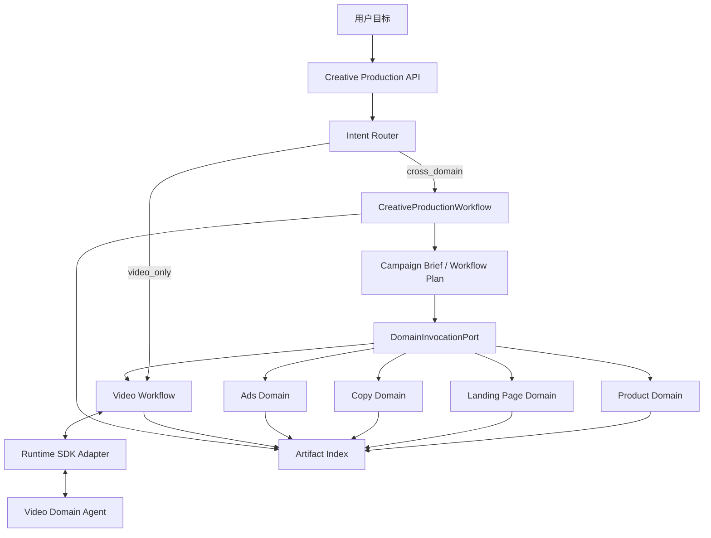
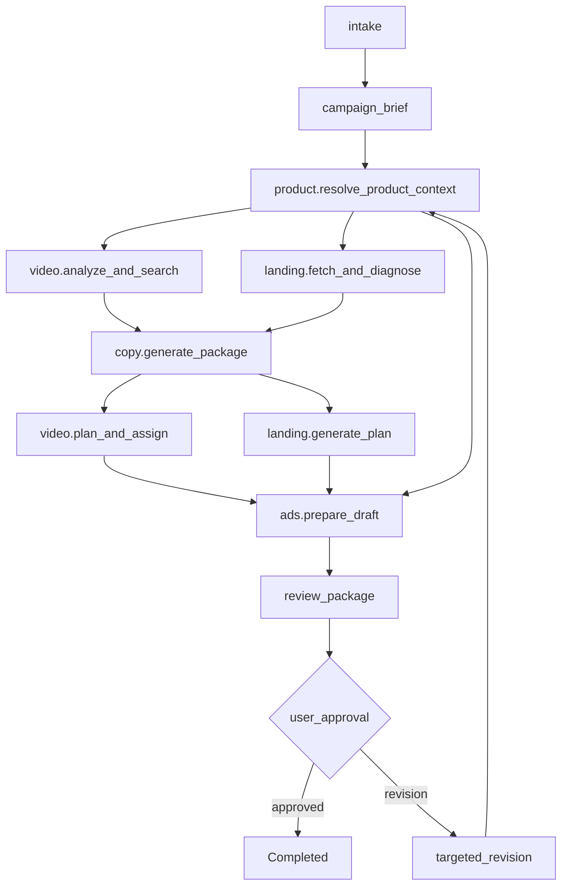

# 跨域编排与领域子工作流设计

> **状态：** 纳入交付的跨域编排基线，2026-11-13。
> **适用范围：** CreativeProductionWorkflow、领域调用、Artifact 交换、跨域状态与验收。
> **范围依据：** [交付范围与 Video/Clip 模型](00_交付范围与VideoClip模型.md)。
> **Video 领域基线：** [Video Domain 架构](../03_VideoDomain架构设计.md)。
> **工程契约：** [工程契约与研发 Backlog](05_VideoDomainAgent_工程契约与研发Backlog.md)。

## 1. 设计目标

本设计新增一个独立的跨域编排层，由主 Workflow 协调 Product、Landing Page、Copy、Ads 和 Video 领域。

目标：

- 让主 Workflow 负责目标拆解、依赖编排、并行执行、汇总、确认、恢复和交付。
- 让每个领域只负责自己的业务语义、数据、Tool 和 Artifact。
- 让 Video Domain Agent 继续只做视频理解、检索、规划和素材分配。
- 禁止 Video Domain Agent 直接调用 Product、Landing Page、Copy 或 Ads 内部接口。
- 通过稳定的 `DomainInvocationPort` 和版本化 Artifact Envelope 交换结果。
- 首版以 Mock/Adapter 实现跨域协作，不依赖真实商品、落地页、广告平台或媒体生产系统。

## 2. 核心架构决策

| ID | 决策 |
|---|---|
| XDA-ADR-01 | 主 Workflow 是跨域编排唯一权威 |
| XDA-ADR-02 | Product、Landing Page、Copy、Ads、Video 均为独立领域 |
| XDA-ADR-03 | 领域间只交换 Artifact Ref 和领域结果，不共享内部实体 |
| XDA-ADR-04 | Video Domain Agent 不拥有跨域 Tool |
| XDA-ADR-05 | 主 Workflow 默认由确定性代码驱动，不创建“全能 Agent” |
| XDA-ADR-06 | 领域调用全部幂等、可重试、可取消、可审计 |
| XDA-ADR-07 | 外部广告发布必须经过显式用户确认 |
| XDA-ADR-08 | 首版跨域领域使用 Mock/Adapter，真实实现不由本次交付阻塞 |

## 3. 系统边界



边界规则：

- `CreativeProductionWorkflow` 是主 Workflow，持有跨域 Task、Step、依赖图、Checkpoint 和用户审批。
- `Video Workflow` 是可被主 Workflow 调用的 Video 子工作流，也可继续支持独立 Video-only 请求。
- `Video Domain Agent` 只由 Video 子工作流启动。
- 领域服务不能反向调用主 Workflow。
- 领域服务之间不能绕过主 Workflow 直接串联。
- 主 Workflow 不读取领域数据库；只读取 `DomainInvocationResult` 和 `ArtifactRef`。
- 领域内部 Agent、Tool、数据库和 Run 对外不可见。

## 4. 领域职责

| 领域 | 核心能力 | 典型输出 | Video Agent 可见内容 |
|---|---|---|---|
| Product | 商品、品牌、卖点、受众、市场、Offer、Claims | `ProductContext` | 只读摘要和 `product_context_ref` |
| Landing Page | 落地页获取、诊断、结构规划、变体生成、校验 | `LandingPagePlan` | 不直接可见 |
| Copy | 广告语、口播稿、CTA、本地化文案 | `CopyPackage` | 只读摘要和 `copy_package_ref`，且仅当 Video 槽位需要 |
| Ads | 账户、受众、预算、出价、广告结构、合规检查 | `AdsDraft` | 不直接可见 |
| Video | Video/Clip 检索、推荐、相似、Storyboard、ClipPlan、Assignment | `VideoCreativeArtifact` | 自身领域对象 |

### 4.1 Product Domain

操作：

- `resolve_product_context`
- `validate_product_claims`
- `resolve_market_offer`

必须输出：

- 商品与品牌稳定引用。
- 目标市场、平台、语言、货币和 Offer。
- 可供下游使用的事实性卖点。
- 每个 Claim 的来源引用。
- 权限、可用性和版本。

不得：

- 生成最终广告语。
- 直接改写 Video Storyboard。
- 自动创建广告计划。

### 4.2 Landing Page Domain

操作：

- `fetch_landing_page`
- `diagnose_landing_page`
- `generate_landing_page_plan`
- `validate_landing_page`

输出至少包含：

- 页面版本和目标线路。
- 主图、详情模块、排序和 CTA 建议。
- 热区或诊断来源。
- 与 Product Claim 的引用关系。
- 内容 hash、权限和 expiry。

不得：

- 决定 Video 素材是否可用。
- 直接发布页面。

### 4.3 Copy Domain

操作：

- `generate_copy_package`
- `generate_voiceover_script`
- `localize_copy`
- `validate_copy_claims`

输出至少包含：

- 广告标题和描述候选。
- 口播稿候选。
- CTA。
- 目标语言和地区。
- Claim 到 ProductContext 的证据引用。
- 候选版本和确认状态。

### 4.4 Ads Domain

操作：

- `prepare_ads_draft`
- `validate_ads_policy`
- `estimate_ads_budget`
- `submit_ads_draft`

输出至少包含：

- 投放平台和账户引用。
- 广告组或计划草稿。
- 受众和地域。
- 预算与出价建议。
- Video、Copy、Landing Page Artifact 引用。
- 合规和人工审批状态。

不得：

- 未经用户确认提交外部广告计划。
- 自行提高预算。
- 使用未确认或已失效的 Artifact。

### 4.5 Video Domain

保留现有职责：

- 理解 Video/Clip 目标。
- 生成 TaskBrief、CreativeBrief、Storyboard、ClipPlan。
- 调用 Search、Recommendation、Similar。
- 生成 CandidateSet、Evidence 和 MaterialAssignment。
- 对局部计划槽位做有限重算。

Video Domain Agent 不负责：

- 商品事实。
- 落地页规划。
- 广告文案。
- 广告账户、预算、受众和发布。
- 跨领域依赖编排。

## 5. Video Agent 的输入边界

主 Workflow 可以给 Video Domain Agent 传入只读 Context Snapshot：

```json
{
  "schema_version": "1.0",
  "task_id": "task_001",
  "project_id": "project_001",
  "campaign_brief_ref": "artifact://campaign-brief/cb_001",
  "product_context_ref": "artifact://product-context/pc_001",
  "copy_package_ref": "artifact://copy-package/copy_001",
  "target": {
    "market": "KR",
    "platform": "TikTok",
    "locale": "ko-KR",
    "aspect_ratio": "9:16"
  },
  "video_objective": {
    "duration_ms": 28000,
    "slots": ["hook", "pain", "show", "cta"],
    "reference_video_ref": "video://video_001"
  },
  "approved_constraints": {
    "product_identity": "光感精华 30ml",
    "claim_refs": ["claim_clean", "claim_daily_use"],
    "must_not_change": ["product_name", "market_claim"]
  },
  "budget": {
    "max_search_calls": 12,
    "max_candidates_per_slot": 10
  }
}
```

约束：

- Snapshot 只包含 Video 决策所需信息。
- 完整商品详情、落地页 DOM 和广告账户不进入 Agent。
- Agent 不能通过 `product_context_ref` 反向读取 Product 服务。
- Agent 输出只能引用允许的 Claim 和已确认产品身份。
- 下游领域修改不得静默改变 Video Agent 已冻结约束。

## 6. 跨域 Artifact

### 6.1 Artifact Envelope

所有领域输出必须包装为：

```json
{
  "schema_version": "1.0",
  "artifact_id": "art_copy_001",
  "artifact_ref": "artifact://copy-package/copy_001/v1",
  "artifact_type": "copy-package",
  "owner_domain": "copy",
  "content_schema": "urn:copy:package:1.0",
  "version": 1,
  "content_hash": "sha256:...",
  "status": "ready",
  "parent_refs": [
    "artifact://product-context/pc_001/v1"
  ],
  "validation_status": "passed",
  "permission_scope": "project:project_001",
  "created_at": "2026-11-13T10:00:00Z"
}
```

规则：

- Artifact Envelope 只保存稳定引用和元数据。
- `artifact_id` 用于 API 和数据库定位，`artifact_ref` 用于跨领域引用。
- 领域内容由拥有者存储和校验。
- 下游只依赖 `content_schema` 和 Artifact Ref。
- 不允许把一个领域的 DTO 直接嵌入另一个领域实体。
- 领域可以新增内部字段，但不能破坏跨域 Envelope。

### 6.2 标准 Artifact 类型

| `artifact_type` | Owner | 核心内容 |
|---|---|---|
| `campaign-brief` | Orchestration | 目标、目标市场、受众、要求产物、约束 |
| `workflow-plan` | Orchestration | 领域步骤、依赖和并行分组 |
| `product-context` | Product | 商品事实、市场、Offer、Claims |
| `landing-page-plan` | Landing Page | 页面结构、模块、排序、CTA |
| `copy-package` | Copy | 广告语、口播稿、本地化文案 |
| `video-creative-artifact` | Video | Storyboard、ClipPlan、Assignment 引用 |
| `ads-draft` | Ads | 计划、预算、受众和素材引用 |
| `review-package` | Orchestration | 待用户确认的跨域结果摘要 |

### 6.3 Staleness

- Artifact 通过 `parent_refs` 形成有向依赖边。
- 上游发布新版本时，只标记依赖该版本的下游 Artifact 为 `stale`。
- `stale` Artifact 不得进入 Ads 草稿或外部发布。
- 用户确认后冻结的 Artifact 需要显式失效操作。
- Video 的单槽位替换只影响对应 Video Artifact；主 Workflow 再判断是否需要重算 Copy、Landing Page 或 Ads。

## 7. 主 Workflow

### 7.1 工作流类型

| `workflow_type` | 入口 | 说明 |
|---|---|---|
| `video_only` | Video API | 只运行 Video 子工作流 |
| `cross_domain_campaign` | Creative Production API | 由主 Workflow 编排多个领域 |

路由规则：

- 只有视频检索、规划或局部替换，使用 `video_only`。
- 同时要求商品理解、文案、落地页、视频和广告草稿，使用 `cross_domain_campaign`。
- 低置信度时先澄清目标产物，不启动全部领域。

### 7.2 默认依赖图



并行规则：

- Product 是所有下游的必选前置。
- Video 信号分析和 Landing Page 诊断可以并行。
- Copy 在 Product、Video 信号和 Landing Page 诊断达到最小可用后执行。
- Video 素材计划和 Landing Page 方案可以并行。
- Ads 草稿必须等待其引用的所有 Artifact 达到 `ready`。

### 7.3 Step 结构

WorkflowPlan 示例：

```json
{
  "schema_version": "1.0",
  "workflow_plan_id": "wp_001",
  "task_id": "task_001",
  "workflow_type": "cross_domain_campaign",
  "steps": [
    {
      "step_key": "product.resolve",
      "step_type": "domain_invocation",
      "domain": "product",
      "operation": "resolve_product_context",
      "depends_on": ["campaign_brief"],
      "join_policy": "all",
      "timeout_ms": 15000
    },
    {
      "step_key": "analysis.parallel",
      "step_type": "fan_out",
      "depends_on": ["product.resolve"],
      "branches": [
        "video.analyze",
        "landing_page.diagnose"
      ],
      "join_policy": "all"
    },
    {
      "step_key": "copy.generate",
      "step_type": "domain_invocation",
      "domain": "copy",
      "operation": "generate_copy_package",
      "depends_on": ["analysis.parallel"],
      "join_policy": "all"
    },
    {
      "step_key": "ads.prepare",
      "step_type": "domain_invocation",
      "domain": "ads",
      "operation": "prepare_ads_draft",
      "depends_on": ["video.plan", "landing_page.generate", "copy.generate"],
      "join_policy": "all",
      "approval_scope": "ads_draft"
    }
  ]
}
```

主 Workflow 每个 Step 保存：

- `step_key`
- `step_type: domain_invocation | fan_out | fan_in | approval | revision`
- `domain`
- `operation`
- `depends_on`
- `input_artifact_refs`
- `output_artifact_refs`
- `fan_out_group`
- `join_policy`
- `attempt`
- `deadline_at`
- `idempotency_key`
- `status`

### 7.4 主 Workflow 不承担的事

- 不直接读取领域数据库。
- 不解释领域内部 Prompt。
- 不直接执行领域 Tool。
- 不把领域 Artifact 内容复制到 Task 状态。
- 不绕过 Policy Gateway 调用外部平台。

## 8. DomainInvocationPort

```java
public interface DomainInvocationPort {
    DomainInvocationResult invoke(
        TenantContext tenant,
        ProjectContext project,
        DomainInvocationRequest request
    );

    DomainInvocationResult get(
        TenantContext tenant,
        String invocationId
    );

    DomainInvocationResult cancel(
        TenantContext tenant,
        String invocationId,
        String reason
    );
}
```

请求：

```json
{
  "schema_version": "1.0",
  "invocation_id": "di_001",
  "task_id": "task_001",
  "step_key": "copy.generate_package",
  "domain": "copy",
  "operation": "generate_copy_package",
  "input_refs": [
    "artifact://product-context/pc_001/v1",
    "artifact://video-analysis/va_001/v1",
    "artifact://landing-diagnosis/ld_001/v1"
  ],
  "context": {
    "market": "KR",
    "platform": "TikTok",
    "locale": "ko-KR"
  },
  "constraints": {
    "tone": "clear_and_trustworthy",
    "max_copy_variants": 3
  },
  "deadline_at": "2026-11-13T10:05:00Z",
  "budget": {
    "max_units": 20
  }
}
```

响应状态：

- `started`
- `succeeded`
- `partial`
- `needs_user_action`
- `failed`
- `cancelled`

响应只允许返回 Artifact Envelope、错误分类、警告、usage 和关联 ID，不返回领域数据库对象。

## 9. 状态、失败与恢复

### 9.1 领域状态映射

| 主 Workflow 状态 | 领域结果 | 行为 |
|---|---|---|
| Running | `succeeded` | 校验 Artifact，再推进下游 |
| Waiting(awaiting_user) | `needs_user_action` | 创建业务确认点 |
| Waiting(awaiting_domain) | `failed(retryable=true)` | 按指数退避重试 |
| Reviewing | `partial` | 展示缺口，允许局部重试 |
| Failed | `failed(retryable=false)` | 停止受影响分支 |
| Cancelled | `cancelled` | 取消未开始 Step |

`Waiting` 新增原因：

- `awaiting_domain`
- `awaiting_approval`

原有 `awaiting_user` 保留，用于信息补充。

### 9.2 重试

- 每个领域调用由 `invocation_id + input_hash` 幂等。
- 可重试错误使用指数退避，默认最多 2 次。
- 同一 Step 的重复调用复用原 `invocation_id`。
- 领域返回不确定状态时，先 `get` 再决定重试。
- 某个领域超时不阻塞与其无依赖关系的并行分支。

### 9.3 部分成功

- 允许 `partial` 输出，但必须列出缺失领域和受影响产物。
- `review-package` 必须标记缺口。
- 缺失 Copy、Landing Page 或 Ads Artifact 时不能生成最终 `review-package=ready`。
- 只有未确认的草稿 Artifact 可以标记 stale；不执行破坏性回滚。

### 9.4 补偿

补偿仅限内部状态：

- 使下游草稿失效。
- 取消未开始的领域调用。
- 保留已完成 Artifact 和审计记录。
- 关闭开放 Action。

不自动：

- 删除已发布广告。
- 修改线上落地页。
- 取消外部投放预算。
- 删除用户素材。

## 10. 用户审批与外部副作用

主 Workflow 必须将审批拆成可理解的范围：

- `approve_video_plan`
- `approve_copy`
- `approve_landing_page`
- `approve_ads_draft`
- `approve_publish`

规则：

- 用户确认 Video Plan 不代表确认 Ads 发布。
- 用户确认 Ads 草稿不代表允许提交外部平台。
- 外部发布需要独立 `publish` Action，并校验预算、账户、地域和权限。
- 任何外部发布 Tool 不注册给 Video Domain Agent。
- 发布前必须校验所有引用 Artifact 均为 `ready` 且未被 stale。
- 本次交付只实现发布门禁和 Mock 提交，不连接真实广告平台。

## 11. API

跨域入口使用独立资源，不与 Video-only Task 混淆。

| 方法 | 路径 | 用途 |
|---|---|---|
| `POST` | `/api/v1/creative/projects` | 创建跨域项目 |
| `GET` | `/api/v1/creative/projects/{projectId}` | 查询跨域项目 |
| `POST` | `/api/v1/creative/projects/{projectId}/tasks` | 创建跨域任务 |
| `GET` | `/api/v1/creative/tasks/{taskId}` | 查询主任务 |
| `GET` | `/api/v1/creative/tasks/{taskId}/stream` | 订阅跨域事件 |
| `GET` | `/api/v1/creative/tasks/{taskId}/domains` | 查询领域调用 |
| `GET` | `/api/v1/creative/tasks/{taskId}/domains/{invocationId}` | 查询单个领域调用 |
| `GET` | `/api/v1/creative/artifacts/{artifactId}` | 读取跨域 Artifact |
| `GET` | `/api/v1/creative/artifacts/{artifactId}/versions` | 查询 Artifact 版本 |
| `POST` | `/api/v1/creative/tasks/{taskId}/wait` | 进入 Waiting |
| `POST` | `/api/v1/creative/tasks/{taskId}/resume` | 恢复任务 |
| `POST` | `/api/v1/creative/tasks/{taskId}/cancel` | 取消任务 |
| `POST` | `/api/v1/creative/tasks/{taskId}/confirmations` | 提交范围化审批 |
| `POST` | `/api/v1/creative/tasks/{taskId}/publish` | 提交已审批广告草稿；本次只实现门禁与 Mock |

创建任务：

```json
{
  "goal": "把商品 1044535 跟到韩国 TikTok，生成口播、落地页方案和视频广告草稿，不自动发布",
  "mode": "cross_domain_campaign",
  "target": {
    "market": "KR",
    "platform": "TikTok",
    "locale": "ko-KR"
  },
  "requested_outputs": [
    "product-context",
    "video-creative-artifact",
    "copy-package",
    "landing-page-plan",
    "ads-draft"
  ],
  "constraints": {
    "aspect_ratio": "9:16",
    "duration_ms": 28000
  },
  "execution": {
    "allow_partial": true,
    "require_publish_approval": true
  }
}
```

## 12. 持久化

主 Workflow 至少持久化：

- `creative_project`
- `creative_task`
- `creative_task_step`
- `domain_invocation`
- `creative_artifact_index`
- `creative_artifact_edge`
- `creative_approval`
- `creative_task_event`

领域内部任务和 Artifact 仍由领域自己持久化。

`domain_invocation` 保存：

- `invocation_id`
- `task_id`
- `step_id`
- `domain`
- `operation`
- `input_hash`
- `idempotency_key`
- `status`
- `external_task_ref`
- `output_refs_json`
- `warning_json`
- `error_code`
- `attempt`
- `deadline_at`
- `started_at`
- `finished_at`

## 13. 可观测性

新增统一关联键：

- `workflow_type`
- `workflow_plan_id`
- `domain_invocation_id`
- `external_domain_task_id`

跨域事件：

- `workflow.plan.created`
- `domain.invocation.started`
- `domain.invocation.completed`
- `domain.invocation.failed`
- `domain.invocation.cancelled`
- `domain.artifact.published`
- `domain.artifact.staled`
- `workflow.review.ready`
- `creative.approval.required`
- `creative.approval.decided`
- `ads.draft.ready`
- `publish.requested`

日志必须能回答：

- 哪个领域在何时被调用。
- 使用了哪些输入 Artifact 版本。
- 哪个领域导致等待或失败。
- 哪个 Artifact 被哪次重试替换。
- 用户批准了什么范围，没有批准什么范围。

## 14. Mock 与契约测试

首版实现：

- `FakeProductDomain`
- `FakeLandingPageDomain`
- `FakeCopyDomain`
- `FakeAdsDomain`
- 现有 Video Domain Mock

必须覆盖：

- Product 成功、缺失和 Claim 冲突。
- Landing Page 成功、超时和 stale 输入。
- Copy 成功、敏感 Claim 拒绝和部分候选。
- Ads 成功、预算不足和审批缺失。
- Video 零结果、局部替换和 Tool 超时。
- 一个领域失败时，无依赖分支继续完成。
- 重试复用 `invocation_id`，不产生重复 Artifact。

## 15. 验收标准

1. `cross_domain_campaign` 请求创建主 Workflow，而不是把所有步骤塞进 Video Agent。
2. Product、Landing Page、Copy、Ads 分别通过 `DomainInvocationPort` 调用。
3. Video Domain Agent 只接收 Video Context Snapshot，输出 Video Artifact。
4. 任意两个领域之间没有直接数据库、DTO 或私有 API 耦合。
5. 主 Workflow 的并行、fan-in、retry、stale 和审批可重复验证。
6. Video-only 请求仍可绕过主 Workflow，直接进入 Video Workflow。
7. Ads 草稿不能自动发布，发布必须有独立审批。
8. 单个领域失败不丢已完成 Artifact，也不生成伪造结果。
9. 所有领域调用、Artifact、审批和恢复链路可追溯。
10. 不依赖真实商品、落地页、广告平台或媒体服务即可完成 Mock 端到端 Demo。

## 16. 与现有视频设计的关系

- 现有 `TaskBrief / CreativeBrief / Storyboard / ClipPlan / MaterialAssignment` 不变。
- 现有 Video Search / Recommendation / Similar 契约不变。
- 现有 Runtime SDK Adapter 不感知 Product、Landing Page、Copy 或 Ads。
- 现有 `Video -> Clip` 不变，并且只在 Video 领域内生效。
- 跨域编排新增在 Video 领域之外，不引入第三层 Video 素材对象。
- 如果未来需要视频生成、时间线或渲染，继续通过独立 Media/Creation Adapter 扩展，不交给 Video Domain Agent 直接执行。
