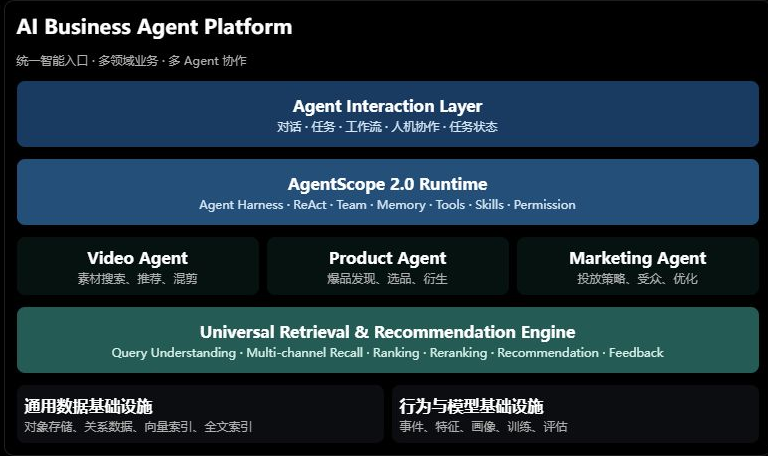
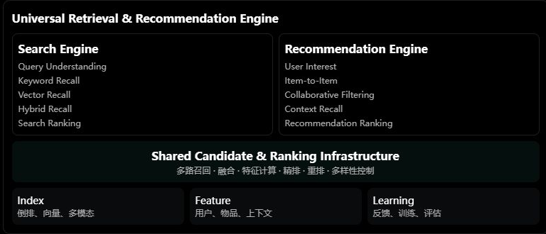
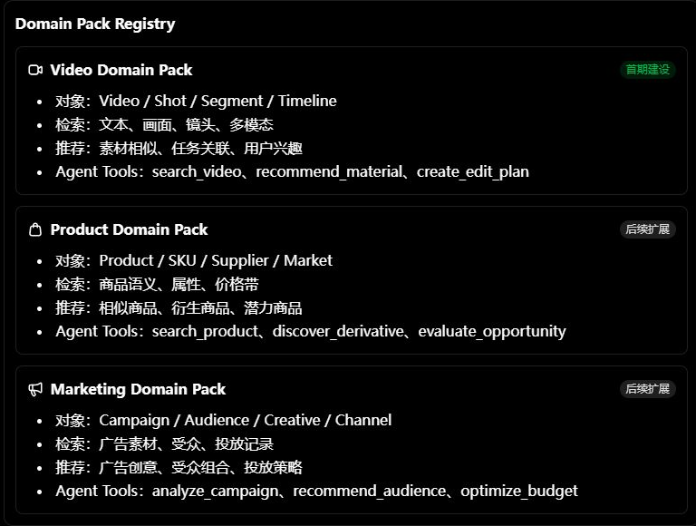
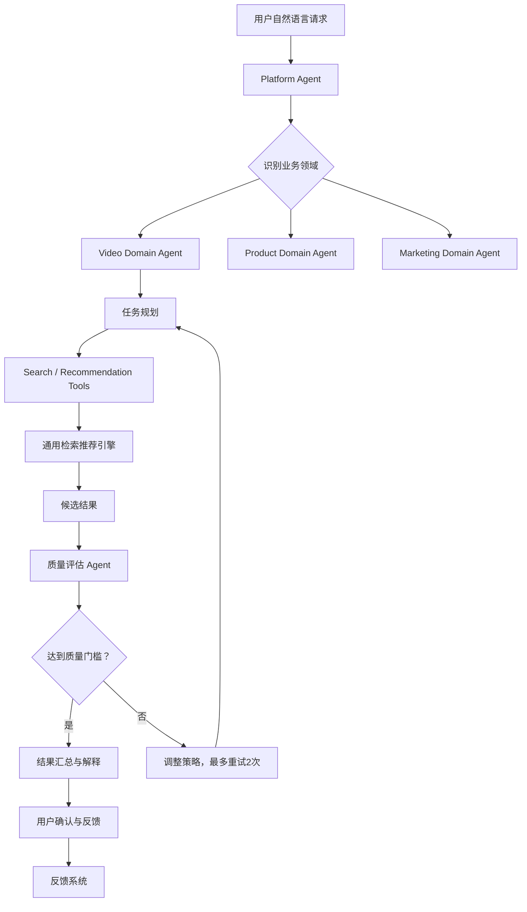
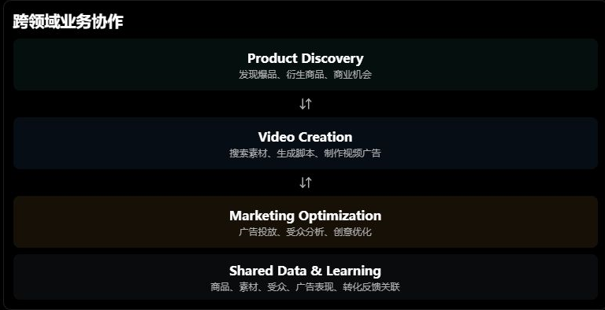
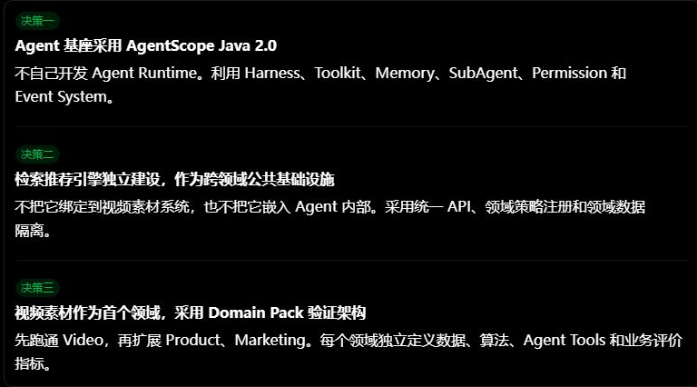

# 对话记录：AI 通用检索推荐与多领域 Agent 平台

> **来源：** [ChatGPT 分享对话](https://chatgpt.com/s/t_6af2eeb4b1d88191a3b0d02fae67eddf)  
> **页面标题：** 看看这段聊天  
> **保存时间：** 2026-11-10  
> **可见内容：** 页面公开为一条合并后的助手回答；原始用户提问未在共享页中公开。  
> **图片说明：** 共享页没有独立图片附件。文中的 5 张图片是从该对话的可视化架构卡片截取，并保存到 `images/chat-t_6af2eeb4/`。

---

## 助手回复

我认为这个方向是值得采用的，而且相比单独建设一个「视频素材 Agent 系统」，我更建议把它提升为一个更大的技术架构：

**以通用检索推荐引擎为基础设施，以 AgentScope 2.0 为智能体运行框架，构建一个支持多业务领域、多种检索推荐任务、多 Agent 协作的 AI 业务平台。**

这样，视频素材只是第一个落地场景。后续扩展到商品选品、广告投放、市场机会发现、商品衍生推荐等领域时，不需要重新建设检索推荐和 Agent 基础设施。

这里有一个很重要的架构原则：

**不要把 Agent 做成检索推荐系统的一个功能模块，而要让 Agent 成为调用、理解、组织和优化检索推荐能力的智能决策层。**

我建议将整个系统分成五个相对独立的层次：

1. 通用数据与内容理解层
2. 通用检索推荐引擎层
3. Agent 智能体运行与协作层
4. 领域业务能力层
5. 用户交互与工作流层

下面展开具体设计。

## 一、总体架构：通用检索推荐底座 + 多领域 Agent 平台

我建议采用下面的架构。



### AI Business Agent Platform

统一智能入口 · 多领域业务 · 多 Agent 协作

**Agent Interaction Layer**
对话 · 任务 · 工作流 · 人机协作 · 任务状态

**AgentScope 2.0 Runtime**
Agent Harness · ReAct · Team · Memory · Tools · Skills · Permission

**Video Agent**
素材搜索、推荐、混剪

**Product Agent**
爆品发现、选品、衍生

**Marketing Agent**
投放策略、受众、优化

**Universal Retrieval & Recommendation Engine**
Query Understanding · Multi-channel Recall · Ranking · Reranking · Recommendation · Feedback

**通用数据基础设施**
对象存储、关系数据、向量索引、全文索引

**行为与模型基础设施**
事件、特征、画像、训练、评估

这里有个重要细节：**通用检索推荐引擎不应该依赖 AgentScope，AgentScope 也不应该依赖某个具体的检索推荐算法。**

两者通过标准 API 和 Tool 接口连接。

这样有几个好处：

- 普通搜索不需要启动 Agent，直接调用检索引擎。
- 复杂搜索由 Agent 理解意图、拆解任务、选择检索策略。
- 主动推荐可以由推荐引擎直接执行，也可以由 Agent 结合当前任务动态组织。
- 后续选品、投放等领域可以复用检索推荐引擎，而不需要复用视频素材的业务逻辑。

## 二、AgentScope 2.0：建议采用 Java 版本作为主运行框架

结合现有软件研发基础，我建议优先采用 **AgentScope Java 2.0 + Spring Boot**。

AgentScope 2.0 的设计已经不仅仅是一个 ReAct Agent 框架，而是向生产级 Agent Harness 演进。

它有几个值得利用的能力：

| AgentScope 能力 | 在平台中的用途 |
|---|---|
| ReActAgent | 单 Agent 推理和工具调用 |
| Harness | 为复杂任务提供执行环境和工程能力 |
| Middleware | 推理、工具执行、权限和上下文拦截 |
| Toolkit | 封装检索、推荐及领域业务工具 |
| Workspace | Agent 工作空间、配置和资源 |
| Memory | 会话记忆和长期记忆 |
| SubAgent | 将复杂任务委派给专业 Agent |
| Permission | 工具调用授权和人工审批 |
| Event System | 前端实时展示推理和执行进度 |
| StateStore | 会话状态持久化和恢复 |

官方文档：

- [AgentScope Java 2.0 GitHub](https://github.com/agentscope-ai/agentscope-java)
- [AgentScope Java 2.0 中文文档](https://github.com/agentscope-ai/agentscope-java/tree/main/docs/v2/zh)
- [2.0 架构与快速入门](https://github.com/agentscope-ai/agentscope-java/blob/main/docs/v2/zh/docs/index.md)

官方将 Agent 的核心推理循环与 Harness 工程能力分离。这一点非常适合我们：先构建轻量业务 Agent，再逐步引入长任务、记忆、子 Agent 和人工审批。 [引用: turn247438search0, turn247438search2, turn247438search7]

我的具体建议是：

**第一阶段不要自己实现 Agent Runtime，也不要急于建设复杂的多 Agent 网络。**

直接利用 AgentScope 2.0 提供的能力，把精力放在：

1. 通用检索推荐引擎。
2. 领域知识和领域工具。
3. Agent 的任务规划和策略选择。
4. 多 Agent 之间的任务分工。
5. 检索推荐效果的反馈和持续优化。

---

## 三、通用检索推荐引擎：真正需要重点建设的底座

这是整个方案最重要的部分。

我建议把它定义为：

**Universal Retrieval & Recommendation Engine（URRE）**

它不是简单的 Elasticsearch + 向量数据库，而是一套独立的检索、推荐、排序、用户兴趣建模和反馈学习系统。

### 3.1 不要将搜索和推荐混为一谈

搜索和推荐虽然可以共用底层能力，但业务目标不同。

| 维度 | 检索 Search | 推荐 Recommendation |
|---|---|---|
| 触发方式 | 用户主动输入 | 主动发现、任务触发 |
| 核心依据 | Query、约束条件 | 用户兴趣、上下文、行为 |
| 核心目标 | 找到用户正在寻找的内容 | 找到用户可能需要的内容 |
| 召回策略 | 关键词、语义、多模态 | 协同过滤、内容相似、用户兴趣 |
| 排序策略 | Query-Relevance | User-Item Relevance |
| 反馈 | 搜索成功、点击、下载 | 曝光、点击、采用、转化 |

底层可以共用召回服务、向量索引、特征系统和排序基础设施，但保留独立的搜索与推荐策略。

### 3.2 建议的引擎内部架构



**Universal Retrieval & Recommendation Engine**

**Search Engine**
Query Understanding
Keyword Recall
Vector Recall
Hybrid Recall
Search Ranking

**Recommendation Engine**
User Interest
Item-to-Item
Collaborative Filtering
Context Recall
Recommendation Ranking

**Shared Candidate & Ranking Infrastructure**
多路召回 · 融合 · 特征计算 · 精排 · 重排 · 多样性控制

Index
倒排、向量、多模态

Feature
用户、物品、上下文

Learning
反馈、训练、评估

我建议重点建设以下八个服务：

| 服务 | 主要职责 |
|---|---|
| Query Understanding | 查询理解、实体识别、条件解析 |
| Recall Service | 多路召回、候选生成 |
| Ranking Service | 粗排、精排 |
| Reranking Service | 多目标重排、多样性、约束 |
| Recommendation Service | 用户兴趣和场景推荐 |
| User Profile Service | 用户兴趣、长期和短期画像 |
| Item Profile Service | 物品特征和语义画像 |
| Feedback Service | 曝光、点击、采用、转化反馈 |

这里有一个设计原则：

**底层算法和数据结构通用化，领域特征与排序模型允许差异化。**

例如，视频素材和商品都需要向量召回，但它们的排序目标显然不一样。

视频素材可能关注：

- 画面内容相似度
- 镜头质量
- 分辨率
- 时长
- 版权状态
- 下载和实际采用率

商品选品则可能关注：

- 商品语义相似度
- 价格带
- 供应链成本
- 市场需求
- 竞争程度
- 毛利空间

因此不要试图用一个万能 Ranking Model 解决所有领域的问题。

应该建设统一的排序框架，允许不同领域注册自己的排序模型、特征和目标函数。

## 四、跨领域扩展：必须设计 Domain Plugin 机制

这是我认为整个项目最值得提前规划的地方。

如果没有领域隔离，未来很容易出现这样的情况：

- 检索引擎中充斥着视频素材专属字段。
- Agent 工具中出现大量商品选品专属逻辑。
- 推荐算法和业务流程相互耦合。
- 新增一个领域，需要修改大量底层代码。

我建议设计一个 **Domain Pack（领域能力包）** 机制。

### 4.1 每个领域由独立的领域包定义

一个领域包包含：

| 组成 | 作用 |
|---|---|
| Domain Schema | 领域对象及属性定义 |
| Domain Ontology | 领域概念、分类及关系 |
| Feature Definition | 领域特征定义 |
| Recall Strategy | 领域召回策略 |
| Ranking Strategy | 领域排序策略 |
| Business Rules | 业务规则和约束 |
| Agent Tools | 领域 Agent 可以调用的工具 |
| Agent Skills | 领域知识和执行方法 |
| Evaluation | 领域评价指标 |

例如：



**Domain Pack Registry**

**Video Domain Pack**

**首期建设**

- 对象：Video / Shot / Segment / Timeline
- 检索：文本、画面、镜头、多模态
- 推荐：素材相似、任务关联、用户兴趣
- Agent Tools：search_video、recommend_material、create_edit_plan

**Product Domain Pack**

**后续扩展**

- 对象：Product / SKU / Supplier / Market
- 检索：商品语义、属性、价格带
- 推荐：相似商品、衍生商品、潜力商品
- Agent Tools：search_product、discover_derivative、evaluate_opportunity

**Marketing Domain Pack**

**后续扩展**

- 对象：Campaign / Audience / Creative / Channel
- 检索：广告素材、受众、投放记录
- 推荐：广告创意、受众组合、投放策略
- Agent Tools：analyze_campaign、recommend_audience、optimize_budget

### 4.2 统一领域接口

可以定义如下接口：

```java
public interface DomainProvider {

    String getDomainId();

    DomainSchema getSchema();

    List getRecallStrategies();

    RankingStrategy getRankingStrategy();

    List getTools();

    List getSkills();

    EvaluationStrategy getEvaluationStrategy();
}
```

检索推荐引擎不关心具体业务，只根据 `domainId` 加载领域配置。

例如：

```json
{
  "domainId": "video",
  "entityType": "shot",
  "recallStrategies": [
    "keyword",
    "semantic",
    "visual",
    "user_interest"
  ],
  "rankingStrategy": "video_multi_objective_v1"
}
```

换成商品领域：

```json
{
  "domainId": "product",
  "entityType": "product",
  "recallStrategies": [
    "keyword",
    "semantic",
    "attribute",
    "market_trend"
  ],
  "rankingStrategy": "product_opportunity_v1"
}
```

注意：这些配置只是架构示例。实际运行中，召回策略和排序策略应当通过注册的实现与版本化配置关联，而不是依靠任意字符串动态加载代码。

### 4.3 不要过度抽象领域数据

我特别建议不要把 Video、Product、Campaign 强行设计成一个包含所有属性的超级实体。

应该采用：

- 通用 Entity：ID、Domain、Type、Tenant、创建时间等。
- 领域 Entity：Video、Shot、Product、SKU、Campaign 等。
- 通用 Feature：Embedding、热度、质量分、行为统计等。
- 领域 Feature：视频画面质量、商品毛利率、广告转化率等。

这相当于：

**统一基础协议 + 领域独立模型 + 可插拔算法策略。**

这样才有真正的扩展性。

---

## 五、Agent 架构：建议采用分层 Agent，而不是一开始就建设 Agent 集群

这里要特别注意：Agent 数量不是越多越好。

结合你之前提出的多 Agent 独立审核、80 分质量门槛、最多两次重试的设计思路，我建议采用三层架构。

### 5.1 第一层：Platform Agent

平台级 Agent，负责整个任务的理解与调度。

主要职责：

- 理解用户自然语言需求。
- 识别当前业务领域。
- 判断用户想执行什么任务。
- 生成任务计划。
- 选择领域 Agent。
- 管理任务执行状态。
- 汇总结果。

例如用户说：

> 我想找一些适合制作科技产品宣传片的未来城市素材，最好有空中交通、霓虹灯和科技建筑。

Platform Agent 识别：

```json
{
  "domain": "video",
  "intent": "search_and_recommend",
  "task": "find_video_materials",
  "constraints": {
    "visual_style": "futuristic",
    "elements": [
      "future_city",
      "air_traffic",
      "neon",
      "technology_buildings"
    ]
  }
}
```

### 5.2 第二层：Domain Agent

每个业务领域有自己的专业 Agent。

| Agent | 职责 |
|---|---|
| Video Agent | 视频素材搜索、推荐、创作 |
| Product Agent | 商品发现、选品、衍生商品 |
| Marketing Agent | 广告投放、受众分析、优化 |
| Research Agent | 市场研究、趋势分析 |

Domain Agent 不应该自己重复实现底层算法，而是调用 Universal Retrieval & Recommendation Engine。

### 5.3 第三层：Task Agent

领域内部根据具体任务进行专业分工。

以 Video Agent 为例：

| Task Agent | 职责 |
|---|---|
| Search Planner | 分析搜索需求，生成检索计划 |
| Retrieval Agent | 组织多路检索和候选召回 |
| Recommendation Agent | 组织个性化推荐 |
| Creation Agent | 创作方案、分镜和素材组合 |
| Quality Agent | 独立审核素材及创作结果 |

但这里我不建议每个任务都启动五个 Agent。

例如：

- 普通搜索：直接调用检索引擎。
- 复杂搜索：Video Agent + Search Planner。
- 搜索并推荐：Video Agent + Search Agent + Recommendation Agent。
- 视频创作：Video Agent + Creation Agent + Quality Agent。

按任务复杂度动态选择执行结构。

### 5.4 AgentScope 2.0 中如何实现

我建议使用下面的对应关系：

| 平台架构 | AgentScope 2.0 |
|---|---|
| Platform Agent | 主 HarnessAgent |
| Domain Agent | 专业 HarnessAgent / Agent |
| Task Agent | SubAgent |
| 检索推荐能力 | Toolkit / Tool |
| 领域知识 | Skills / Workspace |
| 会话记忆 | Memory / StateStore |
| 任务流程 | Agent Team / Workflow |
| 工具权限 | Permission |
| 执行监控 | Event System / Middleware |

AgentScope 的 Harness、SubAgent、工具权限、事件流和持久化机制，正好可以作为这一层的工程基础。 [引用: turn247438search2, turn247438search7]

### 5.5 一个典型执行流程



这里的质量门槛是我们业务定义的，不应把 80 分当成所有领域统一标准。视频素材的画面质量、商品选品的商业潜力、广告投放的 ROI，需要分别定义评价体系。

---

## 六、最关键的设计：Agent 与检索推荐引擎如何协作？

我建议不要让 Agent 直接访问 Elasticsearch、Milvus、Redis 等底层基础设施。

Agent 只调用具有业务语义的标准工具。

### 6.1 设计统一 Retrieval API

例如：

```http
POST /api/v1/retrieval/search
POST /api/v1/retrieval/recommend
POST /api/v1/retrieval/similar
POST /api/v1/retrieval/explore
POST /api/v1/retrieval/rerank
POST /api/v1/retrieval/feedback
```

核心搜索请求：

```json
{
  "domain": "video",
  "query": "未来城市空中交通",
  "entityType": "shot",
  "filters": {
    "duration": {
      "min": 5,
      "max": 30
    }
  },
  "recall": {
    "strategies": [
      "keyword",
      "semantic",
      "visual"
    ]
  },
  "ranking": {
    "strategy": "video_relevance_v1"
  },
  "topK": 100
}
```

商品领域也可以调用同一套接口：

```json
{
  "domain": "product",
  "query": "便携式户外储能产品",
  "entityType": "product",
  "filters": {
    "priceRange": [50, 300]
  },
  "recall": {
    "strategies": [
      "keyword",
      "semantic",
      "attribute"
    ]
  },
  "ranking": {
    "strategy": "product_opportunity_v1"
  },
  "topK": 100
}
```

注意：这里的字段是示例，实际 Schema 应按领域注册和校验。

### 6.2 Agent 不应该只会 Search

我建议为 AgentScope 封装一个通用 Retrieval Toolkit。

| Tool | 作用 |
|---|---|
| search | 按条件搜索 |
| recommend | 个性化或场景推荐 |
| similar | 相似内容发现 |
| explore | 探索未知候选和新机会 |
| rerank | 对已有候选重新排序 |
| analyze_profile | 分析用户或对象画像 |
| explain | 解释推荐原因 |
| feedback | 记录用户反馈 |

特别强调 `explore`。

它是传统搜索推荐和 Agent 驱动的智能发现之间一个很有价值的接口。

例如选品时，用户可能不只是寻找某个商品的相似品，而是希望发现：

- 购买同类商品的人还可能需要什么？
- 这个商品有哪些可延伸的使用场景？
- 是否存在尚未被充分满足的需求？
- 是否存在关联品类中的商业机会？

这时候，Agent 可以组合语义检索、关系扩展、用户画像、趋势分析和商业评分，而不是简单执行一次相似商品搜索。

### 6.3 让 Agent 能够控制检索策略，但不能随意绕过底层约束

这是我建议的权限边界：

| 能力 | Agent 是否可以控制 |
|---|---|
| 选择召回通道 | 可以 |
| 调整 Query | 可以 |
| 选择排序策略 | 在允许范围内 |
| 调整 TopK | 在允许范围内 |
| 调整业务过滤条件 | 不能突破硬约束 |
| 修改排序模型 | 不可以 |
| 修改用户权限 | 不可以 |
| 执行下载、发布、投放 | 根据权限和人工审批 |

例如 Agent 发现关键词检索结果不好，可以追加语义检索或视觉检索，但不能自行取消版权限制。

---

## 七、视频素材、选品、投放三个领域如何共享能力？

我建议从一开始就考虑三个领域之间的协同，而不是只考虑它们各自独立运行。

实际上，它们之间存在天然的业务关联。

### 跨领域业务协作



**Product Discovery**
发现爆品、衍生商品、商业机会

**Video Creation**
搜索素材、生成脚本、制作视频广告

**Marketing Optimization**
广告投放、受众分析、创意优化

**Shared Data & Learning**
商品、素材、受众、广告表现、转化反馈关联

举一个实际业务例子：

用户提出：

> 帮我发现适合欧美市场的户外露营爆品，并制作适合 TikTok 广告投放的视频创意。

系统可以执行：

1. Product Agent：发现户外露营相关的潜力商品。
2. Research Agent：分析目标市场、用户需求和竞争情况。
3. Product Agent：筛选供应链和价格带，评估商业机会。
4. Video Agent：根据商品卖点生成视频脚本。
5. Retrieval Agent：搜索匹配的户外场景素材。
6. Creation Agent：组织镜头、字幕和视频结构。
7. Marketing Agent：生成广告受众和投放策略。
8. Quality Agent：独立评估创意质量。
9. 用户确认后：执行发布或投放操作。

这时，真正的价值已经不再是一个素材检索系统，而是一个跨业务的 AI 工作平台。

不过有一点需要坚持：跨领域共享的是数据关联、检索能力和任务编排能力，不是把各个领域的商业评价标准混成一个评分。

---

## 八、技术选型：建议的基础设施组合

我不建议为了通用化而引入过多技术。先建立稳定的技术底座。

| 层次 | 推荐技术 | 定位 |
|---|---|---|
| Agent Runtime | AgentScope Java 2.0 | Agent 运行、协作、状态 |
| 业务服务 | Spring Boot | 业务 API 和领域服务 |
| Agent API | SSE / HTTP | 流式交互与工具调用 |
| 搜索引擎 | Elasticsearch / OpenSearch | 倒排检索 |
| 向量检索 | Milvus / Elasticsearch Vector | 语义、多模态检索 |
| 推荐引擎 | 自研 + Gorse 等开源参考 | 召回、排序、推荐 |
| 消息系统 | Kafka | 行为事件与异步任务 |
| 缓存 | Redis | 会话、热点数据、在线特征 |
| 关系数据库 | PostgreSQL / MySQL | 业务数据和元数据 |
| 对象存储 | S3 / MinIO | 视频、图片及文件 |
| 模型训练 | Python + PyTorch | Embedding、召回、排序 |
| 模型服务 | 独立 Model Service | 在线推理 |
| 可观测性 | OpenTelemetry | Agent 和检索链路追踪 |

这里推荐重点研究两个方向：

- Vespa：研究它如何统一搜索、向量召回、排序和推荐。
[Vespa GitHub](https://github.com/vespa-engine/vespa)
- Gorse：研究它如何处理用户行为、物品推荐和协同过滤。
[Gorse GitHub](https://github.com/gorse-io/gorse)

我更倾向于：

**先用成熟开源搜索和向量基础设施，自己建设统一检索推荐编排层、领域策略接口和业务反馈闭环。**

不需要一开始就从零实现所有推荐算法。

## 九、具体落地：我建议分四个阶段

不要同时启动所有领域。以视频素材作为第一个完整验证场景，但底层架构从第一天就支持领域扩展。

**阶段一：通用检索推荐底座 + Video Agent MVP**

**最高优先级**

建设内容：
- AgentScope Java 2.0 接入 Spring Boot。
- 建设统一 Retrieval API。
- 建设视频领域 Domain Pack。
- 实现关键词、向量、多模态召回。
- 实现搜索、推荐、相似素材发现。
- 实现 Video Agent 单 Agent 工具调用。
- 记录曝光、点击、预览、下载、实际采用等事件。

验收目标：用户能够通过自然语言完成素材搜索、筛选、推荐和多轮调整。

**阶段二：推荐算法与 Agent 协同优化**

建设内容：
- 用户短期、长期兴趣画像。
- 多路召回与融合排序。
- 多目标精排和个性化重排。
- Agent 动态调整检索策略。
- 搜索结果与推荐结果联动。
- 复杂任务引入 SubAgent。
- 独立质量评估和失败重试。

验收目标：不仅能找到素材，还能理解用户当前创作任务，主动推荐更适合的素材。

**阶段三：Product Domain 扩展**

建设内容：
- 商品领域 Domain Pack。
- 商品、SKU、供应商等领域模型。
- 商品语义检索、相似商品召回。
- 衍生商品探索。
- 商业机会排序模型。
- Product Agent。

验收目标：使用相同检索推荐底座，支持视频素材和商品两个领域。

**阶段四：Marketing Domain + 跨领域 Agent 协作**

建设内容：
- 广告素材、受众、Campaign 领域模型。
- 广告创意检索和推荐。
- 受众推荐和投放策略优化。
- Platform Agent 跨领域任务编排。
- 商品、素材、投放数据关联。
- 人工审批和操作审计。

验收目标：支持从商品发现到视频创作再到广告投放的完整业务链路。

## 十、我认为需要特别避免的五个架构陷阱

| 错误做法 | 我的建议 |
|---|---|
| 让 LLM 直接检索千万级数据 | 检索引擎负责数据规模和性能，Agent 负责策略 |
| 把所有领域做成一个万能数据模型 | 通用协议 + 领域独立 Schema |
| 所有搜索都经过 Agent | 简单任务走快速路径，复杂任务走 Agent |
| 一开始就建设大量 SubAgent | 先单 Agent，按真实任务复杂度拆分 |
| 所有领域共用一个排序模型 | 共享排序框架，独立领域模型和目标函数 |

还有一个特别重要的工程问题：

**Agent 的记忆不能代替业务数据和用户画像。**

例如：

- 用户长期偏好应该保存在 User Profile。
- 用户对素材的点击、下载应该保存在行为事件系统。
- 某次创作任务的上下文应该保存在 Task Context。
- Agent 对任务的阶段性理解可以保存在 Memory。

这些数据需要有明确的生命周期和更新机制，不能全部塞进 Agent Memory。

## 十一、我建议你们最终采用的项目组织结构

建议采用模块化、领域插件化的 Monorepo 或多仓库组织方式。初期可以 Monorepo，便于统一协议和跨模块开发。

```text
ai-business-platform/
│
├── platform/
│   ├── platform-gateway/
│   ├── platform-auth/
│   ├── platform-task/
│   ├── platform-event/
│   └── platform-observability/
│
├── retrieval-engine/
│   ├── retrieval-api/
│   ├── query-understanding/
│   ├── recall-engine/
│   ├── ranking-engine/
│   ├── recommendation-engine/
│   ├── reranking-engine/
│   ├── feature-service/
│   └── feedback-service/
│
├── agent-platform/
│   ├── agent-runtime/
│   ├── agent-orchestrator/
│   ├── agent-toolkit/
│   ├── agent-memory/
│   ├── agent-workspace/
│   ├── agent-permission/
│   └── agent-evaluation/
│
├── domain-packs/
│   ├── video/
│   │   ├── schema/
│   │   ├── features/
│   │   ├── strategies/
│   │   ├── tools/
│   │   ├── skills/
│   │   └── agents/
│   │
│   ├── product/
│   └── marketing/
│
├── model-platform/
│   ├── embedding/
│   ├── reranker/
│   ├── recommendation/
│   └── model-serving/
│
├── data-platform/
│   ├── event-pipeline/
│   ├── feature-pipeline/
│   ├── training-pipeline/
│   └── evaluation/
│
└── applications/
    ├── video-workbench/
    ├── product-workbench/
    └── marketing-workbench/
```

---

## 十二、最终建议：先确定三个架构决策

我把最重要的结论归纳成三个决策。



**决策一**
**Agent 基座采用 AgentScope Java 2.0**

不自己开发 Agent Runtime。利用 Harness、Toolkit、Memory、SubAgent、Permission 和 Event System。

---

**决策二**
**检索推荐引擎独立建设，作为跨领域公共基础设施**

不把它绑定到视频素材系统，也不把它嵌入 Agent 内部。采用统一 API、领域策略注册和领域数据隔离。

---

**决策三**
**视频素材作为首个领域，采用 Domain Pack 验证架构**

先跑通 Video，再扩展 Product、Marketing。每个领域独立定义数据、算法、Agent Tools 和业务评价指标。

我还有一个关于 AgentScope 2.0 的具体建议：初期优先使用 Java SDK 嵌入现有 Spring Boot 业务体系，不要急着把所有服务迁移到 AgentScope Service。官方文档目前将 Service 单独作为服务化部署能力介绍，SDK 本身可以独立运行。 [引用: turn247438search0, turn247438search1]

**最终希望形成的不是一个视频素材 Agent，而是一套可以持续接入新业务领域的 Agent + Retrieval/Recommendation 基础平台。**

这套平台的核心竞争力应该是：通用检索推荐能力、领域知识、Agent 任务编排，以及不断积累的真实业务反馈数据。

### 接下来最值得做的事情

我建议下一步把这套方案正式落成一份：

**《AI 通用检索推荐与多领域 Agent 平台总体架构设计及落地实施方案》**

重点不是继续讨论概念，而是把以下内容具体化：

1. AgentScope Java 2.0 的实际工程结构、Harness 配置和多 Agent 实现。
2. Retrieval Engine 的模块边界、数据库设计和完整 API。
3. Domain Plugin 的注册、加载、配置和扩展机制。
4. Video / Product / Marketing 三个领域的完整实现示例。
5. Agent 与检索推荐引擎的时序图、工具调用协议和状态管理。
6. 从 MVP 到生产环境的开发任务、验收标准和部署架构。

这样就可以直接交给 Codex 开始进行架构搭建和分阶段开发了。

另外，可以持续跟踪 AgentScope 和相关开源检索推荐项目的演进：

> 建议自动化：每周追踪 AgentScope 与推荐开源项目

---

If you want, I can:

- 设计视频素材Agent的具体工能模块
- 构建Domain Pack的完整示例
- 详细规划Agent与检索推荐引擎协作流程
