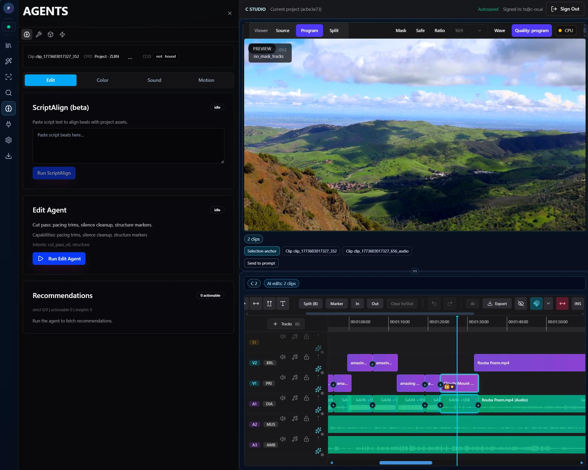
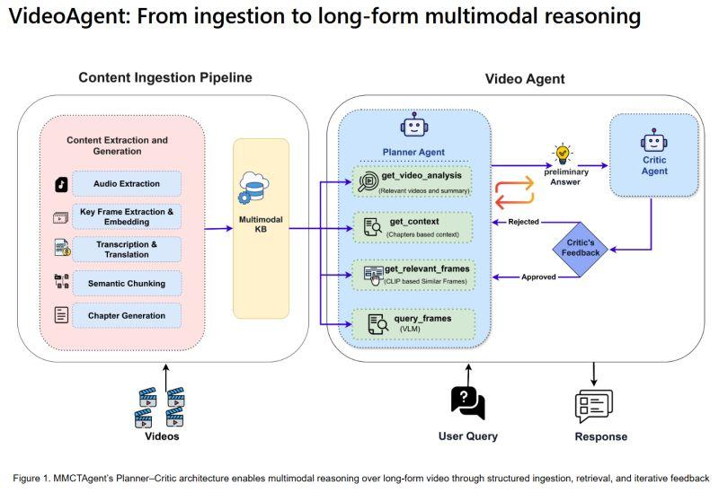
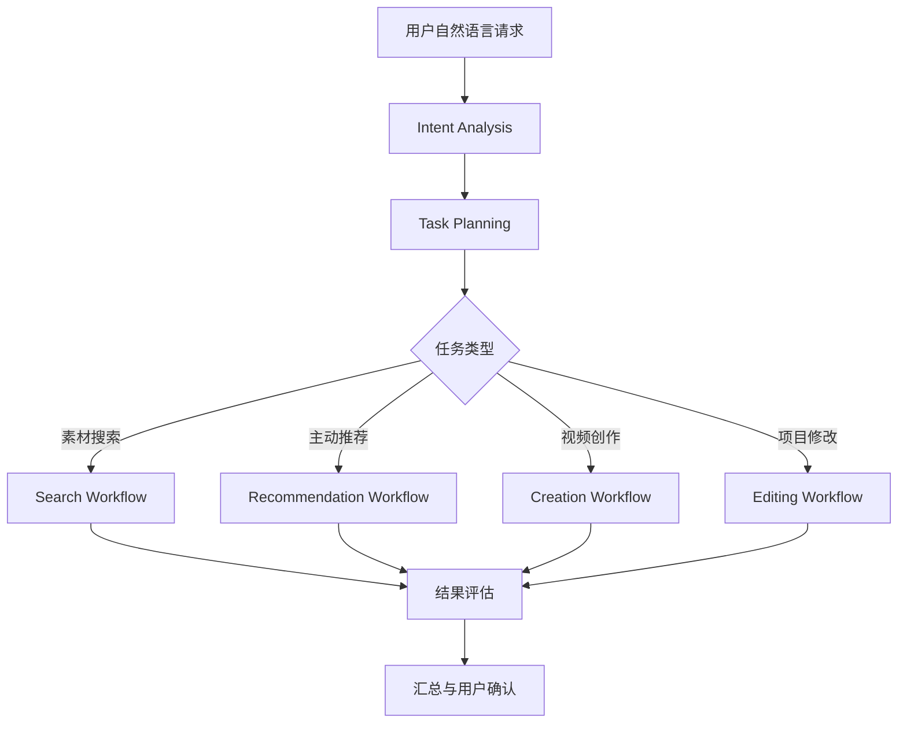
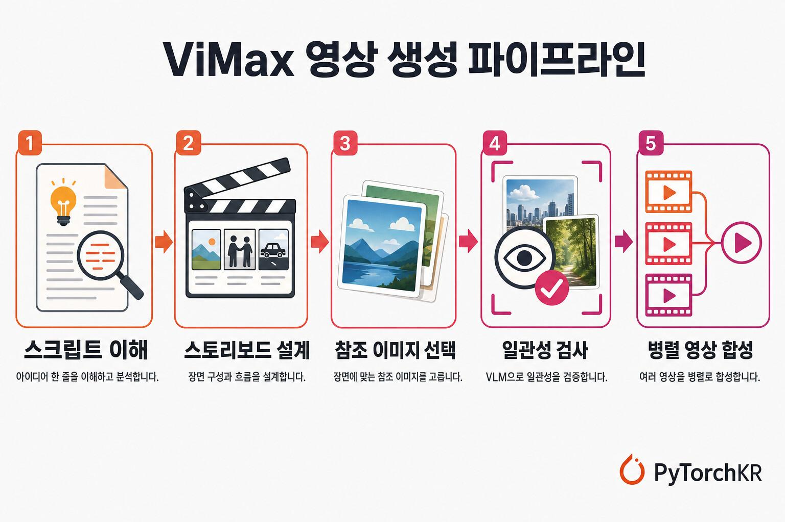
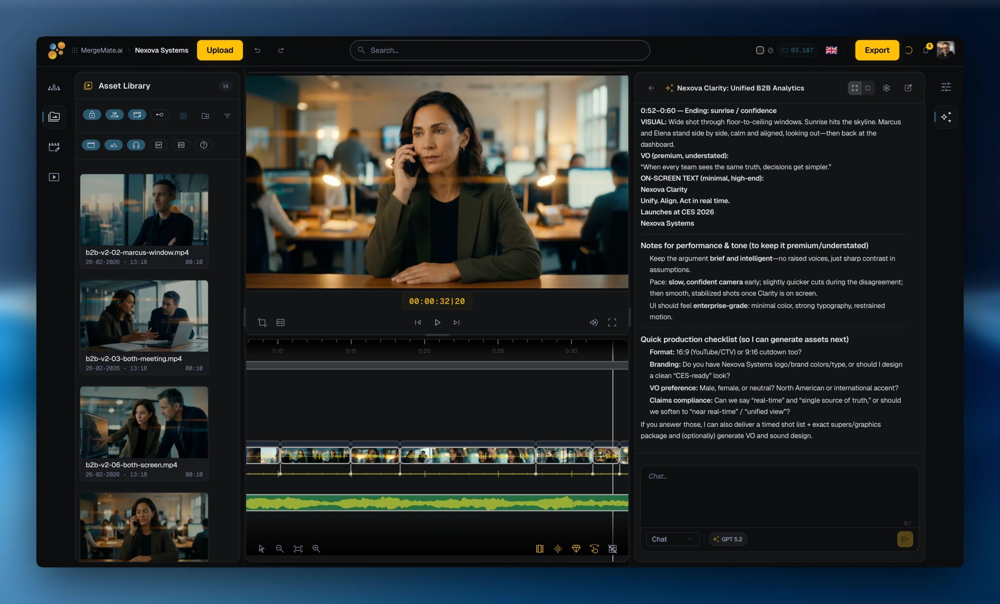
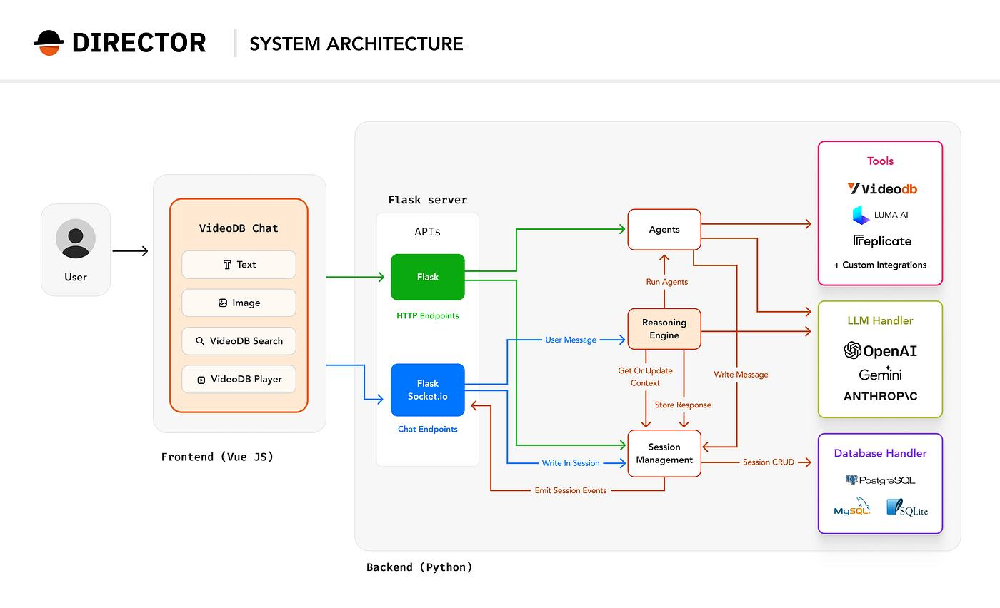
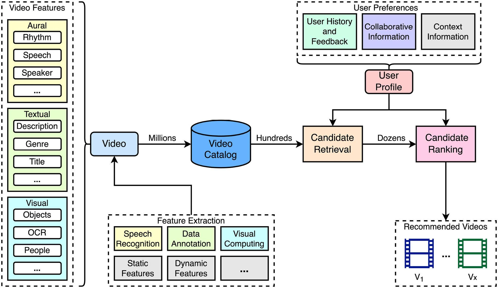
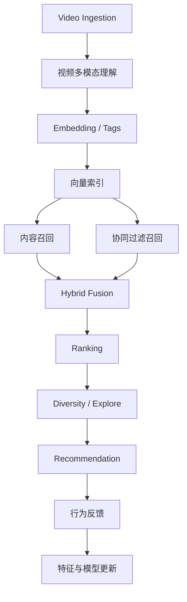
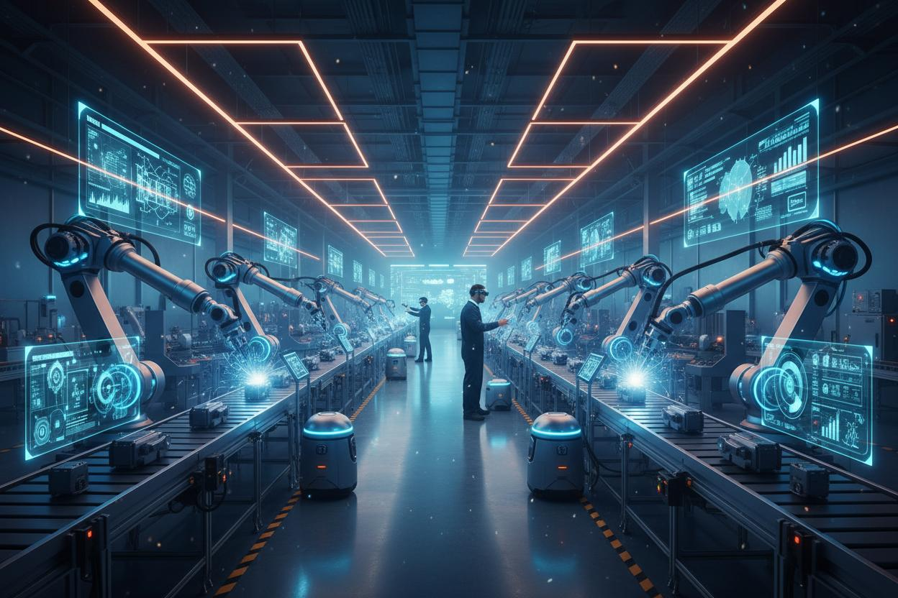
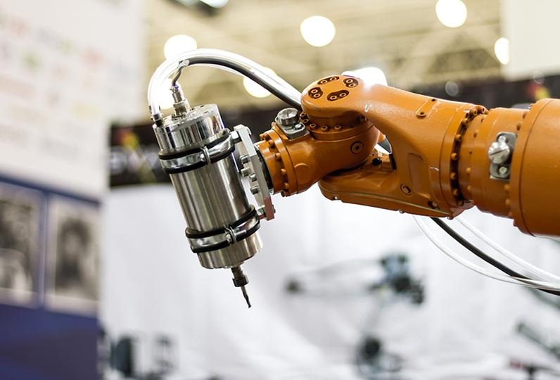

# 视频领域开源项目与 AgentScope 2.0 架构衔接

> **来源**：[ChatGPT 共享对话](https://chatgpt.com/s/t_6af2e9f084908191a5498a84258230fd)  
> **共享页面标题**：看看这段聊天  
> **保存日期**：2026-11-10  
> **说明**：共享页面仅展示了下述助手回复，未展示原始用户提问。

## 助手回复

**有，而且参考价值很高。我认为这两份方案不应该相互替代，而应该合并成一套“平台架构 + 视频领域落地设计”。**

重新找回并阅读了之前的《Video\_Agent\_开源项目源码深度解析与架构设计指南.md》。它和刚完成的通用平台方案，实际上解决的是两个不同层次的问题：

- **通用平台方案**：回答如何构建一个能够支持视频、商品选品、广告投放等多个领域的基础平台。
- **Video Agent 指南**：回答视频领域到底应该如何做检索、推荐、创作、Agent 编排，以及有哪些开源项目值得学习。

尤其重要的是：之前的视频指南中有一些设计，比通用平台方案更加深入。不能因为现在采用了 AgentScope 2.0，就把这些设计丢掉。

我的建议是：**保留之前的视频专项研究成果，将其作为 Video Domain Pack 的详细设计依据；通用平台负责提供统一的运行时、检索推荐能力和领域扩展机制。**

## 一、先给出判断：六个项目都还有价值，但价值层次不同

之前的指南研究了 VEA、VideoAgent、ViMax、MAPO、Director、VideoRecommender。它们不是六个可以直接拼装的组件，而是分别代表视频智能系统中的不同设计模式。[^ref-file]

我建议保留它们，但重新定位：

| 开源项目 | 最值得借鉴的能力 | 在新平台中的位置 | 建议 |
|--------|--------|--------|--------|
| VEA | Agent Loop、Tool Executor、Scratchpad、EditDecision、确定性剪辑编译 | Video Agent 执行机制 | 重点参考 |
| VideoAgent | 意图识别、动态任务图、多模态查询规划 | Platform Agent 与 Video Agent 的任务路由 | 重点参考 |
| ViMax | 长链路创作、项目状态、任务恢复、并行镜头生成 | Video Creation Workflow | 重点参考 |
| MAPO | Ingest、Search、Curation、Selection、Deliver、人工确认 | 视频生产工作流 | 重点参考 |
| Director | 统一入口、Reasoning Engine、Agent 能力组织、交互体验 | Video Agent 产品形态 | 架构参考 |
| VideoRecommender | 多模态理解、混合召回、协同过滤、排序、多样性 | URRE 的 Video Domain 算法参考 | 重点参考 |

这些项目的核心边界，在之前的指南中已经做过区分：例如 VEA 依赖外部视频数据基础设施，MAPO 更偏小规模后期制作原型，Director 依赖 VideoDB，而 VideoRecommender 并不是 Agent 框架。[^ref-file] [^ref-file] [^ref-file]

**我的核心建议：不要把这些项目作为新平台的底层依赖，而要把它们当作经过研究的设计模式和局部实现参考。**

## 二、最重要的变化：把旧视频架构映射到新平台

之前的视频指南有一个很好的架构思想：

> Video Director Agent 负责理解和规划；Search、Recommendation、Creation、Editing、Evaluation 等专业能力负责具体工作。

这与现在的通用平台架构完全兼容。

我们可以把它们对应起来：

## 新平台与 Video Agent 的关系

**通用 Agent 平台 · AgentScope Java 2.0**

Platform Agent、Session、StateStore、Memory、Tools、Middleware、权限和事件系统

**Video Domain Pack · 视频领域专业能力**

Video Director Agent、Search Planner、Recommendation Strategy、Creation Workflow、Editing Workflow、Quality Review

**通用检索推荐引擎 · URRE**

Search、Recommend、Similar、Explore、Recall、Ranking、Reranking、Feedback

**视频领域算法和媒体执行服务**

Video Understanding、Video/Shot/Segment Index、Embedding、Two-Tower、DNN、Reranker、Timeline Compiler、FFmpeg、NLE Adapter

这里有一个关键变化：

**原来视频系统中独立存在的 Search Agent、Recommendation Agent，不一定都要继续作为自治 Agent。**

它们可以被拆分为：

- Search Planner：在复杂查询时负责理解需求、生成检索计划。
- Search Service：执行实际检索。
- Recommendation Strategy：确定推荐场景和目标。
- Recommendation Service：执行候选召回、排序和重排。
- Creation Agent：处理真正需要规划和创作决策的任务。

也就是说，之前的 Agent 设计仍然有价值，但要按照新平台的 Agent / Tool / Service / Workflow 边界重新组织。

---

## 三、逐个项目，如何融入 AgentScope 2.0

### 1. VEA：重点借鉴 Agent 执行机制



**VEA**

[GitHub 源码](https://github.com/Memories-ai-labs/vea-open-source)

优先研究 Agent Loop、Scratchpad、Tool Executor、EditDecision

VEA 最值得学习的不是它的模型，而是它把 LLM 的创作决策和实际媒体执行分开的方式。

建议映射如下：

| VEA 设计 | 新平台对应实现 |
|--------|--------|
| Agent Loop | AgentScope ReAct Agent / Harness |
| Tool Executor | AgentScope Toolkit / Tool |
| Agent Session | AgentScope Session |
| Scratchpad | Task Context + Workspace + Memory |
| Project Workspace | Video Project Workspace |
| EditDecision | 结构化 EditDecision Schema |
| FCPXML Compiler | Timeline Compiler |
| FFmpeg / DaVinci | Media Execution Service |

这里我尤其建议保留 VEA 的 Scratchpad 思想。

但不要简单照搬 Markdown 文件作为全部项目记忆，而是采用三层结构：

1. 数据库保存权威项目状态、计划版本和素材引用。
2. JSON Schema 保存 Storyboard、ShotPlan、MaterialAssignment、EditDecision 等可验证对象。
3. Workspace / Scratchpad 保存面向 Agent 的项目摘要、阶段结论和工作笔记。

这样 AgentScope 负责运行，业务系统负责持久化，二者不会混淆。

### 2. VideoAgent：重点借鉴动态任务路由



**VideoAgent**

[GitHub 源码](https://github.com/HKUDS/VideoAgent)

优先研究 Intent Analysis、Agent Mapping、Graph Workflow

这是我认为最值得用于设计 Platform Agent 和 Video Agent 的项目之一。

例如用户说：

“帮我制作一条 30 秒的智能机器人宣传片。”

系统不能只提取“智能机器人”几个关键词，而应该识别：

- 用户目标：视频创作。
- 创作主题：智能机器人。
- 创作风格：科技感、商业宣传。
- 子目标：机器人外观、机械臂、人机协作、应用场景。
- 交付物：创意简报、分镜、素材集合、时间线草稿。

然后根据任务生成执行图：



但要注意：新平台已经选定 AgentScope Java 2.0，**不建议再把 LangGraph 作为第二套核心 Agent Runtime 引入**。

可以学习 VideoAgent 的动态任务图思想，再使用 AgentScope 2.0 的 Agent、Workflow、Harness 等能力实现；如果某些复杂业务流程需要显式状态机，则由独立的 Workflow / Task Orchestrator 负责状态、重试和恢复。

这样避免双 Runtime、双状态管理和双套调试体系。

### 3. ViMax：重点借鉴创作任务的生命周期



**ViMax**

[GitHub 源码](https://github.com/HKUDS/ViMax)

优先研究项目状态、分阶段创作、并行执行、会话恢复

ViMax 虽然偏生成式视频创作，但它的工作流对我们的真实素材创作系统很有参考价值。

建议把它的创作阶段映射成：

| ViMax | 我们的视频创作系统 |
|--------|--------|
| Idea | 用户创作目标 |
| Script | 创作脚本 |
| Scene | 场景需求 |
| Storyboard | 分镜计划 |
| Shot Design | 镜头需求 |
| Video Generation | 真实素材检索或生成 |
| Continuity Check | 镜头连续性与叙事一致性 |
| Final Assembly | 时间线与成片 |

我认为这里有一个值得进一步强化的能力：

**推荐对象不应只有单条视频或单个镜头，还应该包括能够共同完成一个创作目标的素材组合。**

例如一条机器人宣传片需要：

- 开场：未来工厂全景。
- 主体：机器人外观。
- 细节：机械臂运动。
- 应用：工程师与机器人协作。
- 收尾：产品英雄镜头。

每个镜头分别检索和推荐，最终再做跨镜头组合优化。

这实际上是从 Item Recommendation 走向 Task-aware Set Recommendation / Creative Composition。

### 4. MAPO：重点借鉴人工确认与生产闭环



**MAPO**

[GitHub 源码](https://github.com/Yichen727/Multi-Agent-Production-Orchestrator)

优先研究 Ingest → Search → Curation → Selection → Deliver

MAPO 的核心价值是明确区分 Agent、Service、Schema、State 和 Orchestrator。

建议保留它的业务闭环：


尤其是 Curation 环节，不建议完全自动化。

专业素材工作流里，Agent 可以负责寻找和组织候选，用户保留素材确认、修改时间线和最终导出的控制权。

### 5. Director：重点借鉴产品入口和能力组织



**Director**

[GitHub 源码](https://github.com/video-db/Director)

优先研究 Reasoning Engine、Agent 编排、用户交互

Director 的参考价值主要是产品架构：

- 统一对话入口。
- 专业视频能力模块化。
- Agent 按任务动态组合。
- 任务进度和执行结果可视化。
- 视频基础设施与 Agent 编排分层。

但是不要把 VideoDB 作为我们的基础设施前提。我们需要自建 URRE 和视频资产索引，借鉴它的能力抽象与交互方式即可。

### 6. VideoRecommender：重点借鉴算法链路



**VideoRecommender**

[GitHub 源码](https://github.com/sumitgohil/VideoRecommender)

优先研究 candidate generation、hybrid fusion、ranking、diversity

这是旧指南中与 URRE 最直接相关的项目。

它展示的推荐链路包括：



这个项目适合学习推荐算法的模块化实现，但不应直接作为千万级推荐引擎使用。

需要进一步结合我们之前研究过的 Two-Tower、YouTube DNN、序列推荐、生成式推荐等方案，把它提升为可扩展的推荐架构。

特别是：

- 多路召回：内容、协同、语义、视觉、任务上下文。
- 排序：领域模型与多目标排序。
- 重排：多样性、镜头互补性、版权、质量约束。
- 反馈：曝光、点击、预览、下载、加入时间线、最终采用。

旧指南中关于“不要把每个候选素材交给 LLM 打分”的原则，我建议原样保留。[^ref-file]

---

## 四、我认为旧指南中还有三个比单个开源项目更重要的设计

这三个设计应该直接进入新平台的正式架构，而不只是作为学习资料。

### 1. Video / Shot / Segment 三级检索体系

视频素材不能只按 Video 粒度建立索引。

| 数据层级 | 检索目标 | 示例 |
|--------|--------|--------|
| Video | 找整条视频 | 找一条机器人生产线视频 |
| Shot | 找镜头 | 找机械臂抓取物品的镜头 |
| Segment | 找时间片段 | 找视频第 12～17 秒的机械臂特写 |

建议在 Video Domain Pack 中明确：

```text
Video Domain
├── Video Asset
│   ├── Metadata
│   ├── Global Embedding
│   └── Video Summary
│
├── Shot
│   ├── Start / End Time
│   ├── Scene / Action / Camera
│   ├── Visual Embedding
│   └── Quality Features
│
└── Segment
    ├── Start / End Time
    ├── ASR / OCR
    ├── Fine-grained Embedding
    └── Clip Quality
```

这样可以同时满足资产级搜索、镜头级检索和剪辑级精准定位。

这也为未来接入互联网视频素材、本地素材库以及生成式素材提供统一的对象模型。

### 2. 创作型推荐：从单素材推荐升级为素材组合推荐

这是我认为旧指南里最值得继续深化的设计。

普通推荐算法主要回答：

> 用户可能喜欢哪个素材？

创作型推荐需要回答：

> 为了完成当前创作任务，应该推荐哪些素材，它们如何组合？

建议增加一个独立的能力：

**Creative Composition / Material Assignment Service**

它不是取代 URRE，而是建立在 URRE 之上的领域服务。

**创作型推荐示例：机器人宣传片**

用户目标：制作一条 30 秒宣传视频



**01 · 开场**

未来工厂全景


**02 · 主体**

机器人产品展示



**03 · 细节**

机械臂精准作业


**04 · 应用**

人机协作场景

示意素材组合，不代表实际检索结果。

实现上可以拆为：

1. LLM 将脚本和创作目标拆成镜头需求。
2. URRE 对每个镜头需求独立召回和排序。
3. Material Assignment 将候选素材分配到镜头。
4. Composition Evaluator 评价完整素材组合。
5. 用户确认或调整。
6. 将采用结果回传推荐系统。

组合评估不仅看单条素材相关性，还要看：

- 镜头覆盖完整性。
- 叙事逻辑。
- 镜头之间的互补性。
- 视觉风格一致性。
- 时间长度和节奏。
- 素材质量、版权和可用性。

这会让我们的系统从“素材搜索推荐工具”升级为“创作任务驱动的素材组织系统”。

### 3. 结构化创作中间表示（IR）

VEA 的 EditDecision 思想和 MAPO 的 Schema/State 思想，可以结合起来形成统一的创作中间表示。

建议建立：

```text
CreativeBrief
     ↓
Storyboard
     ↓
ShotPlan
     ↓
MaterialAssignment
     ↓
EditDecision
     ↓
TimelineIR
     ↓
Timeline Compiler
     ↓
Premiere / DaVinci / FFmpeg
```

所有阶段都有明确的 Schema、版本和校验规则。

LLM 负责创作决策，但不能直接生成任意 FFmpeg 命令、任意文件操作或未经验证的时间线。

这个设计不仅有利于视频创作，也为以后扩展其他领域的结构化工作流提供经验。

---

## 五、最终建议：重新定义这两份方案之间的关系

我建议把两份文档作为一套架构体系中的两个层次。

### 第一层 · 平台总体架构

**《AI 通用检索推荐与多领域 Agent 平台总体架构设计及落地实施方案》**

负责通用技术底座：AgentScope Runtime、URRE、Domain Pack、数据平台、权限、任务和反馈。

---

### 第二层 · 视频领域详细设计

**《Video Agent 开源项目源码深度解析与架构设计指南》**

负责 Video Domain 的专业实现：视频理解、三级索引、检索推荐、创作型推荐、Agent 工作流、时间线和媒体执行。

---

### 第三层 · 后续领域扩展

**Product Domain / Marketing Domain 详细设计**

分别研究商品机会发现、供应链评估、广告创意、受众推荐和投放优化。

### 我建议对第一份总体架构方案做五项补充

| 补充位置 | 增加的内容 | 主要参考 |
|--------|--------|--------|
| URRE 章节 | Video/Shot/Segment 三级索引及镜头级检索 | VideoAgent、VideoRecommender |
| Video Domain Pack | Video Understanding、Search Planner、Recommendation Strategy | VideoAgent、VideoRecommender |
| Agent Runtime | Agent Loop、Scratchpad、Task Context、任务恢复 | VEA、ViMax |
| 视频创作工作流 | Storyboard、Material Assignment、EditDecision、Timeline IR | VEA、ViMax、MAPO |
| 推荐系统 | 创作型推荐、素材组合优化、跨镜头质量评估 | VideoRecommender、ViMax |

还有一个需要注意的技术问题：这些参考项目大多以 Python 生态为主，而我们选择了 AgentScope Java 2.0。因此应主要复用其架构思想、业务流程、Schema 和算法设计，不必强行移植整套代码。确实成熟的 Python 模型服务可以通过独立 HTTP/gRPC 服务接入 Java 平台。

另外，旧指南已经说明，其源码核验主要基于 README、架构文档和项目结构，正式引入任何组件前仍需要固定 commit、检查 License、依赖服务和实际实现。不能把项目文档描述直接当成生产能力承诺。[^ref-file]

## 六、下一步我最建议做什么

我不建议现在重新从头调研一遍这些开源项目。已有调研成果已经足够支撑下一轮架构深化。

更有价值的是形成一份新的衔接文档：

**《Video Domain Pack 专项架构设计与 AgentScope 2.0 落地实施方案》**

它应该把两份现有文档真正融合起来，重点解决以下问题：

1. 如何把 VEA、VideoAgent、ViMax、MAPO 的设计映射到 AgentScope Java 2.0。
2. Video Domain Pack 的 Java 模块、SPI、Agent、Tool 和 Workflow 如何组织。
3. 如何把 VideoRecommender 的算法思路升级为 URRE 下的多路召回、Two-Tower、DNN、重排和创作型推荐。
4. Video / Shot / Segment 的数据模型、索引和检索 API 如何设计。
5. 如何实现从用户创作目标到素材组合、分镜、时间线和最终视频的完整闭环。
6. 如何设计可恢复、可评估、可审计的 Agent 任务状态机。

**我的最终判断是：通用平台方案确定了“骨架”，之前的视频专项研究提供了“专业器官和运行机制”。两者结合，才是我们真正应该实施的系统。**

而且视频领域不应该只是通用平台的第一个简单 Demo，它应该成为这套平台的第一个完整、复杂、能验证通用架构是否成立的领域。

---

如果你愿意，我可以：

- 详细规划视频领域集成方案
- 设计视频检索与创作流程示意
- 制定创作型推荐系统技术路线

---

## 参考文件

[^ref-file]: 共享对话所引用的附件：`Video_Agent_开源项目源码深度解析与架构设计指南.md`。共享页面未提供该附件本身。
