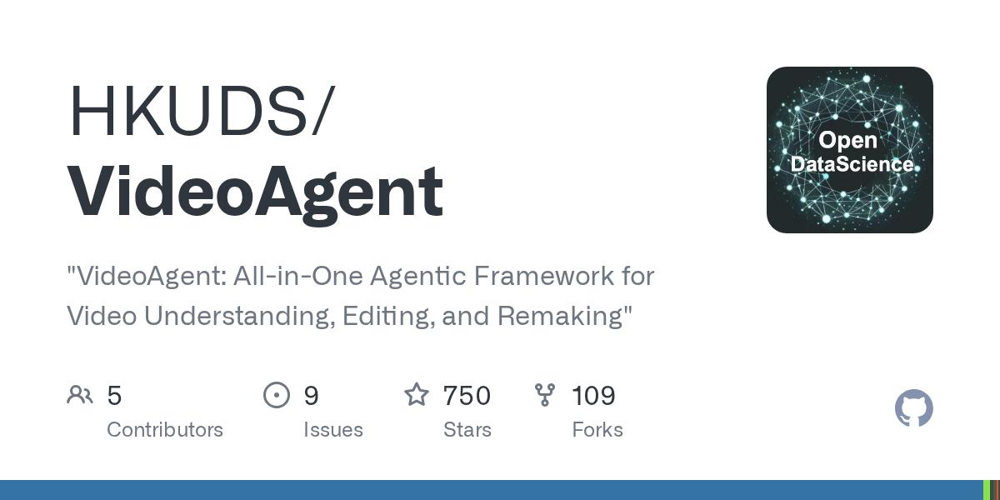
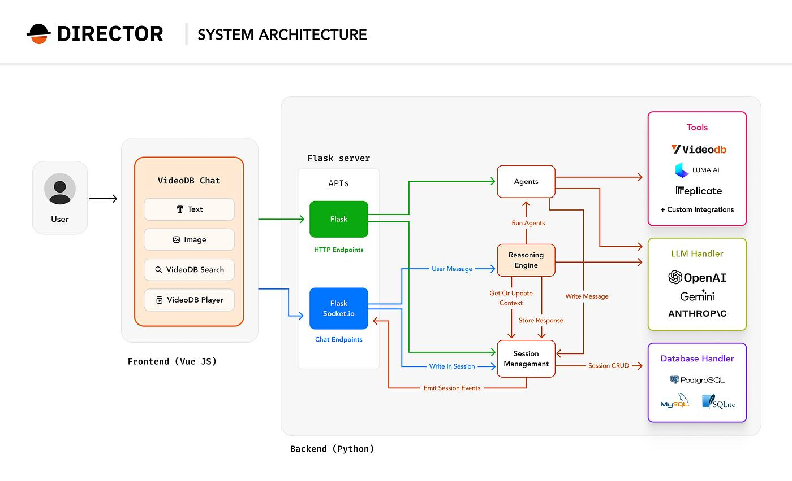
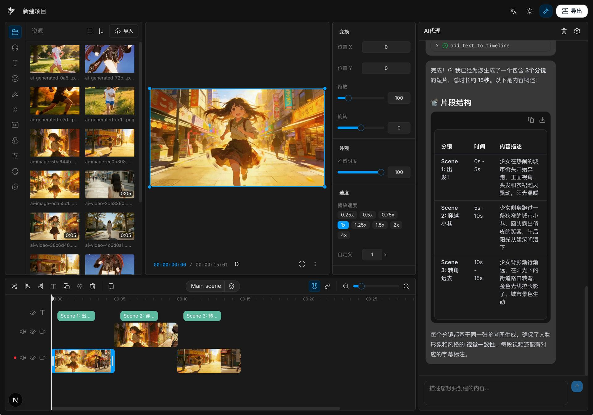
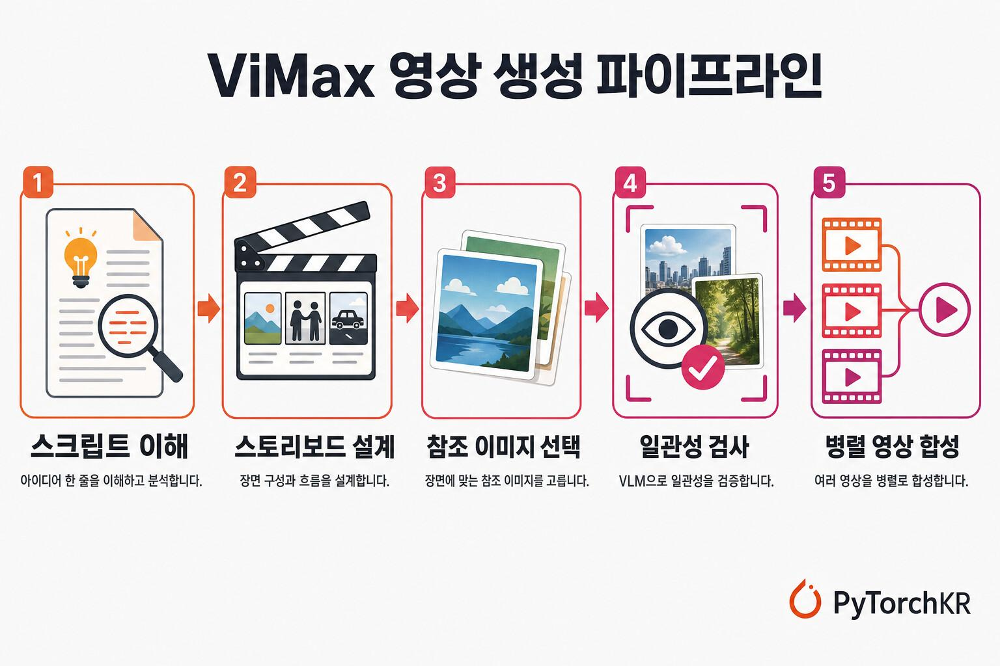
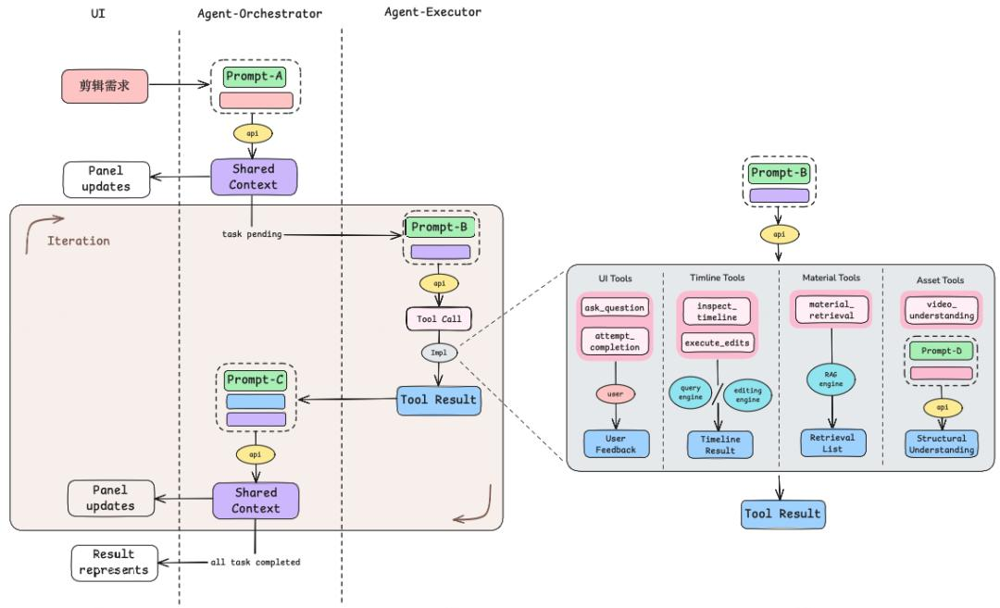
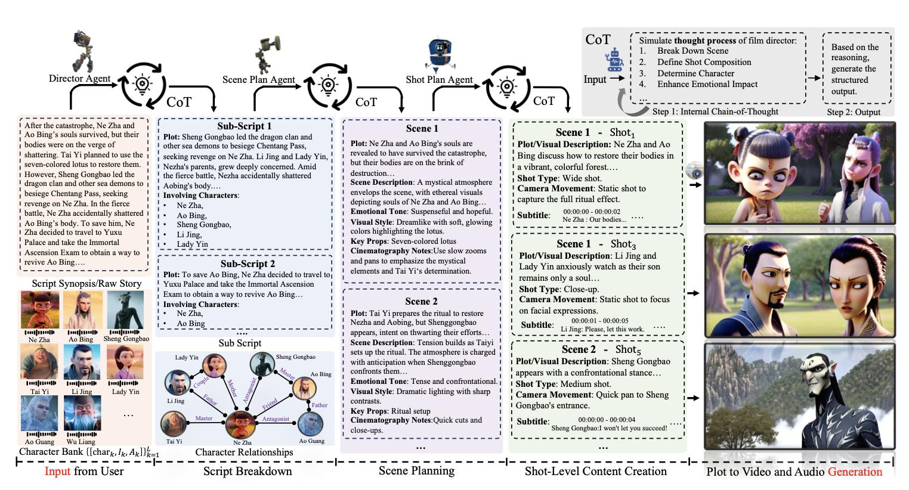
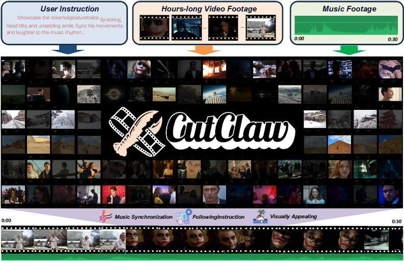
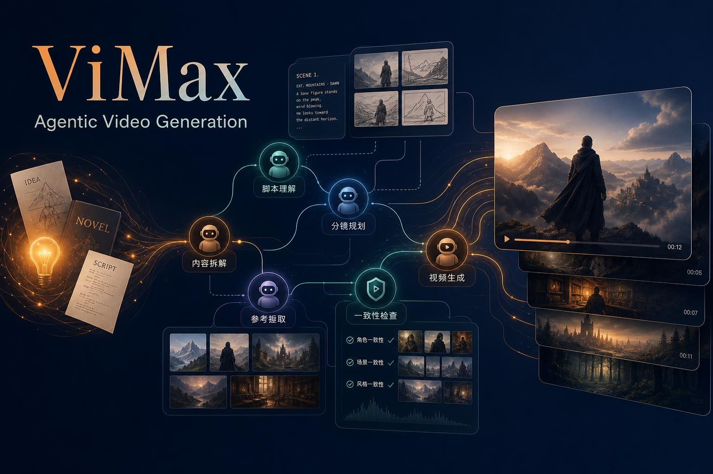
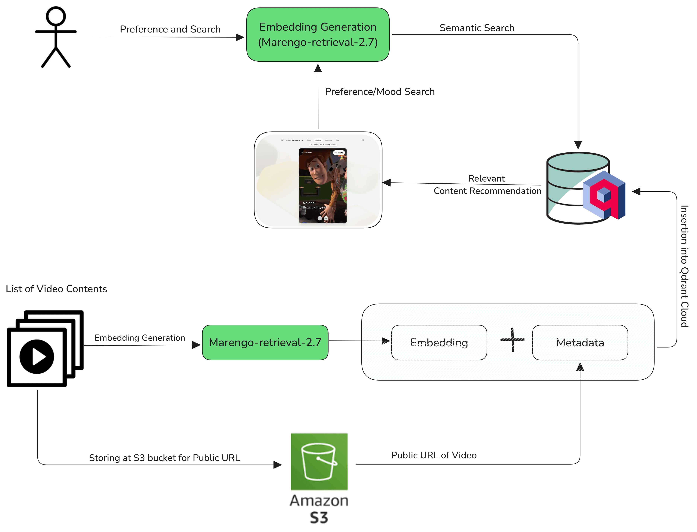

# 视频素材检索推荐与视频创作：开源 Agent 项目调研

> **来源：** [ChatGPT 分享对话](https://chatgpt.com/s/t_6af2ee63a904819188f0fced35aaf029)
> **导出日期：** 2026-11-10
> **对话角色：** Assistant
> **说明：** 分享页仅包含一条合并后的 Assistant 消息。以下保留原回答文字；正文中的 9 张配图已下载到本地并嵌入。原对话中的内联检索引用标记已移除，图片为对话检索/示意结果，不代表项目官方完整产品截图。

---

(开源项目调研) (Agent 架构分析) (2026-11-10)

这次调研，我建议把研究范围扩大到一个完整的视频智能生产体系，而不是只关注 AI 视频生成或自动剪辑。

你正在建设的视频素材检索推荐系统，核心目标实际上是让 Agent 能够理解用户的创作意图，主动寻找素材、判断素材质量、组织素材，最终协助用户完成视频创作。

这意味着我们需要研究的不只是一个 Agent，而是多个专业能力如何被组织成一个完整的智能系统。

## 一、先明确调研范围

我将项目分为四个方向：

(方向 1) **视频理解与素材检索 Agent**

理解视频内容、镜头、人物、动作、场景和语义，支持自然语言检索、时间片段定位及多轮搜索。

重点研究：任务规划、查询拆解、工具调用、多模态 RAG、检索反馈。

---

(方向 2) **素材推荐 Agent**

结合用户画像、历史行为、当前创作任务和素材内容，主动发现并推荐合适的素材。

重点研究：用户意图推理、推荐策略选择、召回与排序编排、反馈学习。

---

(方向 3) **视频创作与剪辑 Agent**

从创意、脚本、分镜到素材选择、时间线编排、剪辑、渲染，完成端到端创作。

重点研究：多 Agent 协作、创作规划、时间线生成、执行验证。

---

(方向 4) **多 Agent 视频生产系统**

将导演、编剧、素材检索、剪辑、审核等角色组织起来，形成可迭代的工作流。

重点研究：Agent 编排、共享记忆、任务状态、质量评估和自我修正。

一个重要的调研结论先放在这里：

**目前开源社区中，视频创作 Agent 的发展明显快于真正意义上的视频推荐 Agent。**

已经有一些项目能够完成自然语言理解、素材检索、自动剪辑和视频生成，但把传统推荐算法、生成式推荐和 Agent 决策真正融合起来的完整开源项目仍然比较少。

因此，不能简单照搬某个项目，而是需要组合不同项目的架构思想。

---

## 二、值得重点研究的开源项目

我筛选了一批与视频 Agent 直接相关的项目。下面按照学习价值，而不是 GitHub Star 数量排序。

### 第一梯队：最值得深入研究的项目



*对话配图 1：VideoAgent 项目参考图。*

**1\. VideoAgent**

(优先级 S)

HKUDS · 多模态视频智能体

GitHub：[HKUDS/VideoAgent](https://github.com/HKUDS/VideoAgent)

涵盖视频理解、编辑、重塑，重点是通过用户意图映射到 Agent，再通过图驱动工作流动态组织工具和执行步骤。

**核心 Agent 架构**

- Intent Analysis：识别用户显性和隐性意图。
- Intent-to-Agent Mapping：根据任务决定调用哪些专业 Agent。
- Graph-driven Workflow：构建可执行工作流。
- Autonomous Tool Use：自主调用多模态工具。
- Adaptive Feedback：执行后进行自我评估和修正。

特别值得研究的是：它不是把用户问题直接交给一个固定的视频处理 Pipeline，而是根据任务动态构建执行路径。

---



*对话配图 2：Director 系统架构参考图。*

**2\. Director**

(优先级 S)

VideoDB · 视频 Agent 编排框架

GitHub：[video-db/Director](https://github.com/video-db/Director)

一个面向视频任务的 Agent 框架，支持视频搜索、摘要、片段提取、编辑、生成、字幕和翻译等。

**核心 Agent 架构**

- Reasoning Engine：负责理解任务和决策。
- Dynamic Agent Orchestration：动态选择专业 Agent。
- Modular Processing：将复杂任务拆成多个步骤。
- VideoDB Infrastructure：负责视频索引、存储、流媒体等。
- Chat-based UI：通过对话驱动整个视频工作流。

它公开描述了 20 多种预置视频 Agent，比较值得研究的是 Reasoning Engine 如何把用户自然语言转化为 Agent 协作流程。

注意：Director 虽然框架开源，但其核心视频基础设施依赖 VideoDB，不能直接视为完全独立、纯本地的系统。

---



*对话配图 3：VEA 风格的对话式视频剪辑工作台参考图。*

**3\. VEA (Video Editing Agent)**

(优先级 S)

Memories.ai · 对话式剪辑 Agent

GitHub：[Memories-ai-labs/vea-open-source](https://github.com/Memories-ai-labs/vea-open-source)

通过对话让 Agent 理解原始素材、制定剪辑方案、选择片段、生成时间线并输出视频。

**核心 Agent 架构**

它的设计非常值得学习，因为已经把 Agent 的内部工作状态做成了可以观察和持久化的结构。

- `comprehension`：素材理解记忆。
- `creative_direction`：创作方向记忆。
- `planning`：执行计划。
- `fcpxml`：剪辑工程状态。

Agent 提供 10 个工具，例如：

| 工具 | 作用 |
|--------|--------|
| `ask_memories` | 对素材库进行问答 |
| `search_footage` | 语义检索素材 |
| `refine_clip_timestamps` | 精确确定片段起止时间 |
| `update_scratchpad` | 更新持久化记忆 |
| `generate_fcpxml` | 生成剪辑工程 |
| `generate_subtitles` | 生成字幕 |
| `finish_turn` | 结束任务 |

特别值得关注的是它的两种运行模式：

- Collaborative：与用户协作，先沟通、再执行。
- Autonomous：自主执行，生成结果后自我检查、调整。

这套设计很接近你希望实现的素材 Agent。

需要注意：VEA 当前版本依赖 Memories.ai Video Datalake 作为视频理解和检索服务，不能把它的素材索引层直接当成完整开源实现。

---



*对话配图 4：ViMax 分阶段视频生成流水线参考图。*

**4\. ViMax**

(优先级 S)

HKUDS · 多 Agent 视频创作

GitHub：[HKUDS/ViMax](https://github.com/HKUDS/ViMax)

围绕导演、编剧、制片、视频生成等专业角色，完成从创意到多镜头视频的创作。

**核心架构特点**

- Idea2Video：创意转视频。
- Script2Video：剧本转视频。
- Novel2Video：长篇小说转视频。
- AutoCameo：将指定人物或宠物融入创作。
- Agent Loop：支持交互式修改、继续执行和渲染控制。

其中最值得研究的是多 Agent 的专业角色分工，以及角色、场景、镜头之间的连续性管理。

### 第二梯队：针对特定 Agent 能力的项目

| 项目 | 核心能力 | 值得研究的内容 |
|--------|--------|--------|
| MAPO | 素材检索到 Premiere 工程 | LangGraph 工作流、人工审核节点 |
| Video Use | 对话式视频剪辑 | Agent Skill、记忆、自我评估 |
| Diffusion Studio Agent | Agent 驱动视频编辑 | 代码化时间线和编辑工具 |
| Cut-as-code | Agent 技能式剪辑 | 技能路由、结构化编辑决策、人机审核 |
| VideoSearcher | 多 Agent 视频理解 | MCP 工具服务、专业 Agent 协作 |

对应代码：

- MAPO：[GitHub](https://github.com/Yichen727/Multi-Agent-Production-Orchestrator)
- Video Use：[GitHub](https://github.com/browser-use/video-use)
- Diffusion Studio Agent：[GitHub](https://github.com/diffusionstudio/agent)
- Cut-as-code：[GitHub](https://github.com/WhiteTowerAI/cut-as-code)
- VideoSearcher：[GitHub](https://github.com/StefanoGarzoni/VideoSearcher-AgenticAI)

其中 MAPO 非常贴近你的素材系统：



*对话配图 5：多 Agent 视频剪辑架构参考图。*

它采用固定的四阶段流程：

1. **Ingest Agent**
   
   通过 FFmpeg、视觉模型、Embedding 等建立素材目录和时间事件索引。
2. **Search Agent**
   
   自然语言检索素材，并输出相关度评分和检索理由。
3. **Selection Agent**
   
   依据剪辑意图，将人工筛选的素材组织成可解释的剪辑时间线。
4. **Deliver Agent**
   
   生成 FCP7 XML 和 JSON，交给 Premiere Pro 使用。

它明确设置了人工素材确认节点和导出节点。注意这是一个规模较小的学术项目原型，而不是生产级参考实现。

它的价值在于：**展示了如何把素材检索和后续视频创作连接起来，而不是将搜索与剪辑做成两个孤立的产品。**

---

## 三、专门研究视频创作 Agent 的多智能体架构

除了上面这些完整系统，还有一批研究型项目值得关注。它们不一定适合直接部署，但对于理解 Agent 的角色设计、任务拆解和协作机制很有帮助。

### 1\. 电影导演式多 Agent



*对话配图 6：MovieAgent 多智能体电影创作架构参考图。*

**MovieAgent**

ShowLab · 多智能体电影创作

[GitHub / showlab/MovieAgent](https://github.com/showlab/MovieAgent)

将电影创作拆成导演、编剧、分镜和场景等专业角色，利用多 Agent 推理协作生成电影。

值得学习：

- 导演 Agent：理解总体创作目标。
- 编剧 Agent：构建故事和剧情。
- 分镜 Agent：规划镜头和场景。
- 场景 Agent：规划拍摄空间。
- 生成执行：将规划转化为实际视觉内容。

### 2\. 多 Agent 长视频剪辑



*对话配图 7：CutClaw 长视频剪辑与音乐同步参考图。*

**CutClaw**

GVCLab · 长视频自动剪辑

[GitHub / GVCLab/CutClaw](https://github.com/GVCLab/CutClaw)

研究多个 Agent 如何配合完成长视频蒙太奇剪辑和音乐同步。

重点是 Writer / Editor / Reviewer 这样的协作关系，以及如何通过审核机制提高剪辑质量。

### 3\. Agent 驱动的动画和故事创作



*对话配图 8：ViMax 多镜头分镜与一致性参考图。*

**Anim-Director**

HITSZ-TMG · 动画导演 Agent

[GitHub](https://github.com/HITsz-TMG/Anim-Director)

研究多模态模型如何自主规划和控制动画视频生成。

### 4\. 视频 Agent 项目索引

我还发现了两个专门收集视频 Agent 的 Awesome 项目，建议作为后续持续发现新项目的入口：

- [awesome-video-agents](https://github.com/PhiloLabs/awesome-video-agents)：覆盖视频理解、视频编辑、多 Agent 创作、MCP 和软件控制。
- [awesome-video-agent](https://github.com/red-fly/awesome-video-agent)：偏向视频 Agent 论文、研究方向和基础设施。

这两个仓库适合做项目地图，不建议直接把里面收录的所有论文和项目都当成成熟可用的软件。

---

## 四、从这些项目中提炼 Agent 架构设计模式

这是我认为本次调研最重要的部分。

这些项目虽然实现方式不同，但其 Agent 架构大致可以归纳为五种模式。

### 模式 A：单 Agent + 专业工具调用

代表：VEA、Video Use。

**用户自然语言请求**

**Video Agent**

理解意图 · 推理 · 规划 · 记忆

素材搜索 Tool

视频理解 Tool

时间戳分析 Tool

时间线生成 Tool

渲染 Tool

质量检测 Tool

**执行结果 + 用户反馈**

这种方式的特点：

- 一个主 Agent 负责所有推理。
- 不同能力以 Tool 的形式提供。
- Agent 自己决定调用哪个工具以及调用顺序。
- 通过持久化 Scratchpad 保存上下文。
- 用户可以不断提出修改意见。

**优点：** 架构简单，容易实现，适合 MVP。

**缺点：** 当检索、推荐、创作、质量审核的业务越来越复杂时，单 Agent 会承担太多职责。

### 模式 B：多 Agent 专业角色协作

代表：ViMax、MovieAgent、CutClaw。

**Director / Orchestrator Agent**

理解总体目标、分配任务、协调执行

**Script Agent**

创意和脚本

**Search Agent**

素材检索

**Producer Agent**

创作资源规划

**Editor Agent**

时间线和剪辑

**Reviewer Agent**

质量审核

**Render Agent**

渲染交付

**最终创作成果**

这种模式的关键不是 Agent 数量，而是职责边界：

| Agent | 输入 | 输出 |
|--------|--------|--------|
| Director | 用户创作目标 | 任务计划 |
| Script | 创作要求 | 脚本、分镜 |
| Search | 素材需求 | 候选素材 |
| Producer | 素材及创作资源 | 创作方案 |
| Editor | 素材、剪辑要求 | 时间线 |
| Reviewer | 创作成果 | 评分、修改建议 |

**关键设计：不要让负责生产的 Agent 同时承担独立质量审核。**

这与你之前研究的多 Agent 对抗式开发思路是一致的。

### 模式 C：图驱动的动态工作流

代表：VideoAgent、LangGraph。

传统 Pipeline：

```text
A → B → C → D
```

所有用户请求都走同一条路径。

Agent Graph：

```text
              ┌→ 视频理解 ──┐
用户请求 → 意图分析           ├→ 结果评估
              ├→ 素材搜索 ──┤
              ├→ 素材推荐 ──┤
              └→ 视频创作 ──┘
                                ↓
                           动态调整路径
```

例如：

用户说：

> 找一些适合制作科技产品宣传片的素材。

Agent 不需要执行视频剪辑，只需要：

1. 识别这是素材发现任务。
2. 提取科技、产品、宣传片等语义条件。
3. 调用素材检索。
4. 调用推荐策略补充候选。
5. 对结果进行筛选和排序。
6. 展示结果。

但如果用户说：

> 用这些素材帮我制作一个 30 秒的科技宣传片。

系统就需要进一步激活：

- 创意规划 Agent。
- 分镜 Agent。
- 素材搜索 Agent。
- 剪辑 Agent。
- 质量审核 Agent。

这就是动态 Agent 编排的价值。

### 模式 D：Agent + 持久化工作记忆

代表：VEA。

这套设计值得重点借鉴。

不要只保存聊天记录，而是把 Agent 的工作状态拆成结构化记忆。

| 记忆类型 | 内容 |
|--------|--------|
| User Context | 用户是谁、偏好什么 |
| Project Context | 当前创作项目 |
| Comprehension | 已理解的素材内容 |
| Creative Direction | 当前创作方向 |
| Planning | 当前执行计划 |
| Execution State | 已完成和待执行任务 |
| Quality Feedback | 历次评分和修改原因 |

例如：

用户第一次说：

> 我想制作一个科技感比较强的宣传视频。

Agent 形成创作方向：

```yaml
creative_direction:
  style: futuristic
  theme: technology
  tone: cinematic
  duration: 30s
  color: blue_cyan
```

之后用户说：

> 第二段换成更有未来感的城市镜头。

Agent 不需要重新理解整个任务，而是基于已有项目记忆修改局部计划。

### 模式 E：Agent Skill + MCP + 执行引擎

代表：Video Use、Cut-as-code、Diffusion Studio。

这一类项目提供了另一种思路：

不一定所有功能都需要封装成一个常驻 Agent。

可以将能力拆成：

- Skill：告诉 Agent 如何完成某种任务。
- MCP / Tool：提供真正的操作能力。
- Execution Engine：负责执行耗时或确定性任务。
- Artifact：保存结构化执行结果。

例如：

```text
/video-search
/video-recommend
/video-understand
/video-create-storyboard
/video-edit
/video-quality-check
/video-render
```

Agent 通过技能理解什么时候调用什么能力，通过工具执行具体操作。

Cut-as-code 的一个值得研究的特点是把编辑决策保存为可审查的文件，而不是只存在模型对话里。

---

## 五、视频素材检索推荐 Agent：现有开源方案的不足

这里需要特别区分两个概念：

**推荐算法 ≠ 推荐 Agent。**

传统推荐算法负责预测用户可能喜欢什么，而 Agent 负责理解当前任务、选择推荐策略、调用算法和解释结果。

目前找到的一个可以用来研究传统视频推荐算法的项目是：



*对话配图 9：VideoRecommender 多模态视频推荐架构参考图。*

**VideoRecommender**

多模态视频推荐系统

[GitHub / VideoRecommender](https://github.com/sumitgohil/VideoRecommender)

支持多模态理解、向量召回、协同过滤、混合排序、SASRec、LightGCN 等。

它提供了一条比较完整的传统推荐算法链路：

```text
视频内容理解
     ↓
多模态标签融合
     ↓
视频向量化
     ↓
Qdrant 向量索引
     ↓
内容召回 + 协同过滤
     ↓
混合融合
     ↓
深度排序
     ↓
多样性控制
     ↓
最终推荐
```

这套架构中，Agent 并不是主要组成部分。它更适合作为 Agent 背后的推荐引擎。

### 我认为真正值得探索的是：Agent 如何控制推荐系统

以你的视频素材业务为例，推荐至少存在三种不同场景。

| 推荐场景 | 用户意图 | 推荐逻辑 |
|--------|--------|--------|
| 搜索增强推荐 | 找某一类素材 | 查询扩展 + 语义召回 |
| 任务驱动推荐 | 制作某个视频 | 项目意图 + 多维素材匹配 |
| 主动推荐 | 用户没有明确搜索 | 历史行为 + 兴趣画像 + 趋势 |

Agent 应该负责判断当前属于哪种推荐场景，并选择相应策略。

例如：

用户说：

> 我要制作一条关于智能机器人的宣传片。

Agent 可以进行如下推理：

1. 识别这是创作任务，而不是普通搜索。
2. 分析创作目标和受众。
3. 生成素材需求：机器人特写、工业生产、机械臂、人工智能、未来城市等。
4. 将需求拆分为多个检索子任务。
5. 并行调用多个召回引擎。
6. 结合用户偏好进行重排。
7. 识别素材之间的场景互补关系。
8. 生成一个具有创作逻辑的素材推荐集合。

注意这里有一个重要区别：

传统推荐系统可能给出 20 个相似的机器人视频。

而创作型 Agent 应该推荐：

- 机器人整体展示镜头。
- 机械臂工作镜头。
- 人机交互镜头。
- 智能工厂镜头。
- 未来城市镜头。

它推荐的不只是相似素材，而是**能够共同完成某个创作目标的素材组合**。

这可能成为你们系统与传统素材搜索平台之间非常重要的差异。

---

## 六、针对你们的视频素材系统，我建议采用的 Agent 总体架构

结合前面的项目，我认为不应该简单选择 VideoAgent 或 ViMax 作为底层，然后把所有业务都塞进去。

更合理的方式是：

**采用 Director Agent + 专业领域 Agent + 推荐算法引擎 + 确定性执行工具的分层架构。**

下面是我建议研究和演进的目标架构。

## Video Intelligence Agent Architecture

面向千万级视频素材检索、推荐和智能创作

**用户交互层**

对话式搜索 · 创作 · 主动推荐 · 项目管理

**Video Director Agent**

意图识别 · 任务规划 · Agent 路由 · 记忆管理 · 结果评估

**Search Agent**

查询理解、语义检索、混合召回

**Recommendation Agent**

用户画像、任务推荐、策略选择

**Creation Agent**

创意规划、脚本、分镜

**Editing Agent**

素材编排、时间线、剪辑

**Evaluation Agent**

相关性、质量、创作意图审核

**Learning Agent**

反馈分析、用户兴趣更新

**专业算法和工具层**

文本 / 图像 / 视频 Embedding

BM25 / 向量混合检索

Two-Tower / DNN

生成式推荐模型

多模态视频理解

FFmpeg / NLE / MCP

**数据与知识层**

视频资产库 · 多模态索引 · 用户行为 · 项目记忆 · 创作知识库

### 这里有几个关键设计原则

**1\. Agent 不应该替代推荐算法。**

推荐模型负责大规模计算和候选排序，Agent 负责理解业务意图、选择策略和组织结果。

千万级素材库不能让 LLM 逐条理解、逐条筛选。

**2\. Search Agent 和 Recommendation Agent 应该分离。**

检索回答的是：哪些素材符合用户的查询条件？

推荐回答的是：哪些素材最值得用户使用？

这两个目标并不完全相同。

**3\. Creation Agent 应该能够反向驱动 Search Agent。**

用户开始创作后，创作 Agent 可以根据脚本、分镜和当前时间线不断提出新的素材需求。

搜索不再是一次性的动作，而是贯穿整个创作过程。

**4\. Evaluation Agent 应该独立。**

它负责审核检索结果、推荐结果和最终视频质量，不能完全依赖生产 Agent 自己给自己打分。

**5\. Agent 负责决策，确定性引擎负责执行。**

例如时间线生成、视频裁切、转码、渲染，应尽可能使用结构化指令和确定性工具，而不是让 LLM 直接生成不可控的执行过程。

---

## 七、推荐的源码学习顺序

如果目的是深入理解 Agent 架构，而不只是运行项目，我建议按照以下顺序学习。

## 建议学习路线

1. **第一阶段：理解视频 Agent 的基础运行机制**
   
   (优先学习)
   
   项目：[VEA](https://github.com/Memories-ai-labs/vea-open-source)
   
   重点阅读：
   
   - Agent Loop
   - Tool Definitions
   - Scratchpad
   - Collaborative / Autonomous Mode
   - Edit Decision JSON
   
   学习目标：理解一个 Agent 如何从用户请求走到真实的视频编辑结果。
2. **第二阶段：理解动态 Agent 编排**
   
   项目：[VideoAgent](https://github.com/HKUDS/VideoAgent)
   
   重点阅读：
   
   - Intent Analysis
   - Intent-to-Agent Mapping
   - Graph Workflow
   - Tool Selection
   - Feedback Loop
   
   学习目标：理解复杂视频任务如何被动态拆解和执行。
3. **第三阶段：理解多 Agent 专业角色协作**
   
   项目：[ViMax](https://github.com/HKUDS/ViMax)、[MovieAgent](https://github.com/showlab/MovieAgent)
   
   重点阅读：
   
   - Agent Role Definition
   - Agent Handoff
   - Shared Context
   - Task Dependency
   - Consistency Management
   
   学习目标：掌握导演、编剧、检索、执行和审核 Agent 的协作机制。
4. **第四阶段：理解素材检索与创作衔接**
   
   项目：[MAPO](https://github.com/Yichen727/Multi-Agent-Production-Orchestrator)、[Director](https://github.com/video-db/Director)
   
   重点阅读：
   
   - Search Pipeline
   - Candidate Curation
   - Selection Agent
   - Timeline Generation
   - Video Infrastructure
   
   学习目标：把素材检索、推荐和视频创作组织为完整业务流程。
5. **第五阶段：理解推荐算法与 Agent 的融合**
   
   项目：[VideoRecommender](https://github.com/sumitgohil/VideoRecommender)
   
   重点阅读：
   
   - Candidate Generation
   - Hybrid Fusion
   - Ranking
   - Sequential Recommendation
   - Diversity
   
   学习目标：理解 Agent 如何调用不同推荐模型，而不是让 LLM 代替推荐模型。

## 八、建议实际研究哪些代码文件和架构细节？

我建议不要只是阅读 README，而是围绕统一的源码分析模板研究。

每个项目都应该回答以下问题：

| 研究维度 | 需要弄清楚的问题 |
|--------|--------|
| Agent 入口 | 用户请求如何进入 Agent？ |
| 意图识别 | 如何判断用户想做什么？ |
| 任务规划 | 谁负责拆解任务？ |
| Agent 路由 | 如何决定调用哪个 Agent？ |
| Tool 系统 | Agent 能调用哪些工具？ |
| Memory | 如何保存长期和短期记忆？ |
| State | 如何保存任务执行状态？ |
| 协作机制 | Agent 之间如何传递结果？ |
| 失败处理 | 工具失败、结果不合格怎么办？ |
| 质量评估 | 如何判断任务真正完成？ |
| 用户反馈 | 如何将点击、预览、下载转化为学习信号？ |

特别建议重点分析这三个项目的源码：

1. VEA：研究一个完整 Agent Loop。
2. VideoAgent：研究动态工作流和意图路由。
3. ViMax：研究多 Agent 专业分工和长期创作状态。

这三个项目分别代表了三种很重要的设计思想。

---

## 九、最终调研结论

我对这批项目的判断是：

| 项目 | 最值得借鉴的能力 | 对你们系统的价值 |
|--------|--------|--------|
| VideoAgent | 意图到 Agent 动态路由 | 很高 |
| VEA | 工具调用、Scratchpad、执行反馈 | 很高 |
| Director | 视频 Agent 平台化编排 | 很高 |
| ViMax | 多 Agent 创作协作 | 很高 |
| MAPO | 检索到剪辑的业务衔接 | 很高 |
| VideoRecommender | 推荐算法底座 | 很高 |
| Video Use | Skill、执行和自我评估 | 较高 |
| Cut-as-code | 可审查的结构化编辑决策 | 较高 |

**我最建议你们最终形成的技术路线是：**

- 以 VideoAgent 的动态任务规划作为 Agent 架构参考。
- 以 VEA 的 Agent Loop、Scratchpad 和工具体系作为执行机制参考。
- 以 ViMax 的专业角色分工作为复杂创作任务的协作参考。
- 以 VideoRecommender 和你们已有的推荐算法体系作为推荐能力底座。
- 以 MAPO 的素材筛选、时间线和工程导出作为创作链路参考。

不是把这些项目拼在一起，而是提取它们各自最有价值的架构思想。

## 十、下一步我建议做的事情

这次调研还是偏项目全景和架构层面的分析。真正要把它转化成你们的技术方案，我认为还需要进行一轮更深入的源码级调研。

我建议下一阶段直接形成一份：

**《Video Agent 开源项目源码深度解析与架构设计指南》**

重点深入拆解：

1. VEA：Agent Loop、工具调用、Scratchpad、状态管理的真实代码实现。
2. VideoAgent：动态路由、Graph Workflow、Agent 选择和反馈循环。
3. ViMax：多 Agent 的角色定义、协作、上下文传递和任务依赖。
4. Director：Reasoning Engine 和专业视频 Agent 的组织方式。
5. MAPO：Search Agent 如何将素材检索结果转化为剪辑时间线。
6. 最后抽象出适用于你们视频素材系统的 Agent 架构，并给出模块划分、接口定义、数据结构和实施步骤。

另外，视频 Agent 领域的开源项目更新很快，可以定期追踪新的架构和实现：

**持续跟踪视频 Agent 开源项目**

每周检索新项目、新论文和重要版本更新，筛选真正包含 Agent 规划、工具调用或多 Agent 协作能力的项目，并输出架构变化和学习价值。

每周追踪视频 Agent 开源项目

**我的核心建议：先把 VEA、VideoAgent、ViMax 三个项目的源码真正读透。** 这比一次性收集几十个视频 Agent 项目更有价值。

---

If you want, I can:

- 深入探讨多 Agent 架构的实际应用案例
- 制定视频素材检索推荐系统开发路线
- 设计动态Agent工作流实例演示
