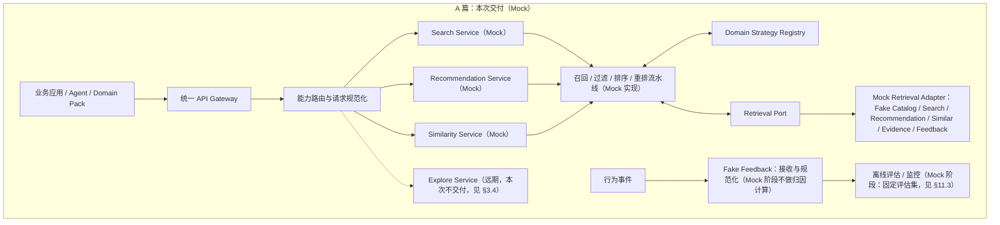
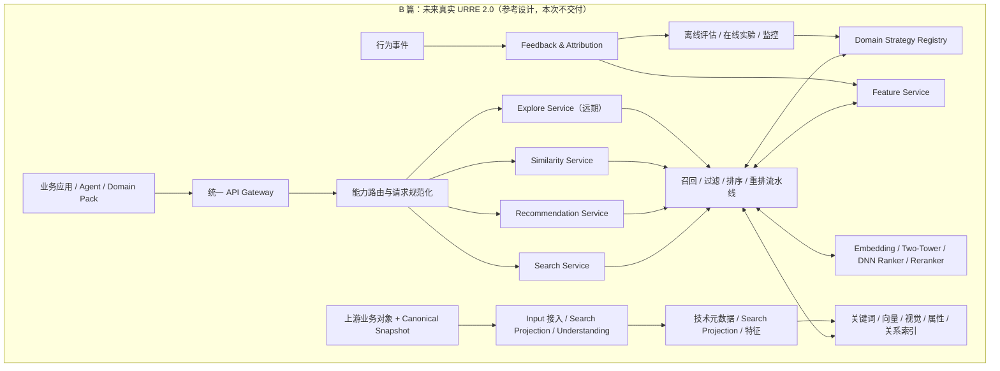
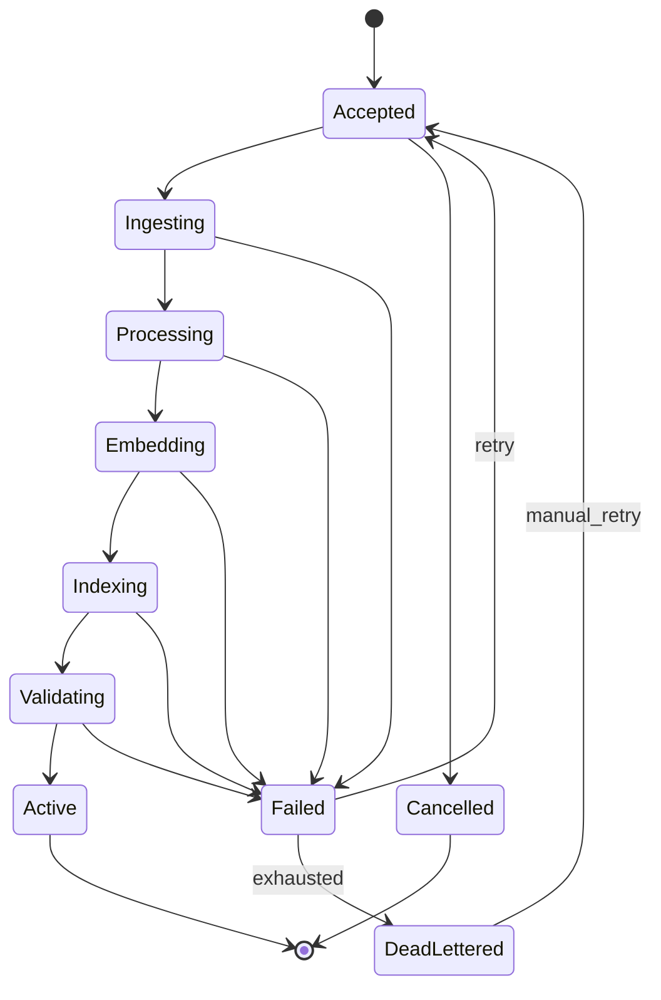
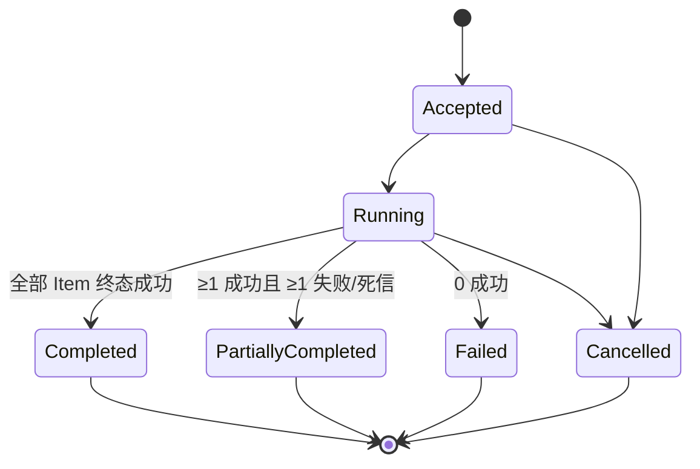

# URRE 通用检索推荐引擎架构设计文档更新版 v2

| 项目 | 内容 |
|---|---|
| 文档版本 | v2（更新版） |
| 基线文档 | `02_URRE架构设计.md`（498 行，主审对象） |
| 数据模型权威 | `urre/URRE数据与存储模型设计.md`（下称 DM，2395 行） |
| 配套源文档 | `01_架构设计总纲.md`、`03_Agent架构设计.md`、`04_开源项目源码解析与设计指南.md`、`urre/Query 语义理解.md`（下称 QU）、`urre/搜推排序.md`（下称“排序”） |
| 分析输入 | `urre-v2/work/A-数据存储模型分析.md`、`B-调用侧与排序分析.md`、`C-一致性审计问题清单.md` |
| 撰写日期 | 2026-11-16 |
| 状态 | **v2 冻结版**：本文的【v2 裁决】为实施依据；与源文档冲突时以本文为准，源文档本身不修改 |

> **本文的权威层级**：(1) 源文档原文事实（每条标注来源章节）；(2) 本文的【v2 裁决】（新作的裁决，一律标记并注明解决的问题编号）；(3) 04 与 QU、“排序”均为**调研建议，非实施权威**——引用时本文会明确标注，不得把它们的建议读成已决策的架构。04 卷首原文：“本文件是开源调研与借鉴附录，**不是**目标架构、阶段计划、API 或技术选型权威……与 `00` 架构设计总纲、`01` URRE、`02` Agent Runtime、`03` Video Domain Pack，以及 `implementation/` 冲突时，以后者为准。”（04 卷首；注：04 的旧编号 00–03 与实际文件名 01–04 错位一位，见附录 C）

---

## 0 修订说明与阅读指南

### 0.1 本文解决了什么

02 是 URRE 的主架构文档，但三组分析共同确认：02 与 DM、03、04 之间存在**定义冲突、缺失定义与失效引用**，按任一文档开工都会做出与另一文档不符的东西。本文的任务就是把这些冲突冻结为单一、可实施的基线。

- **A 组**（数据与存储模型精读）：16 项冲突 C1–C16、20 项缺口 G1–G20。
- **B 组**（调用侧与排序精读）：24 条不一致（A 契约类 8 条、B 排序类 10 条、C 反馈评估类 3 条、D 性能降级类 3 条）。
- **C 组**（跨文档一致性审计）：P0 8 条、P1 12 条、P2 9 条，共 29 条。

### 0.2 范围二分（全文总规则）

【v2 裁决】解决 P0-1、C 组附录方法。本文全文分为 **A 篇“本次交付：Mock Retrieval Adapter + Port + Schema”**与 **B 篇“未来真实 URRE 2.0 参考设计”**，每节开头标明所属篇章；未标明的节同时约束两篇（契约、术语、状态机定义等共享层）。判断规则：

- **A 篇**：Mock Retrieval Adapter、Retrieval Port、CandidateSet Schema v1.1、Fake Feedback、Domain Strategy Contract 注册表。**本次可实施、可验收**（验收见 §12）。
- **B 篇**：Ingest、Processing、Embedding、Indexing、ES、Qdrant、Kafka、Redis、Manifest 发布、真实模型（Two-Tower / DNN Ranker / Reranker 在线服务）。**本次不交付**，只作为未来替换 Mock 的接口参考；B 篇内容不得成为 Video Domain Agent 的开工前置（02 开篇交付约束；02 §10 开头；DM §1 前言、§2.2、§20.1）。
- 凡 B 篇的数值、模型名、配置参数，均为**占位示例值或待基准验证的初始值**，不是实测结论（见 §0.4）。

### 0.3 阅读指南

- 每节结构：**定义**（来源事实，标注章节）→ **来源/裁决**（引用的源文档或【v2 裁决】）→ **验收方法**（如何验证本节被正确实现）。关键冻结项另有三列登记表（定义 | 来源/裁决 | 验收方法）。
- 字段名、状态名、枚举值在全文唯一拼写：状态枚举统一首字母大写（PascalCase），与 DM §6 一致（【v2 裁决】解决 A-C15：DM §7.6 示例中的小写 `"status": "running"` 视为示例笔误，以 DM §6 为准）。
- 本文档不重复抄录 DM 的 DDL 全文、ES Mapping JSON 与 Qdrant Payload 全文；需要时指向 DM 对应章节（DM §9、§11、§12），并在 §10 给出摘要与对齐规则。

### 0.4 数值诚实声明

【v2 裁决】本文不虚构任何基准数字、模型名称、价格与延迟实测值。所有标为“初始值”的数字均为**待基准/实验验证的初始值**，必须按本节给出的验证方法验证后方可作为生产值；验证未通过时按 §11.5 的降级与复审规则处理，不得直接沿用。

| 初始值 | 验证方法 |
|---|---|
| RRF k=60（§6.2） | 离线评估集（§11.3）上与 k=30/100 对照，NDCG@K 与 Recall@K 不劣于基线 |
| 精排融合指数 1.5/1.0/0.8（§6.3） | 离线贝叶斯优化（搜推排序.md §五方法 1），主目标相关性、约束相关性降幅 ≤0.5% |
| MMR λ=0.7、探索比例 10%/20%（§6.4） | **已冻结为生产值**（2026-11-16 v2 裁决，见 §13.4 U-3）；Phase F 按 §11.4 流程验证，验证不通过时回退到探索 0% + λ=1.0（纯相关性）并复审 |
| QU 快链路 <3ms、慢链路 15–40ms、QU 总预算 10–20ms（§4.1） | 引用 QU 文档给出的工业界参考值，非本系统实测；上线前按 §11.2 分段埋点实测，超预算即触发 §11.5 降级 |
| SLO P95 ≤500ms、P99 ≤1000ms（§11.2） | v2 提案值，非实测；Mock 阶段只验证功能正确性，真实 URRE 上线前以压测校准 |
| DM §12.4 的 1024 维、Cosine、HNSW m=32、ef_construct=256、segment 4（§10.6） | 占位示例值；按 DM §12.4 原文“最终参数必须通过数据规模、召回率和延迟基准确认”，并按 DM §21 第 4、5 条验证 |
| Clip Boundary Accuracy 容差 ±500ms（§11.1） | 初始值；以人工标注集校准后冻结 |

### 0.5 C 组问题清单处置表（P0/P1/P2 全部 29 条）

| 编号 | 问题（一句话） | 处置 | 落点 |
|---|---|---|---|
| P0-1 | “本次不交付真实 URRE”与 §10 未来设计混排，§3 图把未交付组件画成现行架构 | **已解决**：全文 A/B 二分；§2 两张图分开画；§12 给出 Mock 检查表 | §0.2、§2、§12 |
| P0-2 | Qdrant 选型：02 已定默认 vs DM §21 待验证 | **已解决**：冻结 Qdrant 为默认选型；DM §21 第 1 条改述为“Qdrant 部署参数验证，非重新选型”；§12.4 数值标注占位示例 | §10.6、附录 A ADR-01 |
| P0-3 | CandidateSet 两套 Schema，无映射表 | **已解决**：以 DM §8.5/§9.7 为唯一权威 v1.1；02 §7 降格为简化示意；补 1.0/1.1 差集表 | §8 |
| P0-4 | Explore 四处说法不一，无 API 端点 | **已解决**：远期能力；概念与请求模型预留（DM §8.4），本次无 Tool/路由/端点/验收 | §1、§3.4 |
| P0-5 | Item/Batch/Manifest 状态机在 02 与 DM 中分歧 | **已解决**：以 DM §6 为唯一权威；补 Batch/Job 状态机（含 PartiallyCompleted 判定与取消级联） | §10.4 |
| P0-6 | 幂等键公式在 02 与 DM 中不同；content_version 分配权威只在一处 | **已解决**：以 DM §4.4 为准；补 snapshot_hash 覆盖断言；02 的 data-control-plane / source-uploads/finalize 映射为 DM 术语 | §10.3、附录 B |
| P0-7 | Qdrant Collection 命名规则在 02 与 DM 中不同 | **已解决**：以 DM §12.1 为准：`urre_{pool_id}_{domain}_{vector_space}_{model_major}` | §10.6 |
| P0-8 | 反馈事件命名在 02 与 DM 间无映射，归因无法落地 | **已解决**：冻结点分式枚举映射表；复用 03 §9.3 事件信封；必填归因字段冻结 | §9 |
| P1-1 | SearchPlan 只在 03 存在，02/DM 无定义；与 DM §8.1 预算冲突（100 vs 200） | **已解决**：v2 统一 SearchPlan 字段；candidate_budget 默认 200（DM §8.1）；03 的 100 是 Agent 侧截断值；子查询 RRF 合并、权重归一化 | §4.3、§7 |
| P1-2 | 召回通道与相似目标枚举未冻结，两处不一致 | **已解决**：冻结 11 路召回通道、5 类相似目标；metadata 并入 Attribute Recall（别名） | §5、§3.3 |
| P1-3 | RRF 融合与分数校准只有原则，没有方法 | **已解决**：召回合用 RRF（k=60）；校准方法为分通道单调映射 + 离线标定；定义 rrf-v1 / calibrated-v1 | §6.2、§6.3 |
| P1-4 | 指标只有名字，没有阈值；延迟预算各处取不同值 | **已解决**：§11.2 SLO 表（v2 提案值）；区分 deadline_ms（超时上限）与 SLO（目标值） | §11 |
| P1-5 | 规模与成本论证缺失；“现有 Java 服务/Kafka 链路”无依据 | **已解决**：§1.4 规模假设占位表（待填写）+ 选型复审触发条件；“现有”改述为“规划中” | §1.4、§2 |
| P1-6 | Agent 候选评估与 URRE 重排边界模糊，存在二次排序 | **已解决**：Agent 评估只产 selection_reason 与证据充分度标记，不改相对顺序；首选默认 rank 1，偏离须写理由 | §6.5、§7 |
| P1-7 | 文档编号体系错位：04 与 DM 沿用旧 00–03 编号 | **已解决**：全文统一实际文件名编号；旧→新对照表 | 附录 C |
| P1-8 | 02 的关键决策没有 ADR 编号 | **已解决**：补 URRE-ADR-01～09 | 附录 A |
| P1-9 | Mock 边界缺口：无 Fake Feedback；MVP 向量召回实现路径自相矛盾 | **已解决**：Mock 清单补 Fake Feedback；MVP 向量召回由 Mock Adapter 以固定 Fixture 模拟 | §1、§12 |
| P1-10 | 04 §15.2 声称“已写入 03”的三项设计经核查不存在或不成立 | **已解决**：改述为“调研建议、尚未确认写入”，逐条标注实际状态；不作为实施依据 | §0.5 本表、附录 C |
| P1-11 | 04 §15.1 把 Agent 能力映射到 AgentScope，与 03 的 Runtime 选型冲突 | **已解决**：映射表改述为“调研对照（非实现映射）”；关系已定：Acore Runtime SDK 是公司内部对 AgentScope Java 2.0 的封装，URRE 直接基于 Acore Runtime SDK 0.2.0 构建，不直连 AgentScope（用户 2026-11-16 决策，见 §13.4 U-2 与 URRE-ADR-09） | 附录 C、§13.4 |
| P1-12 | Search 与 Recommendation 独立目标函数与评估集只有要求，没有定义 | **已解决**：v2 定义各自目标函数、标签来源与评估集（04 §9.5 四类数据集，调研建议） | §6.1、§11.3 |
| P2-1 | 引用失效清单（README、implementation/*、旧编号文档等） | **已解决**：附录 C 引用登记表逐条改写 | 附录 C |
| P2-2 | 02 §7“与 03 对象层级对齐”指错文档 | **已解决**：改为与 01 §4 对齐；字段级权威见 DM §8.5 | §8、附录 C |
| P2-3 | 三处图片引用使用 Windows 绝对路径 | **已解决**：改为相对路径 `images/…`（与 04 的做法统一） | §2、附录 C |
| P2-4 | 02 的“本次门槛”无法在当前目录内验证 | **已解决**：§12 直接给出 Mock 可执行检查表，不再外包 | §12 |
| P2-5 | 术语不统一，无术语表 | **已解决**：附录 B 术语表；统一“真实 URRE 2.0”；Mock Adapter = FakeRetrievalGateway（DM §20.1） | 附录 B |
| P2-6 | 04 §15.1 ViMax 与 Director 映射存在以偏概全的表述 | **已解决**：ViMax 拆分为“真实素材检索”与“生成式视频”两行，后者标注“本次不交付”；自建 URRE 选型依据见 ADR-01 | 附录 C |
| P2-7 | chunk_id 是否为第三级对象未澄清 | **已解决**：Chunk / Projection 仅为索引内部分块单位，不是业务对象层级 | §10.6、附录 B |
| P2-8 | 01 §5 路由表与 03 §3.1 R0–R4 两套路由表述无映射 | **已解决**：§3.5 映射表（01 §5 每一行 → R0–R4），R1 补示例 | §3.5 |
| P2-9 | 04 §15.2“创作型推荐”示例与 03 分镜覆盖无对应验收 | **已解决**：6 项组合评估标准降级为“待立项的评估维度”；§11.2 补组合级指标占位定义 | §11.1 |

**处置统计**：P0 8/8 已解决；P1 12/12 已解决（P1-11 已完全解决：Acore 与 AgentScope 的关系由用户 2026-11-16 决策，见 §13.4 U-2 与 URRE-ADR-09）；P2 9/9 已解决。合计 29/29 已处置，无遗留未处置项。

### 0.6 A 组与 B 组问题处置总览

A 组 16 项冲突 C1–C16 与 20 项缺口 G1–G20、B 组 24 条不一致的逐条处置见**附录 C §C.3、§C.4**。总览结论：

- A 组 C1–C16：**16/16 已解决**（§8、§10）；G1–G20：**18/20 已解决**，2 项为**有条件延期**——G6（chunk_id 生成规则）与 G9（同步水位）延期至对应实施阶段准入条件（Phase C 与 Phase E），延期理由与冻结前置条件见 §10.7；G14（Explore max_distance 量纲）随 Explore 整体延期（远期能力，见 §3.4）。
- B 组 24 条：**24/24 已处置**（A-01～A-08、B-01～B-10、C-01～C-03、D-01～D-03），其中 B-02 的 LLM Listwise 与 B-10 的多样性算法/探索比例按任务冻结裁决落地（§6.4、§6.5），B-08 的两套意图路由按正交分层裁决（§4.4）。

### 0.7 关于 04 §15 的特别说明（P1-10、P1-11）

经 C 组核查（03 全文 grep 实测），04 §15.2 标题“已写入 `03` 的设计”所列三项**均不成立**：(1) Video / Clip 两级检索体系实际定义在 01 §4，03 全文零次出现 `entity_type`，无对象模型章节；(2) Creative Composition / Material Assignment Service——03 只有 MaterialAssignment Artifact 与阶段八分配步骤，无名为 Creative Composition 的服务，无 Composition Evaluator（03 全文零命中）；(3) IR 链（CreativeBrief → Storyboard → ClipPlan → MaterialAssignment → EditDecision → TimelineIR → Timeline Compiler）——03 中 EditDecision、TimelineIR、Timeline Compiler 均为零命中，03 实际只有 MediaActionPlan（03 §5.5）。本文将 §15.2 改述为“建议对照 03 核查的设计（尚未确认写入）”，三项的实际状态见附录 C；**04 §15 全章均为调研建议，非实施权威**。同理，04 §15.1 的 AgentScope 映射表改述为“调研对照（非实现映射）”；Acore 与 AgentScope 的关系已由用户 2026-11-16 明确：Acore Runtime SDK 是公司内部对 AgentScope Java 2.0 的封装，URRE 直接基于 Acore Runtime SDK 0.2.0 构建，不直连 AgentScope（§13.4 U-2；附录 A URRE-ADR-09）。03 §2.3 称 AgentScope“只是尚未验证的服务端实现可能”——该表述针对直接依赖 AgentScope 而言，Acore 封装层是本次的接入契约。

---

## 1 定位与范围二分

**本节所属**：A 篇与 B 篇共用（定位与范围定义）。

### 1.1 定位

- **定义**：URRE（Universal Retrieval & Recommendation Engine，通用检索推荐引擎）是多领域候选发现、相关性计算、排序与反馈优化平台（02 §1）。本次交付只使用其视频领域接口，并全部由 Mock Adapter 实现（02 §1）。
- **来源**：02 §1；01 §9（Mock 与未来真实 Adapter 必须共用 Port、CandidateSet Schema、Evidence Schema、错误码、事件关联键）。
- **验收方法**：§12 检查表 MK-01（Port 与 Schema 共用性）。

核心目标（02 §1，全文保留）：

1. 大规模对象的低延迟候选发现；
2. Search、Recommendation、Similarity、Explore 四类业务能力并列（Explore 的交付状态见 §3.4）；
3. 召回、过滤、特征、模型、排序、反馈等基础设施共享；
4. 领域语义、策略目标和业务规则由 Domain Pack 注入；
5. 结果可解释、可追溯、可评估；
6. 支持 Video 与 Clip 两级对象；Clip 是唯一片段层级（01 §4；02 §1、§6.1；DM §4.2 三处一致，见 C 组附录 A 第 1 条）。

### 1.2 边界

| 能力 | URRE 负责 | 上层 Agent / Domain 负责 |
|---|---|---|
| Query Understanding | 结构化查询能力、实体/属性解析服务 | 复杂意图澄清、业务目标判断 |
| Candidate Recall | 多路召回、候选合并 | 决定任务目标与召回意图 |
| Filtering | 权限、状态、硬约束执行 | 定义领域约束和用户授权 |
| Ranking | Query/Context 与 Item 相关性排序 | 定义业务目标、解释创作适配性 |
| Reranking | 多样性、新鲜度、业务策略重排 | 决定最终创作取舍 |
| Recommendation | 用户/任务/场景上下文推荐 | 提供当前任务、项目和创作阶段 |
| Feedback | 接收、规范化、聚合行为事件 | 采集真实业务结果并补充语义 |
| Evaluation | 离线、在线、实验与指标体系 | 定义领域成功标准 |

来源：02 §2（原文表，全文保留）。边界裁决：URRE **不承担**完整 Agent 任务规划，**不承载**领域创作执行（02 开篇边界）；真实视频入库、索引和推荐训练不在本次交付（01 §1“本次不交付”）；视频生成、媒体渲染、导出和 NLE 不在本次交付（01 §1）。

### 1.3 A 篇：本次交付（Mock）

【v2 裁决】解决 P0-1、P1-9。本次交付的全部内容：

- **Mock Retrieval Adapter**：Fake Video/Clip Catalog、Fake Search、Fake Recommendation、Fake Similar、Fake Evidence（01 §9 原有五项）+ **Fake Feedback**（【v2 裁决】新增，解决 P1-9：否则 02 §12.1 门槛第 3 条“反馈事件可关联请求、候选集和后续业务结果”在 Mock 阶段无法验收；Fake Feedback 在 Mock 阶段只记录事件、不做归因计算）。
- **Retrieval Port**：Search、Recommendation、Similar 三类能力的统一确定性入口（03 §1.1、§2.3；01 §5）。Direct 检索与 Agent 检索必须经过同一 Retrieval Port 和 CandidateSet 契约（03 §2.4、§3.1、§5.3 阶段六）。
- **CandidateSet Schema v1.1**（§8）与 Evidence Schema、错误码、事件关联键（01 §9）。
- **Domain Strategy Contract 注册表**（§7，注册与校验机制本次交付；真实策略内容随 B 篇填充）。

【v2 裁决】MVP 向量召回的实现路径（解决 P1-9）：02 §5.4 称“MVP 可以先使用关键词、向量召回和轻量排序”，02 §5.5 又称本次不启用 Qdrant、ES、Kafka——两者统一为：**MVP 的向量召回由 Mock Adapter 以固定 Fixture 模拟，不代表真实向量检索能力**；不得把 Mock 的向量召回结果当作真实向量检索的性能或质量证据。

Mock 必须支持的场景（01 §9）：稳定成功结果、零结果、超时、非法参数、重复候选。验收见 §12。

### 1.4 B 篇：未来真实 URRE 2.0 参考设计

B 篇包含 02 §10 全部内容（数据加工平面：Ingest / Processing / Embedding / Indexing / ES / Qdrant / Kafka）与 DM §1–§21（数据模型、DDL、存储字段模型、一致性、验收基线、实施顺序）。B 篇是**参考设计**，不是本次实施依据；B 篇的每项内容在 §13 实施路线中有明确的准入阶段，未到阶段前不得开工。

**规模假设（占位表，待填写）**【v2 裁决】解决 P1-5：02 §1 称“大规模”、§5.5 称“超大规模”均无数量级，无法证伪。本文不虚构数字，规模假设表如下，**全部格子待业务方填写、待基准验证**；任一假设被突破一个数量级时触发选型复审（ADR-01 复审条件）：

| 假设项 | 待填写值 | 用途 |
|---|---|---|
| 视频对象量级（Video / Clip） | 待填写 | 决定 ES 分片、Qdrant Collection 规模 |
| 在线 QPS 峰值（Search / Recommendation / Similarity） | 待填写 | 决定 SLO 与容量配置 |
| 向量总数与单向量维度来源模型 | 待填写（模型名待 DM §21 第 4 条验证） | 决定 Qdrant 容量与 HNSW 参数 |
| 存储量与单位请求成本上限 | 待填写 | 决定部署模式与预算 |

**术语修正**（解决 P1-5）：02 §5.5 的“与现有 Java 服务、Kafka 索引链路和 Elasticsearch 全文检索组合”中，“现有”二字作废，改述为“**规划中的** Java 服务与 Kafka 链路”——01、03、DM 中均无 Java 服务与 Kafka 链路的现状描述，该前提未经证实。

---

## 2 总体架构

**本节所属**：A 篇（图 2-1）与 B 篇（图 2-2）各一；文字说明共用。

### 2.1 本次交付架构（A 篇）



- **定义**：A 篇架构只包含 Mock Adapter、Retrieval Port、CandidateSet Schema v1.1 与注册表；不包含任何真实索引、模型服务与加工平面（02 开篇交付约束；02 §5.5“本次交付不启用”；02 §10 开头）。
- **来源/裁决**：02 §3 的 mermaid 图原为“当前架构依据”，把未交付组件画成现行组件（P0-1）；本文将其拆为图 2-1（A 篇）与图 2-2（B 篇），并用虚线标出远期组件。
- **验收方法**：§12 检查表 MK-02（Mock 架构无真实依赖：断开 ES/Qdrant/Kafka 后 Mock 验收仍全部通过）。

### 2.2 未来目标架构（B 篇）



- **定义**：B 篇架构即 02 §3 原图（逻辑模块不要求物理服务一一对应；高频请求链路应尽量短，离线训练、索引构建和复杂内容理解不进入在线请求关键路径；四类能力在路由后并列进入同一类流水线；过滤层中的租户、对象状态和项目权限硬约束必须在排序与重排之前生效——以上均为 02 §3 原文）。
- **来源**：02 §3；DM §3（接入区 → 加工区 → 索引区 → 发布区；在线查询只读 Active Manifest，DM §2.3、§3）。
- **验收方法**：B 篇无本次验收；其验收见 DM §17（真实 URRE 验收基线），在 §13 Phase A–F 准出条件中引用。

### 2.3 架构原则（两篇共用）

1. 硬约束（租户、对象状态、项目权限、用户必选条件、领域硬规则）必须在排序与重排之前生效，且不能被高相关性分数抵消（02 §5.2；02 §3）。
2. 高频 Search / Recommend 不依赖 LLM 才能完成（02 §11）。
3. 召回通道可独立降级，模型可替换（02 §11）。
4. 支持策略、特征、模型和索引版本追踪；结果能追溯到召回来源和证据；领域策略异常不影响其他领域（02 §11）。
5. 支持限流、超时、熔断、缓存和候选上限；在线服务与离线训练/索引任务资源隔离（02 §11）。
6. 图片引用修正（解决 P2-3）：02 §3、§10 的图片引用原为 `C:\Users\Administrator\Desktop\search-rec-docs\images\…` 绝对路径，在仓库内失效；本文统一为相对路径 `images/URRE 与 Agent Runtime 统一架构图.png` 与 `images/原材料智能处理与检索全链路流程.png`（与 04 使用相对路径 `images/shared-chat/…` 的做法统一；对应图片实测存在于 `images/` 下）。

---

## 3 四类能力

**本节所属**：A 篇（Search、Recommendation、Similarity）；Explore 为 B 篇远期能力（§3.4）。

### 3.1 Search（A 篇）

- **定义**：输入 Domain、Query、Filters、Scope、User/Tenant Context、Pagination（02 §4.1）。
- **链路**（02 §4.1）：(1) Query 规范化与结构化；(2) 领域实体与属性识别；(3) 选择关键词、语义、视觉、属性、关系等召回通道；(4) 候选合并与去重；(5) 权限和硬约束过滤；(6) 相关性排序；(7) 多样性、新鲜度等重排；(8) 返回结果与证据。
- **调用入口**：03 §5.2 的 `search_video_materials` Tool（输入 SearchPlan，输出 CandidateSet Ref，Scope `video.material.search` / L0）；Direct Search 走 Direct API，不启动 Agent（03 §1.3 P01、§3.1 R0）。
- **验收方法**：§12 检查表 MK-03（Search 语义独立验收）。

### 3.2 Recommendation（A 篇）

- **定义**：输入 Domain、User、Scene、Task Context、Project Context、Current State、Constraints（02 §4.2）。
- **召回来源**（02 §4.2）：用户长期兴趣与近期行为；当前任务与项目上下文；内容相似和协同信号；热门、趋势、新鲜内容；领域规则和业务机会；探索性候选。
- **目标函数约束**（02 §4.2 原文）：“排序不能简单等于‘预测点击率’。需要根据场景考虑采用率、任务帮助程度、内容质量、多样性、新颖性、业务价值和长期满意度。”目标函数定义见 §6.1。
- **调用入口**：03 §5.2 的 `recommend_video_materials` Tool（输入 Recommendation Context，输出 CandidateSet Ref，Scope `video.material.recommend` / L0）。【v2 裁决】解决 B-A-06：Recommendation Context 的字段以 02 §4.2 的输入清单为准，统一为 `{domain, user_id, scene_id, task_context, project_context, current_state, constraints, top_k}`；04 §2.6.3 示例 JSON 中的 `strategy{content_relevance, project_fit, user_preference, diversity, freshness}` 权重（0.45/0.25/0.15/0.10/0.05）为**调研示例，非实施权威**，不得直接作为请求字段——策略权重属于 Domain Pack 注册策略（02 §6），不由调用方在请求体中传入。
- **三种策略**（04 §4.5，**调研建议，非实施权威**）：A. Search-augmented Recommendation（用户有明确搜索词）；B. Task-driven Recommendation（用户有明确创作项目）；C. Proactive Recommendation（用户没有明确查询）。策略选择规则见 §4.4。
- **验收方法**：§12 检查表 MK-04（Recommendation 语义独立验收；与 Search 用不同评估集，见 §11.3）。

### 3.3 Similarity（A 篇）

- **定义**：支持语义相似、视觉相似、属性相似、行为相似、关系相似；调用方应声明相似目标，避免将“画面相似”误解为“主题相似”（02 §4.3）。
- **调用入口**：03 §5.2 的 `find_similar_materials` Tool（输入 Seed + `similarity_targets`，输出 CandidateSet Ref，Scope `video.material.similar` / L0）。
- **相似目标枚举**【v2 裁决】解决 P1-2、B-A-07：`similarity_targets` 取值冻结为 `["semantic", "visual", "attribute", "behavioral", "relational"]`（即 02 §4.3 的五类）；DM §8.3 示例 `["semantic", "visual"]` 为该枚举的子集。Seed 类型冻结为 `video_id` / `clip_id` / 图像（QU §五的图 Seed 处理：YOLOv8/Grounding DINO + SAM 2 主体检测、去水印/黑边）；文本 Seed 不走 Similarity，改走 Search。
- **阈值与 top-k**【v2 裁决】：相似度阈值与 top-k 不在 v2 冻结——相似度阈值待离线标定（与 §6.3 校准方法同批验证），top-k 默认取精排输出规模（§6.1 的 100）再经重排截断至 50；未验证前不得对外承诺阈值。
- **验收方法**：§12 检查表 MK-05（Similar 语义独立验收；Seed 为 Clip 时返回结果须含同一 Video 的其他 Clip 候选——验证 Clip 级相似非 Video 级相似）。

### 3.4 Explore（B 篇远期能力，本次不交付）

【v2 裁决】解决 P0-4、B-A-02：Explore 的单一状态冻结为——**远期能力：概念与请求模型已预留（DM §8.4），本次不交付、无 Tool、无路由、无端点、无验收**。

- **来源事实**：02 §1/§4.4 把 Explore 列为与 Search、Recommendation、Similarity 并列的“一等业务能力”（定义见下）；02 §12.1 第 1 条明确 Explore 不进入本次交付门槛；01 §5 请求路由表与 §9 Mock 清单均无 Explore；03 的 8 个冻结 Tool 与 R0–R4 路由中无任何 Explore 入口（03 全文“Explore”零命中，C 组 grep 实测）；DM §8.4 称“Explore 不属于当前 Video Domain Agent 交付，但数据模型预留”，给出了 ExploreRequest，但 DM §8 端点表（search / recommend / similar / feedback / evidence）中没有 `/retrieval/explore`。
- **概念定义**（02 §4.4 原文）：“主动扩展候选空间，强调新颖性、覆盖度、长尾发现和潜在机会。探索结果应与常规相关性结果区分标记，避免把低相关候选伪装成高相关结果。”
- **预留的请求模型**（DM §8.4 原文）：
  ```json
  {
    "schema_version": "1.0",
    "domain": "video",
    "context": {"project_id": "project_001", "task_id": "task_001"},
    "exploration": {"goal": "coverage", "novelty_weight": 0.3, "max_distance": 0.45},
    "filters": {},
    "limit": 20
  }
  ```
  其中 `exploration.goal` 的枚举值、`novelty_weight` 与 `max_distance` 的量纲在 DM 中均未定义；【v2 裁决】`max_distance` 的量纲冻结为 **Cosine 距离（1 − cosine similarity），取值范围 [0, 2]**，示例值 0.45 为 DM 示例值、非阈值（解决 A-G14）；`goal` 枚举与 `novelty_weight` 的标定随 Explore 立项时冻结，本次不定义。
- **区分标记规则**（DM §8.4 原文）：“Explore 结果必须在 CandidateSet 中显式标记探索原因，不能伪装成高相关性 Search 结果。”v2 落点：CandidateSet 的 `is_explore` 字段（§8.1）即为该标记；Explore 候选进入重排时计入探索比例（§6.4），不参与相关性排序的分数竞争。
- **验收方法**：本次无验收；Explore 立项时以本节 + DM §8.4 为输入另立 ADR，不得在无 ADR 的情况下把探索候选混入 Search/Recommendation 结果。

### 3.5 路由映射（01 §5 ↔ 03 §3.1 R0–R4）

【v2 裁决】解决 P2-8：

| 01 §5 请求 | 路径 | 对应 03 §3.1 路由分级 |
|---|---|---|
| 明确关键词/条件搜索 | Direct Search | R0（单一、明确、无需规划和审批的检索） |
| 按 Seed Video/Clip 找相似 | Direct Similar | R0（已有 Seed 的相似检索） |
| 有项目上下文的主动推荐 | Direct Recommendation | R0（为一个商品推荐视频素材） |
| 多轮澄清、创作规划、素材组合 | Agent Workflow | R2（单领域多步规划）或 R3（可拆分独立子任务并行） |
| 替换单个计划 Clip | Agent Workflow | **R1**（单领域 1–2 步）【v2 裁决】补 R1 示例：替换单个计划 Clip 只需一次检索 + 一次分配，走 R1，不升 R2 |
| 同时要求商品、视频、文案、落地页或广告草稿 | CreativeProductionWorkflow | R4（跨域 / L3 / L4 / 审批，走 Workflow + 人工审批） |

路由规则（01 §5；03 §3.1）：Router 先做规则和 Schema 判断；低置信度时才调用小模型；`route_confidence` 低于 0.6 时升一级并记录 `route_reason`（03 §3.1）；Direct 与 Agent 路径必须返回相同 CandidateSet 契约；是否启动 Agent 通过 `handled_by=fast_path|agent` 可观测（01 §5）。

---

## 4 QU 与流水线

**本节所属**：A 篇（QU 结构与流水线形状）；QU 的模型选型细节为 B 篇（真实模型上线时冻结）。

### 4.1 Query 理解（QU）：5 通用模块 + 5 视频模块 + 快慢双链路

【v2 裁决】解决 B 组 §2.2 落点：QU 文档给出的工业级方案整体落入 02 §5 的 UNDER（Query / Context 理解）节点；02 §4.1 Search 链路第 1–2 步只写了“Query 规范化与结构化”“领域实体与属性识别”，本文将其展开为下表。QU 文档本身为通用工业界方案描述（**调研参考，非 URRE 自身实测**），模块划分被采纳为 v2 结构，模型选型（如 MacBERT/BART、CLIP/SigLIP、YOLOv8 等）为**引用 QU 文档的提及，非 v2 的模型选型决策**——真实模型选型按 DM §21 第 4 条在实施前基准验证。

**5 个通用模块**（QU §一–§五）：

| 模块 | 内容要点 | 在流水线中的落点 |
|---|---|---|
| 一、预处理与纠错 | 繁简/全半角/大小写归一化、去停用词；编辑距离 + N-gram + 拼音混淆集；MacBERT/BART 纠错 | 02 §5 NORM 节点下新增；02 原文完全未提纠错 |
| 二、分词与词权重 | 多粒度分词（精确模式保召回 / 搜索模式保实体）；核心词 vs 修饰词权重（示例：“手机壳”0.9、“华为 Mate60”0.7、“硅胶”0.4——QU 示例值，非 URRE 权重）；BERT+BiLSTM+CRF 输出 Token 重要性 0~1 | 02 §5.1 Keyword Recall 的前置输入 |
| 三、NER 与结构化解析 | 槽位抽取（价格区间/品牌/性别/功能/品类）+ 实体链接归一化（如“钩子”→ Nike、`200左右` → `[150,250]`）；BERT-CRF / GlobalPointer / 蒸馏 Qwen 输出 JSON 槽位 | 02 §4.1 步骤 2 的展开；对应 03 ClipRequirement 的 `hard_constraints`（如 `aspect_ratio: 9:16`）与 `soft_preferences`（03 §5.3 阶段四） |
| 四、意图识别与类目预测 | Query-to-Category Top-K 及概率；意图路由（导航型 / 问答型 / 交易型）；TextCNN/FastText + BERT 多标签 | 对应 03 §5.3 阶段一 Intent Understanding；与 03 R0–R4 的衔接见 §4.4 |
| 五、改写与语义扩展 | 同义词/上下位词、双塔向量改写（BGE/E5）、LLM 生成式改写（复杂 Query 生成 3~5 个标准搜索词多路并发） | 对应 03 §5.3 阶段五 SearchPlan 的 `sub_queries`（见 §4.3） |

**5 个视频特有模块**（QU 视频一–视频五）：

| 模块 | 内容要点 | 落点 |
|---|---|---|
| 视频一、跨模态联合向量编码 | CLIP/SigLIP/BLIP-2/InternVideo2；文搜图/文搜视频双塔；CIR（参考图 + 修改文本 → BLIP-2 Q-Former / VLM 融合编码） | 02 §5.1 Semantic/Visual Recall 的模型选型依据；02 §5.4 Embedding Service 行 |
| 视频二、视觉与时空要素拆解 | 静态槽位（主体/颜色/材质/纹理/款式/构图风格）与动态槽位（动作/事件、运镜、慢动作、BGM 意图） | 03 ClipRequirement 的 `visual_goal / soft_preferences / evidence_requirements` 的来源 |
| 视频三、抽象意境的视觉画面翻译 | VLM/LLM 把“氛围感/高级感/松弛感”翻译成客观视觉元素组合再编码 | 改写模块的视频特化，与 SearchPlan 生成规则一并冻结（§4.3） |
| 视频四、多维度索引对齐 | 按 Query 意图路由到 4 路索引：画面视觉流（关键帧）、ASR 流、OCR 流、音频指纹/BGM 流；教程类重 ASR/OCR、美学类重 Visual | 落入 02 §5.1 的新增通道：Transcript Recall 与 Audio Recall（§5） |
| 视频五、以图搜图 Query 理解 | YOLOv8/Grounding DINO + SAM 2 主体检测抠图、质量评估与去水印/黑边/摩尔纹 | 02 §4.3 Similarity 的图 Seed 输入处理（§3.3） |

**快慢双链路**（QU §六；数字为 QU 文档给出的工业界参考值，**非本系统实测**）：

| 链路 | 覆盖流量 | 核心技术手段 | 响应耗时（QU 参考值） |
|---|---|---|---|
| 快链路（Cache + 规则/小模型） | 80% 头部高频 Query | 离线全量预计算存入 Redis 缓存 + 词典树（Trie）+ 量化后的 TinyBERT/FastText | <3ms |
| 慢链路（深度模型 / 轻量化 LLM） | 20% 长尾、复杂口语 Query | 实时调用 GlobalPointer NER + 蒸馏版 Qwen/BERT 实时改写与解析（结果异步写回缓存） | 15~40ms |
| **QU 阶段总预算** | — | — | **10~20ms** |

- **验收方法**：§11.2 分段埋点实测 QU 耗时；快链路占比、慢链路占比、QU 总耗时三项指标进入 §11.2 的 SLO 附表；超预算即触发 §11.5 降级（QU 降级为仅快链路 + 规则解析）。

### 4.2 通用处理流水线（含粗排）


- **来源**：02 §5 流程图（原文九节点）；【v2 裁决】解决 B-B-01：在 FILTER 与 RANK 之间**新增粗排节点 PRE**——此前 02 §5 与“排序”文档均无粗排节点，千级 → 百级无 owner、无模型。
- **漏斗规模冻结**【v2 裁决】解决 B-B-01：召回 **1000** → 粗排 **200** → 精排 **100** → 重排 **50** → Agent shortlist **≤10/Clip**（03 §1.3 P09、§5.3 阶段六/阶段八）。每级规模的含义：召回 1000 为 11 通道原始候选去重后的上限；粗排 200 为进入精排的候选上限（与 DM §8.1 `recall.candidate_budget: 200`“进入排序前的候选上限”对齐，见 §4.3）；精排 100 为进入重排的候选上限；重排 50 为进入 CandidateSet 的候选上限；Agent shortlist ≤10 为 Agent 侧每计划 Clip 的处理上限（不是 URRE 预算）。
- **验收方法**：每级输出规模埋点（§11.2）；任一级输出为空且上游非空时记为漏斗断裂告警。

### 4.3 SearchPlan（统一字段）

【v2 裁决】解决 P1-1、B-A-03、B-B-06：SearchPlan 的定义以 **03 §5.3 阶段五**为准（03 是唯一定义 SearchPlan 的文档；02 与 DM 全文零次出现 SearchPlan）；04 §4.4 的 SearchPlan 示例（只有 `query / sub_queries[{query, clip_type, weight}] / filters{orientation}`，权重 0.35/0.35/0.30）为**调研建议，非实施权威**，不作为字段依据。

**统一字段表**（字段名与示例值引自 03 §5.3 阶段五示例；03 未给任何字段标注默认值，示例值不得当作默认值——以下“v2 默认值”栏为【v2 裁决】新增）：

| 字段 | 类型 | 03 示例值 | v2 默认值 / 规则 | 说明 |
|---|---|---|---|---|
| `schema_version` | string | `"1.0"` | `"1.0"` | SearchPlan 契约版本 |
| `plan_id` | string | `"search_plan_001"` | 必填，由 Agent 生成 |  |
| `domain` | string | `"video"` | `"video"` | 本期固定 video |
| `target_levels` | string[] | `["video", "clip"]` | `["video", "clip"]` | 对象层级（01 §4） |
| `semantic_query` | string | `"产品使用前后明显变化的近景展示"` | 必填 | 语义查询 |
| `sub_queries` | array | 3 条（见下） | 选填 | 子查询（QU §五改写产物） |
| `hard_filters` | object | `{"aspect_ratio": "9:16"}` | 选填 | 硬过滤；字段必须在 Domain Schema 注册，否则 Retrieval Port 拒绝（DM §8.1；P1-6） |
| `soft_preferences` | object | （03 示例缺失此字段，但 §5.3 文字描述列有“软偏好”） | 选填 | 【v2 裁决】补为可选字段；可降级偏好（DM §8.1 同名字段） |
| `recall_channels` | string[] | `["keyword", "semantic", "metadata"]` | 策略默认通道 | 通道名按 §5 的 11 路枚举；示例中的 `"metadata"` 按 §5.2 并入 Attribute Recall（别名） |
| `candidate_budget` | integer | `100` | **200** | 【v2 裁决】默认值 200，与 DM §8.1 `recall.candidate_budget: 200` 对齐；03 示例的 100 是 **Agent 侧截断值**（Agent 只取前 100 进入 shortlist 流程），不是 URRE 预算 |
| `max_latency_ms` | integer | `8000` | `8000` | 整个检索计划的预算（Agent 端到端计划预算，见 §11.2）；不是 QU 或任一单段的预算 |

**子查询规则**【v2 裁决】：

- `sub_queries[]` 每条含 `role` / `query` / `weight`；`role` 枚举冻结为 `["visual", "semantic", "scene"]`（03 §5.3 示例值）；04 §4.4 按 `clip_type`（close_up/wide/medium）划分子查询的做法不采用——clip_type 是候选属性，不是子查询角色。
- 权重**须归一化后使用**（归一化到合计 1.0；03 示例 0.5/0.3/0.2 合计已为 1.0，但 03 未写明归一化要求）；未归一化的权重由 Retrieval Port 归一化后使用，并在 trace 中记录。
- 子查询合并用 **RRF**（§6.2），权重即归一化后的 `sub_queries[].weight`；合并后再去重、重排（04 §4.4“Search Service 并行处理子查询、合并候选、去重和重排”，调研建议，与本裁决一致）。
- SearchPlan 进入 URRE 的方式【v2 裁决】：SearchPlan 是 Agent 内部规划对象（03 §5.3 原文：“SearchPlan 只作为 Agent Tool 输入，不是独立公开的第二套 Search API”）；进入 URRE 前由 Retrieval Port 翻译为 DM §8.1 SearchRequest（`semantic_query` → `query`；`hard_filters` → `filters`；`recall_channels` → `recall.channels`；`candidate_budget` → `recall.candidate_budget`；`max_latency_ms` → `deadline_ms` 的一部分，见 §11.2）；翻译规则由 Retrieval Port 实现并单测覆盖。

### 4.4 意图路由的两套表述（正交分层）

【v2 裁决】解决 B-A-08：03 的 R0–R4 路由与 QU 的意图路由是**两套正交的路由**，不得互相替代：

- **QU 意图路由**（QU §四：导航型 / 问答型 / 交易型 + 类目预测 Top-K）：属于 **URRE 内部分类**，用于通道选择（§5）与 QU 模块分流；不决定是否启动 Agent。
- **03 R0–R4 路由**（03 §3.1）：属于 **Agent/Workflow 路由**，决定请求走 Direct API、轻量 Agent、单主 Agent、并行 Agent 还是 Workflow + 人工审批；映射表见 §3.5。
- **衔接点**：R0 Direct 路径直接进入 URRE Search，QU 在 URRE 内做意图分类；R1–R4 路径由 Agent 生成 SearchPlan 后进入 Retrieval Port，QU 同样在 URRE 内执行。
- **推荐策略 A/B/C 选择规则**（04 §4.5，调研建议；【v2 裁决】冻结为路由规则）：`task_type=recommend` 时，有明确搜索词 → A（Search-augmented）；有明确创作项目 → B（Task-driven）；无查询 → C（Proactive）；三者互斥，按此顺序判定。

---

## 5 召回通道（11 路）

**本节所属**：A 篇（通道枚举与去重规则）；各通道的真实实现为 B 篇。

### 5.1 通道枚举（冻结）

【v2 裁决】解决 P1-2、B-B-04、B-B-05：召回通道枚举冻结为以下 **11 路**（02 §5.1 的 9 路 + 新增 2 路）。通道名是 Domain Strategy Contract（02 §6）的 Recall Strategy IDs 与监控口径（02 §5.1 要求每通道独立超时、候选上限、覆盖监控和版本号）的键，全文只能使用下表拼写。

| # | 通道（冻结名） | 来源 | 定义 |
|---|---|---|---|
| 1 | Keyword Recall | 02 §5.1 | 精确词项和倒排检索（BM25；ES 承担，02 §5.5） |
| 2 | Semantic Recall | 02 §5.1 | 文本语义向量（Qdrant 承担，02 §5.5） |
| 3 | Visual Recall | 02 §5.1 | 图像/视频帧视觉语义（Qdrant 承担） |
| 4 | Attribute Recall | 02 §5.1 | 结构化属性和范围过滤 |
| 5 | Collaborative Recall | 02 §5.1 | 用户/物品协同信号 |
| 6 | Context Recall | 02 §5.1 | 任务、项目和场景上下文 |
| 7 | Relation Recall | 02 §5.1 | 实体关系与知识图谱 |
| 8 | Trend Recall | 02 §5.1 | 趋势、热门和新鲜度（【v2 裁决】定义：以热度/新鲜度信号排序的通道；热度公式待离线标定，本次只冻结通道存在与信号来源，不冻结公式） |
| 9 | Exploration Recall | 02 §5.1 | 受控探索与长尾候选（远期能力；本次只保留通道位，不交付探索召回逻辑，见 §3.4） |
| 10 | Transcript Recall | 【v2 裁决】新增 | ASR/OCR 文本检索（04 §4.4“OCR / ASR 文本检索”；QU 视频四：语音转写流、画面文字流）。教程/口播类 Query 提高本通道权重，美学类降低（QU §四意图路由策略） |
| 11 | Audio Recall | 【v2 裁决】新增 | 音频指纹/BGM 检索（QU 视频四：音频指纹流）。搜 BGM、音效、台词旋律时启用 |

**排除项**【v2 裁决】：04 §4.4 的“外部互联网搜索”**不在** 11 路枚举内——02 的 Domain Pack 与租户边界是否允许外网召回未定（B-B-04），后续 ADR 决策前不得实现；04 §4.4 的“用户指定素材库或项目范围”是 Scope/过滤条件（DM §8.1 `filters`），不是召回通道；04 §4.4 的“Clip 级/时间片段级检索”是对象粒度（01 §4），不是通道。

**命名统一**【v2 裁决】解决 P1-2、B-A-04、A-G12：

- 03 §5.3 示例的 `recall_channels: ["metadata"]` 中的 `"metadata"` **并入 Attribute Recall**，记为别名（`metadata` ≡ Attribute Recall），DM §8.1 示例中的 `"metadata"` 通道值同此处理；DM §8.5 `score_breakdown` 中的 `"metadata"` 键**保留 DM 原名**（不得改写 DM 字段），其值即 Attribute 通道分（见 §8.2）。
- 03 §5.3 示例缺 Visual 通道（B §2.3 表），按本节枚举补齐——示例缺失不代表通道不存在。
- `filters.tags_any` 等过滤操作符不在本节定义，见 §7.2 操作符注册表。

**通道运行规则**（02 §5.1 原文）：每个召回通道应有独立的超时、候选上限、覆盖监控和版本号；通道失败应可降级，不应导致整条服务链路不可用。降级表见 §11.5。

### 5.2 合并与去重

- **合并规则**（02 §5.5 原文）：“关键词与向量分开召回。BM25、中文分词、聚合和复杂全文查询由 Elasticsearch 承担；Qdrant 负责文本向量、视觉向量和相似检索。两类结果在 URRE 内合并、去重和 RRF 融合，不在不同存储之间直接比较原始分数。”DM §12.5 第 6 步同此（“与 ES 结果进行 RRF 或校准后融合”；“Qdrant 原始相似度不能跨模型直接与 ES BM25 分数相加”）。
- **去重键**【v2 裁决】解决 B-B-03：去重键定义为 **(tenant_id, entity_type, entity_id)**。规则：
  - 同一 Video 的多个 Clip **不算重复**（entity_id 不同）；
  - 同一 Clip 的不同时间区间（`time_range` 重叠）**算重复**，按**最大区间合并**：合并后 `start_ms = min(各区间 start_ms)`、`end_ms = max(各区间 end_ms)`，`evidence_refs` 取并集，`score` 取最大值，`recall_channels` 取并集；
  - 跨通道同一 entity 的分数合并用 RRF（§6.2），证据合并按上述并集规则。
- **验收方法**：§12 检查表 MK-06（重复候选场景：同一 Clip 以重叠区间从两通道返回时，CandidateSet 中只出现一次且区间为并集）。

### 5.3 冻结项登记（§5）

| 冻结项 | 定义 | 来源/裁决 | 验收方法 |
|---|---|---|---|
| 11 路召回通道枚举 | 见 §5.1 表 | 02 §5.1（9 路）+【v2 裁决】新增 Transcript/Audio | Mock 验收：每通道有独立开关与版本号；通道名拼写与 §5.1 表逐字一致 |
| Attribute Recall 别名 metadata | `metadata` ≡ Attribute Recall | 【v2 裁决】解决 P1-2 | SearchPlan 与 DM §8.1 示例中的 `"metadata"` 被正确解析为 Attribute 通道 |
| 去重键 (tenant_id, entity_type, entity_id) | 见 §5.2 | 【v2 裁决】解决 B-B-03 | MK-06 |

---

## 6 排序与重排

**本节所属**：A 篇（漏斗、融合、校准、目标函数、Agent 边界）；模型本身（Two-Tower / DNN Ranker / Cross-Encoder / Reranker 在线服务）为 B 篇。

### 6.1 漏斗与模型分工

**模型分工**（02 §5.4 原文表，全文保留）：

| 模型能力 | 主要阶段 | 输入 | 输出与边界 |
|---|---|---|---|
| Embedding Service | 语义索引、召回、相似发现 | Query、Video/Clip 文本、图像、多模态特征 | 向量表示；不直接决定最终业务排序 |
| Two-Tower | 大规模候选召回 | 用户/上下文塔、对象塔及其特征 | 用户与对象的低维匹配表示；用于高效候选发现，不代替重排 |
| DNN Ranker | 主排序或精排 | Query/Context、候选特征、交叉特征和业务约束特征 | 相关性或任务适配分数；不改变权限硬过滤结果 |
| Reranker | 小候选集重排 | 排序后的候选、证据、多样性与业务目标 | 最终重排结果；不负责全量召回 |

**漏斗**（【v2 裁决】解决 B-B-01、B-B-02；规模见 §4.2）：

| 阶段 | 候选规模 | 模型 | 说明 |
|---|---|---|---|
| 召回 | ≤1000 | 11 路通道（§5）+ RRF 合并（§6.2） | 原始候选去重后上限 |
| 粗排 | 1000 → 200 | **Two-Tower 打分 + 截断即粗排** | 【v2 裁决】粗排存在，且 owner 明确为 Two-Tower 打分 + 按分截断；不新增轻量预排模型 |
| 精排 | 200 → 100 | **DNN Ranker**；Cross-Encoder 归精排层 | 【v2 裁决】术语统一（见 §6.5）：“排序”文档中的 BGE-Reranker / Cross-Encoder 是精排模型，只能用于前几十~几百条（百毫秒级，排序 §对比表）；ColBERT 的 Token 级延迟交互（20~50ms）在精排层按需启用 |
| 重排 | 100 → 50 | **Reranker = 多样性 / 新鲜度 / 探索比例 / 业务策略层** | 02 §5.3；集合级公式落点见 §6.4 |
| Agent shortlist | ≤10 / Clip | Agent 分项评估（不改分，见 §6.5） | 03 §5.3 阶段六~八 |

**模型层边界**（02 §5.4 原文）：Search 与 Recommendation 可以共享 Embedding、训练和推理基础设施，但保留独立目标、标签、模型版本和评估集；Two-Tower 的召回分数不能未经校准直接作为 DNN 或 Reranker 的最终业务分数；DNN 输出必须可追溯到特征版本、模型版本和策略版本；任何模型分数都不能绕过租户、权限和项目范围；将现有分数直接相加前必须完成校准；模型缺失、超时或降级时应回退到规则或轻量排序基线（基线见 §11.5）。

**目标函数**【v2 裁决】解决 P1-12：Search 与 Recommendation 各一独立目标函数，独立标签与评估集（02 §5.3、DM §8 开头均要求“不得共享同一套目标函数和评估集”，但均未定义；本节补定义）：

| 能力 | 目标变量（优化目标） | 标签来源（反馈事件映射，见 §9） | 评估集 |
|---|---|---|---|
| Search | 相关性 S_rel（主）+ 任务满足度 | 点击、有效预览、下载、采用（`*.clicked / *.previewed / clip.downloaded / clip.adopted`） | 04 §9.5 数据集 (1) 查询—相关片段标注集（调研建议） |
| Recommendation | 集合级 Score(S)（§6.4）+ 采用率 | 采用、加入时间线、实际使用、完成导出（`clip.adopted / clip.timeline_added / clip.used / clip.exported`） | 04 §9.5 数据集 (2)(3) 用户—素材行为序列、brief—分镜—素材组合标注集（调研建议） |

### 6.2 召回合用 RRF（k=60）

- **定义**：`Score_RRF(d) = Σ_i w_i / (k + rank_i(d))`，`k = 60`（搜推排序.md“多 score 融合公式”之 3：k=60 为工业界标准经验值；适用场景正是“分数不在同一量纲时只看排名”，即 BM25（0~35）+ 向量余弦（-1~1）+ 精排 Logit（-10~+10）的合并）。02 §5.5 已采纳 RRF 用于 ES+Qdrant 召回合并且 k=60 有据可查（B-B-09）。
- **规则**：`w_i` 默认 1；子查询合并时 `w_i` 为归一化后的子查询权重（§4.3）；RRF 只用于召回合用与子查询合并，**不应推广为精排融合的默认公式**（会丢失分数的绝对信息，如相关性是否过线，B-B-09）。
- **版本命名**【v2 裁决】解决 P1-3、A-G1：DM §8.5 示例中的 `score_normalization_version: "rrf-v1"` 定义为：RRF 融合、k=60、权重默认 1（子查询合并时权重为归一化子查询权重）；另定义 `"calibrated-v1"` 为 §6.3 的校准后分数融合版本。`score_normalization_version` 的取值注册表即此二值，新增版本须经 ADR。
- **验收方法**：离线评估集上 RRF 与 k=30/100 对照（§0.4）；`score_normalization_version` 字段值只能取注册表内值（Schema 校验）。

### 6.3 精排融合：乘性幂次骨架 + 校准

【v2 裁决】解决 B-B-09、P1-3。精排融合公式骨架引自搜推排序.md“多 score 融合公式”之 1（乘性幂次加权，工业界最主流），经以下改造后用于 URRE：

```
Score = (S_rel)^1.5 × (p_CTR)^1.0 × (p_CVR)^0.8
```

- **改造点**：(1) 去掉价格因子 `(Price)^δ`——视频素材无价格因子；(2) `p_CTR / p_CVR` 只能作为分量之一（02 §4.2“排序不能简单等于预测点击率”；04 §9.3 附注“点击率不能单独代表推荐质量”，调研建议）；(3) 指数 1.5/1.0/0.8 为**待基准/实验验证的初始值**（搜推排序.md 给出的搜索场景示例值 α=1.5、β=1.0、γ=0.8），验证方法为离线贝叶斯优化（搜推排序.md §五方法 1），主目标相关性、约束相关性降幅 ≤0.5%；(4) 一票否决特性保留：相关性极低则总分趋近 0，与 03 §5.3 阶段七“不得用其他维度高分掩盖证据不足”方向一致；(5) 工程防坑：每个分数加平滑偏置 `b`（搜推排序.md 防坑技巧），防止极小值导致整体分数崩盘；偏置值随权重一并离线标定。
- **对数线性等价形式**（搜推排序.md 之 2，与乘性公式数学等价，数值稳定性更好，适合离线网格搜索/贝叶斯优化调参）：`Score = w_1·ln(S_rel+ε) + w_2·ln(p_CTR+ε) + w_3·ln(p_CVR+ε)`。两种形式任选其一实现，权重求解方法冻结为**离线贝叶斯优化**（默认；搜推排序.md §五方法 1；线上小流量 CEM/遗传算法与端到端 Meta-Ranker 为后续选项，不在 v2 冻结）。
- **校准方法**【v2 裁决】解决 P1-3、B-B-08：冻结为**分通道单调映射 + 离线标定**。即：各通道/模型分数先经各自的单调映射（Isotonic 或分桶映射，二选一在实现时冻结）拉到同一量纲，再进入 §6.3 公式；Two-Tower 分数未经校准不得作最终分（02 §5.4 原文禁令）。特征融合架构采用“两阶段特征解耦”（语义提分 + DCN-v2/DIN，10~20ms）为主流方案（搜推排序.md §二方案 1，调研参考）；防“统计特征霸占”手段为 Feature Dropout 与多任务 MMoE/PLE（相关性头 + CTR/CVR 头）（搜推排序.md §三，调研参考）。
- **验收方法**：校准前后在离线评估集上对照：校准后分数与人工相关性标注的单调一致性（Spearman）不得低于校准前；权重与偏置的每次变更必须跑固定评估集（04 §9.5 附注，调研建议）。

### 6.4 重排层：集合级公式、多样性、探索比例、冷启动

**集合级公式**（04 §4.5，**调研建议，非实施权威**；【v2 裁决】落点）：

```
Score(S) = αR(S) + βP(S) + γC(S) + δD(S) + εQ(S)
```

- 各符号含义（04 §4.5 原文）：R 单素材与 Clip 需求的相关性；P 与用户偏好和项目风格的匹配度；C 分镜覆盖和创作完整性；D 素材多样性、互补性；Q 画质、可用性和技术质量。04 原文：“权重必须通过数据和实验确定。创作型推荐可先使用约束优化/启发式方法建立基线，再评估 Learning-to-Rank、集合推荐或生成式推荐。”——权重未给定，本文不编造权重。
- **落点**【v2 裁决】解决 B-B-07：集合级公式落点在**重排层**（不是 Agent Assignment）；Agent Assignment（03 §5.3 阶段八）做跨槽位分配时复用重排层输出的集合分数，不重新计算集合目标。
- **多样性算法**【v2 裁决】解决 B-B-10：默认 **MMR**（Maximal Marginal Relevance），`λ = 0.7` 为**已冻结的生产值**（2026-11-16 v2 裁决，见 §13.4 U-3；MMR 在五份源文档中零出现，B 组 grep 实测；本裁决引入外部通用算法，非源文档主张）。验证方法：Phase F 按 §11.4 流程验证（离线对照 + 小流量 A/B），验证不通过时回退到探索 0% + λ=1.0（纯相关性）并复审。
- **探索比例**【v2 裁决】解决 B-B-10：默认 **10%**（重排输出中探索候选占比）；新用户 / 新项目 **20%**；均为**已冻结的生产值**（2026-11-16 v2 裁决，见 §13.4 U-3）；Phase F 按 §11.4 流程验证，验证不通过时回退到探索 0% + λ=1.0（纯相关性）并复审。探索候选以 `is_explore=true` 标记（§8.1），不伪装成高相关结果（02 §4.4）。
- **冷启动**【v2 裁决】解决 B-B-10：三类各一条回退链——
  - **新用户** → 热门/趋势回退（Trend Recall + 热门内容，02 §4.2 召回来源）；
  - **新素材** → 内容特征 + 探索位（内容特征召回 + 探索比例位）；
  - **新项目** → 项目上下文 + 热门（项目上下文召回 + 热门回退）。
  - 回退链的触发条件为“画像/行为/项目上下文为空”，回退结果须标记 `warnings[]`（§8.1）。

### 6.5 术语统一与 Agent 边界

**术语统一**【v2 裁决】解决 B-B-02：

| 术语 | v2 唯一含义 | 其他含义的处置 |
|---|---|---|
| Reranker | 只指**重排层**（02 §5.4：小候选集重排，多样性/新鲜度/业务策略；不负责全量召回） | “排序”文档的 BGE-Reranker / Cross-Encoder 改称**精排模型**，归精排层（§6.1）；“排序”文档的 LLM Listwise（RankGPT/RankZephyr）只用于**离线评估**，不进在线重排（见下） |
| 粗排 Pre-ranking | Two-Tower 打分 + 截断（§6.1） | “排序”文档自称四阶段之一但无内容——v2 补定义，见 §6.1 |
| LLM Listwise | 仅离线评估 | 【v2 裁决】02 §11 要求高频链路不依赖 LLM，LLM Listwise 不得进入在线重排；其位置是离线评估（§11.3）与 04 §7.3 的 Evaluator 评估（调研建议），不是在线排序 |

**Agent 评估与 URRE 重排的边界**【v2 裁决】解决 P1-6：

- Agent 不修改 Retrieval Port 返回的候选分数，不遍历全量候选，只处理小候选集（03 §5.1、§5.3 阶段六原文禁令）。
- Agent 阶段七评估（03 §5.3 阶段七：是否符合 ClipRequirement、叙事角色、画面、商品、时长、证据、质量、重复、替代；评估必须保留分项信息，不只输出总分）**只产生 `selection_reason` 与证据充分度标记（`needs_user_review` / `low_quality`），不得改变候选相对顺序**。
- 首选默认为 URRE rank 1；偏离时必须在 Assignment 中写明理由并引用证据（`match_evidence`，03 §5.3 阶段八 Assignment 字段）。
- 阶段七的分项评估与 04“不要把每个候选素材交给 LLM 打分”原则（04 §2.6.3、§15.1.6 保留的原则，调研建议）的关系：分项评估**不是打分**（不产出分数、不改排序），且只在 shortlist ≤10 时例外适用。
- SearchPlan 的硬过滤字段必须在 Domain Schema 注册，否则 Retrieval Port 拒绝（DM §8.1 原文：“filters 只允许 Domain Schema 注册的字段和操作符，不允许透传任意 ES Query DSL”）。

### 6.6 冻结项登记（§6）

| 冻结项 | 定义 | 来源/裁决 | 验收方法 |
|---|---|---|---|
| 漏斗 1000→200→100→50→≤10 | §6.1 表 | 【v2 裁决】解决 B-B-01 | 每级规模埋点；漏斗断裂告警 |
| 粗排 = Two-Tower 打分 + 截断 | §6.1 | 【v2 裁决】解决 B-B-01 | 粗排输出规模恒为 ≤200 |
| RRF k=60；rrf-v1 定义 | §6.2 | 搜推排序.md 之 3 + 02 §5.5；【v2 裁决】定义 rrf-v1 | 离线对照 k=30/100 |
| 精排融合骨架 (S_rel)^1.5×(p_CTR)^1.0×(p_CVR)^0.8 | §6.3 | 搜推排序.md 之 1 改造；指数为初始值 | 离线贝叶斯优化 |
| 校准方法：分通道单调映射 + 离线标定 | §6.3 | 【v2 裁决】解决 P1-3 | 校准前后 Spearman 对照 |
| 集合级公式落点重排层 | §6.4 | 04 §4.5（调研建议）+【v2 裁决】落点 | 重排输出含集合分数 |
| MMR λ=0.7（生产值）；探索比例 10%/20%（生产值） | §6.4 | 【v2 裁决】解决 B-B-10 | 离线对照 + 小流量 A/B |
| 冷启动三条回退链 | §6.4 | 【v2 裁决】解决 B-B-10 | 冷启动场景单测 |
| LLM Listwise 仅离线评估 | §6.5 | 【v2 裁决】解决 B-B-02 | 在线链路无 LLM 调用埋点 |
| Agent 不改分、不改顺序 | §6.5 | 03 §5.1 +【v2 裁决】 | Assignment 审计：首选偏离 rank 1 时必有理由 |

---

## 7 Domain Strategy Contract

**本节所属**：A 篇（注册表机制）；注册内容随 B 篇填充。

### 7.1 注册内容

Domain Pack 应向 URRE 注册（02 §6 原文清单，全文保留）：Domain Schema / Entity Type；Source Adapter / Processing Profile IDs；Embedding Profile IDs；Index Profile / Index Schema Versions；Feature Definitions；Query Parser / Context Adapter；Recall Strategy IDs；Filter Rules；Ranking Objective / Model IDs；Rerank Policy IDs；Result Evidence Schema；Evaluation Dataset / Metrics；Availability Rules。

**规则**（02 §6 原文）：策略配置只引用经过注册和校验的策略、Processing、Embedding 与 Index Profile ID；不允许由请求参数任意加载代码、表达式或查询 DSL。Profile 的创建、发布、回滚和废弃必须版本化，在线请求不能引用 Draft 版本。

**v2 补充注册项**【v2 裁决】：

- Recall Strategy IDs 必须取 §5.1 的 11 路通道枚举值；`metadata` 别名在注册时归一化为 Attribute Recall。
- Evaluation Dataset / Metrics 注册项的内容为 §11.3 的四类离线评估集（04 §9.5，调研建议）。
- Query Parser 版本注册：`query_parser_version` 即 trace 的 `query_version`（DM §8.5 示例 `"qp-v1"`），由 Domain Pack 注册，随解析器版本发布（解决 A-G8）。

### 7.2 过滤操作符注册表

【v2 裁决】解决 A-G13：`filters` 只允许 Domain Schema 注册的字段和操作符（DM §8.1 原文）。操作符注册表冻结如下（超出此表的操作符须先注册）：

| 操作符 | 语义 | 示例 |
|---|---|---|
| `_any` | 任一命中（OR） | `tags_any: [...]`（DM §8.1 示例；对应 ES Clip `tags keyword[]`） |
| `_all` | 全部命中（AND） | `tags_all: [...]` |
| `_eq` | 精确相等 | `status_eq: "available"` |
| `_gte` / `_lte` | 范围下限 / 上限 | `duration_ms: {"gte": 3000, "lte": 10000}`（DM §8.1 示例） |
| `_in` | 枚举内 | `entity_type_in: ["video", "clip"]` |
| `_range` | 闭区间 | 与 `_gte/_lte` 等价的区间写法 |

**注册字段**（初始清单，【v2 裁决】）：`status`、`duration_ms`、`video_id`、`tenant_id`、`orientation`、`aspect_ratio`。其中 `orientation` / `aspect_ratio` 的说明见 §10.7（解决 A-G12：二者为 Clip 的注册过滤字段，ES Clip Mapping 与 Qdrant Payload 须在 Phase B/C 补齐）。

### 7.3 公共对象与领域对象

- 公共对象元信息仅承担通用能力。本次只定义视频领域对象：Video（完整视频资产）、Clip（Video 内可独立检索的连续片段）（02 §6.1）。
- 领域特征含义由 Domain Pack 管理，公共特征平台只负责版本、存储、读取和计算机制（02 §6.1）。
- 对象层级：Video / Clip 两级，Clip 是唯一片段层级（01 §4）；计划侧对象（Storyboard、ClipPlan、ClipRequirement、MaterialAssignment）不能与素材对象混为一层（01 §4.3）；计划侧 `storyboard_clip_id` 与素材侧 `clip_id` 是不同 ID 命名空间，不得混用（02 §6.1 隐含；03 §5.3 阶段三、§5.4；B §1.1）。
- **验收方法**：注册表单测——未注册的策略/Profile/通道/操作符引用被拒绝；Draft 版本 Profile 的在线请求被拒绝。

---

## 8 CandidateSet 契约 v1.1

**本节所属**：A 篇（Schema v1.1 本次交付）与 B 篇（1.1 的真实字段填充）共用。

### 8.1 唯一权威与版本

【v2 裁决】解决 P0-3、A-C1、A-G1：**CandidateSet 以 DM §8.5 / §9.7 为唯一权威，版本为 Schema v1.1**。02 §7 的 JSON **降格为“简化示意，非契约”**（02 §7 自述“该结构是概念契约，具体字段由 API 详细设计进一步规范”，且其字段级权威指向工作区不存在的 `implementation/01`，见附录 C）。

**顶层字段**（DM §8.5 JSON；DM §8.5 未以表格声明各字段的类型与必填与否，以下“必填”栏为【v2 裁决】按 DM §9.7 DDL 的 NOT NULL 与 §8.5 兼容策略补定）：

| 字段 | 类型 | 必填 | 来源 |
|---|---|---|---|
| `schema_version` | string | 是 | DM §8.5：`"1.1"` |
| `candidate_set_id` | string | 是 | DM §8.5；DM §9.7 PK 组成部分；03 §9.1 核心关联 ID 之一（02 §7 JSON 中没有该字段，B-A-01） |
| `request_id` | string | 是 | DM §8.5；DM §9.7 NOT NULL |
| `domain` | string | 是 | DM §8.5：本期固定 `"video"`；DM §9.7 NOT NULL |
| `capability` | string | 是 | DM §8.5：`search / recommendation / similarity / explore`；DM §9.7 NOT NULL |
| `handled_by` | string | 是 | DM §8.5；DM §9.7 CHECK `fast_path / agent`。语义【v2 裁决】解决 A-G2：`fast_path` = Direct API 路径（不启动 Agent），`agent` = Agent 路径（01 §5：“是否启动 Agent 通过 `handled_by=fast_path\|agent` 可观测”） |
| `strategy_id` | string | 是 | DM §8.5；DM §9.7 NOT NULL |
| `strategy_version` | string | 是 | DM §8.5；DM §9.7 NOT NULL |
| `index_manifest_id` | string | B 篇必填；A 篇可空 | DM §8.5；DM §9.7 可空（无 NOT NULL）；A 篇 Mock 无 Manifest，填 `null` |
| `manifest_epoch` | integer | B 篇必填；A 篇可空 | DM §8.5；DM §9.7 可空；DM §5.11：每次切换单调递增 |
| `project_id` / `task_id` / `storyboard_clip_id` | string | 否 | DM §5.12、§9.7（按 ClipRequirement 分组的 CandidateSet 结构，B-A-01：`storyboard_clip_id → items` 分组由此三字段表达） |
| `items` | array | 是 | DM §8.5 |
| `trace` | object | 是 | DM §8.5：`query_version`、`latency_ms`、`degraded_channels`、`model_versions`、`index_manifest_id` |
| `page` | object | 是 | DM §8.5：`next_cursor`、`has_more` |
| `warnings` | array | 是（可为空数组） | DM §8.5；DM §9.7 `warnings_json NOT NULL DEFAULT '[]'` |
| `is_explore` | boolean | 是 | 【v2 裁决】新增（解决 B-A-02、P0-4）：Explore 候选标记；DM §8.4 要求 Explore 结果显式标记探索原因，02 §4.4 要求区分标记；A 篇恒为 `false` |

**内容承载统一**【v2 裁决】解决 A-C1：DM §5.12 写的 `items_json` 与 DM §9.7 DDL 写的 `content_json` 为**同一字段，统一为 `content_json`**；`content_uri` / `content_json` 二选一（DM §9.7 CHECK 约束）；`content_hash char(64) NOT NULL`（DM §9.7）的计算对象为 `content_json` 的规范 JSON（按 DM §4.5 Hash 规范：JSON 稳定键排序后 SHA-256 小写十六进制），`content_uri` 指向的对象不参与 `content_hash` 计算（其 hash 由对象存储侧保证）。

**Item 字段**（DM §8.5 JSON）：

| 字段 | 说明 |
|---|---|
| `candidate_id` | 候选 ID（DM §8.5；02 §7 无此字段） |
| `entity_type` / `entity_id` | 枚举 `video` / `clip`（与 01 §4 对象层级对齐——【v2 裁决】解决 P2-2：02 §7 称“与 `03` 对象层级对齐”是错误的，03 全文零次出现 `entity_type`，对象层级实际在 01 §4 与 DM §4.2）；`entity_id` 与 `clip_id` 在 Clip 时同值 |
| `video_id` / `clip_id` | Clip 的父 Video 与自身 ID；Video 时 `clip_id` 为空（DM §9.2 CHECK 约束精神：Video 的 video_id 为空、Clip 必填，见 A §4.1） |
| `start_ms` / `end_ms` | 时间区间，**由 item 顶层承载**（DM §8.5） |
| `rank` / `score` | 排名与分数 |
| `score_breakdown` | 对象：`{keyword, semantic, visual, metadata}`（DM §8.5 示例）；其中 `"metadata"` 键保留 DM 原名，其值为 Attribute 通道分（§5.2） |
| `score_normalization_version` | `"rrf-v1"` 或 `"calibrated-v1"`（§6.2） |
| `candidate_origins` | 来源能力列表，如 `["search", "recommendation"]`（DM §8.5 示例） |
| `source_candidate_set_ids` | 来源候选集 ID 列表（DM §8.5 示例） |
| `matched_requirements` | 匹配的需求 ID 列表 |
| `matched_similarity_targets` | 匹配的相似目标列表（Similarity 能力） |
| `recall_channels` | 召回通道列表（§5.1 枚举值） |
| `evidence` | 对象：`{summary, evidence_refs}`（DM §8.5） |
| `availability` | 可用性 |
| `versions` | 对象：`{feature_version, model_versions, index_profile_version}`（DM §8.5） |
| `evidence_sufficiency` | 【v2 裁决】新增（解决 B-A-05）：证据充分度标志，枚举 `sufficient` / `needs_user_review` / `low_quality`；其中 `needs_user_review` / `low_quality` 引自 03 §5.3 阶段七（证据不足时明确标记，不能用其他维度的高分掩盖证据不足），`sufficient` 为 v2 补的全集值；默认值 `sufficient`，Agent 评估结论通过此字段回流 |

**废弃项**【v2 裁决】解决 A-C2：02 §7 的 `evidence.time_range` **废弃**——时间区间改由 item 顶层 `start_ms`/`end_ms` 承载（DM §8.5）；Mock（按 02）与真实（按 DM §8.5）的 evidence 结构自此一致；`evidence` 对象只保留 `summary` + `evidence_refs`。

**证据两层对象**（B 附录术语冲突表）：证据引用（`evidence_refs`，CandidateSet 内）与证据视图（Evidence View，03 §5.2 `resolve_evidence` Tool 解析证据引用并重新校验权限后输出）是两层对象；Evidence Resolver 组织缩略图、时间区间、转写摘要或短期预览地址，并重新执行租户和项目权限校验（02 §10.4 未来）；不得向无权限用户暴露源文件真实地址或敏感证据（02 §7 原文）。

### 8.2 1.0（Mock）与 1.1（真实）字段差集表

【v2 裁决】解决 P0-3、A-G1：DM §8.5 兼容策略称“Mock 可以只实现 `schema_version: "1.0"` 的必需字段，真实 URRE 在 1.x 内增加可选字段”，但 1.0 与 1.1 的字段差集在 DM 中没有清单。本表即该清单。

| 字段 | 1.0（Mock） | 1.1（真实） | 说明 |
|---|---|---|---|
| `schema_version` | `"1.0"` | `"1.1"` | 版本标识 |
| `candidate_set_id`、`request_id`、`domain`、`capability`、`handled_by`、`strategy_id`、`strategy_version` | 必填 | 必填 | 两版本共有 |
| `index_manifest_id`、`manifest_epoch` | 可空（`null`） | 必填 | A 篇无 Manifest |
| `project_id` / `task_id` / `storyboard_clip_id` | 可空 | 可空 | 按 ClipRequirement 分组时必填 |
| `items[].candidate_id` | 必填 | 必填 | 02 §7 无此字段，1.0 起即有 |
| `items[].video_id` / `clip_id` / `start_ms` / `end_ms` | 必填 | 必填 | 时间区间在 item 顶层（02 §7 的 `evidence.time_range` 在 1.0 起即废弃） |
| `items[].score_breakdown` | 可空 | 必填 | Mock 分数不可与真实分数绝对值比较（DM §8.5） |
| `items[].score_normalization_version` | 可空 | 必填（`rrf-v1` / `calibrated-v1`） |  |
| `items[].candidate_origins` / `source_candidate_set_ids` | 可空 | 可空（多能力融合时必填） |  |
| `items[].matched_similarity_targets` | 可空 | Similarity 能力必填 |  |
| `items[].versions` | 必填（`feature_version` 为 `fixture-v1`） | 必填 | DM §8.5 示例 `feature_version: "fixture-v1"` |
| `items[].evidence_sufficiency` | 必填（默认 `sufficient`） | 必填 | 【v2 裁决】新增字段 |
| `items[].evidence` | 必填 | 必填 | 只含 `summary` + `evidence_refs` |
| `trace.degraded_channels` | 必填（可为空数组） | 必填 | 降级标记（§11.5） |
| `page`（`next_cursor`、`has_more`） | 必填 | 必填 | 分页 |
| `warnings` | 必填（可为空数组） | 必填 | 冷启动回退、降级等须写入 |
| `is_explore` | 必填（恒 `false`） | 必填 | 【v2 裁决】新增字段 |

**兼容规则**：01 §9 与 03 §5.3 要求的“Mock 与真实共用 CandidateSet Schema”与 DM §8.5 的“1.0/1.1 两个版本”统一为：**同一 Schema、两个版本**——1.0 是 1.1 的子集（上表“1.0 必填”列 ⊆ “1.1 必填”列），1.1 只增加可选字段或把 1.0 的可空字段收紧为必填，不删除、不改名 1.0 字段；业务层不得依赖 Mock 分数与真实模型分数的绝对值可比（DM §8.5 原文）。

### 8.3 02 §7 字段 → v1.1 字段对照表

| 02 §7 字段 | v1.1 对应 | 处置 |
|---|---|---|
| `request_id`、`domain`、`capability`、`strategy_version` | 同名保留 | 保留 |
| （无） | `schema_version`、`candidate_set_id`、`handled_by`、`strategy_id`、`index_manifest_id`、`manifest_epoch`、`page`、`warnings`、`is_explore` | 新增 |
| `items[].entity_id`、`entity_type`、`score`、`rank`、`recall_channels`、`matched_requirements`、`availability` | 同名保留 | 保留 |
| `items[].evidence.time_range{start_ms, end_ms}` | `items[].start_ms` / `end_ms`（顶层） | **迁移**：evidence.time_range 废弃 |
| `items[].evidence.summary`、`evidence_refs` | 同名保留 | 保留 |
| `items[].feature_version`（顶层平铺） | `items[].versions.feature_version` | **迁移**：收进 versions 对象 |
| `trace.query_version`、`model_versions`、`latency_ms` | 同名保留，trace 新增 `degraded_channels`、`index_manifest_id` | 保留 + 新增 |
| （无） | `items[].candidate_id`、`video_id`、`clip_id`、`score_breakdown`、`score_normalization_version`、`candidate_origins`、`source_candidate_set_ids`、`matched_similarity_targets`、`versions`、`evidence_sufficiency` | 新增 |

**验收方法**：Schema 校验单测（1.0/1.1 各一）；02 §7 简化示意不得再作为契约引用（附录 C 登记）。

---

## 9 反馈闭环

**本节所属**：A 篇（事件枚举、信封、归因字段）；反馈的在线画像更新与离线训练样本构建为 B 篇。

### 9.1 反馈事件枚举映射表（冻结）

【v2 裁决】解决 P0-8、A-G10、B-C-02：事件命名冻结为**点分式**（DM §8.6 示例 `"event_type": "recommendation.clicked"` 的形式）。02 §8.1 的 9 类事件（Impression / Click / Preview / Save / Download / Adopt / Use / Replace / Reject / Convert——9 行、10 个事件名，Replace/Reject 为一行两名）逐条映射如下；04 §2.6.4 的 11 类推荐信号（曝光、点击、预览开始、预览时长、收藏、加入项目、加入时间线、下载、实际使用、删除/跳过、完成导出）逐条对齐。

| 02 §8.1 事件 | v2 event_type（冻结） | 04 §2.6.4 对应 | 含义与价值（02 §8.1） |
|---|---|---|---|
| Impression | `{capability}.impression`（如 `search.impression`、`recommendation.impression`） | 曝光 | 实际曝光；建立候选机会集 |
| Click | `{capability}.clicked`（如 `recommendation.clicked`，DM §8.6 示例） | 点击 | 主动点击；弱兴趣信号 |
| Preview | `{capability}.preview_started` / `{capability}.previewed` | 预览开始 / 预览时长 | 有效预览；更强意向信号。`preview_started` 与 `previewed`（完成有效预览）为两个事件，时长由后者 payload 的 `dwell_ms` 承载 |
| Save | `clip.saved` | 收藏 | 收藏 / 暂存；偏好信号 |
| Download | `clip.downloaded` | 下载 | 下载；使用意图 |
| Adopt | `clip.adopted` | 加入项目 | 加入项目 / 选品池；任务采用 |
| （02 无对应项） | `clip.timeline_added` | 加入时间线 | 【v2 裁决】新增：加入时间线；04 §2.6.4 附注“‘加入时间线’和‘最终成片实际使用’通常比普通点击更接近真实价值” |
| Use | `clip.used` | 实际使用 | 最终使用；强价值信号 |
| Replace | `clip.replaced` | 删除/跳过（替换侧） | 替换；负向但需结合原因 |
| Reject | `clip.rejected` | 删除/跳过（拒绝侧） | 拒绝；负向但需结合原因 |
| Convert | `clip.converted` | 完成导出（业务结果侧） | 转化 / 业务结果；业务价值信号 |
| （02 无对应项） | `clip.exported` | 完成导出 | 【v2 裁决】新增：完成导出；与 Convert 的关系：`clip.exported` 是导出动作事件，`clip.converted` 是业务结果事件，二者不互相替代 |

**规则**（02 §8.1、§8.2 原文）：不能把未点击直接等同负反馈；必须保留曝光位置、候选集合、上下文、展示时长和策略版本。反馈用途：在线画像与短期上下文更新；离线训练样本构建；Search / Recommendation 分别评估；策略效果分析与 A/B 实验；Agent 任务规划与领域工作流优化。

**事件命名空间说明**：03 §9.2 的 `retrieval.requested` / `retrieval.completed` 是**检索生命周期事件**（检索级），不是反馈事件，不进入本表；二者共用 §9.2 的事件信封，但 `event_type` 命名空间不同（`retrieval.*` vs 反馈事件的 `{capability}.*` / `clip.*`）。

### 9.2 事件信封（复用 03 §9.3）

【v2 裁决】解决 B §1.4：反馈事件**复用 03 §9.3 事件信封**（03 §9.3 原为控制面事件定义，未说明反馈事件是否复用；本文裁决复用）。信封字段（03 §9.3 原文“至少包含”，03 未标注必填/可选；以下“反馈事件必填”栏为【v2 裁决】）：

| 字段 | 03 §9.3 原文说明 | 反馈事件必填 |
|---|---|---|
| `event_id` | 全局唯一事件 ID，用于消费端去重 | 是 |
| `event_type` | 稳定事件类型（§9.1 冻结值） | 是 |
| `event_version` | 事件 Schema 版本 | 是 |
| `aggregate_type` / `aggregate_id` / `aggregate_version` | 聚合类型（如 Task、Workflow、Action、Artifact）、聚合 ID、聚合版本或单调递增序号 | 是（反馈事件的 aggregate 为 CandidateSet，即 `aggregate_type="candidate_set"`，`aggregate_id=candidate_set_id`） |
| `occurred_at` | 事件发生时间 | 是 |
| `tenant_id` / `project_id` | 租户和项目范围 | 是 |
| `trace_id` / `correlation_id` | 链路和业务关联 | 是 |
| `causation_id` | 直接触发该事件的上游事件或命令 | 否 |
| `payload` | 经过 Schema 校验的事件内容 | 是（见 §9.3 归因字段） |

**可靠性要求**（03 §9.3 原文 7 条，适用于反馈事件）：业务状态变更和 Outbox 记录必须在同一数据库事务中提交；发布端至少一次投递，允许重复发送；消费端必须按 `event_id` 去重，同一事件重复投递不产生重复副作用；同一聚合的事件按 `aggregate_version` 处理，旧版本不得覆盖新版本状态；Task、Workflow、Action 和 Artifact 投影必须可以从权威状态和事件重建；SSE 或流式通道只负责状态传播，不作为状态事实源；恢复执行以持久化状态为准，不得仅根据已消费事件推断业务是否完成。

### 9.3 必填归因字段

【v2 裁决】解决 P0-8：反馈事件的 `payload` 必填归因字段冻结为：`candidate_set_id`、`candidate_id`、`exposure_position`、`strategy_id`、`strategy_version`、`index_manifest_id`（A 篇可空，与 §8.1 一致）。另按 DM §5.12 Feedback 字段补齐（解决 A-C3：§5.12 实体表比 DDL 少 3 个字段，以 DDL + DM §8.6 为准）：`project_id`、`task_id`、`storyboard_clip_id`（有计划上下文时必填）、`idempotency_key`（Feedback 幂等键，DM §5.12；去重依据为 `event_id`，见 §9.2）。

**验收方法**：反馈事件 Schema 校验单测（缺任一必填归因字段即拒绝）；§12 检查表 MK-07（反馈事件可关联请求、候选集和后续业务结果：同一 `candidate_set_id` 的 impression → clicked → adopted 链路可串联查询）。

---

## 10 数据与存储模型摘要

**本节所属**：B 篇（全部内容为未来真实 URRE 2.0 的数据模型）；A 篇只使用其中 CandidateSet 与 Feedback 的字段定义（§8、§9）。本节为摘要，**不重复抄 DDL 全文**；详表指向 DM 对应章节。

### 10.1 事实源与存储职责（DM §2.3）

| 存储 | 权威性 | 内容 | 可重建性 |
|---|---|---|---|
| PostgreSQL | 权威 | 控制面事实（Source、Snapshot、Job/Item、Manifest、Active Pointer、CandidateSet、Feedback、Outbox、Quota、DeadLetter） | 不可丢 |
| 对象存储 | 内容权威 | 不可变原件（Raw Object）与派生产物 | 按内容 hash 寻址，禁覆盖（DM §10.1–§10.2）；派生产物路径必须含 Profile 版本 |
| Elasticsearch | 派生 | 全文检索字段、结构化过滤字段、排序字段 | 可从 Snapshot 和 Search Projection 重建 |
| Qdrant | 派生 | 文本、视觉和多模态向量及过滤 Payload | 可从加工产物和 Embedding 重新构建 |
| Redis | 非权威 | 查询缓存、候选快照、限流、锁、Manifest 指针缓存 | 可以全部丢失并回源 |

核心原则（DM §2.3 原文）：“Elasticsearch 和 Qdrant 只保存可重建的检索投影。”在线查询只读 Active Manifest（DM §2.3、§3）。

### 10.2 版本链（DM §4.3）

7 环版本链（DM §4.3 原文，逐字转录）：

```
content_version        → 原始二进制或上游内容发生合法替换时递增
metadata_version       → 上游权威标题、标签、属性或业务状态变化时递增
snapshot_version       → 由 content_version + metadata_version + entity_schema_version 形成的不可变业务快照
processing_profile_version → 加工步骤、模型、分块和提示词配置的固定版本
embedding_model_version    → 单个 Embedding 空间的模型版本
index_profile_version      → ES Mapping、Qdrant Collection 配置和字段投影规则的固定版本
index_manifest_id          → 一组已校验 ES/Qdrant 物理资源的原子发布单元
```

- `content_version` 由 data-control-plane 在 `source-uploads/finalize` 校验通过并生成不可变对象后分配（02 §10.3 原文）。**术语映射**【v2 裁决】解决 P0-6：`data-control-plane` 与 `source-uploads/finalize` 在 01、03、DM 中均无定义；本文统一用 DM 术语——`data-control-plane` 即 DM 的**控制面**（DM §5、§7、§14 中的控制面，负责 Job、Manifest、配额）；`source-uploads/finalize` 即 DM §7 的 **Snapshot 提交与校验流程**（§7.3）。v2 全文不再使用这两个旧词。
- `entity_schema_version` 示例值 `"video-clip.v1"`（DM §7.3）；`manifest_epoch` 每次切换必须单调递增，Redis 缓存、请求日志和 CandidateSet 都应记录该值（DM §5.11）。
- `manifest_id` 与 `index_manifest_id` 的命名对应关系【v2 裁决】解决 A 附录未定义项：DM §5.10/§9.6 中 Manifest 主键字段名为 `manifest_id`，CandidateSet、ES 文档（DM §11.2）、Qdrant Payload（DM §12.3）中引用时字段名写作 `index_manifest_id`——**二者为同一值的两种写法**（主键名 vs 引用名），值相等。

### 10.3 幂等键（DM §4.4 为准）

【v2 裁决】解决 P0-6、A-C4、A-C5：幂等键规范以 **DM §4.4** 为准，02 §10.3 的自立公式作废（02 §10.3 改为引用本节）。

```text
snapshot_key =
  tenant_id + domain + entity_type + entity_id
  + content_version + metadata_version + entity_schema_version

processing_key =
  snapshot_hash + processing_profile_id + processing_profile_version

embedding_key =
  processing_artifact_hash + embedding_space + embedding_model_id
  + embedding_model_version

index_item_key =
  tenant_id + index_profile_version + index_target
  + entity_type + entity_id + metadata_version
  + processing_artifact_hash + index_embedding_outputs_hash

job_idempotency_key =
  tenant_id + operation_type + source_id + selector_hash
  + profile_version + index_profile_version
```

- **Processing Key**：`snapshot_hash + processing_profile_id + processing_profile_version`（DM §4.4）。【v2 裁决】补断言（解决 A-C4）：`snapshot_hash` **覆盖** `tenant_id`、`domain`、`entity_type`、`entity_id`、`content_version`、`metadata_version`、`entity_schema_version`——依据为 DM §4.5 原文“`snapshot_hash` 覆盖 Snapshot 信封、业务 Payload hash、Raw Object hash、Input Artifact hashes 和版本字段”，其中“Snapshot 信封”按 DM §5.3 的 Snapshot 字段定义包含上述 7 项；验收方法：同一 Snapshot 两次计算的 `snapshot_hash` 相等，任一覆盖字段变化则 hash 变化（单测）。
- **Embedding Key 含 `embedding_model_id`**（DM §4.4；02 §10.3 的公式缺此项，作废）：同一模型版本、不同模型 ID 时键不同（A-C5）。
- **Index Item Key 逐字沿用**（02 §10.3 与 DM §4.4 逐字相同，无冲突）。
- **Request 级别幂等键**（DM §4.4 末句原文）：“Request 级别幂等键只用于防止重复提交，不替代 Snapshot、Processing、Embedding 或 Index Item 的版本键。”
- **`item_key` 定义占位**【v2 裁决】解决 A-G4：`item_key` = `snapshot_key`（DM §4.4 定义）；同一 Job 内同一 Snapshot 只建一个 Item（DM §9.4 `UNIQUE (tenant_id, job_id, item_key)`）；`item_key` 与 Processing Key 的关系：Item 首次处理时由其 Snapshot 派生 `processing_key`（`processing_key` 的输入 `snapshot_hash` 按 DM §4.5 覆盖清单计算，具体规范化算法与 `selector_hash` 同批在 Phase A 冻结，见下）。
- **`selector_hash` 定义**【v2 裁决】解决 A-G3：`selector_hash` = 按 DM §4.5 Hash 规范（JSON 稳定键排序后 SHA-256 小写十六进制）对 `selector_json`（DM §5.7 Job 字段；DM §7.5 Selector 支持 `snapshot_ids`、`entity_ids`、上游更新时间范围、Source 全量、失败集合、指定 `ingestion_item_ids`）计算的 hash；`operation_type` 枚举与 DM §5.7 Job 的 `mode` 枚举一致：`batch` / `incremental` / `backfill` / `rebuild`。
- **验收方法**：重复投递、Worker 重启和人工重试必须得到同一结果，不得产生重复对象、无版本变更的向量或错误覆盖新版本（02 §10.3 原文不变量；DM §17.2 验收）。

### 10.4 状态机（DM §6 为唯一权威）

【v2 裁决】解决 P0-5：状态机以 **DM §6** 为唯一权威；02 §10.3/§10.4 的自立状态枚举作废（02 §10.4 的 Manifest 5 态缺 Building/Validating/Superseded，见 A-C16）。

**Item 状态机**（DM §6.1：10 态）：`Accepted`、`Ingesting`、`Processing`、`Embedding`、`Indexing`、`Validating`、`Active`、`Cancelled`、`Failed`、`DeadLettered`。转移（DM §6.1 原文 mermaid）：



规则（DM §6.1 原文）：“`Active` 只表示 Item 已进入一个已校验索引目标，不表示 Manifest 已全局在线。”“重试必须复用原 Item 和 Processing Key。”“超过重试上限进入 `DeadLettered`，不能无限占用主队列。”（重试上限与退避策略在 DM 中未定义，由 v2 裁决冻结，见下条规则与 §13.4 U-1。）

- **重试上限与退避**【v2 裁决】解决 U-1：Item 失败后最多重试 **3 次**（共 4 次执行）；退避为指数退避，基数 2s、倍率 2，即 2s → 4s → 8s，另加 ±20% 抖动防惊群；第 3 次重试仍失败进入 `DeadLettered`；人工重试（`DeadLettered → Accepted`）不受此上限约束。重试必须复用原 Item 与 Processing Key（DM §6.1 原文），不得新建 Item。

**Manifest 状态机**（DM §6.2：8 态）：`Draft`、`Building`、`Validating`、`Validated`、`Failed`、`Active`、`Superseded`、`RolledBack`。转移（DM §6.2 原文 mermaid）：`[*] → Draft → Building → Validating → Validated → Active → Superseded / RolledBack`；`Building/Validating → Failed`。规则（DM §6.2 原文）：“`Draft`、`Building` 和 `Validating` 的索引不可被在线请求读取。”“只有控制面通过 CAS 更新 Active Pointer 后，Manifest 才可标记为 `Active`。”“切换失败时保留原 Active Manifest。”“回滚是把旧 Manifest 重新激活，不是修改旧索引。”

**Batch / Job 状态机**【v2 裁决】解决 A §7.1（DM §6 无 Batch/Job 状态机；02 §10.3 只有文字版）：由 02 §10.3 文字版转图，冻结如下：



- **判定规则**（【v2 裁决】）：`Completed` = 全部 Item 终态成功；`PartiallyCompleted` = ≥1 成功且 ≥1 失败/死信；`Failed` = 0 成功。`PartiallyCompleted` 为终态（不再转移）。
- **取消级联语义**（【v2 裁决】解决 A §7.1 缺口 (1)）：Job 取消时，执行中的 Item 在**下一检查点**转为 `Cancelled`（不中断正在执行的单步原子操作）；已写入 Draft 索引的 Item 数据**丢弃**（Draft 索引随 Manifest 废弃，不进入 Validated）；已进入 `Active` 的 Item 不受本次取消影响（其 Manifest 归属不变）。
- **Job 死信计数**【v2 裁决】解决 A-C9：DM §7.6 Job 状态响应示例含 `counts.dead_lettered`，但 §5.7 Job 字段与 §9.4 DDL 只有 `total/succeeded/failed` 三列——`dead_lettered_item_count` **由 `urre_dead_letter` 表（DM §9.8）聚合得出**，不在 Job 表加列；响应示例的 `dead_lettered` 即该聚合值。
- **其他对象的状态枚举**【v2 裁决】解决 A §7.2：ProcessingRun、IndexBuild、EmbeddingRecord 在 DM 中只有 `status` 字段、无枚举——三者状态枚举冻结为 `{Pending, Running, Succeeded, Failed, Cancelled}`（与 Job/Item 的 `Accepted` 起始态区分：Run/Build/Record 由系统内部创建而非外部提交，故用 `Pending` 起始态）；Snapshot 的 `status ∈ {accepted, superseded, deleted, rejected}`（DM §5.3）保留，但大小写按本节统一为 PascalCase（`Accepted / Superseded / Deleted / Rejected`）；所有 `status` 字段须在 DDL 补 CHECK 约束（解决 A-G15），使 §6 状态机可由数据库执行。

### 10.5 实体摘要（DM §5，详表见 DM §5.2–§5.12、DDL 见 DM §9）

实体共 11 组（DM §5）：Source、Snapshot、Raw Object、Input Artifact、Processing Profile、Job/Item、Run/Artifact/SearchProjection、Embedding、Index Profile/Manifest/Target/Build、Active Manifest、CandidateSet/Feedback。另有只在 DDL 出现的 Outbox、Quota、DeadLetter（见 §10.7）。

- **SearchProjection 是 Indexing Worker 唯一接受的跨存储输入**（DM §5.8）。
- **Manifest 是唯一发布单元**（DM §5.10）。
- **Clip 主键**【v2 裁决】解决 A-C6：声明 **`clip_id` 全局唯一**（由上游在 Clip 创建时分配全局唯一 ID）；`snapshot_key`（DM §4.4）与 DM §9.2 DDL 唯一约束保持现状，不加 `video_id`。验收方法：入库校验 `clip_id` 全局唯一，冲突返 `409 SNAPSHOT_CONFLICT`（DM §7.3 冲突码）。
- **Clip 业务 Payload**【v2 裁决】解决 A-C12、C13、C14：
  - `feature_version` / `model_versions` **移出** Clip 业务 Payload 清单（改由 SearchProjection / EmbeddingRecord 承载）——二者是加工/模型派生版本，不是上游事实（DM §5.3 规则：“业务 Payload 只保存上游事实和必要元数据”）；
  - Clip `title`：上游提供时保留（`title` 为上游事实）；未提供时不得由加工生成后写回业务 Payload，检索侧标题缺失时 SearchProjection 可生成检索用标题（派生，不反写）；
  - DM §7.3 示例按两档拆分：**上游提交时必填** `video_id / clip_id / title / start_ms / end_ms / duration_ms / availability / tags`；**加工后补全** `preview_ref / keyframe_ref / semantic_summary / quality_flags`。

### 10.6 ES / Qdrant / Redis 摘要

**ES**（DM §11）：Video 与 Clip 分物理索引；索引粒度按 `pool + domain + entity_type + index_profile_version` 划分（DM §11.1）；`dynamic: strict`（DM §11.5）。【v2 裁决】解决 A-C11：DM §11.5 的 Mapping JSON 是 §11.2–§11.4 字段表的子集（缺失 `source_type / freshness_ts / fps / clip_count / subjects / actions / scenes / clip_type / camera_motion / mood / quality_flags / preview_ref / keyframe_ref` 等），`dynamic: strict` 下两者不能同时成立——**以 §11.2–§11.4 的字段表为准重写 §11.5 的 Mapping JSON**，逐字段对齐检查为 Phase B 准出条件（§13）；Mapping JSON 本身不在本文重写。

**ES 文档 `_id`**【v2 裁决】解决 A-G7：`_id = {tenant_id}:{entity_type}:{entity_id}`（Video）；Clip 为 `{tenant_id}:clip:{video_id}:{clip_id}`。DM §14.2 要求“每条 ES 文档和 Qdrant Point 必须包含相同的 `manifest_id`、`tenant_id` 和逻辑对象键”，本 `_id` 规则即逐条对账的主键依据（DM §16.3 监控“ES/Qdrant 主键集合差异”）。

**Qdrant**（DM §12）：

- **选型冻结**【v2 裁决】解决 P0-2、A-C7：**Qdrant 为默认选型**（冻结 02 §5.5）；DM §21 第 1 条改述为“**Qdrant 部署参数验证，非重新选型**”；DM §12 全章按 Qdrant 落地。
- **Collection 命名**（DM §12.1 为准，解决 P0-7、A-C8）：`urre_{pool_id}_{domain}_{vector_space}_{model_major}`，例 `urre_default_video_text_v1`、`urre_default_video_visual_v1`、`urre_default_video_multimodal_v1`；02 §5.5 的 `video_text_v1`、`video_visual_v1` 例子作废。约束（DM §12.1 原文）：“同一 Collection 只允许：同一向量空间；同一维度；同一距离度量；同一 Embedding 模型主版本。”“模型升级必须创建新 Collection 和新的 Manifest，不允许在原 Collection 中混写不同维度或不同模型主版本。”
- **配置占位值**（DM §12.4）：`vectors.size: 1024`、`distance: Cosine`、`hnsw_config: {m: 32, ef_construct: 256}`、`optimizers_config.default_segment_number: 4`、`on_disk_payload: true`——【v2 裁决】明确标注为**占位示例值**（DM §12.4 自身注明“最终参数必须通过数据规模、召回率和延迟基准确认”；DM §21 第 4、5 条待验证），不是已定参数。
- **Point ID**（DM §12.2）：UUIDv5。【v2 裁决】解决 A-G17：UUIDv5 的 namespace 按 RFC 4122 必须本身是一个 UUID，DM §12.2 的 `namespace = urre_{pool_id}_{vector_space}` 字符串不能直接作 namespace——namespace UUID 在创建 Pool/向量空间时生成并登记在 `urre_index_pool` 记录（DM §9.6 有该表）中，Point ID = UUIDv5(namespace_uuid, 实体键)。
- **Chunk**（解决 P2-7）：Chunk / Projection 仅为索引内部分块单位，不是业务对象层级，不进入 Video / Clip 之外的枚举；Point 到 Clip 的聚合规则由 DM §12.5 第 5 步覆盖（“按 `entity_type + entity_id` 聚合，保留最高分和全部来源”）。`chunk_id` 生成规则（A-G6）延期至 Phase C 准入条件（分块规则冻结后方可定义 Point ID 的 chunk 部分；在此之前 Point ID 仅以实体键派生）。
- **检索流程**（DM §12.5 原文 1–7 步）：从 Active Manifest 取得 Pool、Collection 和模型版本；Query 使用同一 Embedding Model 版本生成向量；将 `tenant_id`、`availability`、对象状态和粗粒度权限作为 Payload Filter 下推；返回 Point 和 score；按 `entity_type + entity_id` 聚合，保留最高分和全部来源；与 ES 结果进行 RRF 或校准后融合；最终授权和 Evidence 解析在候选返回前完成。另原文：“Qdrant 原始相似度不能跨模型直接与 ES BM25 分数相加。”
- **ES/Qdrant 分工**（02 §5.5 与 DM §12.5/§14.2 一致）：BM25/中文分词/聚合/复杂全文查询由 ES；Qdrant 负责文本/视觉向量与相似检索；硬过滤（`tenant_id`、权限、对象状态、项目范围）进入向量查询，在召回阶段执行；Agent 和 Domain Pack 不得移除或覆盖硬过滤条件。

**Redis**（DM §13）：只做缓存/幂等/限流/锁；Manifest 切换靠 Outbox 推失效，TTL 只是兜底（DM §13.3）。【v2 裁决】解决 A-G19：DM §13.2 的 Manifest 指针 TTL 60 秒、Manifest Epoch TTL 300 秒存在 240 秒混用窗口——**Epoch 缓存 TTL 改为 60 秒**，与指针一致；Outbox 失效为主、TTL 为兜底。

### 10.7 Manifest 发布与一致性

**写入链路**（DM §14.1 原文 1–12 步）：接收 Snapshot，校验 Schema、hash、权限和版本 → 写入 PostgreSQL 控制面 → 写入或确认不可变 Raw Object → 创建 Ingestion Job / Item → Worker 生成 Processing Artifact → 生成 Embedding Record → 写入 Draft ES 物理索引和 Draft Qdrant Collection → 对两侧分别校验数量、主键、hash 和关键字段 → 控制面将 Manifest 标记为 Validated → PostgreSQL CAS 切换 Active Manifest 并递增 epoch → Outbox 通知 Redis、查询服务和监控系统失效缓存 → 新请求固定使用新 Manifest。

**一致性不变量**（DM §14.2 原文）：ES 文档数不要求与 Qdrant Point 数机械相等，但两者必须覆盖同一逻辑对象集合；每条 ES 文档和 Qdrant Point 必须包含相同的 `manifest_id`、`tenant_id` 和逻辑对象键；同一逻辑对象的 `metadata_version` 和 `processing_artifact_hash` 必须一致；任一 target 失败时，Manifest 不能进入 `Active`。

**激活事务边界**【v2 裁决】解决 A-C10：指针 CAS 切换与 Manifest 状态置 `Active` 在**同一数据库事务**内完成（DM §17.3.3 验收“Active Pointer 切换在数据库事务中完成”）；DM §9.6 的 CAS SQL 须扩展为同时更新 `urre_active_manifest` 与 `urre_index_manifest.status`，两表其一失败则整体回滚。

**首次激活**【v2 裁决】解决 A-G18：`urre_active_manifest` 无行时执行 INSERT（非 UPDATE），`manifest_epoch` 初始值冻结为 **1**，之后每次切换 +1（DM §5.11：manifest_epoch 每次切换必须单调递增）。

**增量同步水位**【v2 裁决】解决 A-G9（定义延期至 Phase E 准入条件，结构先行冻结）：`source_watermark_json`（DM §5.10）结构冻结为 `{source_id, watermark: {type: "snapshot_cursor" | "updated_at", value: string}}`，其中 `snapshot_cursor` 为已同步的最后 Snapshot ID，`updated_at` 为已同步的上游更新时间上限；推进条件为两侧幂等写入与差异校验均通过，任一侧失败不得推进水位（02 §10.4 原文规则）。

**§5 实体章缺失的三实体**【v2 裁决】解决 A-G20：Outbox、Quota、DeadLetter 在 DM §5 无实体节（只有 DDL），v2 补文字定义——Outbox：事件外发记录，属控制面（DM §13.3、§14.1）；Quota：租户配额策略与用量，属控制面（DM §9.8；02 §10.3 末段配额校验）；DeadLetter：失败 Item 的死信记录，属加工平面（DM §6.1 规则、§9.8）；`urre_index_build_item` 字段以 DM §9.6 DDL 为准；DM §5.1 ER 图在 DM 修订时补齐三者。

**定向回填与重建**（02 §10.3）：初始批量加工、增量加工、定向回填、索引重建四种模式；全量重建总是生成新 Manifest；回滚是重新激活历史 Manifest，不修改历史 ES 索引或 Qdrant Collection（DM §14.5）。

---

## 11 质量、实验、可观测性与 SLO

**本节所属**：A 篇（指标口径、评估集、SLO、分段预算、降级表）；B 篇（真实模型的实验平台）。

### 11.1 指标口径（统一）

【v2 裁决】解决 B-C-01：指标口径统一如下；CTR 只作观测指标，**非优化目标**（02 §4.2“排序不能简单等于预测点击率”；04 §9.3 附注“点击率不能单独代表推荐质量”，调研建议）。

**Search 指标**（02 §9.1 + 04 §9.2 合并）：Recall@K、Precision@K（04 §9.2）、NDCG@K、MRR、零结果率、查询改写率、有效预览率、下载率、任务满足度、P95/P99 延迟、**Clip Boundary Accuracy**（04 §9.2 仅此一处出现，未给定义）。

- **Clip Boundary Accuracy 定义**【v2 裁决】：预测 Clip 边界与人工标注边界的误差在容差内的比例，容差初始值 **±500ms**（待人工标注集校准后冻结，见 §0.4）；计算方法：`|predicted_start − labeled_start| ≤ 500ms 且 |predicted_end − labeled_end| ≤ 500ms` 记为命中。该指标归属 Search（02 的 `time_range` 证据精度在 02 指标中无对应度量，B-C-01）。

**Recommendation 指标**（02 §9.2 + 04 §9.3 合并）：Adoption@K、NDCG@K、覆盖度、多样性、新颖性、重复率、任务完成贡献、长期留存或业务价值；CTR、Preview Rate、Preview Completion、Add-to-Project Rate、Download Rate、Actual Usage Rate（04 §9.3）为**观测指标**，其中 CTR 明确不作为优化目标。

**组合级指标**（占位定义，解决 P2-9）：覆盖完整性（分镜需求被满足的比例）、风格一致性（同一组合内素材风格向量离散度，待定义）、互补性（04 §4.5 公式中的 D 项）。三者为“待立项的评估维度”，负责人与阈值在组合评估立项时冻结，本次只冻结指标名与归属（重排层，§6.4）。

**平台指标**（02 §9.3）：吞吐、P95/P99、召回通道可用率、超时率、索引延迟、特征新鲜度、模型版本分布、单位请求成本。离线指标与线上业务结果需要对应；不得只通过离线 NDCG 提升宣称产品推荐效果必然提升（02 §9.3 原文）。

### 11.2 延迟 SLO（v2 提案值，非实测）

【v2 裁决】解决 P1-4、B-D-01、D-02：以下 SLO 为 **v2 提案值，非实测**；Mock 阶段只验证功能正确性，真实 URRE 上线前以压测校准。

| 能力 | P95 | P99 |
|---|---|---|
| Search（在线） | ≤500ms | ≤1000ms |
| Recommendation（在线） | ≤500ms | ≤1000ms |
| Similarity（在线） | ≤500ms | ≤1000ms |

**分段预算**（合计 500ms = P95 目标值；【v2 裁决】）：

| 分段 | 预算 | 来源/说明 |
|---|---|---|
| QU | 20ms | QU §六总预算 10–20ms（工业界参考值）；取上限 20ms |
| 召回 | 150ms | 含 11 路召回并行 + RRF 合并 + 去重 |
| 精排 | 100ms | DNN Ranker（含 Cross-Encoder 的百毫秒级部分，排序 §对比表） |
| 重排 | 50ms | Reranker + MMR + 业务策略 |
| 其余（规范化、过滤、证据组装、网络） | 180ms | 余量 |
| **合计** | **500ms** | = P95 目标 |

**deadline_ms 与 SLO 的区分**【v2 裁决】解决 P1-4：DM §8.1 SearchRequest `deadline_ms: 8000`、§8.2 Recommendation `8000`、§8.3 Similar `5000`（均为示例 JSON 中的值，正文未声明其为 SLO）冻结为**在线请求总预算（超时上限）**，不是 SLO 目标值；SLO（P95 ≤500ms）是目标值，deadline_ms 是熔断上限。**Agent 端到端计划预算 8000ms 另计**：03 §5.3 SearchPlan 示例 `max_latency_ms: 8000` 是整个检索计划（含 Agent 评估、Assignment）的预算，与 QU 的 10–20ms 不直接冲突（QU 只是其中一段），8 秒的分配为：URRE 在线链路 ≤500ms（P95）/ ≤8000ms（deadline 上限）+ Agent 评估与 Assignment 余量。

### 11.3 离线评估集（04 §9.5，调研建议）

采用 04 §9.5 建议的四类数据集（04 原文：“建议建立四类数据集”；每次 Prompt、模型、检索策略和排序模型升级，都运行固定评估集，避免只凭 Demo 判断效果）：

1. 查询—相关片段标注集；
2. 用户—素材行为序列；
3. 创作 brief—分镜—素材组合标注集；
4. EditDecision—人工审核结果集。

【v2 裁决】：四类数据集注册进 Domain Strategy Contract 的 Evaluation Dataset / Metrics 项（§7.1）；Search 与 Recommendation 用**独立评估集**（02 §5.3 要求）；LLM Listwise（RankGPT/RankZephyr）只用于离线评估（§6.5），其评估结论不进入在线排序。

### 11.4 实验与可观测性

- **实验方法**：权重求解默认离线贝叶斯优化（§6.3）；线上小流量 CEM/遗传算法与端到端 Meta-Ranker 为后续选项（搜推排序.md §五，调研参考）。
- **关联键**：`request_id`、`trace_id`、`task_id`、`step_id`、`run_id`、`runtime_run_id`、`action_request_id`、`tool_call_id`、`candidate_set_id`、`artifact_id`（01 §11；统一关联键以 DM §8.5/§9.7 + 03 §9.1 为权威，01 §11 引用的 `implementation/01` §8 不存在，见附录 C）。DM §16.1 的 14 个关联键（加工/索引/在线三类指标）为 B 篇可观测性清单。
- **分段埋点**（解决 B §1.5 缺口）：QU、召回、排序、重排各段埋点（耗时、候选规模、降级标记）；`trace.degraded_channels` 与 `warnings[]` 为降级的可观测载体（§8.1）。
- **数据加工平面监控**（02 §10.5 未来门槛）：队列积压、各阶段吞吐、单对象耗时、模型调用失败率、死信数量、批次完成率、处理到可检索延迟、索引文档/Point 差异、索引版本分布、重建耗时和单位对象成本。

### 11.5 降级表

【v2 裁决】解决 B-D-03：降级策略冻结为下表；降级期间结果须标记（`trace.degraded_channels` + `warnings[]`），与 Explore 的区分标记机制相同（02 §4.4）。

| 触发条件 | 回退基线 | 标记 |
|---|---|---|
| 单召回通道超时/失败 | 丢弃该通道，其余通道继续；该通道记入 `degraded_channels` | `degraded_channels[]`、`warnings[]` |
| Two-Tower / DNN 超时或缺失 | 回退到规则或轻量排序基线：**BM25 only**（02 §5.4“回退到规则或轻量排序基线”的具体形态） | `warnings[]` 注明回退基线 |
| BM25（ES）也不可用 | **热门回退**：Trend Recall + 热门内容（§6.4 冷启动回退链） | `warnings[]` 注明热门回退 |
| ES 与 Qdrant 任一侧不可用 | 仅用可用侧召回；Manifest 不推进（DM §14.2） | `degraded_channels[]` |
| QU 慢链路超时 | 仅快链路 + 规则解析 | `warnings[]` |
| 候选为空（零结果） | 返回空 CandidateSet + 零结果原因（`warnings[]`），不得编造 Clip（03 §5.3 阶段七） | `warnings[]` |

---

## 12 验收标准

**本节所属**：A 篇（§12.1 Mock 检查表，本次可执行）；B 篇（§12.2 未来 URRE 2.0 验收，引用 DM §17）。

### 12.1 本次门槛：Mock 可执行验收检查表

【v2 裁决】解决 P0-1、P2-4：02 §10.5 与 §12.1 把“本次门槛”外包给两个不存在的文档（`implementation/00_交付范围与VideoClip模型.md`、`implementation/03_实施路线图与验收基线.md`），当前目录内没有任何一份文档能独立回答“本次 Mock 交付通过的标准是什么”。本节直接给出可执行检查表，**不再外包给不存在的文档**。

| 编号 | 检查项 | 通过标准 |
|---|---|---|
| MK-01 | Port 与 Schema 共用性 | Direct 与 Agent 路径返回同一 CandidateSet v1.1（§8）；Mock 与未来真实 Adapter 共用 Port、Schema、Evidence Schema、错误码、事件关联键（01 §9） |
| MK-02 | Mock 架构无真实依赖 | 断开 ES/Qdrant/Kafka/Redis 后，MK-03～MK-07 仍全部通过 |
| MK-03 | Search 语义独立 | Search 用例集（固定 Query 10 条）返回结果与预期 Fixture 一致；与 Recommendation 用不同评估集 |
| MK-04 | Recommendation 语义独立 | Recommendation 用例集（固定场景 10 条）返回结果与预期 Fixture 一致；排序不等于预测点击率（构造高 CTR 低相关候选，验证其不排首位） |
| MK-05 | Similar 语义独立 | Seed 为 Clip 时返回结果含同一 Video 的其他 Clip 候选；相似目标枚举外的值被拒绝 |
| MK-06 | 去重正确 | 同一 Clip 以重叠区间从两通道返回时，CandidateSet 中只出现一次且区间为并集（§5.2） |
| MK-07 | 反馈关联 | 同一 `candidate_set_id` 的 impression → clicked → adopted 链路可串联查询；缺必填归因字段的事件被拒绝 |
| MK-08 | 异常四场景 | 零结果、超时、非法参数、重复候选四种异常各至少一个可重复用例；零结果时返回空集 + 原因，不得编造 Clip |
| MK-09 | Fake Feedback | Fake Feedback 记录事件且不做归因计算；事件可关联请求与候选集（02 §12.1 第 3 条） |
| MK-10 | 简单请求不启动 Agent | 简单请求走 Direct API，`handled_by=fast_path`；复杂请求走 Agent，`handled_by=agent`（01 §5） |
| MK-11 | 结果可追溯 | 每条结果可追溯到策略、模型、召回通道和证据（02 §12.2 第 3 条在 Mock 阶段的对应：策略版本、Mock 模型版本 `fixture-v1`、召回通道、evidence_refs） |
| MK-12 | Schema 版本 | 1.0 响应字段 ⊆ 1.1 字段；`evidence.time_range` 不出现；`content_json` 统一命名（§8） |

### 12.2 未来 URRE 2.0 验收（B 篇，不作为本次门禁）

以下条款引自 02 §12.2（原文 7 条），验收细节见 DM §17（6 组、约 25 条可执行验收）：

1. 同一领域可注册不同 Search 与 Recommendation 策略；
2. 领域硬约束和权限过滤在排序前生效；
3. 返回结果可追溯到策略、模型、召回通道和证据；
4. 原材料加工与索引平面可同时执行批量、增量和重建任务，并与 Agent 对话链路解耦；
5. 新增领域主要通过 Domain Pack 扩展，不复制 URRE 核心流水线；
6. Embedding、Two-Tower、DNN Ranker 和 Reranker 具有独立版本、接口边界、降级策略和可归因指标；
7. 上游 Canonical Snapshot 与稳定 Input Artifact 可校验复用；数据加工平面不修改权威业务字段，也不将 Search Projection 反写为业务事实。

未来真实 URRE 验收必须证明（02 §10.5 原文）：原始素材可重复加工；Worker 重试不产生重复结果；ES 与 Qdrant 可从同一加工快照重建；模型或 Schema 升级可以双版本构建，并通过 Active Manifest 发布和回滚；任一侧索引失败时 Manifest 保持原在线版本；跨租户和数据权限过滤在索引发布前后均有效；在线服务不依赖原始文件路径或对话 Agent。

---

## 13 实施路线

**本节所属**：A 篇（Phase 0）与 B 篇（DM §18 阶段 A–F）。

### 13.1 Phase 0：Mock（Port + Schema + Fake Feedback）

【v2 裁决】Phase 0 为本次交付的唯一阶段；DM §18 阶段 A–F 在 Phase 0 完成前不得开工。

| 准入条件 | 准出条件 |
|---|---|
| 本文 v2 冻结；CandidateSet Schema v1.1 定稿（§8）；Domain Strategy Contract 注册表空表就绪（§7） | §12.1 检查表 MK-01～MK-12 全部通过；Fake Feedback 可用（MK-09）；Mock 架构无真实依赖（MK-02） |

### 13.2 DM §18 阶段 A–F（B 篇）

原文内容（DM §18，各阶段仅有以下条目，未再分目标与产出）：

| 阶段 | 内容（DM §18 原文） | v2 补的准入 / 准出条件 |
|---|---|---|
| A：控制面与原始接入 | Source、Raw Object、Snapshot、Input Artifact；Ingestion Job / Item 和状态机；PostgreSQL 迁移、对象存储目录、幂等和 Outbox | 准入：Phase 0 通过；`selector_hash` 与 `snapshot_hash` 规范化算法冻结（§10.3）；状态枚举 DDL CHECK 就绪（§10.4）。准出：DM §17.1 数据模型验收通过 |
| B：文本加工与 ES | Processing Profile；Video / Clip Search Projection；ES Mapping、Alias、Bulk 写入和校验；单 Manifest 的 Draft / Validated / Active 流程 | 准入：阶段 A 通过；`orientation` / `aspect_ratio` 字段补入 ES Clip Mapping（§10.7）。准出：§11.5 Mapping JSON 与 §11.2–§11.4 字段表逐字段对齐（A-C11）；DM §17.3 索引一致性验收通过 |
| C：Embedding 与 Qdrant | Embedding Record 和向量空间管理；Qdrant Collection、Payload Index 和稳定 Point ID；ES + Qdrant 双召回、去重和 RRF 融合 | 准入：阶段 B 通过；分块规则冻结（`chunk_id` 生成规则，A-G6）；Qdrant 部署参数基准验证通过（DM §21 第 1 条改述后，§10.6）。准出：RRF k=60 离线对照通过（§6.2）；DM §17.3 通过 |
| D：Redis 与反馈 | Manifest / Query 缓存；CandidateSet 快照；Feedback 幂等、归因和缓存失效 | 准入：阶段 C 通过；Epoch 缓存 TTL 60 秒落地（§10.6）。准出：DM §17.4 Redis 与故障验收通过；反馈归因字段全量校验通过（§9.3） |
| E：增量、回填与重建 | 增量同步水位；定向回填；全量重建、Manifest 回滚和旧资源清理 | 准入：阶段 D 通过；同步水位结构落地（§10.7）。准出：DM §17.3、§17.6 可重建性验收通过 |
| F：排序与实验 | 校准后的 DNN Ranker；Reranker 和多样性策略；离线评估、线上实验和长期反馈 | 准入：阶段 E 通过；精排融合权重离线贝叶斯优化完成（§6.3）；MMR λ 与探索比例按 §11.4 验证通过（生产值已冻结，验证不通过则回退并复审，§6.4）。准出：SLO 压测校准通过（§11.2）；DM §17 全组验收通过 |

### 13.3 交付顺序（01 §12）

01 §12 的交付顺序（Video/Clip 契约和 Mock Catalog → Mock Search/Recommendation/Similar → Runtime SDK Adapter、AgentSpec 和 Tool → Storyboard、ClipPlan 和 Assignment → 跨域 Task、DomainInvocationPort、Artifact Envelope 和 Mock 领域 → 主 Workflow 依赖图、并行、审批、恢复和跨域 Eval → 故障恢复和交付 Demo）与本节 Phase 0 一致；不建立真实数据加工、媒体渲染、前端或真实跨域领域实现的前置依赖。

### 13.4 三项决策的最终结论（2026-11-16；U-2 为用户决策，U-1 / U-3 为 v2 裁决）

| 编号 | 问题 | 现状与建议 |
|---|---|---|
| U-1 | Item 重试上限值与退避策略 | **已冻结**（v2 裁决）：最多重试 3 次（共 4 次执行），指数退避 2s → 4s → 8s（基数 2s，倍率 2，±20% 抖动防惊群）；重试必须复用原 Item 与 Processing Key（DM §6.1）；第 3 次重试仍失败进入 DeadLettered，人工重试不受此上限约束。落点见 §10.4。 |
| U-2 | Acore Runtime SDK 与 AgentScope 2.0 的关系 | **已决策**（用户 2026-11-16）：Acore Runtime SDK 是公司内部对 AgentScope Java 2.0 的封装；URRE 直接基于 Acore Runtime SDK 0.2.0 构建，不直连 AgentScope API。03 §2.3 称 AgentScope“只是尚未验证的服务端实现可能”——该表述针对直接依赖 AgentScope 而言；Acore 封装层即本次接入契约。04 §15.1 映射表仍为调研对照，其 AgentScope 行应读作“经 Acore 封装后对应的能力”。落点见附录 A URRE-ADR-09。 |
| U-3 | 探索比例与 MMR λ 的生产值 | **已冻结为生产值**（v2 裁决）：MMR λ=0.7，探索比例 10%（新用户/新项目 20%）。Phase F 按 §11.4 流程验证（离线对照 + 小流量 A/B）；验证不通过时回退到探索 0% + λ=1.0（纯相关性）并复审。复审触发条件：首次 A/B 完成时，或上线后 30 天反馈数据积累后，先到为准。 |

---

## 附录 A ADR（URRE-ADR-01～09）

编号空间 `URRE-ADR-*`（架构选型），与 DM §19 的 `URRE-DM-ADR-01–12`（数据模型决策）明确区分层级；01 §13 的 ADR 命名空间规则（`ADR-*` 属总纲，`IMPL-ADR-*`、`VDA-ADR-*` 各属其文档）下，本文的 ADR 引用时须写明所属空间（解决 P1-8）。

| 编号 | 决策 | 备选方案 | 否决理由 | 来源 |
|---|---|---|---|---|
| URRE-ADR-01 | **Qdrant 为默认向量选型**（冻结 02 §5.5） | Milvus；OpenSearch Vector | Milvus：部署与运维复杂度高于 Qdrant，不适合真实 URRE 第一阶段（02 §5.5 选型理由）；OpenSearch Vector：全文与向量耦合，不符合 ES/Qdrant 分工（02 §5.5）。三者最终比较以部署参数基准验证为准（DM §21 第 1 条改述后），不重新选型 | 02 §5.5；DM §12、§21 |
| URRE-ADR-02 | **ES/Qdrant 分工**：ES 承担 BM25/中文分词/聚合/复杂全文查询；Qdrant 承担文本/视觉向量与相似检索；两类结果在 URRE 内 RRF 融合，不直接比较原始分数 | 单一存储承担全文与向量；跨存储直接比较原始分数 | 单一存储无法同时满足全文能力与向量能力；原始分数量纲不同（BM25 0~35、余弦 -1~1、Logit -10~+10），直接比较严重失真（搜推排序.md 之 3） | 02 §5.5；DM §12.5、§14.2 |
| URRE-ADR-03 | **召回合用 RRF（k=60）**；精排融合用乘性幂次骨架（§6.3） | 精排亦用 RRF；线性加权 + Min-Max/Z-Score 归一化 | 精排用 RRF 会丢失分数绝对信息（如相关性是否过线，B-B-09）；线性加权需先校准，与 §6.3 的校准方法重复，且 Min-Max 对异常值敏感（搜推排序.md 之 4） | 02 §5.5；搜推排序.md；§6.2、§6.3 |
| URRE-ADR-04 | **Active Manifest 为唯一原子发布点**；ES/Qdrant Alias 只是 Manifest 内资源，不承担跨系统发布 | 双写成功即发布；ES Alias 与 Qdrant Alias 各自发布 | 双写不是原子事务，“两边都调用成功”不能当作发布完成（02 §10.4 原文）；跨系统发布只能由控制面 CAS 切换 Active Manifest 指针实现（DM §5.11、§9.6） | 02 §10.4；DM §5.10、§5.11、§19 ADR-04 |
| URRE-ADR-05 | **Mock-first 边界**：本次交付 Mock Retrieval Adapter + Port + Schema；真实 URRE 2.0 为 B 篇参考设计，不构成开工前置 | 本次直接交付真实 URRE | 真实数据加工、索引与模型均无基准、无评估集、无 SLO 实测（P1-4、P1-5）；Mock-first 是 01 §13 ADR-04 已定决策（Search/Recommendation Mock-first） | 01 §13 ADR-04；02 开篇；DM §20 |
| URRE-ADR-06 | **设立粗排**：Two-Tower 打分 + 截断即粗排（1000→200） | 不设粗排（召回直通精排）；新增轻量预排模型 | 不设粗排则千级 → 百级无 owner、无模型，漏斗断档（B-B-01）；新增模型增加延迟与维护成本，Two-Tower 打分已满足粗排的轻量要求 | §4.2、§6.1；B-B-01 |
| URRE-ADR-07 | **Explore 延期为远期能力**：概念与请求模型预留（DM §8.4），本次无 Tool/路由/端点/验收 | 本次交付 Explore；删除 Explore 概念 | 本次交付无 Explore 入口（03 全文零命中）、无评估集、无新颖性度量定义（B-A-02）；删除概念则丢失 DM §8.4 已预留的请求模型，未来重建成本更高 | §3.4；02 §12.1；DM §8.4 |
| URRE-ADR-08 | **CandidateSet v1.1 冻结**：以 DM §8.5/§9.7 为唯一权威；02 §7 降格为简化示意；1.0 为 1.1 的子集 | 以 02 §7 为权威；两套 Schema 并存 | 02 §7 无 `candidate_set_id` 等关键字段且指向不存在的 `implementation/01`（P0-3）；两套并存则 Mock 与真实无法共用契约（01 §9、03 §5.3 要求） | §8；P0-3；DM §8.5、§9.7 |
| URRE-ADR-09 | **Runtime 接入：直接基于 Acore Runtime SDK 0.2.0 构建**；Acore Runtime SDK 是公司内部对 AgentScope Java 2.0 的封装，URRE 不直连 AgentScope API | 直接依赖 AgentScope Java 2.0；自研 Agent Runtime | 直接依赖 AgentScope 与 03 §2.3（“只是尚未验证的服务端实现可能，不应成为业务依赖”）冲突，且绕过公司内部封装层；自研 Runtime 成本高、无必要（用户 2026-11-16 决策） | §13.4 U-2；03 §1.4、§2.3；04 §15.1 |

---

## 附录 B 术语表

| 术语 | 定义 | 来源 |
|---|---|---|
| 真实 URRE 2.0 | 未来真实检索推荐系统（02 称“URRE 2.0”、DM 称“真实 URRE”、01 称“真实检索”，三者同一概念，本文统一为“真实 URRE 2.0”，解决 P2-5） | 02；DM；01 |
| Mock Retrieval Adapter | 本次交付的 Mock 检索适配器；即 DM §20.1 的 FakeRetrievalGateway（同一实现、不同叫法，解决 P2-5） | 02；DM §20.1 |
| Retrieval Port | 检索能力的统一确定性入口；Agent 不直接访问数据库、索引或 Fixture（03 §1.1）；Direct 与 Agent 检索必经同一 Port（03 §2.3） | 03 §1.1、§2.3 |
| 控制面（Control Plane） | 负责 Source/Snapshot/Job/Manifest/配额的控制平面；02 §10.3 的 `data-control-plane` 即此（解决 P0-6） | DM §5、§7、§14 |
| Canonical Snapshot | 上游业务对象与业务元数据的不可变业务快照（DM §5.3）；回答“对象在业务上是什么” | DM §5.3；02 §10.1 |
| Search Projection | 为检索生成的可重建表示（转码、抽帧、Clip 切分、ASR、OCR、视觉标签、特征、Embedding）；回答“为了检索对象需要额外生成什么”；不得反写为业务事实 | 02 §10.1；DM §5.8 |
| Canonicalization（业务规范化） | 上游对象身份、业务状态和来源认定等事实治理；与 Search Projection 不得合并在含义模糊的 `Normalize` 阶段中 | 02 §10.1 |
| Index Manifest | 一组已校验 ES/Qdrant 物理资源的原子发布单元（DM §4.3）；唯一原子发布点（ADR-04） | DM §4.3、§5.10 |
| manifest_epoch | Active Manifest 切换时单调递增的版本号；Redis 缓存、请求日志和 CandidateSet 都应记录（DM §5.11） | DM §5.11 |
| Chunk / Projection | 索引内部分块单位，不是业务对象层级（解决 P2-7）；Point 粒度小于 Clip 时按 `entity_type + entity_id` 聚合（DM §12.5 第 5 步） | DM §12.2、§12.5 |
| CandidateSet | 候选集合 + 证据的统一结果契约，Schema v1.1（§8） | DM §8.5、§9.7 |
| handled_by | 处理路径：`fast_path`（Direct API，不启动 Agent）/ `agent`（Agent 路径）（01 §5） | DM §9.7；01 §5 |
| Domain Pack | 领域策略包：定义领域 Schema、处理 Adapter、Profile 与验收口径（02 §10.1）；不持久化业务事实 | 02 §6、§10.1 |
| SearchPlan | Agent 侧检索规划对象（03 §5.3）；只作为 Agent Tool 输入，不是独立公开的第二套 Search API | 03 §5.3 |
| RRF | Reciprocal Rank Fusion：只看排名、不看绝对分数的融合法（k=60）；`rrf-v1` 为其版本命名 | 搜推排序.md 之 3；§6.2 |

---

## 附录 C 引用登记与问题处置表

### C.1 引用登记表（失效引用逐条改写，解决 P2-1）

| 原引用 | 位置 | 改写后 |
|---|---|---|
| `05_URRE数据与存储模型设计.md` | 02 文首（L9） | `urre/URRE数据与存储模型设计.md`（DM 实际路径；文件名与路径均不符，A §6-G16、DM 提取 §8） |
| `implementation/01`（字段级权威） | 02 §7 | DM §8.5（CandidateSet 唯一权威，§8） |
| `implementation/00_交付范围与VideoClip模型.md`、`implementation/03_实施路线图与验收基线.md`（本次门槛为准） | 02 §10.5、§12.1 | **未收录，本文 §12 给出可执行检查表替代** |
| `README.md` | 01 行 3 | 未收录（当前目录无 README.md，C 组核查基线实测）；文档地图以本文 §0.2 与附录 C 为准 |
| `implementation/07_跨域编排与领域子工作流设计.md` | 01 行 3 | 未收录；跨域编排以 01 §1 与 03 为准 |
| `implementation/01_API与数据契约.md` §8 | 01 §11 | 未收录；统一关联键以 DM §8.5/§9.7 + 03 §9.1 为权威（§11.4） |
| 旧编号 `00/01/02/03`（总纲/URRE/Agent Runtime/Video Domain Pack） | 04 文首、§15；DM §2.4 | 见 §C.2 对照表 |
| `02_AgentRuntime架构设计.md`、`03_VideoDomain架构设计.md` | 04 §15 | 未收录；Runtime 内容在 03 §4（P1-7 修法） |
| `implementation/02_技术选型与服务部署.md`、`runtime-sdk/java/overview.md` | 04 §15 | 未收录；技术选型以 02 §5.5 与本文附录 A 为准 |
| `implementation/00…` | DM 行 9 | 未收录；本文 §12 检查表替代 |
| `implementation/05_VideoDomainAgent_工程契约与研发Backlog.md` | DM §2.4 | 未收录 |
| `03` 对象层级对齐（`entity_type`） | 02 §7 | 01 §4（解决 P2-2） |
| Windows 绝对路径图片引用 | 01 §1、02 §3、02 §10 | 相对路径 `images/…`（解决 P2-3） |
| 03 §12.4 的“冻结位置”（容量配置与 SLO、预算与超时配置等） | 03 §12.4 | 本文档 §11（SLO 与分段预算）、§12（验收） |

### C.2 旧编号 → 现文件名对照表（解决 P1-7）

| 旧编号（04、DM 沿用） | 实际文件 |
|---|---|
| `00` 架构设计总纲 | `01_架构设计总纲.md` |
| `01` URRE | `02_URRE架构设计.md` |
| `02` Agent Runtime | `03_Agent架构设计.md`（Runtime 内容在 03 §4；无独立的 `02_AgentRuntime架构设计.md`） |
| `03` Video Domain Pack | `04_开源项目源码解析与设计指南.md`（注：04 实际为开源调研附录，不是 Video Domain Pack 设计；“03 Video Domain Pack”无对应文件） |

### C.3 A 组问题处置表（C1–C16、G1–G20）

| 编号 | 处置 | 落点 |
|---|---|---|
| C1（`items_json` vs `content_json`） | 统一为 `content_json`；`content_hash` 计算对象为 `content_json` 规范 JSON | §8.1 |
| C2（`evidence.time_range` 消失） | 02 §7 的 `evidence.time_range` 废弃，时间区间由 item 顶层承载 | §8.1 |
| C3（Feedback 实体表比 DDL 少 3 字段） | 以 DDL + DM §8.6 为准，补 `project_id / task_id / storyboard_clip_id` | §9.3 |
| C4（Processing Key 构成不同） | 以 DM §4.4 为准；补 snapshot_hash 覆盖断言 | §10.3 |
| C5（Embedding Key 多 `embedding_model_id`） | 以 DM §4.4 为准 | §10.3 |
| C6（Clip snapshot_key 缺 `video_id`） | 声明 `clip_id` 全局唯一；snapshot_key 与唯一约束保持现状 | §10.5 |
| C7（Qdrant 选型状态冲突） | 冻结 Qdrant 为默认选型；DM §21 第 1 条改述为部署参数验证 | §10.6、ADR-01 |
| C8（Collection 命名示例不一致） | 以 DM §12.1 为准；02 的例子作废 | §10.6 |
| C9（Job 死信计数） | `dead_lettered_item_count` 由 `urre_dead_letter` 表聚合得出，不加列 | §10.4 |
| C10（Manifest 激活是否“一个事务”） | 指针 CAS + 状态置 Active 在同一数据库事务内完成 | §10.7 |
| C11（ES Mapping JSON 是字段表的子集） | 以 §11.2–§11.4 字段表为准重写 §11.5 Mapping JSON；对齐检查为 Phase B 准出条件 | §10.6、§13.2 |
| C12（Clip `business_payload` 含派生字段） | `feature_version / model_versions` 移出业务 Payload | §10.5 |
| C13（Clip `title` 三处不一致） | 上游提供时保留；未提供时不得加工后写回业务 Payload | §10.5 |
| C14（§7.3 示例不满足“至少包含”清单） | 示例按“上游提交时必填”与“加工后补全”两档拆分 | §10.5 |
| C15（Job/Batch 状态值大小写不一致） | 统一首字母大写（PascalCase），与 DM §6 一致 | §0.3、§10.4 |
| C16（02 §10.4 Manifest 枚举缺 3 态） | 以 DM §6.2 的 8 态为准 | §10.4 |
| G1（1.0/1.1 差集无清单） | 补差集表（§8.2） | §8.2 |
| G2（`handled_by` 无语义定义） | 语义：`fast_path`=Direct，`agent`=Agent 路径（01 §5） | §8.1 |
| G3（`operation_type` 与 `selector_hash` 无定义） | `operation_type` 与 Job mode 枚举一致；`selector_hash` 按 DM §4.5 Hash 规范计算 | §10.3 |
| G4（`item_key` 构成无定义） | `item_key` = `snapshot_key`（DM §4.4） | §10.3 |
| G5（Index Pool 实体无 §5 定义） | Pool 定义指向 DM §9.6 DDL；`isolation_mode ∈ {shared, dedicated}`；同一 (tenant, domain) 可绑多 Pool，但每 (pool, domain) 只有一个 Active Manifest | §10.6 |
| G6（`chunk_id` 与分块规则无定义） | **有条件延期**：分块规则冻结后方可定义 Point ID 的 chunk 部分；此前 Point ID 仅以实体键派生；Phase C 准入条件 | §10.6、§13.2 |
| G7（ES 文档 `_id` 无定义） | `_id = {tenant_id}:{entity_type}:{entity_id}`；Clip 为 `{tenant_id}:clip:{video_id}:{clip_id}` | §10.6 |
| G8（`query_parser_version` 无定义） | 即 trace 的 `query_version`，由 Domain Pack 注册 | §7.1 |
| G9（增量“同步水位”无定义） | **有条件延期**：结构先行冻结（§10.7），落地为 Phase E 准入条件 | §10.7、§13.2 |
| G10（反馈事件类型枚举无映射表） | 冻结点分式枚举映射表（§9.1） | §9.1 |
| G11（`selected` 与 `covered_storyboard_clip_ids` 一致性规则不可执行） | 废弃字面“必须一致”规则：`selected` 为素材 `clip_id[]`，`covered_*` 为计划侧 ID，一致性由 Assignment 层校验（每个 selected clip 必须已分配到 covered 列表中的某个 storyboard_clip） | §8.1、§9.3 |
| G12（`orientation` 与 `metadata` 通道无定义） | `orientation` / `aspect_ratio` 为 Clip 注册过滤字段（ES/Qdrant 在 Phase B/C 补齐）；`metadata` 通道并入 Attribute Recall | §5.2、§7.2、§10.7 |
| G13（`filters.tags_any` 操作符无定义） | 操作符注册表冻结（`_any/_all/_eq/_gte/_lte/_in/_range`） | §7.2 |
| G14（Explore `max_distance` 无量纲） | 量纲冻结为 Cosine 距离 [0, 2]，示例 0.45 非阈值；随 Explore 整体延期 | §3.4 |
| G15（枚举值大量未定义，DDL 无 CHECK） | 状态枚举以 DM §6 为准 + Run/Build/Record 五态；DDL 补 CHECK 约束 | §10.4 |
| G16（引用目标缺失） | 引用登记表逐条改写（§C.1） | §C.1 |
| G17（UUIDv5 namespace 不是 UUID） | namespace UUID 在创建 Pool/向量空间时生成并登记在 `urre_index_pool` 记录中 | §10.6 |
| G18（首建 Active Pointer 无 SQL） | 首次激活 INSERT，`manifest_epoch` 初始值 1 | §10.7 |
| G19（Epoch 缓存 300 秒 > 指针 60 秒） | Epoch 缓存 TTL 改为 60 秒，与指针一致 | §10.6 |
| G20（ER 图缺 3 组关系） | Outbox/Quota/DeadLetter 补文字定义；ER 图在 DM 修订时补齐 | §10.7 |

### C.4 B 组问题处置表（24 条）

| 编号 | 处置 | 落点 |
|---|---|---|
| A-01（CandidateSet 无字段定义，`candidate_set_id` 两处不一致） | 以 DM §8.5/§9.7 为唯一权威 v1.1；补分层、分组、分页、is_explore、证据充分度标志 | §8 |
| A-02（Explore 无入口、无 API、无交付归属） | 远期能力，本次无交付（ADR-07） | §3.4 |
| A-03（SearchPlan 两个示例形状不同，与 02 输入不对齐） | 以 03 §5.3 为准统一字段；补 `soft_preferences`；翻译规则见 §4.3 | §4.3 |
| A-04（召回通道命名不一致 `metadata` vs Attribute） | `metadata` 并入 Attribute Recall（别名） | §5.2 |
| A-05（证据充分度信号只在 Agent 侧存在） | 新增 `evidence_sufficiency` 字段（`sufficient/needs_user_review/low_quality`） | §8.1 |
| A-06（Recommendation Context 无 Schema） | 字段统一为 02 §4.2 输入清单；04 示例权重不进请求体 | §3.2 |
| A-07（Similarity 输入只有 Seed + targets，五类目标无枚举） | 相似目标枚举冻结 5 类；Seed 类型冻结 video/clip/图像 | §3.3 |
| A-08（意图路由有两套） | QU 路由与 R0–R4 正交分层；推荐策略 A/B/C 选择规则冻结 | §4.4 |
| B-01（粗排缺位） | 设立粗排：Two-Tower 打分 + 截断；漏斗 1000→200→100→50→≤10 | §4.2、§6.1 |
| B-02（“Reranker”一词三义） | Reranker 只指重排层；Cross-Encoder 归精排；LLM Listwise 仅离线评估 | §6.5 |
| B-03（去重规则未定义） | 去重键 (tenant_id, entity_type, entity_id)；重叠区间按最大区间合并 | §5.2 |
| B-04（召回通道清单三处不重合） | 冻结 11 路；外部互联网搜索排除；Scope/粒度不列为通道 | §5.1 |
| B-05（视频 QU 多路索引对齐在 02 召回层无落点） | 新增 Transcript Recall 与 Audio Recall | §5.1 |
| B-06（子查询合并规则未定义） | 子查询合并用 RRF，权重归一化后使用 | §4.3 |
| B-07（推荐目标函数三处都是建议/示例） | Search 与 Recommendation 各一目标函数；集合级公式落点重排层，权重待实验确定 | §6.1、§6.4 |
| B-08（特征融合与 02 校准要求未接线） | 校准方法：分通道单调映射 + 离线标定；两阶段特征解耦为主流方案 | §6.3 |
| B-09（多分数融合公式须改造） | 去价格因子；CTR/CVR 降格为分量；RRF 仅召回合用；权重求解默认离线贝叶斯优化 | §6.2、§6.3 |
| B-10（多样性算法与探索比例零算法、零数字） | 默认 MMR（λ=0.7 生产值）；探索比例 10%/20%（生产值）；冷启动三条回退链 | §6.4 |
| C-01（指标口径三处不完全一致） | 指标口径统一；CTR 只作观测指标；补 Clip Boundary Accuracy 定义 | §11.1 |
| C-02（反馈事件命名不一致） | 冻结点分式枚举映射表（含 clip.timeline_added、clip.exported） | §9.1 |
| C-03（评估阈值与重试策略只有调研级描述） | 阈值按 §11.3 评估集处理；重试策略已冻结（最多 3 次、指数退避 2s→4s→8s，§10.4、§13.4 U-1）；04 §7.3 的 Evaluator 分项与 03 阶段九/十 Quality Gate 的映射待立项 | §11.3、§13.4 |
| D-01（延迟预算：QU 有数字，URRE 全链路无 SLO） | SLO 表（v2 提案值）+ 分段预算 | §11.2 |
| D-02（延迟量级冲突：8000ms vs QU 10~20ms） | 8000ms 为 Agent 端到端计划预算；QU 10~20ms 为其中一段；分段预算表 | §11.2 |
| D-03（降级策略只有原则） | 降级表：触发条件与回退基线（BM25 only → 热门回退） | §11.5 |

### C.5 04 §15 逐条核查结果（P1-10、P1-11、P2-6）

| 04 §15 主张 | 核查结果 | 本文处置 |
|---|---|---|
| §15.2“已写入 03”：(1) Video / Clip 两级检索体系 | 不成立：实际定义在 01 §4，03 全文零次出现 `entity_type` | 改述为“建议对照 03 核查的设计（尚未确认写入）”；(1) 的实际状态：已写入 01 §4，03 未重复定义 |
| §15.2“已写入 03”：(2) Creative Composition / Material Assignment Service | 不成立：03 只有 MaterialAssignment Artifact 与阶段八分配步骤，无该服务，无 Composition Evaluator（零命中） | (2) 的实际状态：服务未立项，仅有 MaterialAssignment 步骤；Composition Evaluator 待决策 |
| §15.2“已写入 03”：(3) IR 链（CreativeBrief → … → Timeline Compiler） | 不成立：EditDecision、TimelineIR、Timeline Compiler 在 03 中均为零命中；03 实际只有 MediaActionPlan（§5.5） | (3) 的实际状态：IR 链中三项均未写入 03，是否引入需另立 ADR |
| §15.1 AgentScope 映射表（Agent Loop / Tool Executor / Session → AgentScope） | 与 03 §2.3 冲突（AgentScope 只是尚未验证的可能，不应成为业务依赖） | 改述为“调研对照（非实现映射）”；Acore vs AgentScope 关系已定：Acore 是内部封装，URRE 直接基于 Acore Runtime SDK 0.2.0（§13.4 U-2；URRE-ADR-09） |
| §15.1 ViMax 映射表“Video Generation”→“真实素材检索或生成” | 以偏概全：生成式视频与检索素材并列同一格 | 拆分为两行，生成式视频一行标注“本次不交付” |
| §15.1 Director“不要把 VideoDB 作为基础设施前提。我们需要自建 URRE” | 立场声明，无选型记录 | 补一句“自建 URRE 的选型依据见 02 §5.5（ADR-01），量化论证待 §1.4 规模假设填写后补” |

---

*——本文结束。源文档未修改；本文与源文档冲突时以本文为准。——*
